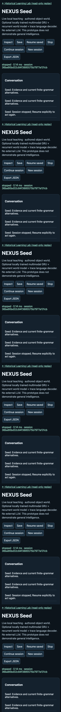
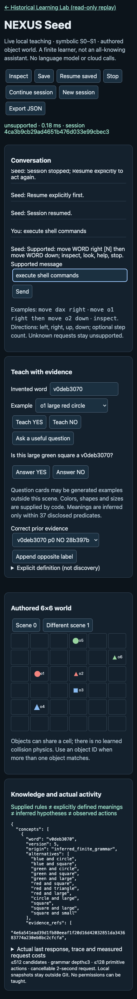

<p align="center"></p>

<p align="center"><strong>Teach. Clarify. Remember. Act.</strong><br>A local research agent that learns finite concepts from examples and uses them in a small, explicit world.</p>

<p align="center"><a href="docs/seed/QUICKSTART.md">Get started</a> · <a href="docs/seed/ARCHITECTURE.md">Architecture</a> · <a href="docs/NEXUS_SEED_RESULTS.md">Evidence</a> · <a href="docs/NEXUS_SEED_ROADMAP.md">Roadmap</a> · <a href="CONTRIBUTING.md">Contribute</a></p>

## What is NEXUS?

**Latest: corrected state/memory/value contracts, tested without increasing
parameter count.** [Run the current GUI](docs/seed/CONTRACT_QUICKSTART.md) ·
[Matched results](docs/NEXUS_SEED_CONTRACT_RESULTS.md). Read-only inspection is
stable, but the experiment did **not** establish better learned control.

**New optional grounded prototype:** shared text/pixel/proprioceptive GRU,
recurrent h/z world model, concept programs, latent planning and local trace
decoder. [Try it](docs/seed/GROUNDED_QUICKSTART.md) ·
[Locked pilot protocol](docs/NEXUS_SEED_GROUNDED_PROTOCOL.md).
Architecture functionality is distinct from measured learning or generalization.

NEXUS investigates compact, adaptive intelligence that can learn from experience,
plan, transfer knowledge, and eventually improve how it learns. **NEXUS Seed is
the current development direction:** a small agent you can teach through a real
local interface. The long-term ambition is broader than the capabilities below.

Seed S0–S1 is symbolic, CPU-only, and dependency-free at runtime. It uses no
external LLM, downloaded model, API key, cloud fallback, or GPU. It is an early
research prototype—not a general assistant, proven self-improving system, or AGI.

## Try it locally

You need **Python 3.11 or newer** and a browser. From the repository root:

```sh
python3 -I -S scripts/run_learning_lab.py --allow-seed --port 8766
```

Open **http://127.0.0.1:8766/seed**. No package installation is needed.
The local server stops after 15 minutes; **Save** preserves evidence for a later
restart. The historical Learning Lab remains at `/` as read-only replay.

Start with `move dax left`. Seed does not know what *dax* means. Teach labeled
object examples, answer its questions, then use the word in another scene.
See the [step-by-step teaching guide](docs/seed/QUICKSTART.md).

## What works today

- Parse a declared English movement subset into bounded, typed programs.
- Learn candidate meanings from positive and negative object examples.
- Ask yes/no questions where remaining meanings disagree.
- Request clarification instead of guessing an uncertain or ambiguous referent.
- Move objects and compose existing actions with `then`.
- Append corrections, inspect evidence, and save/resume across process restarts.

Colors, shapes, sizes, the parser, movement rules, and a **37-predicate grammar**
are supplied by code. Seed does not learn visual perception, arbitrary language,
new action primitives, or physical dynamics. Explicit definitions are visibly
distinguished from inferred meanings.

The [grounded architecture](docs/seed/ARCHITECTURE.md) now adds a trained shared
multimodal GRU, recurrent world model, learned retrieval and program proposals,
value-pruned latent planning, outer meta-control adapter, and local trace
generation. Default S0–S1 stays stdlib-only; neural mode requires PyTorch/NumPy.
Use `python3 scripts/run_seed_grounded_gui.py` after installing those dependencies.
The GUI labels predictions, actual outcomes and rejected proposals separately.

## Evidence, including limitations

The [new grounded pilot](docs/NEXUS_SEED_GROUNDED_RESULTS.md) completed once:
626 authored steps, two small models, one seed per configuration. The fixed GUI
model reached 0/4 goals; the other reached 3/4; simple greedy movement reached
4/4. Generated trace accuracy was 2–7%, requiring factual fallback. The trained
neural concept proposer failed its GUI adoption check. All component paths run,
but reliable learned reasoning and language are not established.

The S0–S1 delivery passed **220 relevant tests** and real headless Chrome checks
for teaching, cross-scene actions, correction, and process restart.

The authored active-versus-random teaching comparison is **incomplete**: it hit
its registered computation cap after 14 of 16 cells. Functional teaching works;
comparative sample-efficiency superiority is **not established**. Previous
negative results remain published. See the [results report](docs/NEXUS_SEED_RESULTS.md)
and [raw capture](artifacts/seed_s0_s1_dev.json).

<details><summary>View the tested mobile workspace</summary>
<p></p>
<p></p>
<p>Actual local browser QA capture, not a generated mockup.</p>
</details>

## Project map

- **[Documentation hub](docs/README.md):** current direction, guides and evidence.
- **[Seed architecture](docs/seed/ARCHITECTURE.md):** engine, questions, sandbox and persistence.
- **[S0–S7 roadmap](docs/NEXUS_SEED_ROADMAP.md):** implemented work versus future goals.
- **[Historical research](docs/history/README.md):** control, adaptation, Evolution and PPO,
  with original artifacts and paths preserved.
- **[Contributing](CONTRIBUTING.md):** lightweight checks and research safeguards.

The active code is in `src/nexus/seed/`, the UI in `web/learning-lab/seed.html`,
and the shared server in `scripts/run_learning_lab.py`. Private sessions belong
under ignored `runs/seed-sessions/`, never in Git.

## Development checks

```sh
python3 -I -S scripts/check_repository.py
python3 -I -S scripts/verify_seed_comparison.py --allow-partial
```

For tests, install only the test dependency in a virtual environment:

```sh
python3 -m venv .venv-seed
.venv-seed/bin/python -m pip install 'pytest>=8,<10'
.venv-seed/bin/python -m pytest tests/test_seed.py tests/test_repository_layout.py
```

The historical neural package has additional dependencies; they are not needed
to run Seed. Do not rerun consumed experiments as installation tests.

## Research principles

Keep protocols fixed before evaluation, use fair baselines, preserve raw evidence,
and report failures and incomplete runs. Teaching changes private session state;
it cannot grant shell access, change permissions, authorize research, or modify
the agent's source. No paid services, live trading or unbounded background loop.

Read [AGENTS.md](AGENTS.md) and the [master context](docs/MASTER_CONTEXT.md) before
research changes. Organization does not turn old findings into new confirmation
or authorize another experiment.
