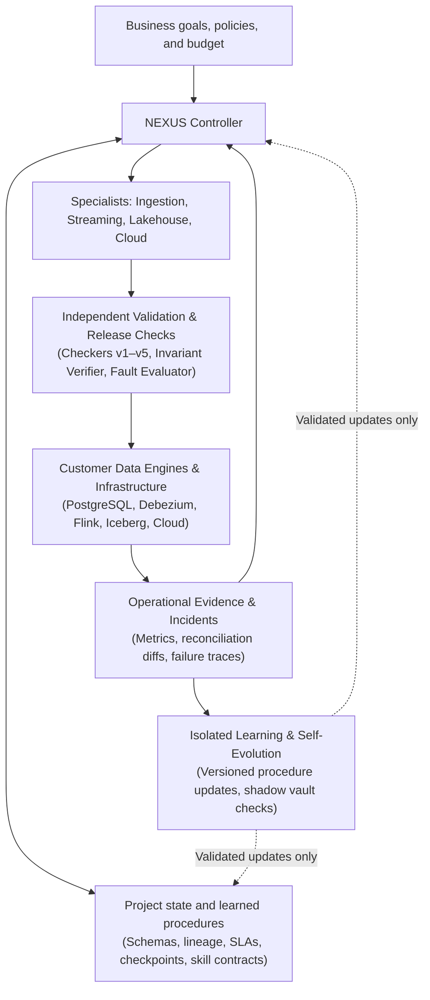

# NEXUS Data Platform

> **"Give NEXUS your data sources, business requirements, infrastructure access, and budget. It designs, builds, operates, repairs, and improves your data platform—and learns reusable engineering procedures from its experience."**

NEXUS is an autonomous data engineering and operations system engineered to take end-to-end ownership of production data lifecycles—spanning ingestion, change data capture (CDC), streaming pipelines, messy structured and unstructured data, lakehouses, data warehouses, cloud infrastructure, and incident recovery—while becoming measurably cheaper and more reliable through verified experience.

Unlike conventional coding assistants that stop after generating a script that exits with code `0`, NEXUS separates **editable engineering and learning policies** from an **independent verification, invariant-checking, and cost-accounting boundary**. It treats silent data corruption, duplicate side-effects, and unverified assumptions as first-class failures.

---

## Table of Contents

1. [What NEXUS Takes Responsibility For](#1-what-nexus-takes-responsibility-for)
2. [Current Maturity & Honest Assessment](#2-current-maturity--honest-assessment)
3. [Flagship Scenario: End-to-End Logistics Platform](#3-flagship-scenario-end-to-end-logistics-platform)
4. [System Architecture](#4-system-architecture)
5. [How Learning & AGI Capabilities Work Inside the Product](#5-how-learning--agi-capabilities-work-inside-the-product)
6. [How NEXUS Stays Inexpensive](#6-how-nexus-stays-inexpensive)
7. [The 10-Stage Engineering & Verification Roadmap](#7-the-10-stage-engineering--verification-roadmap)
8. [Unified 7-Measure Scorecard](#8-unified-7-measure-scorecard)
9. [Verified Foundation (Baseline `46c3e53`)](#9-verified-foundation-baseline-46c3e53)
10. [Repository Structure & Quickstart](#10-repository-structure--quickstart)

---

## 1. What NEXUS Takes Responsibility For

NEXUS is designed around full lifecycle ownership—including what happens in production after initial deployment. "Handling all kinds of data" means an extensible system with explicit support envelopes and active uncertainty handling, never silently guessing the meaning of an unfamiliar file or ambiguous business rule.

| Area | What the Platform Must Do | Difficult Cases It Must Handle |
| :--- | :--- | :--- |
| **Discovery & requirements** | Inspect existing systems, identify dependencies, clarify business definitions, propose an implementation | Undocumented databases, conflicting requirements, unclear ownership, inconsistent definitions |
| **Data ingestion** | Connect databases, APIs, files, applications, and event streams | Pagination, rate limits, interrupted transfers, incremental snapshots, authentication changes |
| **Database change capture (CDC)** | Keep downstream systems synchronized with inserts, updates, and deletes | Snapshot-to-stream transitions, replayed changes, transaction ordering, missing history |
| **Streaming pipelines** | Build and operate continuously running transformations | Late and out-of-order events, duplicates, stateful joins, traffic spikes, backpressure |
| **Messy structured data** | Normalize, validate, reconcile, and transform records | Broken dates, mixed units, inconsistent identifiers, nested structures, missing fields |
| **Documents & other media** | Extract usable data from documents, scans, logs, audio, and images using appropriate models | Uncertain extraction, changing layouts, contradictory documents, preserving source evidence |
| **Data lakes & lakehouses** | Organize raw and curated datasets, tables, catalogs, and retention | Schema changes, concurrent writes, small-file buildup, partition changes, historical corrections |
| **Warehouses & data modeling** | Create business entities, relationships, historical models, and analytical datasets | Customer identity resolution, slowly changing dimensions, join multiplication, inconsistent metrics |
| **Cloud infrastructure** | Generate and operate infrastructure configurations, compute, storage, networking, and permissions | Capacity changes, quota limits, infrastructure drift, service failures, migrations |
| **Pipeline delivery** | Write SQL/Python and configuration, test, deploy, schedule, and document | Dependency conflicts, incompatible upgrades, partial deployments, rollback |
| **Operations & recovery** | Detect incidents, diagnose causes, repair, replay, and reconcile results | Corrupted state, delayed sources, failed checkpoints, partially completed backfills |
| **Performance & cost** | Optimize queries, storage, processing frequency, and resource allocation | Skewed keys, expensive joins, runaway retries, growing state, network transfer costs |
| **Governance & collaboration** | Track lineage, permissions, business decisions, and change history | Sensitive data, conflicting stakeholder requests, deletion requirements, downstream impact |

---

## 2. Current Maturity & Honest Assessment

Scientific honesty is a core requirement of this repository. Every claim is separated into what is already proved in code, what is technically achievable with established engineering, and what remains an open research milestone:

| Goal | Assessment & Current Status |
| :--- | :--- |
| **Generate, test, and repair complex SQL/Python pipelines** | **Technically achievable** with a capable model, execution tools, and independent testing (Active in Stages 1–3). |
| **Build streaming pipelines, lakes, warehouses, and cloud infrastructure** | **Technically achievable**, operating established engines (PostgreSQL, Debezium, Apache Flink, Apache Iceberg) through NEXUS (Stages 4–5). |
| **Operate those systems and recover from failures** | **Achievable within demonstrated operating conditions**, with strict state-reconciliation and reliability engineering (Stage 5). |
| **Reuse experience to reduce future work** | **Plausible; bounded evidence** (`0.796x Fresh` and `0.878x Placebo` work across `5/5` seeds on internal synthesis folds, Wave 40; negligible vs a hand-designed prior; tested on data pipelines in Stage 6). |
| **Transfer reliably to unfamiliar companies and workloads** | **Still unproved at production scale** (external PROSE, Wave 40: 36 held-out-valid of 175 evaluable, 6 of 42 certified-but-held-out-fail; Stage 3: 8/8 on sealed synthetic logistics projects with held-out schemas; withheld domains in Stage 7). |
| **Autonomously invent better learning procedures repeatedly and economically** | **Open research problem**; requires multi-lineage improvements that repay discovery cost on untouched projects (Stages 8–9). |
| **Replace an entire team across arbitrary environments at low cost** | **Not yet demonstrated**; evaluated strictly on sustained external workloads with explicit scope and authority boundaries (Stage 10). |

---

## 3. Flagship Scenario: End-to-End Logistics Platform

Consider the target workflow NEXUS is built and tested against:

> *"Combine live vehicle events, warehouse databases, customer orders, supplier spreadsheets, and delivery documents. Give us current inventory and delivery status, preserve historical corrections, and stay within our cloud budget."*

### Build Phase
1. **Discover** sources and determine how `orders`, `vehicles`, `shipments`, and `warehouses` relate.
2. **Clarify** ambiguous definitions with stakeholders (e.g., when a shipment officially counts as delivered or how cancelled-after-shipped orders affect carrier metrics) instead of guessing silently.
3. **Configure & build** database change capture (CDC), streaming ingestion, and messy file/document extraction.
4. **Construct** a lakehouse with raw evidence (`Bronze`), cleaned/deduplicated records (`Silver`), and reconciled business datasets (`Gold`).
5. **Implement** streaming joins, historical retroactive updates, and downstream analytical interfaces.
6. **Verify** correctness, failure recovery, access controls, and expected operating cost against an independent oracle.
7. **Deploy** within granted authority and monitor the running system.

### Operations Phase (When Production Gets Messy)
Writing a pipeline that runs once is only the beginning. NEXUS must detect, distinguish, and recover from live production incidents without corrupting downstream state:
- A vehicle reconnects and uploads **yesterday's telemetry events** out of order.
- A supplier **renames or reorders columns** in a manifest spreadsheet.
- A transactional database emits a **retroactive price correction and a hard deletion**.
- One warehouse's event traffic **spikes 10×**.
- A processing worker **crashes halfway through an incremental update**.

NEXUS must verify **end-to-end exactly-once semantics** across replayable sources and transactional or idempotent sinks (e.g., verifying Apache Flink source offsets and sink idempotency rather than merely toggling a checkpoint flag).

---

## 4. System Architecture

NEXUS uses a shared controller coordinating specialized engineering modules over persistent project state, bounded by an independent validation and cost-accounting kernel:



### Core Architectural Boundaries

1. **Pinned Verification Kernel (`src/nexus/checker_kernel.py` .. `checker_kernel_v5.py`):**
   Five versioned, zero-internal-import specification checkers whose exact file bytes are SHA-256 pinned at commit `622a29a`. No solver, template, or learning policy may modify them or share code with them.
2. **Closed Outcome Contract (`src/nexus/outcome_contract.py`):**
   Every per-input and project-level decision maps to an explicit, non-overlapping outcome (`VALID_UNIQUE`, `ABSTAIN_ERROR`, `ASK_CLARIFICATION`, `UNDER_SPECIFIED_WARNING`, `ABSTAIN_UNSUPPORTED`, plus project-level `COMPLETED_VERIFIED`, `COMPLETED_UNVERIFIED`, `HARD_FAIL`) so runtime errors or ambiguous requirements are never conflated with valid answers.
3. **Independent Data-Engineering Evaluator (`src/nexus/de_evaluator.py`, `src/nexus/de_env.py`):**
   Executes candidate pipelines in an isolated subprocess across a four-step operational protocol—`b1` (initial landing batch), `b2` (second batch with retention), `b2_rerun` (idempotency check), and `b2_crash` (hard `os._exit(137)` mid-batch crash followed by recovery)—and compares `Bronze`, `Silver`, and `Gold` tables against a clean truth world that the agent can never access.
4. **Non-Stationary Drift & Change Detection (`src/nexus/w39_world.py`):**
   Uses the `N1-merge-exact` binomial sufficient-statistic change detector (`1.000` recall, `0.0/1000` false-alarm rate) to trigger surgical re-synthesis or schema adaptation only when true distribution/schema shifts occur.

---

## 5. How Learning & AGI Capabilities Work Inside the Product

NEXUS does not treat "learning" as dumping raw transcripts into a prompt window. Every learned artifact—whether a representation prior, a reusable transformation macro, a verification check, or a repair policy—must earn its keep under strict statistical and budget gates:

| Capability Layer | Mechanism in Code | Acceptance Gate |
| :--- | :--- | :--- |
| **Order-Invariant Synthesis (`w40_search.py`)** | Canonical lexicographic candidate enumeration (`(cost, str(expr))`) with sketch deduplication and dual-budget early stopping (`B_exec = 500`, `B_total = 700.0`). | `100%` permutation invariance across `5` example/seed reorderings (`175/175` property tests). |
| **Cross-Domain Representation Priors (`w40_learn.py`)** | Leave-One-Domain-Out (LODO) operator cost tables and reusable macros learned from certified solutions on training domains. | Paired sign-flip permutation test (`p < 0.05`) on held-out domains before replacing uniform priors. |
| **Budgeted Online Adaptation (`w40_online.py`)** | Buffered stream learner (`K = 4`, hysteresis `tau = 0.10`) that updates priors online while charging every static row score (`C_ROW = 0.052`) and refit (`C_FIT = 2.0`). | Must reduce **total execution-equivalents** (including learning overhead) vs. `NoLearn` (`118.21` vs `138.62`, `-14.7%`). |
| **Counterexample-Guided Fault Localization (`w38_repair.py`, `de_template.py`)** | Isolates stage-level invariant failures (e.g., fan-out joins, arrival-order CDC apply, silent row drops, non-idempotent reruns) and synthesizes targeted repairs. | Zero regressions on previously passing batches (`b1`, `b2`, `b2_rerun`, `b2_crash`) and verified truth match. |
| **Active Clarification vs. Guessing (`outcome_contract.py`)** | Detects when multiple in-scope transformations or business rules satisfy the visible examples (`ASK_CLARIFICATION` / `UNDER_SPECIFIED_WARNING`). | Queries the stakeholder channel when available or abstains cleanly (`0` silent guesses on ambiguous specs). |

---

## 6. How NEXUS Stays Inexpensive

Autonomous engineering systems fail in practice if verification or meta-learning consumes unbounded compute. NEXUS enforces hardware-grounded cost discipline at every layer:

1. **Dual-Budget Accounting (`B_exec = 500`, `B_total = 700.0`):**
   Static scoring and prior refitting are not free. Every cost-table lookup (`C_ROW = 0.052` execution-equivalents, calibrated against CPU instruction ratios in `scripts/w40_calibrate.py`) and every online refit (`C_FIT = 2.0` execution-equivalents) is charged directly against the per-task budget.
2. **OS Kernel Retired-Instruction Metering (`src/nexus/wave31_evaluator.py`):**
   Subprocess workers report actual hardware retired CPU instructions via macOS `rusage_info_v4` (`ri_instructions`), preventing wall-clock noise from masking algorithmic bloat.
3. **Buffered Refits with Hysteresis (`K = 4`, `tau = 0.10`):**
   Instead of refitting after every task, `w40_online.py` batches solved episodes and only promotes a refitted prior if validation gain exceeds the hysteresis margin `tau = 0.10`.
4. **Surgical Stage Repair Over Full Rebuilds:**
   Because pipelines commit `Bronze`, `Silver`, and `Gold` stages with explicit contracts and lineage (`src/nexus/de_template.py`), faults localized to a downstream aggregation or currency conversion repair only the affected stage rather than re-ingesting raw sources.

---

## 7. The 10-Stage Engineering & Verification Roadmap

Full definitions, exit conditions and the standing rules: [`docs/NEXUS_10_STAGE_ROADMAP.md`](docs/NEXUS_10_STAGE_ROADMAP.md).
Results: [`docs/NEXUS_STAGES_1_TO_3_REPORT.md`](docs/NEXUS_STAGES_1_TO_3_REPORT.md) and, as Stages 4–6 complete, `docs/NEXUS_STAGES_4_TO_6_REPORT.md`.

| # | Stage | Exit condition (predeclared) | Status |
| :---: | :--- | :--- | :--- |
| 1 | **Trustworthy starting point:** component audit, regression and outcome distinguishability | 100% of the pinned regression suite; valid / ABSTAIN_ERROR / UNDER_SPECIFIED / ASK_CLARIFICATION / unsupported never conflated | **PASS**: 228/228 |
| 2 | **Logistics engineering environment + independent evaluator** (truth world → messy CDC, telemetry, CSV drops, sqlite snapshots; batch 3 held out) | 8/8 deliberately broken exit-0 pipelines caught with exact reasons; 0 false alarms | **PASS**: 8/8 on 6/6 dev projects |
| 3 | **Unfamiliar projects without history:** Conventional vs NEXUS, same generator, tools and budgets | Frozen one-shot sealed test; full 7-measure scorecard | **PASS**: NEXUS 8/8 correct, 0 silent errors; Conventional 0/8 (8 silent) |
| 4 | **Real streaming, CDC and lakehouse recovery:** offset log with separately committed offsets, watermarks and retractions, live backfills, schema evolution, bad-deploy rollback, withheld fault classes | Reference-matching outputs at checkpoints, during live + backfill, and after crash recovery on sealed projects | in progress |
| 5 | **Deployment responsibility and hidden-cause incidents:** deployment config, incident ledger, N1-based drift alarms | Service and 100% data correctness restored; a restart that leaves corrupted data fails | in progress |
| 6 | **Experience reuse that pays back:** admissible, retirable procedure library | Experienced keeps 0 silent errors and cuts development CPU, rejected-attempt CPU and check runs vs Fresh and Placebo after charging all library costs | in progress |
| 7 | **Breadth:** new domains and engines | Generalization to withheld domains, schemas and mechanisms | proposed |
| 8 | **Open-ended code generation** inside the same verification loop | Silent-error rate unchanged or lower at lower human dependence | proposed |
| 9 | **Self-evolution under the evaluator firewall** | Improvement on withheld projects vs frozen self and Placebo edits | proposed |
| 10 | **Integrated autonomous DE&Ops evaluation** on withheld projects end to end | 7-measure scorecard against predeclared targets | proposed |

---

## 8. Unified 7-Measure Scorecard

Logged in every stage report, Stage 1 through Stage 10:

| # | Measure | What is logged |
| :---: | :--- | :--- |
| 1 | **Correctness** | Independently checked outputs (seen and held-out batches); **silent data errors** (submitted, exit 0, wrong data), tracked explicitly; unresolved ambiguity; exact diagnoses |
| 2 | **Completion** | Finished projects / incidents, hard failures, explicit abstentions |
| 3 | **Reliability** | Freshness SLA violations, crash-recovery success and time, duplicate or missing side effects |
| 4 | **Cost** | Proposer / model calls, CPU (agent, pipeline, checks), storage / IO, learning overhead, wasted work on rejected attempts; operating cost vs full development cost |
| 5 | **Human dependence** | `ASK_CLARIFICATION` calls (and unnecessary ones), human engineering repairs (must be 0), operational interventions |
| 6 | **Learning benefit** | Relevant history vs Fresh (no history) and Placebo (irrelevant history), after charging every learning cost |
| 7 | **Generalization** | Withheld projects, schemas, names, units, currencies, encodings, mechanisms and data batches |

---

## 9. Verified Foundation

Every figure below comes from a committed artifact or report. Earlier wording that cited non-existent artifacts and
unverified figures was removed on 2026-10-27.

| Subsystem | Verified result | Source |
| :--- | :--- | :--- |
| Pinned checker kernels v1–v5 (`622a29a`) | 5/5 pins intact; 42/42 kernel tests | `tests/test_checker_kernel*.py`, `artifacts/de_stage1_regression.json` |
| Search-order invariance (state-dominance repair) | 175/175 | `tests/test_search_order_invariance.py` |
| Internal cross-domain transfer (Wave 40 C1) | Repr-v5 0.796× Fresh, 0.878× Placebo work, 5/5 seeds, equal solves, 0 wrong; vs the hand-designed prior: negligible (Fixed+Repr 0.991× Fixed) | `artifacts/w40_lodo_confirm_785*.json`, `docs/NEXUS_WAVE40_INVARIANCE_AND_CEILINGS.md` |
| Hierarchical stream memory (Wave 40 C2) | 0.837× Fresh, 0.859× Hard-Gated; 1.000× Ungated (tie) | `artifacts/w40_stream_confirm_785*.json` |
| External PROSE transfer (Wave 40 C3, 175 evaluable) | Held-out-valid 36; certified-but-held-out-fail 6 of 42; 11 silent failures in 420 inputs; product-level correctness **not established** | `artifacts/w40_prose_confirm2.json` |
| N1-merge-exact adaptation (Wave 39 C3) | 2.8× fixed-model compute, return 1.003× N1, 5/5 seeds | `artifacts/w39_world_confirm.json` |
| Stage 1 regression gate | 228/228 | `artifacts/de_stage1_regression.json` |
| Stage 2 evaluator | 8/8 required broken pipelines (+6 supplementary) caught with exact reasons on 6/6 dev projects; 0 false alarms | `artifacts/de_stage2_proof.json` |
| Stage 3 sealed final test (8 projects) | NEXUS 8/8 independently correct, 0 silent errors, 0 unresolved ambiguity, 0 repairs; Conventional 0/8 (8 silent). NEXUS development CPU ≈ 33× Conventional; operating cost equal | `artifacts/de_stage3_test.json` |

---

## 10. Repository Structure & Quickstart

### 10.1 Directory Layout

```text
nexus-ai/
├── README.md                          # NEXUS Data Platform overview, architecture, roadmap & scorecard
├── AGENTS.md                          # Scientific integrity firewall, pinned SHA-256 hashes & BURNED registry
├── pyproject.toml                     # Package configuration & pytest settings
├── src/
│   └── nexus/
│       ├── checker_kernel.py          # Pinned Checker Kernel v1 (+ .sha256)
│       ├── checker_kernel_v2.py       # Pinned Checker Kernel v2 (+ .sha256)
│       ├── checker_kernel_v3.py       # Pinned Checker Kernel v3 (+ .sha256)
│       ├── checker_kernel_v4.py       # Pinned Checker Kernel v4 (+ .sha256)
│       ├── checker_kernel_v5.py       # Pinned Checker Kernel v5 (+ .sha256, frozen at 622a29a)
│       ├── outcome_contract.py        # Stage 1 closed outcome contract (VALID_UNIQUE / ASK_CLARIFICATION / ...)
│       ├── de_env.py                  # Stage 2 logistics data-engineering environment (truth vs messy landing)
│       ├── de_evaluator.py            # Stage 2 protected operational evaluator (b1, b2, b2_rerun, b2_crash)
│       ├── de_template.py             # Stage 2/3 bronze-silver-gold pipeline generator & decision space
│       ├── w40_search.py              # Order-invariant synthesis engine (B_exec=500, B_total=700)
│       ├── w40_learn.py               # Order-invariant LODO representation & macro learner
│       ├── w40_online.py              # Dual-budget buffered online stream learner (K=4, tau=0.10)
│       ├── w40_eval.py                # Wave 40 subprocess evaluation harness
│       ├── w39_lang.py                # Extended string/record transformation IR & AST primitives
│       ├── w39_prose.py               # External Microsoft PROSE benchmark loader & BURNED quarantine
│       ├── w39_world.py               # N1-merge-exact non-stationary change-point detector
│       ├── w38_domains.py             # 8-domain synthetic task & metamorphic invariant generators
│       ├── w38_repair.py              # Stage-level fault localization & 1-edit program repair
│       ├── wave31_evaluator.py        # Isolated subprocess sandbox & macOS ri_instructions meter
│       └── wave32_detectors.py        # 5 anti-cheat detectors (D1-D5)
├── tests/
│   ├── test_checker_kernel*.py        # 42 tests verifying pinned SHA-256 digests & differential oracles
│   ├── test_search_order_invariance.py# 175 permutation invariance tests (search, LODO, PROSE)
│   ├── test_w40_components.py         # 5 Wave 40 component & dual-budget accounting tests
│   └── test_stage1_regression.py      # 6 Stage 1 outcome contract & regression gate tests
├── scripts/
│   ├── de_stage1_regression.py        # Unified 228-test + SHA-256 + scorecard regression runner
│   ├── de_budget.py                   # Session budget ledger & cost-accounting utility
│   ├── w40_invariance.py              # Reproduces artifacts/w40_invariance.json
│   ├── w40_lodo.py                    # Reproduces artifacts/w40_lodo.json
│   ├── w40_online.py                  # Reproduces artifacts/w40_online.json
│   ├── w40_prose.py                   # Reproduces artifacts/w40_prose.json
│   └── archive/                       # 43 archived historical wave drivers (Waves 27–39)
├── docs/
│   ├── INDEX.md                       # Complete documentation index
│   ├── ARCHITECTURE.md                # System block diagram, module map & data quarantine spec
│   ├── ROADMAP_10_STAGES.md           # 10-Stage Autonomous Data Engineering Roadmap & 7-Measure Scorecard
│   ├── NEXUS_WAVE40_INVARIANCE_AND_CEILINGS.md
│   ├── NEXUS_WAVE39_EXTERNAL_TRANSFER.md
│   ├── NEXUS_CHECKER_V2_SPEC.md .. NEXUS_CHECKER_V5_SPEC.md
│   └── history/                       # Archived intermediate wave reports (Waves 26–37)
└── artifacts/
    ├── w40_invariance.json
    ├── w40_lodo.json
    ├── w40_online.json
    ├── w40_prose.json
    └── de_stage1_regression.json
```

### 10.2 Quickstart Commands

```bash
# 1. Run the unified Stage 1 + Wave 40 regression gate (228 tests + pinned SHA-256 verification)
PYTHONPATH=src .venv/bin/python scripts/de_stage1_regression.py

# 2. Run pytest directly across the core verification and invariance suites
PYTHONPATH=src .venv/bin/pytest \
  tests/test_checker_kernel.py \
  tests/test_checker_kernel_v2.py \
  tests/test_checker_kernel_v3.py \
  tests/test_checker_kernel_v4.py \
  tests/test_checker_kernel_v5.py \
  tests/test_search_order_invariance.py \
  tests/test_w40_components.py \
  tests/test_stage1_regression.py -q

# 3. Reproduce Wave 40 benchmark artifacts
PYTHONPATH=src .venv/bin/python scripts/w40_invariance.py
PYTHONPATH=src .venv/bin/python scripts/w40_lodo.py
PYTHONPATH=src .venv/bin/python scripts/w40_prose.py
PYTHONPATH=src .venv/bin/python scripts/w40_online.py
```

### 10.3 Further Reading
- **Architecture & Module Map:** [`docs/ARCHITECTURE.md`](docs/ARCHITECTURE.md)
- **10-Stage Roadmap & 7-Measure Scorecard:** [`docs/NEXUS_10_STAGE_ROADMAP.md`](docs/NEXUS_10_STAGE_ROADMAP.md) (canonical; `docs/ROADMAP_10_STAGES.md` is an earlier duplicate)
- **Complete Documentation Index:** [`docs/INDEX.md`](docs/INDEX.md)
- **Operational Safeguards & Pinned Hashes:** [`AGENTS.md`](AGENTS.md)
