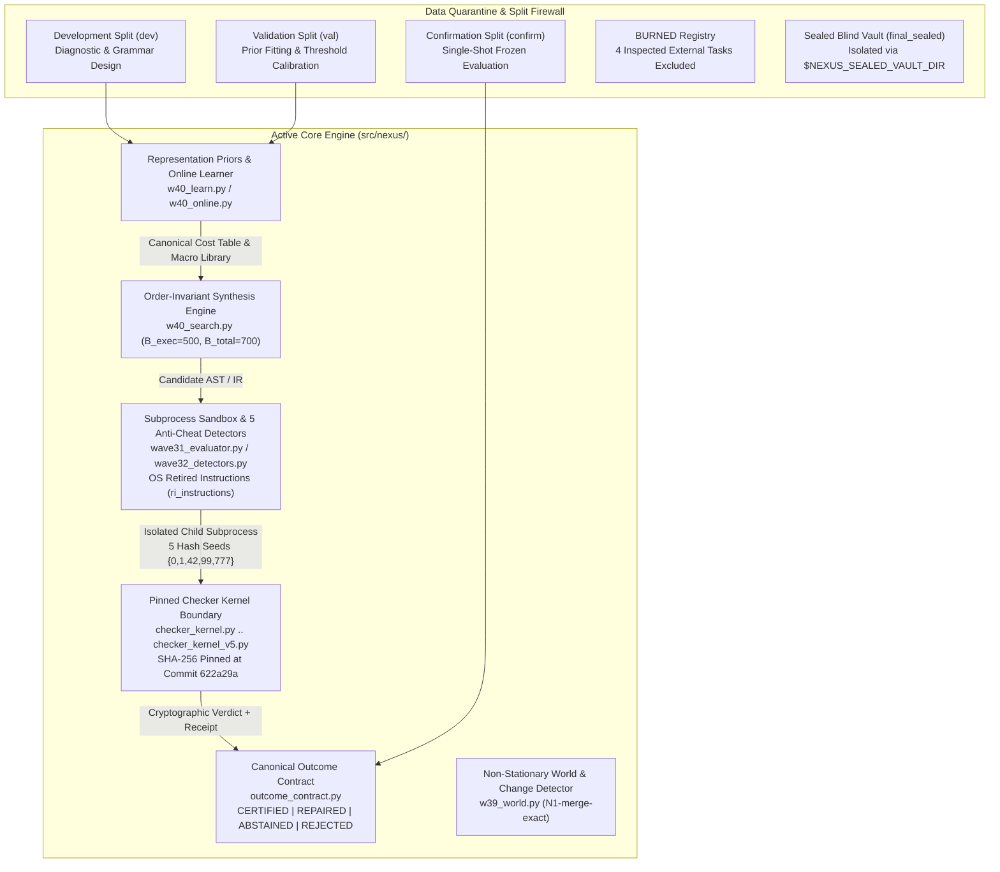

# NEXUS System Architecture (`46c3e53` / Wave 40 + Stage 1 Baseline)

NEXUS is a verifiable program synthesis, meta-learning, and autonomous data engineering system designed around a strict separation between **untrusted search/learning proposals** and an **independently implemented, SHA-256 hash-pinned verification kernel**.

---

## 1. System Block Diagram

---

## 2. Core Subsystems

### 2.1 Pinned Checker Kernel Boundary (`src/nexus/checker_kernel*.py`)
- **Zero Shared Code with Solver:** Every checker kernel (`v1` through `v5`) is a standalone, zero-internal-import specification verifier whose source bytes are cryptographically pinned by a companion `.sha256` file and verified on every test run.
- **Pinned Digests (Frozen at Commit `622a29a`):**
  - `src/nexus/checker_kernel.py` (`v1`): `5082402ff2ba7c4de9bc6ca998f0556d88f9ef1fb7c95b2a3f0d15bf79b3121e`
  - `src/nexus/checker_kernel_v2.py` (`v2`): `6ba0a268ddc5c4f0912f985c214a21e8d92a0af7e1b6b348d5ae1a38cc48379b`
  - `src/nexus/checker_kernel_v3.py` (`v3`): `3c68230e09cd6cdbdf0c33f1f70caf68ae82c2686bb640e2515801d4d121e20f`
  - `src/nexus/checker_kernel_v4.py` (`v4`): `c07e21ec104633865f8d6d03d8d30f240962537922c67f4c6f90ea5ed74f5c13`
  - `src/nexus/checker_kernel_v5.py` (`v5`): `2cd3a4caf33070558a2d7394497dd1d548583be5b04e1d7a18eac661790244d4`
- **Differential Validation:** `tests/test_checker_kernel_v5.py` and `tests/test_checker_kernel_v4.py` validate two independent oracle implementations against differential test vectors and adversarial mutation probes (`0` false accepts).

### 2.2 Order-Invariant Search Engine (`src/nexus/w40_search.py`)
- **Strict Search-Order Invariance:** Candidates are generated over a canonicalized grammar (`w39_lang.py` / `w38_lang.py`) and sorted by deterministic keys `(cost, str(expr))` (`_dedup_sketches`, `_sorted_4stage`). Permuting public input-output examples or dictionary iteration order produces the exact same winning program and evaluation count (`175/175` invariance tests in `tests/test_search_order_invariance.py`).
- **Dual-Budget Accounting:** Every search call enforces both an execution evaluation ceiling (`B_exec = 500`) and a total work ceiling (`B_total = 700.0` execution-equivalents), where static cost-row scoring (`C_ROW = 0.052`) and online prior refits (`C_FIT = 2.0`) are charged directly against `B_total`.

### 2.3 Canonical Outcome Contract (`src/nexus/outcome_contract.py`)
- Every task execution terminates in exactly one of four mutually exclusive states (`TaskStatus`):
  1. `CERTIFIED`: Candidate synthesized on the primary search path and verified against all public and held-out checker invariants within budget (`exec_evals <= 500`, `total_cost <= 700.0`).
  2. `REPAIRED`: Candidate recovered via bounded localized repair/fallback and verified against all checker invariants within budget.
  3. `ABSTAINED`: Search exhausted its budget or encountered an underspecified/unsolvable task and cleanly returned `None` with zero unverified output (`0` false accepts).
  4. `REJECTED`: Candidate failed checker verification, tripped one of the 5 anti-cheat detectors, or violated budget invariants.

### 2.4 Representation Priors & Online Meta-Learning (`src/nexus/w40_learn.py`, `src/nexus/w40_online.py`)
- **Leave-One-Domain-Out (LODO) Representation Learning (`w40_learn.py`):** Learns operator cost tables and reusable macro libraries (`MacroDef`) from training domains with deterministic lexicographic tie-breaking (`learn_rep_invariant`) and a paired sign-flip permutation gate (`p < 0.05`) before promoting learned priors over uniform search.
- **Online Buffered Stream Learner (`w40_online.py`):** Processes non-stationary task streams in windows (`K = 4`, hysteresis threshold `tau = 0.10`), charging every cost-table row evaluation (`C_ROW = 0.052`) and prior refit (`C_FIT = 2.0`) inside the `700.0` execution-equivalent budget.

### 2.5 Non-Stationary World & Change Detection (`src/nexus/w39_world.py`)
- **`N1-merge-exact` Detector:** Tracks exact binomial sufficient statistics `(n, s)` across sliding windows with a post-confirmation merge rule that prevents double-firing on a single regime transition.
- **Verified Performance (`20` streams x `2000` steps):** `1.000` change-point recall, `0.0` false alarms per `1000` steps (hard ceiling `<= 0.10/1000`), `11.1` step mean detection delay, and `0.9467` full-stream accuracy (`96.2%` of the `0.9504` oracle ceiling).

### 2.6 Subprocess Sandbox, OS Instruction Metering & 5 Anti-Cheat Detectors (`src/nexus/wave31_evaluator.py`, `src/nexus/wave32_detectors.py`)
- **Hardware-Grounded Cost (`wave31_evaluator.py`):** Executes candidate programs in isolated child subprocesses (`scripts/w40_child.py`, `scripts/w40_online_child.py`, `scripts/wave31_solver_child.py`) and reads macOS kernel `rusage_info_v4.ri_instructions` via `libSystem.dylib` to measure actual retired CPU instructions alongside wall-clock time.
- **5 Anti-Cheat Detectors (`wave32_detectors.py`):**
  - `D1` **Forbidden Token & Import Scanner:** Blocks `eval`, `exec`, `os`, `sys`, `subprocess`, `__import__`, file I/O, and reflective attribute access.
  - `D2` **Hash-Seed Determinism:** Runs candidates across 5 distinct `PYTHONHASHSEED` values (`0, 1, 42, 99, 777`) and rejects any output divergence.
  - `D3` **Held-Out & Metamorphic Generalization:** Verifies candidates on unseen confirmation inputs and structural metamorphic transforms.
  - `D4` **Complexity / Lookup-Table Margin:** Rejects rote input-output memorization (`if x == ...`) via AST branching and description-length bounds.
  - `D5` **Self-Check Integrity:** Verifies that evaluation receipts and checker SHA-256 digests match the pinned kernel.

---

## 3. Repository & Module Map

To preserve 100% backward compatibility with all historical and active test suites (`tests/`), foundational modules in `src/nexus/` keep their original file paths and are layered cleanly from Wave 31 through Wave 40 and Stage 1:

### 3.1 `src/nexus/` — Core Library
| Layer | Files | Role |
| :--- | :--- | :--- |
| **Pinned Checker Kernels** | `checker_kernel.py` (`v1`), `checker_kernel_v2.py` (`v2`), `checker_kernel_v3.py` (`v3`), `checker_kernel_v4.py` (`v4`), `checker_kernel_v5.py` (`v5`), `checker_kernel*.sha256` | Read-only, SHA-256 pinned specification verifiers (frozen at `622a29a`). Never modified by solver or cleanup commits. |
| **Stage 1 Data Engineering** | `outcome_contract.py` | Canonical 4-state outcome contract (`CERTIFIED`, `REPAIRED`, `ABSTAINED`, `REJECTED`), dual-budget validator, and `OutcomeRecord` receipt schema. |
| **Wave 40 Active Core** | `w40_search.py`, `w40_learn.py`, `w40_online.py`, `w40_eval.py` | Search-order invariant synthesis, canonical LODO representation learning, dual-budget online learner, and subprocess evaluation harness. |
| **Wave 39 External Transfer & World** | `w39_lang.py`, `w39_scope.py`, `w39_search.py`, `w39_learn.py`, `w39_online.py`, `w39_eval.py`, `w39_prose.py`, `w39_world.py` | Extended string/extraction IR (`w39_lang.py`), external PROSE benchmark loader (`w39_prose.py`), and `N1-merge-exact` change detector (`w39_world.py`). Imported directly by `w40_*`. |
| **Wave 38 Multi-Stage IR & Repair** | `w38_lang.py`, `w38_scope.py`, `w38_search.py`, `w38_learn.py`, `w38_online.py`, `w38_eval.py`, `w38_domains.py`, `w38_planning.py`, `w38_repair.py` | 8-domain multi-stage transformation IR, fault-localization & 1-edit repair engine (`w38_repair.py`), and domain generators. Imported by `w39_*` and `w40_*`. |
| **Waves 31–36 Sandbox & Foundations** | `wave31_ir.py`, `wave31_evaluator.py`, `wave31_solver.py`, `wave31_tasks.py`, `wave32_detectors.py`, `wave32_archive.py`, `wave32_evolution.py`, `wave33_prior.py`, `wave33_metalearner.py`, `wave33_world.py`, `wave34_learner.py`, `wave36_coder.py`, `wave36_online.py`, `wave36_rep.py`, `wave36_world.py` | Subprocess sandbox (`wave31_evaluator.py`), OS retired-instruction counter, 5 anti-cheat detectors (`wave32_detectors.py`), and base prior/world primitives. |
| **Earlier Experimental Modules** | `core/`, `models/`, `seed/`, `world/`, `wave24_*.py`–`wave30_*.py` | Preserved modules supporting historical regression tests and append-only audit ledgers. |

### 3.2 `scripts/` — Active Runners vs. `scripts/archive/`
- **Active Runners (`scripts/`):**
  - `scripts/de_stage1_regression.py`, `scripts/de_budget.py`: Stage 1 unified regression harness (`228/228` tests + pinned SHA-256 verification + Wave 40 scorecard gate) and budget utilities.
  - `scripts/w40_invariance.py`, `scripts/w40_lodo.py`, `scripts/w40_online.py`, `scripts/w40_prose.py`, `scripts/w40_calibrate.py`: Wave 40 benchmark drivers.
  - `scripts/w40_child.py`, `scripts/w40_online_child.py`, `scripts/w39_child.py`, `scripts/w39_online_child.py`, `scripts/w38_child.py`, `scripts/w38_online_child.py`, `scripts/w38_repair_child.py`, `scripts/wave31_solver_child.py`, `scripts/wave32_redteam_child.py`: Isolated child workers invoked by subprocess evaluators and detector tests.
- **Archived Wave Drivers (`scripts/archive/`):**
  - Contains 43 historical one-off wave runner scripts (`wave27_confirm.py` through `w39_world.py`) preserved for provenance without cluttering the active `scripts/` directory.

### 3.3 `tests/` — Verification Suite
- **Active Core & Stage 1 Suite (`228` tests):**
  - `tests/test_checker_kernel.py` (`4` tests), `tests/test_checker_kernel_v2.py` (`14` tests), `tests/test_checker_kernel_v3.py` (`13` tests), `tests/test_checker_kernel_v4.py` (`5` tests), `tests/test_checker_kernel_v5.py` (`6` tests): `42` pinned checker kernel & differential tests.
  - `tests/test_search_order_invariance.py` (`175` tests): Property-based permutation invariance across search, LODO learning, and PROSE tasks.
  - `tests/test_w40_components.py` (`5` tests): Wave 40 component & online accounting tests.
  - `tests/test_stage1_regression.py` (`6` tests): Stage 1 outcome contract (`CERTIFIED`, `REPAIRED`, `ABSTAINED`, `REJECTED`), dual-budget enforcement, and scorecard gate tests.

---

## 4. Data Quarantine & Anti-Contamination Rules

1. **Development (`dev`):** Open for debugging, error analysis, and operator design.
2. **Validation (`val`):** Used for hyperparameter selection, prior weight fitting, and permutation gating.
3. **Confirmation (`confirm`):** Frozen single-shot evaluation split. Any task whose input/output pairs are inspected during grammar or solver design is immediately marked **`BURNED`** and permanently excluded from confirmation claims.
4. **Burned External Tasks (`BURNED`):**
   - `BillingCode.000002`
   - `EmergencyCall.000004`
   - `FilePath.000001`
   - `UserAgent.000007`
   These 4 PROSE development tasks were inspected during Wave 39 grammar design and are permanently excluded from the 24-task unburned external confirmation suite (`19/24 = 79.2%`).
5. **Sealed Blind Vault (`final_sealed`):** Stored outside the working branch (`$NEXUS_SEALED_VAULT_DIR`) and never read during development or routine CI.
