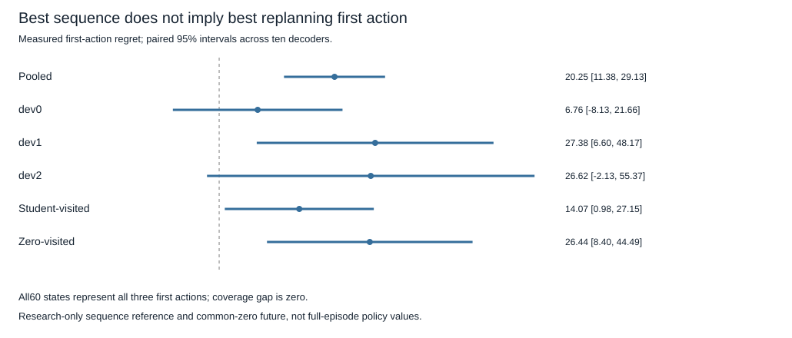

# Sequence-to-first-action alignment — exploratory results

## Registered decision

The complete offline analysis detected a **sequence-to-first-action alignment gap** in the saved visited-state interventions. Label: `sequence_first_action_misalignment_detected`.

The actually best64-return candidate sequence's first action loses **20.254 [11.382,29.127] return points** relative to the best of the three measured first-action-plus-zero-replanning branches. The mean exceeds the registered one-point threshold and the paired95% lower bound is above zero.

Every saved state's16 candidates represented all three first actions: **60/60 states, coverage gap0**. Represented-action regret is therefore exactly the same20.254 interval, not a second independent positive finding. The missing-action explanation does not explain this measured gap. The selected sequence's first action was optimal for the first-action intervention in **18/60 states (30%)**; the ten-decoder interval for that rate is13.33%–46.67%. These states are not60 independent model-training replications.

This establishes a gap between the two specified interventions on this finite sample. It does **not** prove the cause of the historical full-episode negative transfer, improve a deployed controller, demonstrate learning-to-learn or justify an AGI claim.

## What the two values mean

The sequence reference is the best **among16 sampled candidates**, measured by actually executing all16 actions followed by48 zero-policy steps. It is not a globally optimal sequence, a learned controller or an oracle for another future policy.

The action reference is the best **among all three first actions**, each followed by63 zero-policy replanning steps. Both values use64 rewards, the same restored phase50 state and action-independent registered future randomness. However, steps1–15 differ in their decision rule: fixed sequence versus replanning. A high value under the first rule need not imply a good first action under the second.

All three first actions being represented rules out absent first-action coverage on these states. It does not rule out insufficient **future-sequence** search: the best of16 complete sequences can still depend on how well suffixes were sampled under each first action. Thus the evidence supports a finite-search objective/future-policy alignment gap, not a uniquely isolated causal planning defect.

No new data were collected. The analysis used exactly60 saved decoder/task/visitor states from the source-scalar evaluation, with sixteen complete-sequence outcomes and three first-action outcomes per state. True simulator outcomes were used only for research references; no outcomes entered a model, optimizer or deployed decision rule. All networks, historical readouts and the scalar stayed unchanged.

## Decoder, task and visitor results

The primary metric is saved once per state and averaged over two equally weighted visitor groups and three tasks inside each of ten independently pretrained decoders. There is no repeated primary row per student. Context-based secondary references average five students inside each decoder. Intervals are paired t95,df9,critical2.262, conditional on the fixed suite; task/visitor intervals are unadjusted exploratory sensitivities.

All ten decoder primary estimates are positive: **1.651,15.776,1.755,22.244,20.409,39.298,21.004,18.897,24.167,37.340**.

- **dev0 (g6,m1,l1):** regret **6.763 [−8.128,+21.655]**, inconclusive individually; first-action optimality40%.
- **dev1 (g10,m2,l1):** **27.381 [6.597,48.165]**; optimality35%.
- **dev2 (g10,m1,l1.55):** **26.618 [−2.133,55.369]**, inconclusive individually; optimality15%.
- **Student-visited states:** **14.067 [0.984,27.150]**; optimality30%.
- **Zero-visited states:** **26.442 [8.396,44.488]**; optimality30%.

The task-specific t intervals are untruncated; a negative lower bound for a nonnegative regret means uncertainty, not physically negative regret. The pooled result does not establish the gap independently on every physics setting.



## Learned-scoring references

Mean64 return under the first-action/common-zero intervention:

- Research sequence-reference first action: **−177.530**.
- Research best of three first actions: **−157.276**.
- Original H16-scoring student first action: **−172.541**.
- Original value-corrected student first action: **−174.216**.
- Source-calibrated student first action: **−174.282**.

The sequence-reference minus original-student first-action return is **−4.989 [−14.532,+4.553]**; versus original correction **−3.314 [−14.287,+7.659]**; versus calibrated correction **−3.248 [−14.563,+8.066]**. These paired comparisons are inconclusive. Do not claim the research sequence reference is statistically worse than the learned controller from the means alone. Original/uncalibrated/calibrated first-action regrets are15.265,16.940,17.006 respectively; they remain secondary, dependent measurements on the same outcomes.

The best-sequence choice agrees with the original student's first action44.33% of the time, with uncalibrated correction38.67%, and with calibrated correction38%. These are context-averaged descriptions, not additional decoder replications. The primary research-reference gap does not depend on the shared fitted scalar; calibrated-reference intervals remain conditional on that scalar.

## Provenance, resources and tests

Branch `codex/action-value-alignment-audit`. Starting SHA **1f73c39f0ca608c0498dd62742814ed3e50221c6**, matched GitHub before branching. Protocol/implementation/clean execution SHA **0070332091722b675d212b2330b201b9bf038f55**.

- Config SHA256 `3b8b6231eb402a8e6377cf03fc3a865382ed717a8db18b39e73a68a1d749209d`.
- Protocol SHA256 `13eb80a3a113fe3e486eb364f6d72ad6c6ab9220e472565c4e8521aeea8c4a47`.
- Allocation SHA256 `62f01589754836e7b20fb9a722ac472b6e1e525c964e8fd20049509a4c8a8a89`.
- Raw result SHA256 `02ee53a91e09013fc03433db73a9bb85152bd4b2f40cd0e2191246e94f2afd2b`.

One run completed in **3.09675seconds**, below60. **Zero new real or imagined transitions, world-model inference, fitting or checkpoint changes**. Frozen scalar-readout arithmetic was recomputed during parent validation; this is included in runtime, not a neural rollout. The75,960-step parent collection and source fitting costs are inherited, not collected again. No binary files were loaded or newly audited; the preceding120-file audit remains in the parent report. Python3.13.5,NumPy2.5.4,local CPU; peak memory not measured.

The conservative session account advances from3,422.4955 to **3,425.5923seconds**, leaving **174.4077seconds**. The inherited2,700-second reservation is not a measured execution claim. Test and integrity verification runs are reported separately. No simulation, retry or further scientific experiment occurred.

Before calculation **21 focused tests passed in3.88seconds**, including known mismatch/alignment, exact ties, flat outcomes, missing-action coverage, state-metric counting, equal visitor weights, type rejection and source validation without environment/model loading. An independent plain-sum/selected-index implementation reproduced primary gaps, decomposition and all decoder/task/visitor intervals. It verified60/60 full action coverage and18 optimal first actions. This is independent arithmetic, not external scientific replication. Final full suite: **713 passed,1 deselected in228.26seconds**. The local-binary marker remains intentionally separate; this offline analysis does not need .pt files and claims no new binary audit. No tests or analysis runs failed. Counts are also in `artifacts/action_value_alignment_verification.json`.

```sh
PYTHONPATH=src:.deps python3 -m pytest tests/test_action_value_alignment.py -p no:cacheprovider
PYTHONPATH=src:.deps python3 scripts/run_action_value_alignment.py
# Executed once from clean0070332; refuses repeat/overwrite:
PYTHONPATH=src:.deps python3 scripts/run_action_value_alignment.py --execute
# Offline integrity/arithmetic only:
PYTHONPATH=src:.deps python3 scripts/run_action_value_alignment.py --audit
PYTHONPATH=src:.deps python3 scripts/audit_action_value_alignment.py
PYTHONPATH=src:.deps python3 -m pytest -p no:cacheprovider
```

## One next experiment

Test a **source-trained readout whose labels match the first-action-plus-zero-replanning intervention**, rather than the committed-sequence future. Keep original models/readouts frozen; fit a separate small readout on source-only forced-action/common-zero returns, then freeze it before fresh visited-state evaluation against original H16 and sequence-value scoring. Judge selected first-action64 return, not prediction loss alone. This tests whether an explicitly aligned target can improve action choice; the current gap does not guarantee it will.

A minimal proposed budget is about29,880 new real steps:15,360 source action-label steps plus3,000 visited-state collection and11,520 evaluation action-branch steps. Roughly7.7million imagined transitions, estimated110–130CPU seconds, proposed cap150seconds. Finalize exact data splits, inputs, architecture size, inference comparisons and statistical screen in a separate protocol before any training or collection. This proposal has not been implemented or run. It is not another scalar sweep or an automatic architecture expansion.
