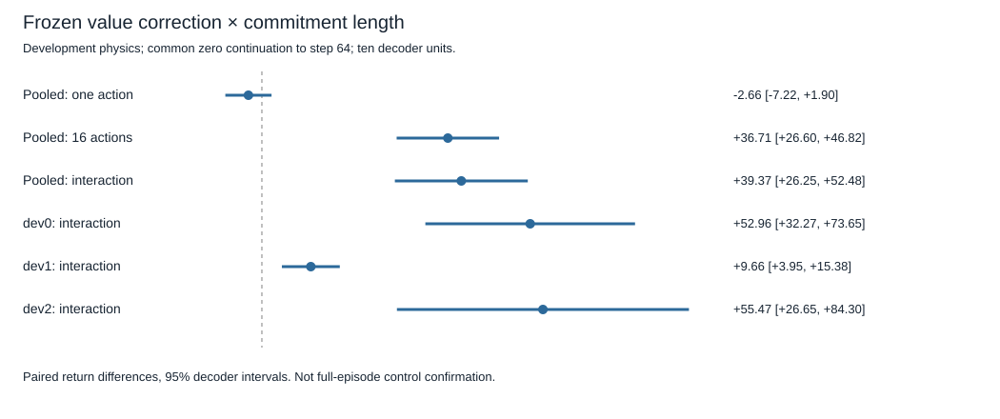

# Frozen value correction × commitment length — results

## Registered decision

The single locked run completed with label **`commitment_sensitive_gain`**. Across ten independent decoder units, correction helped more when committing its selected 16-action sequence than when taking only the first action and replanning with the common zero-context controller:

- One-action correction effect: **−2.656 [−7.215, +1.904]** return points; inconclusive.
- Full-sequence correction effect: **+36.710 [+26.599, +46.821]**.
- Primary interaction, full-sequence effect minus one-action effect: **+39.366 [+26.247, +52.484]**.

The primary mean exceeds the registered one-point threshold and its paired 95% interval is above zero; the full-sequence gain interval is also above zero. This directly tests the interaction on identical states and candidate sets. It does not infer interaction from significance in one arm and nonsignificance in another.

These are conditional 64-step counterfactuals on known development physics. They do not establish improved full-episode control, unseen-physics generalization, learning-to-learn, or an explanation of the historical 184-step negative-transfer gap.

## What was held fixed

Ten independently trained decoders, five saved broad-student contexts per decoder, original zero-context comparison, source normalization, frozen terminal readouts, H=16, 16 candidate sequences and torque actions −2/0/+2. No fitting, encoder inference from new experience, or network updates. Two registered fresh initial states per development physics; identical candidate arrays across scoring rules and decoders. Every arm continues under the same zero-context policy to step 64, using action-independent planning seeds at each local step.

All 16 candidate outcomes were evaluated, removing the earlier four-labeled-candidate restriction. All three first-action outcomes were cached per decoder/state. Actual 16-step prefixes were cached once across decoders and contexts. Cached reuse is not counted as new interaction. Research-only simulator state never enters model scoring.

The three tasks are dev0=(gravity 6, mass 1, length 1), dev1=(10,2,1), dev2=(10,1,1.55). Physics are already inspected development material. No reserved confirmation tasks or closed evaluation seeds were reopened.

## Task and decoder sensitivity

Paired effects below average students and both initial states inside each decoder. Each interval uses ten decoder values, t critical 2.262, nine degrees of freedom. Individual task intervals are unadjusted exploratory sensitivity analyses.

- **dev0:** one-action −0.860 [−4.107,+2.388]; full-sequence +52.101 [31.356,72.845]; interaction +52.960 [32.267,73.654].
- **dev1:** one-action +0.164 [−0.321,+0.649]; full-sequence +9.826 [4.369,15.284]; interaction +9.663 [3.946,15.379].
- **dev2:** one-action −7.272 [−17.967,+3.423]; full-sequence +48.202 [26.868,69.537]; interaction +55.474 [26.653,84.295].

All ten pooled decoder interaction estimates are positive: 39.168,10.109,38.805,31.629,21.138,31.469,62.544,44.823,73.239,40.731. The complete per-seed/state/task/context rewards and scores remain in the raw artifact. Student seeds and states are averaged within decoders, not treated as independent training replications.

Zero-context correction also shows a secondary commitment interaction: **+28.866 [19.102,38.631]**, with full-sequence gain **+33.756 [24.748,42.763]** and one-action gain **+4.889 [0.054,9.724]**. Therefore the finding does not establish that learned student context is necessary for commitment sensitivity.



## Interpretation and limits

The same-state interaction supports sensitivity to whether the selected sequence is actually followed. The earlier apparent contrast was not solely an artifact of comparing different sampled state/candidate sets. This is evidence for the registered mechanism on this finite suite, not a universal claim about terminal-value planning.

Crucially, the mean original one-action return is **−244.356**, corrected one-action **−247.011**, original full-sequence **−299.030**, and corrected full-sequence **−262.320**. Despite its improvement relative to uncorrected sequence commitment, corrected full-sequence commitment is descriptively still below original one-action return. A larger correction effect does not mean that deploying block commitment is superior. That cross-arm absolute comparison is descriptive, not an additional preregistered success criterion.

Correction changed 72.33% of selected sequences and 58.67% of first actions. Endpoint observation distances between commitment arms average 1.321 under original scoring and 1.241 under correction. Distances are computed per student before averaging, with raw angular velocity and cosine/sine coordinates; they are not causal explanations. Regret reduction equals return improvement algebraically and is not independent evidence.

Only six sampled initial states are shared across all decoders. Decoder-level intervals quantify pretrained-model variability conditional on these states/tasks, not uncertainty across arbitrary state distributions. The study does not sample late visited states. These common-zero suffixes are not full corrected-policy values. No planner or architecture change follows automatically.

## Provenance and resources

Prepared implementation/protocol commit: **3ea92b8985ba096e9d2a4eb2b3fdf60b38000e32**. Standing-authority commit: **2fb1fb322f9f8e4e9c5acbc89783ef6c7644286b**. Clean execution/allocation commit: **201810c7a146687654868294503769fdedab73d8**. Branch: `codex/commitment-value-execution`.

Config SHA256: `ebd9b2b5ebf4eff5d7c2248176da89a343b86898e7302bd2d13d7b7726e1f16c`.
Protocol SHA256: `f320043b01e2b1a57ce603918b34259d6f708583da62c500f726b03d8e086a79`.
Raw artifact SHA256: `1844bf2a97316cf8a2c5e4a00ef145c03c88bb693632c5fc3b13181865975623`.
Exact allocation SHA256: `7f089bf573e5ac4783d9d4b48a717a7694c77ef4f1248a93ef61fef4fa6ff238`.

**225.528 seconds** local CPU, below the 900-second cap. **59,136 unique real steps:** 1,536 prefixes, 46,080 block tails and 11,520 first-action continuations. **14,883,840 imagined transitions**. Zero new support collection, source training, teacher fitting or readout fitting. The inherited contexts correspond to 384 unique earlier support steps; inherited training costs remain in their original reports. All 120 local binary hashes verified before/after; all 60 six-model cells preserved model/context/normalization fingerprints and all ten readouts stayed unchanged. Local binaries remain outside Git and are needed for simulation reproduction; repository-only arithmetic auditing needs only tracked data.

The session allocation conservatively reserved 2,700 seconds for preceding execution because session continuity was uncertain. This is an allocation, not 2,700 measured seconds. The new run consumed 225.528 seconds, with an accounting upper bound of 2,925.528 against the 3,600-second session cap. No additional simulation was started in this cycle.

## Verification and commands

Before collection, **37 focused tests passed in 9.41 seconds**; the explicit 120-file/30-group reconstruction audit passed with zero new environment steps. The clean committed protocol was executed once; all planned cells completed and the original validator accepted the capture.

Afterward, an independent arithmetic implementation reconstructed chosen actions, reward sums, paired differences and decoder intervals without loading models or collecting data. This is independent arithmetic, not external scientific replication. A corruption test exposed that the original validator could miss reward alteration in an unselected cached trace: the audit now checks every trace's saved early/late/total sum, including unselected actions. The actual capture passes these stronger checks unchanged; no resimulation or artifact rewriting occurred. An initial plotting attempt lacked matplotlib; the final figure uses dependency-free SVG. These maintenance failures did not affect experimental collection or its metrics.

Final focused suite: **41 passed in14.67 seconds**. Final full suite: **608 passed,1 deselected in146.26 seconds**; the deselected checkpoint-integrity marker is intentionally separate from repository-only tests. Explicit standalone checkpoint verification afterward: **120 verified,0 missing,0 mismatched**. The first full-suite attempt had607 passes and the one audit-corruption failure described above; it was corrected before the final clean pass. The first focused postcollection attempt similarly had40 passes and that same failure. No simulation was repeated. Test and resource details are also in `artifacts/commitment_value_verification.json`. No passing test is treated as evidence of control improvement.

```sh
PYTHONPATH=src:.deps python3 -m pytest tests/test_commitment_value.py -p no:cacheprovider
PYTHONPATH=src:.deps python3 scripts/run_commitment_value.py --verify-inputs
# Executed once from clean 201810c; do not rerun the closed sample:
PYTHONPATH=src:.deps python3 scripts/run_commitment_value.py --approved-config-sha256 ebd9b2b5ebf4eff5d7c2248176da89a343b86898e7302bd2d13d7b7726e1f16c
# Safe offline reproduction:
PYTHONPATH=src:.deps python3 scripts/run_commitment_value.py --audit
PYTHONPATH=src:.deps python3 scripts/audit_commitment_value.py
PYTHONPATH=src:.deps python3 -m pytest tests/test_commitment_value.py tests/test_commitment_value_recorded.py -p no:cacheprovider
PYTHONPATH=src:.deps python3 -m pytest -p no:cacheprovider
```

## One next scientific experiment

Replicate this locked correction-by-commitment interaction on **late states visited by the unchanged controllers**, with equal student-visitor/zero-visitor weighting inside each decoder. Preserve all frozen weights, readouts, H16/16 candidates and common-zero suffix. This tests whether the positive initial-state interaction survives the distribution encountered during control before considering block commitment as a policy change. Register fresh trajectory seeds and a bounded budget separately; do not reuse the current six states for tuning.
