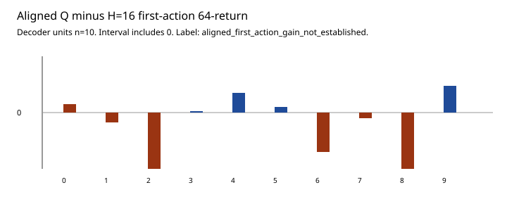

# Source-trained first-action value — development results

## Registered decision

The complete run **did not establish a first-action return gain**. Label: `aligned_first_action_gain_not_established`.

Aligned-Q minus frozen H=16 first-action 64-return: **−3.535 [−9.840, +2.769]**. The mean is below the registered one-point threshold and the paired 95% interval includes 0. The screen required mean ≥ 1 and lower bound > 0. Neither passed. This is a valid, complete, inconclusive decision result, not a timeout and not an equivalence claim.

Aligned-Q minus the frozen sequence-value correction: **−0.967 [−7.868, +5.934]**, also including 0. Sequence-value minus H=16: **−2.568 [−6.195, +1.058]**. Neither secondary contrast can upgrade the failed primary screen.

This does **not** identify the 20.254 sequence-to-first-action oracle gap's cause, improve a deployed controller, demonstrate learning-to-learn, or justify an architecture change.

## What was tested

Ten frozen decoders, five saved student contexts each, H=16 and 16 candidates unchanged. A new 15-coefficient linear ridge Q(s, z, a) was fit from source-only first-action-plus-63-zero-replanning 64-step returns (144 rows per decoder: 8 tasks × 6 contexts × 3 actions). The fit was written to disk and reloaded before any development environment step. The frozen 78-coefficient sequence-value readout was used only as a comparator and was not refit.

Development evaluation used new phase-50 visited states on the three known development physics, two visitors per decoder/task, shared 16-candidate sets, and the three measured first-action common-zero returns. Primary aggregation: students, then equal visitor groups, then equal tasks, inside each of ten independently pretrained decoders. Intervals are Student-t 95%, df 9, conditional on the shared source-fitted Q.

## Means and sensitivity

Pooled first-action 64-returns: H=16 **−152.638**; sequence-value **−155.206**; aligned Q **−156.173**. In-set first-action regrets: 8.763, and 12.298 for aligned Q. Aligned first-action agreed with H=16 on **0.387 [0.249, 0.524]** of student selections and with sequence-value on **0.360 [0.193, 0.527]**.

Decoder aligned-minus-H=16 point estimates: **0.49, −2.33, −21.44, 0.34, 4.84, 1.24, −9.84, −1.34, −13.87, 6.55**. Four of ten are positive. No task or visitor group establishes the registered gain:

- **dev0 (g6, m1, l1):** **0.099 [−0.297, +0.496]**
- **dev1 (g10, m2, l1):** **2.083 [−4.031, +8.196]**
- **dev2 (g10, m1, l1.55):** **−12.788 [−34.048, +8.472]**
- **Student-visited:** **−5.468 [−19.901, +8.965]**
- **Zero-visited:** **−1.603 [−13.784, +10.578]**
- **Zero scoring context:** **−1.685 [−10.349, +6.978]**

## Prediction is not a pass

Source-fit RMSE by decoder was **70.3, 72.3, 72.8, 71.7, 73.4, 75.2, 69.6, 73.5, 76.8, 65.3**. Development Q RMSE against the three actual first-action returns was **107.546 [88.340, 126.751]**. The linear readout did not fit the registered 64-step target closely even on source data. That prediction failure is reported separately and cannot pass the decision screen. It also means this experiment does not give the aligned-label hypothesis a strong test of *capacity-matched* scoring; it tests this 15-coefficient linear Q.



## Provenance, resources and tests

Branch `cursor/first-action-value-learning`. Starting SHA **ff2619315caeb24da6af5311b3cb33d104076c92**. Protocol/implementation/clean execution SHA **0d08bfa7340a6b1a9c6de64d8ee890e70b613de5**.

- Config SHA256 `fd2a94944774e024625315c2464153493741b3b23881d0ba9b2a470ffedadcc8`
- Protocol SHA256 `5b0bbd353ef5746de33e59b0d7bd5ba7da03b8e0013eafdb74dcef6ec5c76f7f`
- Allocation SHA256 `617ce91a1d28ee04a597c04377ccdf5bc2e8d05ad739dd6fef718f406b8f2964`
- Fit SHA256 `0b2c5e1d018842a8eb5decc2af6df0a9fce7c3f87b82dba9112b080550b2f627`
- Raw result SHA256 `1ea6c5e28930b1e6670a4894862af23f2f701f0ebd1d0d4ebeebefcd43e3828a`

One run completed in **126.642 s**, below 150. Exactly **29,880** new real steps (15,360 source labels, 3,000 collection, 11,520 first-action branches) and **7,741,440** imagined transitions. No new support. No world-model, encoder, or historical readout writes. Before/after 120-file checkpoint audits: 0 missing, 0 mismatched. 80 source cells and 60 evaluation cells completed. Python 3.13.5, NumPy 2.5.4, torch 2.14.1, local CPU.

The conservative session account advances from 3,425.5923 to **3,552.2343 s**, leaving **47.766 s**. Testing is reported separately. No retry.

Before collection, **15 focused tests passed** and the explicit 120-file audit passed. Full default suite: **728 passed, 1 deselected in 262.09 s**. After the run, an independent rebuild from integer selected indices and plain 64-step reward sums reproduced the primary interval exactly. The `--audit` path passed. Counts are also in `artifacts/first_action_value_verification.json`.

```sh
PYTHONPATH=src:.deps python3 -m pytest tests/test_first_action_value.py -p no:cacheprovider
PYTHONPATH=src:.deps python3 scripts/verify_checkpoint_integrity.py
PYTHONPATH=src:.deps python3 scripts/run_first_action_value.py --execute
PYTHONPATH=src:.deps python3 scripts/run_first_action_value.py --audit
PYTHONPATH=src:.deps python3 -m pytest tests/test_first_action_value_recorded.py -p no:cacheprovider
```

## One next experiment

Keep the world model frozen. Repeat this exact first-action screen with a **capacity-matched** ridge readout: the same 77 polynomial coordinates of (observation, context) used by sequence-value V, plus three action dummies (81 coefficients), fit on the same class of source first-action-plus-zero-replanning labels, frozen before new development visited states. If that estimator still cannot beat H=16 on decoder-level 64-step first-action return, close the score-correction branch rather than adding layers or reopening confirmation physics. Estimated cost remains on the order of 30,000 real steps and a 150-second class cap; lock a separate protocol before collection. This proposal has not run.
