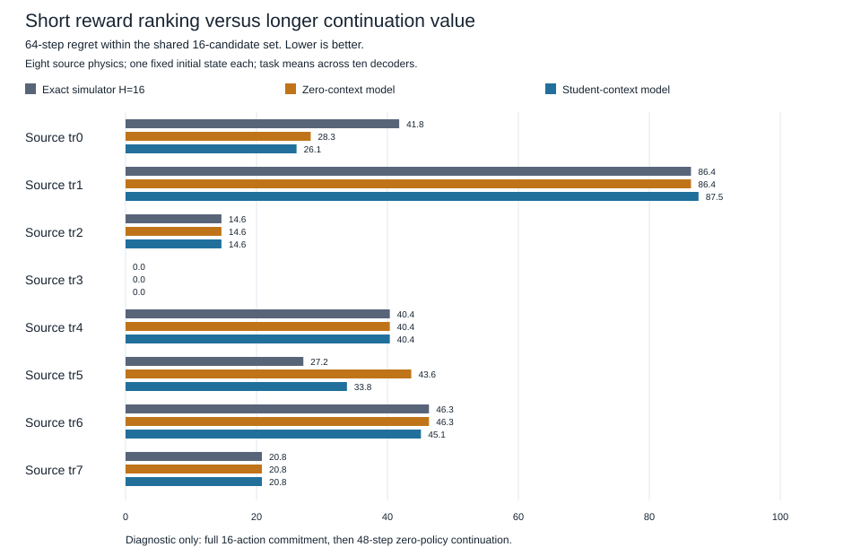

# Source planning-value diagnostic — locked protocol v1

Starting revision: `850dbaa9ebb3f00eb2bdb81d5b1209c43600e9c8`. Remote matched this local, clean revision. The user authorized another bounded local research cycle. No training, controller modification, closed-seed reuse, or independent control-success test is authorized here.

## Question and competing explanations

H-objective: even exact simulator H=16 reward ranking omits practically relevant consequences under a common later policy. H-model: learned-model score errors, rather than that short objective, dominate the selected sequence's longer-value regret. Both, neither, and task dependence are possible. Exact simulator scores are research comparisons only; they never enter deployed MPC or latent inference.

This is the smallest source-only planning-value diagnostic following the policy-switch result. It uses the eight **existing source physics**, not fresh physics confirmation. New initial-state, support and action seeds are fixed in `configs/planning_value.yaml`. It does not test the heavy-mass rp2 failure directly. Previously evaluated physics and artifacts stay closed. The fresh material is episode experience, not new independent physics.

## Frozen design

Ten independently trained decoders, five saved broad students each; unchanged normalization, weights, FiLM, H=16, 16 candidate sequences, actions −2/0/+2 and published Pendulum reward. Verify all 120 required checkpoint files and manifest before and after. No fitting of any kind. New 128-row random-behavior support per source task, shared across decoders/students. Source support is disjoint from diagnostic reset seeds.

One registered reset state per source task; all eight tasks weighted equally. At that identical simulator state draw one shared 16×16 candidate action array. Execute each full candidate block in the simulator once, recording all rewards, observations and endpoint state. Cache this model-independent prefix across decoders. Score the same block with zero and each student context using unchanged MPC rollout scoring.

From each actual prefix endpoint, execute 48 steps of the **same decoder's zero-context MPC**. Each local continuation step uses a preregistered seed independent of candidate index, selected action, student seed and previous outcomes. The continuation policy is identical across candidate comparisons within a decoder, but acts on different endpoint states. Preserve the original episode clock (suffix starts at 16). Never cross a 200-step boundary. Sum the actual 16+48 rewards to obtain this candidate's diagnostic 64-step value. Frozen contexts remain fixed.

Crucial distinction: committing a whole 16-action block before zero-policy continuation is **not** receding-horizon first-action execution or full-episode policy value. This diagnostic can reveal objective truncation under this intervention, but cannot causally explain the earlier negative episode transfer.

## Outcomes, aggregation and decision

Primary: 64-step regret of the candidate selected by **exact actual H=16 reward**, relative to the best 64-step candidate in this same 16-candidate set. Argmax ties use first index. Average eight tasks within decoder; t interval across ten decoder means, df=9 (critical value 2.262). Repeated states, candidates and student seeds are not independent replications. The eight initial states and shared support are fixed; uncertainty is conditional on this finite suite. Regret is nonnegative by construction, so an interval above zero alone is weak evidence. Declare `short_objective_misses_practical_value` only if complete integrity passes, mean regret ≥5 and 95% lower bound >0; otherwise `objective_mismatch_inconclusive`. This is a development screen, not generalization proof. No multiple primary outcomes.

Secondary, exploratory: student and zero 64-step regrets; student-minus-zero selected 64-step return; exact16-minus-model selected 64-step returns (may have either sign); H=16 predicted-versus-actual reward MAE; candidate-ranking correlation against actual16 and actual64; first-action/sequence disagreement; per-task and per-decoder results. Average five student seeds inside task/decoder first. Actual64-best is an in-set diagnostic reference, not an oracle controller. Actual16 and actual64 share prefix rewards and their differences/regrets are algebraically dependent; never count them as separate replications. Secondary intervals are unadjusted descriptive intervals. No retuning or follow-up run on these seeds.

## Compute cap and provenance

One run only. Cap 600 seconds (~4–6 minutes estimated from the preceding 202-second/13.38M-state run). Planned environment interactions: support 8×128=1,024; cached prefixes 8×16×16=2,048; suffixes 10×8×16×48=61,440; total **64,512**. Imagined transitions: score 10×8×6×16×16=122,880; continuation 61,440×16×16=15,728,640; total **15,851,520**. Support encoding adds 10×8×5×128=51,200 encoder rows, separately disclosed. No source-training interactions in this run. Checkpoint verification, JSON saving and CPU wall time included in cap. No paid services or unbounded retries.

Save partial results with `complete=false` on missing cells, nonfinite data, timeout, integrity discrepancy or other failure. Commit this protocol, executable configuration, tests and implementation before execution; require clean Git revision. Record SHA, hashes of configuration/protocol, source data, parent and manifests, exact dependency versions, counters and raw reward/action traces. Prior artifact files must remain byte-identical. A standalone offline audit checks raw reward arithmetic and candidate RNG without collecting new data.

## Planned correctness checks

Shared restoration and candidate arrays; correct prefix/suffix reward indexing; same continuation RNG across candidates; frozen weights/normalization/context; source-only task registry; closed seed rejection; exact planned decoder/task/student/condition grid; missing whole axes, numeric strings, bool, NaN/inf and truncated traces rejected; selected indices reconstructed from raw scores; ten-decoder aggregation and cap enforcement. Synthetic tests are correctness evidence only.

## Reproduction

`PYTHONPATH=src:.deps python3 -m pytest tests/test_planning_value.py -p no:cacheprovider`

`PYTHONPATH=src:.deps python3 scripts/run_planning_value.py`

`PYTHONPATH=src:.deps python3 scripts/audit_planning_value.py`

The runner refuses an existing result, dirty implementation or changed locked configuration. No results have been measured at protocol registration. After execution, results are reported below without changing the registered rules.


## Completed run and processing history

The single collection run executed the complete locked grid in **238.48 seconds**, below 600 seconds. All 80 decoder/task cells and 128 cached prefixes were recorded. No model fitting, architecture change, control sweep, new physics confirmation or rerun occurred.

The initial execution ended with `complete=false` because its final validator expected 64-character support hashes; the reused `prefix_hash()` actually returns 16-character SHA256 prefixes. The synthetic fixture had repeated that incorrect assumption. The raw capture is preserved byte-for-byte, including the failure. After adding a real helper-contract regression, commit `d48bf5165d13ebe6e97a21b946b4ebfca997be55` corrected the schema **without changing outcomes, estimand, screen or collected data**. Separate offline validation took 0.676 seconds and verified every planned cell. Use `artifacts/planning_value_validation.json` together with the matching raw capture hash and audit; do not interpret the original capture's error flag as a successful original validation. Recovery status: **`complete_data_recovered_by_offline_validation`**. Details: `NEXUS_PLANNING_VALUE_VALIDATION_FIX.md`.

## Primary finding

Exact actual H=16 selection still incurred **+34.685 [+22.677, +46.694]** points of 64-step regret against the best candidate in the identical set. All ten decoder means were positive; seven of eight task means were positive. The registered five-point development screen passed: **`short_objective_misses_practical_value`**. The lower interval also exceeds five, but this remains a conditional development diagnostic. The regret is nonnegative by construction; this is not an unbiased estimate of a controller improvement.

Actual H=16 and actual64 selected the same candidate only **17.5%** of the time. Even removing learned-model score error does not remove longer-value regret in this intervention. That supports H-objective on this finite source suite. It does not establish that objective truncation causes the historical fresh-physics episode deficit.

## Learned-model comparisons (exploratory)

- Student-minus-zero selected64 return: **+1.507 [-2.870, +5.885]**, inconclusive.
- Exact16-minus-zero selected64 return: **+0.371 [-2.833, +3.574]**, inconclusive.
- Exact16-minus-student selected64 return: **-1.137 [-7.836, +5.563]**, inconclusive.
- Zero-context64 regret: **+35.056 [+23.781, +46.332]**; student64 regret: **+33.549 [+24.439, +42.659]**.
- Mean student/zero Spearman against actual16: **0.923/0.848**. Against actual64: **0.245/0.161**.
- Student/zero H=16 reward-forecast MAE: **4.882/4.094**. On this sample the student does not have the lower point estimate for reward calibration. Its better rank correlation is a different property.
- Student/zero selected16 regret: **0.336/0.508**; first-action disagreement **9.75%**.

Paired differences are computed within decoder, not inferred from overlap of separate intervals. The exploratory student-minus-zero rank16 contrast is +0.075 [0.038, 0.113], rank64 +0.084 [0.030, 0.139], and reward-MAE +0.788 [−0.326, 1.901]. These intervals are unadjusted and mathematically related to the same recorded trajectories; they are not independent confirmations. Better correlation across candidates did not establish better argmax return.

### Task means (all registered tasks)

- tr0: exact16 regret 41.794; zero regret 28.277; student regret 26.116; student-minus-zero return +2.160.
- tr1: exact16 regret 86.362; zero regret 86.362; student regret 87.514; student-minus-zero return -1.152.
- tr2: exact16 regret 14.644; zero regret 14.644; student regret 14.644; student-minus-zero return +0.000.
- tr3: exact16 regret 0.000; zero regret 0.000; student regret 0.000; student-minus-zero return +0.000.
- tr4: exact16 regret 40.362; zero regret 40.362; student regret 40.362; student-minus-zero return +0.000.
- tr5: exact16 regret 27.156; zero regret 43.639; student regret 33.814; student-minus-zero return +9.824.
- tr6: exact16 regret 46.342; zero regret 46.342; student regret 45.117; student-minus-zero return +1.225.
- tr7: exact16 regret 20.823; zero regret 20.823; student regret 20.823; student-minus-zero return +0.000.

Task tr1 has the largest exact16 regret (86.362). Tr3 has none: exact16 selected the best64 candidate in every decoder there. Physics, contexts and raw scores/rewards are retained in the executable config and raw capture. The source suite includes no mass-3.1 rp2 task, so this is not a new direct test of that negative-transfer case.

### Independent decoder means

- Decoder 0: exact16 regret 23.985281; student-minus-zero 64-step return +2.185699.
- Decoder 1: exact16 regret 33.683841; student-minus-zero 64-step return -1.088960.
- Decoder 2: exact16 regret 54.277371; student-minus-zero 64-step return +14.280775.
- Decoder 3: exact16 regret 27.076831; student-minus-zero 64-step return +0.892806.
- Decoder 4: exact16 regret 61.190170; student-minus-zero 64-step return +5.792999.
- Decoder 5: exact16 regret 41.438340; student-minus-zero 64-step return +3.047204.
- Decoder 6: exact16 regret 46.077619; student-minus-zero 64-step return +0.000000.
- Decoder 7: exact16 regret 13.178599; student-minus-zero 64-step return -0.350704.
- Decoder 8: exact16 regret 9.470634; student-minus-zero 64-step return -10.283716.
- Decoder 9: exact16 regret 36.475912; student-minus-zero 64-step return +0.595835.



## Integrity, costs and reproducibility

All 120 required checkpoint files verified before and after collection. The 80 decoder/task groups each preserved all six network/normalization/context fingerprints exactly. The independent arithmetic implementation reconstructed the primary interval and student-minus-zero contrast from raw rewards, and verified **61,440/61,440** candidate decisions against regenerated RNG. This is an independent calculation, not external replication. No earlier tracked artifact changed.

Actual environment steps: support **1,024**, cached prefix **2,048**, continuation **61,440**; total **64,512**, exactly the cap. Cached prefixes count once across all decoder and context comparisons. Imagined transitions: scoring **122,880**, continuation **15,728,640**, total **15,851,520**. Additional encoder work: **51,200 support rows** across 400 context installations. There were zero source-training optimizer updates. Existing pretraining costs are inherited and not hidden inside this evaluation budget. Offline recovery and audit generated zero new environment interactions.

Execution revision: `f6fafc16697e4cbff85f79146e0a089cfdaa33b0`. Offline processing revision: `d48bf5165d13ebe6e97a21b946b4ebfca997be55`. Config SHA256: `3a4f1ebcf774209401496bc8a3dc077fead5f1ec79697d518737656679e2d085`. Frozen pre-run protocol SHA256: `1c40804ebcf0006f363071f5ff996420644bbdd5d60a7810d2fc7a4ed301e251` (retrieve through `git show` at the execution revision). Parent SHA256: `123bd0fd168397c4f030b049217116f4c7b6678f3b78d0df3e3627a9747c01b5`. Manifest SHA256: `265cd1822ec73bab8eac6fd792438c3c9fe7834ae5af307b8c33104bf919d06b`. Raw capture SHA256: `597faebffee7354141a512ac3c970e37d11bf1ee0ed3feed074a6a2d82345781`. Raw capture size: 10,086,226 bytes. Support hash fields are explicitly **16-character truncated SHA256**, not full hashes. Other hashes above are full SHA256.

Dependencies recorded by the run: python=3.13.5 (main, Jun 11 2025, 15:36:57) [Clang 17.0.0 (clang-1700.0.13.3)], torch=2.14.1, numpy=2.5.4, gymnasium=1.4.0. No package installation or paid services were used. Local checkpoint paths and full binary hashes remain in the existing checkpoint manifest. Those ignored `.pt` files are **not supplied by GitHub**; a clone can audit JSON/provenance without them, while an explicit checkpoint audit or simulation must fail clearly if they are missing.

Tests actually executed:

- Initial focused suite: 37 passed, one explicit checkpoint test deselected, 13.90 seconds.
- Initial full regression: 474 passed, one explicit checkpoint test deselected, 100.43 seconds.
- Explicit local checkpoint test: 1 passed, 3 unrelated tests deselected, 0.74 seconds; all 120 files verified.
- After hash-contract correction, focused suite: 42 passed, one checkpoint test deselected, 18.33 seconds.
- Full regression after the hash correction: **479 passed**, one explicitly separate checkpoint test deselected, **102.05 seconds**.
- Final full regression, including repository-only reconstruction of every saved statistic: **480 passed**, one explicitly separate checkpoint test deselected, **101.87 seconds**.

Commands:

```sh
PYTHONPATH=src:.deps python3 -m pytest tests/test_planning_value.py tests/test_policy_switch.py tests/test_checkpoint_integrity.py -p no:cacheprovider
PYTHONPATH=src:.deps python3 -m pytest -p no:cacheprovider
PYTHONPATH=src:.deps python3 -m pytest tests/test_checkpoint_integrity.py -m checkpoint_integrity -p no:cacheprovider
PYTHONPATH=src:.deps python3 scripts/run_planning_value.py
PYTHONPATH=src:.deps python3 scripts/validate_planning_value_capture.py
PYTHONPATH=src:.deps python3 scripts/audit_planning_value.py
```

The last three commands were run once; they refuse to overwrite existing captures/validation/audit artifacts. Reproduce collection only in a separate checkout at the execution revision with the exact verified binaries/dependencies, preserving these closed results. Current source fixes the helper contract; the original execution revision reproduces its documented final validation error. For a read-only recheck of the saved data, call `validate_and_summarize(raw, load_config())` from `nexus.world.planning_value`, and compare it to the saved validation artifact and raw hash. The independent audit artifact records the original successful audit.

## Limits and single next experiment

Only one initial state per source physics, one support history per task and one candidate set per state were registered. Decoder intervals do not represent uncertainty over the population of states or physics. The 48-step continuation uses shared per-step candidate seeds; it is the specified research policy, not the closed full-episode RNG stream. Executing a full 16-action block is different from first-action replanning. The in-set best64 value uses simulator knowledge only for evaluation. Long-value regret, rank agreement and reward error are dependent diagnostics. These findings neither demonstrate a better controller nor explain the complete closed fresh-physics return loss.

**One next experiment:** fit a small source-only terminal-value estimator, keeping encoder/decoder/H=16/16 candidates fixed, then test whether its score correction improves same-state first-action return under a locked common continuation on fresh development states against unchanged MPC. Use disjoint training and evaluation states and a separately committed protocol; do not fit to this closed diagnostic. Proposed next ceiling: ten minutes local CPU and 65,000 environment steps, with an explicit smaller training/evaluation allocation registered before collection. This is a proposal, not an executed improvement. No wider encoder, architecture search, control-success claim, learning-to-learn claim or AGI claim follows.
