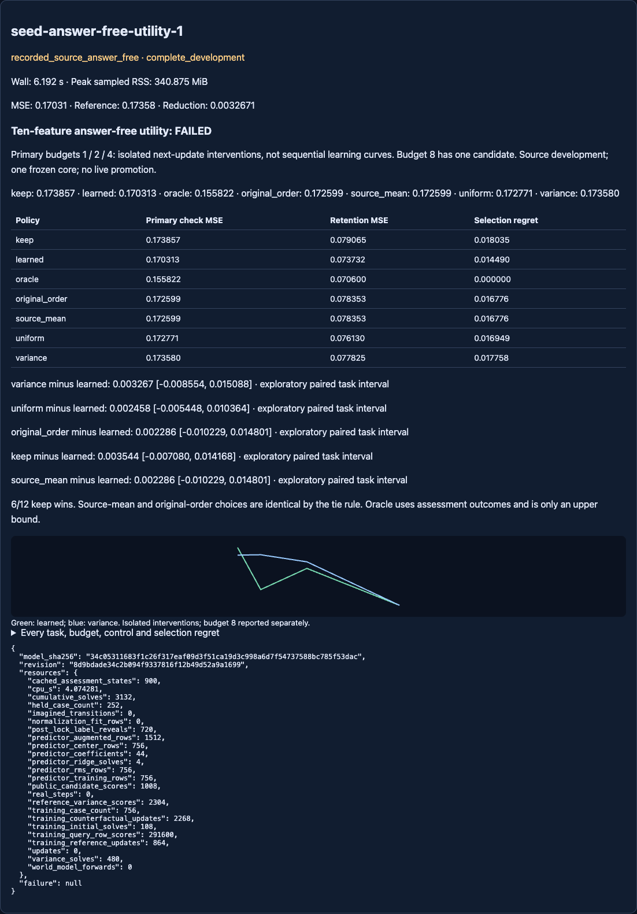

# Ten answer-free features did not establish useful learned questioning

Valid complete SOURCE-development execution; **registered screen FAILED**.
Branch **codex/seed-answer-free-question-utility**, reconciled base
**1a6167073321d2a7241227ded4627599a63b4386**. The older reviewed8f404db is an
ancestor. The newer54-feature failed study and all previous results are preserved.
Protocol and tested implementation committed BEFORE this run at
**8d9bdade34c2b094f9337816f12b49d52a9a1699**.

[Protocol](NEXUS_SEED_ANSWER_FREE_UTILITY_PROTOCOL.md),
[executable configuration](../configs/seed_answer_free_utility.json),
[complete raw cases/models/choices](../artifacts/seed_answer_free_utility.json).
Raw SHA256 **c3f5f6ac824e0c90653a24be81f89869e99a1fd8c1c275e93c0f8af9284c555c**.

## Primary comparison: equal-weight budgets1/2/4

Lower check MSE is better. The read-only GUI presents a comparison table with
all policies, retention and selection regret:

- **Learned ten-scalar ridge: .170312813**; selection regret .014490427.
- **Variance: .173579915**; learned reduction **1.88%**; regret .017757528.
- **Exact uniform expectation: .172770916**; reduction **1.42%**; regret .016948529.
- **First remaining/original order: .172598803**; reduction **1.32%**;
  regret .016776416.
- **Keep: .173857214**; reduction **2.04%**; regret .018034827.
- **Featureless source-mean utility: .172598803**, identical to original order
  under the predeclared original-index tie break; not independent evidence.
- **Evaluator check oracle: .155822387**, regret0; an optimistic upper bound
  on question selection using outcomes inaccessible to the learner. It does
  not get to choose keep; it is not a deployed policy.

All four required reductions miss5%. Variance-minus-learned is
**+.003267102 [−.008554214,+.015088417]**; keep-minus-learned is
**+.003544401 [−.007079565,+.014168366]**. Uniform contrast
**+.002458103 [−.005447701,+.010363906]**; original-order/source-mean contrast
**+.002285989 [−.010229043,+.014801022]**. Required interval gates fail.
Only **6/12 tasks** beat keep, below8. Retention passes: .073731570 learned
versus .077824653 variance (excess−.004093083, below the+.01 allowance).

These exploratory paired t intervals average the three damping fits and budgets
inside each source task, df11. The four training folds overlap, all source tasks
were previously inspected and all share ONE frozen core. They are not independent
world-model replications, new confirmation, control evidence or learning-to-learn.

## Budget and task sensitivity

Learned / variance / uniform / original-order / keep check MSE:

- Budget1: **.176412 / .174196 / .175911 / .175283 / .174851**.
- Budget2: **.164187 / .174302 / .170406 / .171515 / .174196**.
- Budget4: **.170340 / .172241 / .171995 / .170998 / .172524**.
- Budget8, secondary only: every question policy/oracle **.159628**;
  keep **.161026**. One remaining row provides no ranking evidence.

These are isolated next-update interventions on restored fixed reference states,
NOT sequential learned-question learning curves. Budget8 is excluded from the
primary mean. Oracle-subtracted regret differences are mathematically the same
MSE differences, not corroborating evidence.

Per-task primary learned / variance / keep (all seven methods remain in the JSON
and GUI; cached per-damping-fit scores remain in the linked parent JSON bank):

- 95000000: .309012 / .314675 / .310507.
- 95010000: .168611 / .216742 / .217127.
- 95020000: .148001 / .174721 / .169115.
- 95030000: .170388 / .167178 / .164631.
- 95040000: .183358 / .183246 / .184854.
- 95050000: .131052 / .138093 / .127805.
- 95060000: .183022 / .183804 / .178704.
- 95070000: .122643 / .125519 / .125728.
- 95080000: .132435 / .123698 / .131205.
- 95090000: .203430 / .186514 / .184971.
- 95100000: .137036 / .134918 / .134946.
- 95110000: .154767 / .133850 / .156694.

The largest keep gains are concentrated on95010000 (+.048516) and95020000
(+.021114); the largest keep loss is95090000 (−.018459). Budget1 worsens
variance while budget2 improves. Overall utility-prediction MSE **.000435079**
is worse than the featureless training mean **.000414295**. This representation
and ridge fail to transfer utility reliably on this bank. The evidence does not
identify whether unstable labels, insufficient features or limited task diversity
is responsible. Do not enlarge the architecture or retune on this result.

## Leakage and provenance audit

The pure ten-feature function accepts candidate inputs, current predictions,
variance, observed anchors/prefix and remaining count only. No candidate answer,
post-update proposal, task ID, query label or retention label is an argument.
Changing unasked answers leaves pre-answer features/choices unchanged at every
budget. Assessment poisoning cannot affect the separate decision API. Held
tasks and other folds' constants are absent from the training extractor; removing
them leaves identical training input, preprocessing and fitted coefficients.

Every training counterfactual was rebuilt under the CURRENT outer fold's frozen
normalization and damping. Pooling historical own-fold fits would leak current
held tasks indirectly; none were pooled. Training labels use only the nine tasks'
SELECTION query bank. Excluded-task selection outcomes never enter training;
CHECK/retention stay evaluator-only. All four folds' choices/model hashes were
persisted before post-lock LabelOracle reveals/assessment. This is a trusted
offline API separation, not hostile-process access isolation.

The evaluator reuses900 cached excluded-task before/after states only after
checking their fixed-learner equations and scores against recorded raw check
and retention arrays. Each policy requests exactly one new answer after its
permitted observed prefix;720 restored-prefix label accesses are recorded.
Uniform/oracle expectations enumerate recorded evaluator cases, not extra agent
teaching opportunities. All raw dependency hashes and the old invalid-capture /
separate query-bank validation chain are preserved, not silently rewritten.

Source/frozen pack digest is unchanged. Frozen core SHA256
**cfe06a6737c8e225564ebcaea9ba4678aabd45b61129828e64354e74fa3c8d1b**;
readout SHA256
**8129cbd4768f4cd5dce938cd8b6740172bf5dbe8742dcb97c497951ad5e87745**.
The frozen30278-parameter core and2209-parameter readout receive zero updates
and zero neural calls. Historical786 artifacts are byte-preserved from base.

## Cost and reproduction

One run, no retry: **6.191857s host wall**, **4.074281s worker process CPU**,
**340.875MiB peak sampled RSS**, below60s/2048MiB. Worker study body3.184736s;
loading, hashing, audit and serialization account for the difference. No new
environment interactions, imagined transitions, neural forwards or outer updates.

108 anchor-initial solves,864 reference updates,2268 counterfactual updates
(3132 cumulative solves),480 input-variance solves,756 training/252 excluded
cases and291600 training query-row scores. Four new ridge solves,189 cases
per fold,1512 antisymmetrically augmented training presentations. **11 prediction
coefficients per fold (44 total)** plus80 saved centering/RMS scalars. The reused
counterfactual helper temporarily computes its legacy features before replacement;
only the ten declared scalars reach the new fit. Compute is not matched to the
untrained simple controls; all costs are reported.

Conservative **8s debit**: **1971.6321034559958s used /
1628.3678965440042s remaining**, preserving the carried session. No second study.
Python3.13.5, Torch2.14.1, CPU, one thread. Config SHA256
**70f26a547cde29a386f3934ac14f48c3fd4a11aa10247bed884fe48e7c3dbe9e**;
protocol SHA256
**86b88e0513f37cb64e6e33593eeee21304816f760af3879a71feaaadf32f39c5**;
choice/model lock
**34c05311683f1c26f317eaf09d3f51ca19d3c998a6d7f54737588bc785f53dac**.

Focused21 tests passed. Initial full relevant regression had755 passes and14
setup errors from an older fixture charging cumulative pytest CPU; fixed by a
fresh subprocess without changing scientific code/caps. Corrected focused/shared
run:122 passed in62.08s. Final relevant regression: **773 passed in174.97s**.
The15 read-only GUI checks passed in40.242s, including the complete comparison
table, source-failure labels, original labs, mobile layout and unchanged journal.
After strengthening assessment poisoning to verify that changed labels actually
alter evaluator scores while leaving features/choices unchanged,25 focused and
saved-evidence tests passed in31.78s. No scientific implementation changed.
Detailed outcomes are recorded in
[verification receipt](../artifacts/seed_answer_free_utility_verification.json).

Independent stdlib replay validates all1008 variances (maximum error3.675e−7,
tolerance2e−5), fold-only normalization, fixed update and ridge equations,
assessment scores, complete grids and separately calculated primary means/CIs.
No fitting or neural imports in the verifier:

```sh
python3 -I -S scripts/verify_seed_answer_free_utility.py
python3 -I -S scripts/check_repository.py
```

The `/labs` and `/experimental` GUI shows this failed screen, all controls,
task results and costs. It does not install the predictor into Session or alter
the live agent. Main and unrelated checkout work remain unchanged.



## One next experiment

Preregister a **recorded-data utility-label reliability audit**, using the saved
fixed candidate states and separate query-start subsets. Measure agreement of
utility signs and candidate rankings across subsets, with no fitting or new
simulation, before modifying representation or capacity. Proposed30s CPU/wall,
zero new interactions; not allocated or run here. This distinguishes a noisy
supervision target from a selector failing to exploit stable task information.
Use this study's SAME outer-fold learner states and normalization, never pool
assessment caches scored under a different fold's learner.
