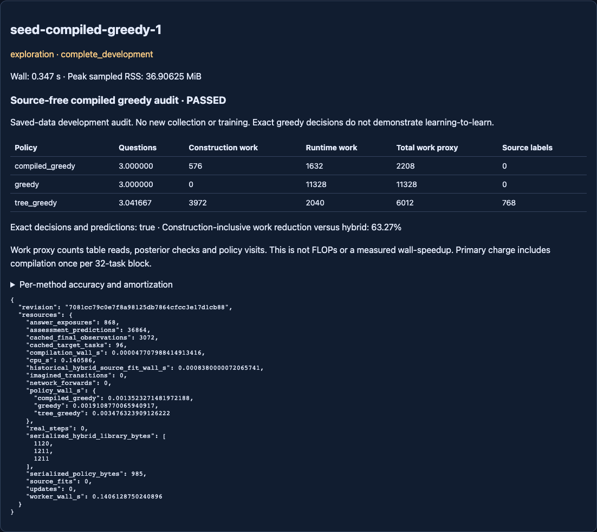

# Source-free compiled greedy — complete audit, cost/exactness screen PASSED

Branch `codex/seed-compiled-greedy-audit`; starting revision
`9b8360aadabe2e79570e1b1a3d62c89191aeb552`, matching GitHub after fetch.
Protocol/tested implementation committed before execution at
**7081cc79c0e7f8a98125db7864cfcc3e17d1cb88**. One run, no retries.
[Locked protocol](NEXUS_SEED_COMPILED_GREEDY_PROTOCOL.md),
[config](../configs/seed_compiled_greedy.json),
[raw data and choices](../artifacts/seed_compiled_greedy.json),
[independent verification](../artifacts/seed_compiled_greedy_audit.json).

## What was tested

The eight known Boolean laws and eight available questions completely specify
the greedy rule. Compilation uses ONLY this public grammar, before loading
saved answers. It stores reachable posterior/remaining-query decisions with
the same squared-partition objective and lowest-index tie break. No source
labels, learned model, target rule ID or query outcome enters compilation.
The existing LabelOracle/adaptation loop still chooses before revealing answers
and charges the same runtime posterior updates. No live policy was replaced.

This replays the already inspected96 rule-balanced targets in three frozen
source-library blocks. It is a deterministic retrospective SOURCE audit, not
fresh validation or independent evidence of a new learning procedure.

## Decisions, questions and quality

Every compiled question, revealed-answer trace, posterior, budget snapshot and
final prediction exactly matches online greedy on all96 tasks. All eight
possible laws also pass synthetic exhaustive unit tests. Numerical decision
and prediction tolerance is exact equality; independent metric arithmetic is
checked within1e-12. No five-question tail: compiled/online greedy stop at3.

- Compiled greedy: **3.000000** mean questions; source labels0.
- Online greedy: **3.000000**; source labels0.
- Learned hybrid: **3.041667**; historical source labels768 across three trees.

Compiled-minus-hybrid questions per block:−.125,0,0. Exploratory block-level
mean **−.041667 [−.220944,+.137611]**, n3/df2. This does not establish a
statistically reliable question advantage. Tasks/observations are not counted
as independent learners; repeated compiled policies are not new training seeds.

At budgets1/2/4/8, compiled AND online accuracy is75.4232% /84.7982% /100% /100%;
hybrid75.6510% /85.2539% /100% /100%. Thus hybrid has slightly higher early
classification accuracy. Compiled Brier.145182/.076253/0/0 is lower than
hybrid.150625/.077013/0/0. Neither metric can substitute for the other.
All32 tasks and both supplied sensor families per block are retained in raw
results. The first block accounts for the question difference; the other two
have identical mean question counts.

## Construction and runtime costs

The primary comparison conservatively charges a separate compilation for each
32-task block, matching the hybrid's separately fitted source library charges.
Actual compilation was executed once, then shared; three charges are an
amortization comparison, not three executed fits or new independent policies.

- **Compiled:**576 construction table reads (3×192),288 runtime policy lookups,
  1344 posterior checks, no runtime search. Total **2208** proxy units.
- **Hybrid:**3972 historical source split comparisons,80 runtime search reads,
  588 tree visits,1372 posterior checks. Total **6012** proxy units.
- **Online greedy:**9984 search reads,1344 posterior checks. Total **11328**.

Compiled work is **63.2735% lower than hybrid**, exceeding the predeclared20%
cost threshold, and80.5085% below online greedy. Exactness/integrity also pass.
Runtime alone: compiled1632 versus hybrid2040 (20% lower), independent of source
charges. Secondary single-shared-compilation total for96 tasks: **1824**.
No result is promoted into the live agent.

One compiler creates15 nodes including terminal nodes, evaluates46 candidate
scores, reads168 scoring and24 partition entries. Canonical serialized size
is985bytes; individual hybrid libraries1120/1211/1211bytes (including their
provenance, so these sizes are not equivalent model-only parameter counts).
All methods share the supplied64-cell truth table. The pure compiler receives
no source data and fits no parameters.

Measured single-pass policy wall over96 tasks: compiled.001352s, online.001911s,
hybrid.003476s. Compilation.000047708s. Historical hybrid source fit.000838s.
These tiny timings and historical construction measurements are not a robust,
hardware-matched latency benchmark. No speedup percentage is inferred from
them. Worker hashing, serialization, loading, final prediction and host-validator
overhead are included in host accounting; separate post-run repository audits,
GUI checks and pytest are engineering verification, not included in that timing.
Entropy arithmetic, allocations and all
Python instructions are NOT represented by the simple work proxy. “63.27%”
means fewer declared operations, NOT63.27% fewer FLOPs or wall time.

## Resources, provenance and leakage audit

Existing EXPERIMENTAL host, clean revision, source hashes and exact configuration
and protocol hashes are recorded in the artifact. Config SHA256:
`942bca6166717f0eea70bf6db4b38eab22d06e878421d3a95755723c34be1cc1`.
Protocol SHA256:
`29b24ec0b6c400eaa06e23aaf1dd348d08b9d611d087bcd21b5e43587e5f7c7f`.
Parent artifact SHA256:
`8e1c4ab0c32d3c1753463eb82c4cf7992b64f0220e644c88e72b701e785f7a47`.
Raw result SHA256:
`e5ae952a8022c4db61297743ff7404ebd86baa9bad67c257333c02ac3caa1913`.

Cap30s CPU/wall and2048MiB sampled RSS. Actual host wall **.346810s**, worker
wall.140613s, worker CPU.140586s, sampled RSS **36.90625MiB**. Zero new real
or imagined interactions, zero model inference, training or source-tree fits.
868 cached answer exposures and36864 final prediction operations are separate
from the3072 reused final observations. Source data costs768 are historical
comparative charges, not newly collected or debited a second time.

Conservative debit **2s**; carried ledger now **1987.6321034559958s used /
1612.3678965440042s remaining**. No second experiment or architecture search.

Both frozen JSON neural checkpoints match their historical hashes before and
after. Every learned library and the compiled policy remain unchanged during
evaluation. The independent verifier derives the truth table separately,
recomputes scores, posterior updates, final probabilities, metrics and cost
totals, and checks all810 previous artifact files byte-for-byte against the
starting revision. Closed evidence and main are unchanged. Changing hidden
answers cannot affect the initial locked choice; changing final labels cannot
affect any question. Full method/task/budget grids, hashes and finite timing
fields are enforced before declared completeness.

## Tests and GUI

Before execution:77 affected tests passed; the broad command below passed
**951 tests in193.36s**. Final focused compiler tests16 passed after adding
interval/storage diagnostics; no scientific data was used in those fixtures.

Final post-result checks: **93 passed in48.39s**, covering the compiler, saved
independent evidence, hybrid/replication, host and Lab sessions/release. Command:
`python3 -m pytest -o addopts= -q --tb=short tests/test_seed_compiled_greedy.py tests/test_seed_compiled_greedy_evidence.py tests/test_seed_investigation_hybrid.py tests/test_seed_investigation_replication.py tests/test_seed_experimental.py tests/test_learning_lab_sessions.py tests/test_learning_lab_release.py`
with the same environment below. The preceding initial fixture failures were
a missing synthetic source-time field and an
overbroad text check confusing byte encoding with environment observation
encoding; both were corrected before the registered run.

```
env PYTHONDONTWRITEBYTECODE=1 OPENBLAS_NUM_THREADS=1 OMP_NUM_THREADS=1 \
PYTHONPATH=src:/Users/ajayghimire/Projects/nexus-ai/.deps \
python3 -m pytest -o addopts= -q --tb=short tests/test_seed*.py \
 tests/test_learning_lab_sessions.py tests/test_learning_lab_release.py \
 tests/test_planning.py tests/test_expr.py tests/test_factory.py \
 tests/test_evolution2_planner_quality.py
python3 scripts/verify_seed_compiled_greedy.py
python3 scripts/check_repository.py
```

The existing [read-only GUI](http://127.0.0.1:8785/experimental#seed-compiled-greedy-1)
shows decisions, construction/runtime/source charges, runtime and honest claim
limits. Browser test `tests/browser/seed_compiled_greedy.cjs` passed15 checks,
including saved API arithmetic, no new interactions and mobile overflow.
Visual inspection found a cramped table; a presentation-only full-width card
and scrollable mobile table fix was checked afterward. This did not alter the
registered implementation or results. Start the bounded local server with
`python3 scripts/run_seed_shared_gui.py --symbolic --port 8785 --max-runtime-s 900`.



## Scientific conclusion and one next question

**Caching the supplied exact greedy computation suffices for—and improves on—
the observed hybrid compute advantage in this finite grammar.** The audit
screen passed; the claim that these savings specifically require learning from
source examples is unsupported. Prior negative replication remains negative.
General learning-to-learn has not been achieved and cannot be promised by
continuing an unbounded loop on this same bank.

One next experiment: **test source-learned investigation transfer when the
query-outcome rules must be inferred from source experience rather than supplied
in full, against equally informed compiled and online planners.** Register fresh
task families and matched information/compute budgets first. Do not continue
optimizing the closed eight-law bank or run this next experiment automatically.
