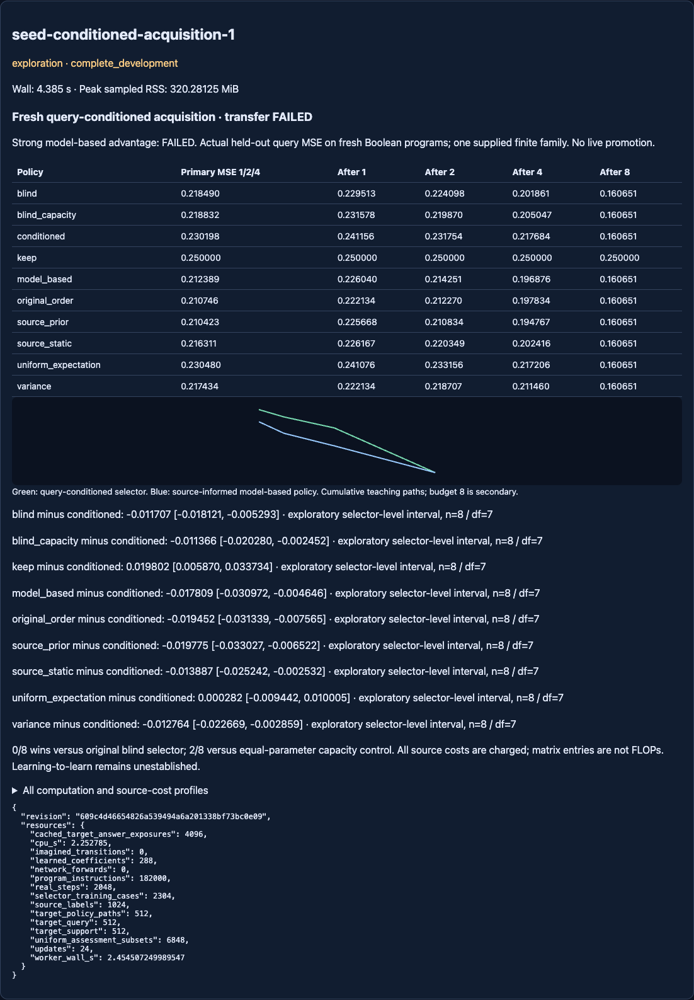

# Fresh query-conditioned acquisition — both screens FAILED

## Outcome

The query-conditioned selector performed worse than both query-blind controls
and both strong model-based policies. It failed the registered transfer and
strong-advantage screens. This is a complete, valid negative development run,
not an incomplete execution. No retry, retuning, live promotion or main merge.

Primary query MSE averages teaching budgets 1/2/4, then tasks inside each of eight
source-trained selector repetitions, then repetitions equally. Lower is better:

- **conditioned (13 coefficients): 0.230197913**.
- blind (original 10): **0.218490472**.
- blind_capacity (13): **0.218831751**.
- variance: **0.217433857**.
- model_based (uniform prior): **0.212388827**.
- source_prior (source-informed model-based): **0.210423097**.
- source_static: **0.216310788**.
- original_order: **0.210746148**.
- uniform_expectation (exact random-subset expectation): **0.230479520**.
- keep/no teaching: **0.250000000**.

Conditioned MSE is **5.36% higher** than the original blind selector. It beats
that selector in **0/8 repetitions** and the equal-coefficient control in **2/8**.
Only **17/64 individual tasks** improve versus blind; those tasks are not 64
independent trained models. Twenty tasks have conditioned primary MSE above keep.
Original order is a very strong cheap reference in this authored distribution.

The prior source audit remains valid: omitting public query information can
prevent an optimal choice under the supplied model. That does not imply these
three geometry summaries learn the required posterior relationships. Useful
learned questioning and learning-to-learn remain unestablished.

## Registration, provenance and scope

Branch `codex/seed-query-conditioned-acquisition` starts from fetched, clean
`a290b4a10da40db27bc2c41c754d45e7dfbba11d`. Protocol and implementation committed
BEFORE outcomes at **609c4d46654826a539494a6a201338bf73bc0e09**.

- [Locked protocol](NEXUS_SEED_CONDITIONED_ACQUISITION_PROTOCOL.md).
- [Executable configuration](../configs/seed_conditioned_acquisition.json).
- [Raw tasks, source cases/models, paths and costs](../artifacts/seed_conditioned_acquisition.json).
- [Independent verification](../artifacts/seed_conditioned_acquisition_audit.json).

Raw SHA256: `f4faa9ea0967a4b2109f1bccc0e5bbf81a40a73ae42d1af8e4667e5d588ab673`.
Config SHA256: `074e8391881e0da674b402841bd4ddfce9272a999c76236aa3076d1edf7c720e`.
Protocol SHA256: `fb755d2141653195ae9b09969588157bcabccda81f8b0d01d7b5f5ff051f0a96`.

All 128 new source/target Boolean program identities are distinct from each
other and all 192 previously registered acquisition programs. Source and target
have eight tasks each per repetition and matching [1,1,3,3] strata. This reduced
source size and new mixture were registered BEFORE collection because the old
two-term stratum lacked enough unused functions. They apply to every current
method. Absolute scores cannot be compared across old/new banks as an effect
of query conditioning. One supplied 910-program family is not general language
learning, control or independent confirmation of broad intelligence.

The fixed uniform version-space learner, original ten features, source utility
construction, LabelOracle, numerical ridge implementation and resource host
were reused. The only old API change is an optional source-count argument with
default 16; historical arithmetic remains unchanged. The two new 13-coefficient
models match rows, ridge, coefficient count and data budgets, but their feature
semantics and effective rank differ. This is not matched FLOPs or causal proof.

## Registered comparisons and uncertainty

Intervals below are **baseline minus conditioned** MSE; positive favors
conditioned. Paired exploratory 95% t intervals across eight selector fits,
df7, t=2.364624251, conditional on one supplied finite catalogue:

- blind: **−0.011707441 [−0.018121450, −0.005293432]**.
- blind_capacity: **−0.011366162 [−0.020280097, −0.002452226]**.
- variance: **−0.012764056 [−0.022669145, −0.002858967]**.
- model_based: **−0.017809085 [−0.030971924, −0.004646247]**.
- source_prior: **−0.019774816 [−0.033027370, −0.006522262]**.
- source_static: **−0.013887125 [−0.025242244, −0.002532005]**.
- original_order: **−0.019451764 [−0.031338553, −0.007564976]**.
- uniform_expectation: **+0.000281608 [−0.009442165, +0.010005380]**.
- keep: **+0.019802087 [+0.005870402, +0.033733773]**.

No reliable improvement over random expectation is established. The required
5% improvements and positive intervals versus both blind controls fail; the
6/8 blind-win rule fails. The .005 noninferiority margin fails against both
model-based controls. Strong model-based superiority also fails. Integrity and
known-prefix retention pass, but cannot rescue the quality screens.

Programs were sampled globally without replacement, so repetitions share a
finite prior and are coupled by exclusion. Prefixes, query inputs and tasks
are not extra trained-model replicates. All intervals are exploratory, not
independent world-model or environment-family confirmation.

## Curves and repetition/task sensitivity

Cumulative query MSE after 1 / 2 / 4 / 8 revealed teaching examples:

- Conditioned: **.241156 / .231754 / .217684 / .160651**.
- Blind: **.229513 / .224098 / .201861 / .160651**.
- Blind capacity: **.231578 / .219870 / .205047 / .160651**.
- Uniform model-based: **.226040 / .214251 / .196876 / .160651**.
- Source-informed model-based: **.225668 / .210834 / .194767 / .160651**.
- Original order: **.222134 / .212270 / .197834 / .160651**.

All nine non-keep methods converge to identical budget-eight predictions from
the same eight teaching rows. Budget 8 is secondary. Unlike earlier isolated
next-update audits, these are genuinely cumulative teaching paths; chosen
earlier answers change the next posterior.

Repetition suffix 1–8: primary conditioned / blind / source_prior MSE:

1. .224671 / .208850 / .197144.
2. .240964 / .237065 / .220733.
3. .229974 / .221260 / .235307.
4. .255765 / .237774 / .232240.
5. .232273 / .224657 / .212788.
6. .235571 / .211659 / .188209.
7. .225099 / .223965 / .222221.
8. .197266 / .182695 / .174741.

Every task's four budgets, predictions, revealed labels, score vectors, retained
hypotheses and costs are in the raw artifact. Largest primary regression against
blind is task1747200003 (+.105571); largest improvement is task1747200002
(−.072042). These are descriptive extremes, not new hypothesis tests.

## Focused diagnosis, without a new experiment

Post-hoc arithmetic on SAVED source matrices, with no fitting or selection:
mean in-sample utility-prediction MSE is .001236147 for blind, .001181596 for
blind_capacity and .001198992 for conditioned. Conditioned improves its source
fit versus blind in every repetition, yet loses on target prediction in every
repetition. Compute from each saved case as `(X / scale @ beta − utility)^2`.
This training loss is not a success metric.

Candidate-to-query Hamming-distance summaries do not encode the posterior's
joint candidate/query predictions or dependencies. Whether that omission,
realized utility-label noise, small source diversity, or selected-prefix
distribution shift caused the harm is unresolved. The data do not justify an
architecture enlargement, regularization sweep, or conclusion that query
conditioning is inherently harmful. Do not tune on this now-closed target bank.

## Data boundaries and reproducibility

The pure extra-feature function accepts only candidate/query INPUTS and a cost
counter. No unasked answer, query outcome, task ID or updated candidate model
enters it. Source-only cases/normalization fit all three selectors before any
target paths. Choices lock before answer revelation; all target paths complete
before independent query labels are collected. Source and target true programs
are disjoint, and teaching/query inputs within each task are disjoint.

The source-informed baseline legitimately infers source strata from original
source observations; no target identity/physics metadata enters a selector.
All predicted probabilities use the same fixed uniform posterior, including
that baseline. Known teaching labels remain exactly consistent with every
retained hypothesis. This is logical prefix retention, not broad lifelong
retention evidence. No historical neural checkpoint or live policy changes.

Independent reconstruction uses an algebraic parity table rather than the
runtime interpreter, source-only RMS/normal equations rather than the ridge
API, and weighted squared-error outcome branches rather than expected_gain.
It verifies all 2304 source cases, 24 coefficient/scale pairs, 512 target paths,
6848 random-subset assessments, per-task/block means and paired intervals.
Numerical tolerance 1e-12; coefficient tolerance 1e-10. Score ties retain the
registered stored-score argmax after independent score verification to 1e-12;
the host also exactly replays the canonical implementation and paths.
All 826 prior artifacts, frozen neural JSON checkpoints and execution source
hashes passed. Explicit config registry: 262 files; coverage does not certify
unavailable external runs or arbitrary implicit historical seed formulas.

## Resource accounting

- One execution; cap60 s CPU/wall, 2048 MiB sampled RSS,2500 authored labels,
  24 numerical ridge fits. No retries or budget changes.
- Host wall **4.385213500 s**, worker wall **2.454507250 s**, CPU **2.252785 s**.
- Peak sampled RSS **320.28125 MiB**.
- Actual **2048 authored labels**:1024 source,512 target teaching,512 target query.
- **4096 cached method answer exposures**,512 policy paths; these are not new
  interactions. No simulator steps, neural forwards or imagined transitions.
- 2304 shared source utility cases,24 new small ridge fits,288 coefficients plus
  their source RMS values. Historical frozen weights remain untouched.
- 182000 public interpreter instructions. Query geometry:18432 source plus18432
  target distance operations. Blind-capacity interactions:6912 source plus6912
  target. Three learned selectors each perform2304 target ridge predictions.
- Source data/utility construction uses7002596 matrix entries shared by the
  three fits. Exact random assessment uses18622893 entries. Keep assessment
  additionally materializes64*910*8=465920 entries; this is evaluator work,
  separate from executable-policy selection costs.
- Isolated-method source-inclusive matrix proxies: conditioned7470275,
  blind7466096, blind_capacity7457441, model_based15363803,
  source_prior16233669, source_static5776047, variance1316395,
  original_order542457. Profiles charge appropriate source construction to
  each method, not all combined fits. These stand-alone proxies are derived
  from shared accounting, not separately timed executions. Geometry, ridge linear algebra, allocation,
  hashes, serialization and verification are not hidden in a FLOP claim; whole
  execution wall is reported separately. Lower proxy cost does not rescue the
  conditioned selector's lower quality; original order is cheaper and stronger.
- Ledger debit **6 s**. Carried **2005.6321034559958 s used /
  1594.3678965440042 s remaining**. Main/unrelated files unchanged.

## Tests and read-only GUI

Before collection:86 focused tests, then105 expanded regression/evidence tests
passed in71.31 s, plus the independent reference math test in.29 s. Browser
script syntax, repository links/preservation and diff checks passed. Ordinary
tests use known synthetic arrays and never launch the registered study.

After saving outcomes, **1054 broad regression tests passed in318.04 s**:
`tests/test_seed*.py`, Lab sessions/release, planning, expressions, factory and
Evolution-2 planner quality. This includes the new saved-evidence replay and
independent arithmetic receipt checks. Repository consistency passed for85
active documents,394 local links,2010 preserved files and20 explicitly recorded
code changes. `git diff --check` also passed. These checks are engineering
verification, not additional scientific runs or new confirmation data.

The existing GUI now displays all ten controls, curves, intervals, both failed
screens and computation profiles. Fourteen read-only browser checks passed,
including actual resource counts and mobile overflow. Screenshot visually
checked; no live promotion. Open `/experimental#seed-conditioned-acquisition-1`.



Commands, using the local dependency environment for NumPy/pytest:

```sh
env PYTHONDONTWRITEBYTECODE=1 OPENBLAS_NUM_THREADS=1 OMP_NUM_THREADS=1 \
PYTHONPATH=src:/Users/ajayghimire/Projects/nexus-ai/.deps \
python3 -m pytest -o addopts= -q --tb=short tests/test_seed_conditioned_acquisition.py \
 tests/test_seed_source_acquisition.py tests/test_seed_source_acquisition_evidence.py \
 tests/test_seed_query_context.py tests/test_seed_query_context_evidence.py \
 tests/test_seed_experimental.py tests/test_learning_lab_sessions.py tests/test_learning_lab_release.py
python3 scripts/verify_seed_conditioned_acquisition.py
python3 scripts/check_repository.py
```

The broad regression invocation used the same environment and pytest flags,
with `tests/test_seed*.py tests/test_learning_lab_sessions.py
tests/test_learning_lab_release.py tests/test_planning.py tests/test_expr.py
tests/test_factory.py tests/test_evolution2_planner_quality.py`.

## One next experiment

**A source-only utility-label reliability audit on saved source cases.** Compare
realized single-task utility targets with the fixed learner's posterior-expected
gain, measuring sign/ranking disagreement and variation before fitting another
selector. Keep target outcomes closed and current models/features frozen;
zero new labels or simulations. This can test a specific possible explanation
for better source fit but worse selection. It has not run here. No architecture
sweep, target retuning, control or general learning-to-learn claim is justified.
