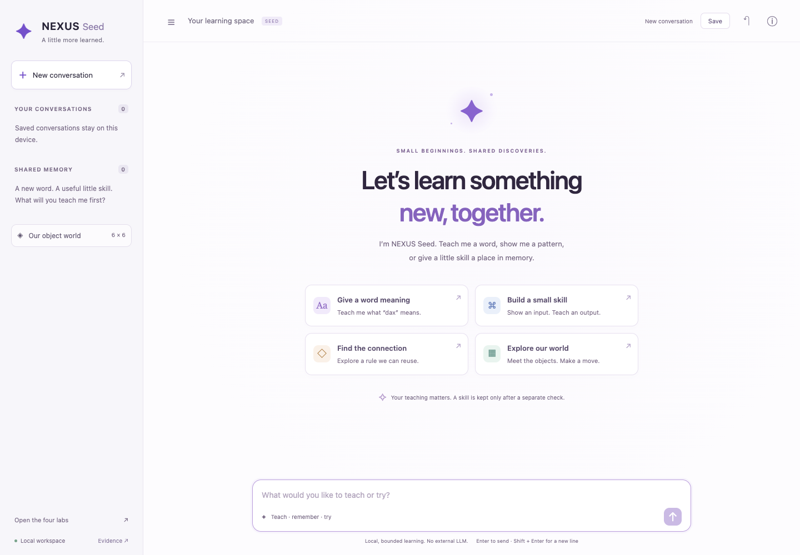
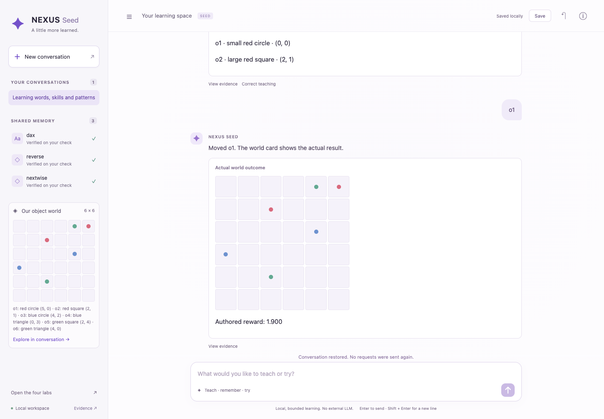
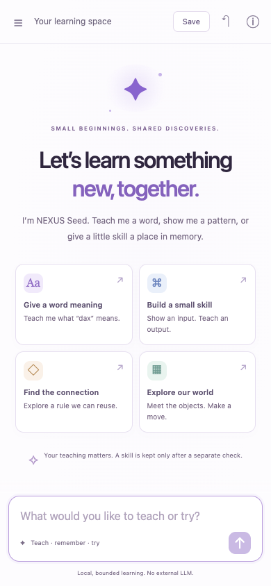

# NEXUS Seed conversation workspace

The original chat/Session interface remains the only conversational application.
This checkout adds a local file/procedure workspace on that same Conversation,
SeedWorkspace and E1 journal path, plus an optional owned pretrained runtime.
It is interface engineering, not a scientific experiment or evidence of
learning-to-learn. Closed assistant-benchmark artifacts stay untouched.

Feature branch **cursor/seed-local-conversation-workspace**, starting from
reviewed repair **codex/seed-config-repair-baseline**
`e178b6d250f02c4958802c895aa29da1e6220c87`. Historical experiments are
preserved. Main is not modified.

## Open it

From this feature checkout, no API key is needed:

```sh
python3 -I -S scripts/run_seed_shared_gui.py --symbolic --port 8784 --max-runtime-s 900
```

Optional local model (ordinary chat and unclear structured parses). Weights are
not in Git; set paths for this machine:

```sh
export NEXUS_MODEL_PATH=.models/qwen2.5-0.5b-instruct-q4_k_m.gguf
export NEXUS_LLAMA_SERVER=llama-server
python3 -I -S scripts/run_seed_shared_gui.py --symbolic --port 8784 --max-runtime-s 900
```

Open **http://127.0.0.1:8784/** or `/chat`. The server stops after 15 minutes.
A tiny authored CSV lives at `fixtures/seed/conversation_workspace_sample.csv`.
Name that path in chat, then ask for grouped totals or individual rows. Results
are written under the Seed directory `outputs/` and never overwrite the source.
Say “save this procedure”, restart, restore the conversation, then reuse it.
If the model file or `llama-server` is missing, ordinary chat reports
`local_model_unavailable` instead of substituting a template.
The existing `nexus serve --mode symbolic` launcher also serves chat at its root.
To use the original owner-hash-verified shared encoder, omit `--symbolic` and
use the existing optional dependencies/checkpoint launcher. The UI QA used the
stdlib symbolic path: zero neural inference or training. The separate old
neural action-controller UI remains at `/seed`; chat uses the shared-lab world
path and does not mix recurrent controller states.



## Try a conversation

- “Hello” / “What can you do?”
- “I want to teach you a word.” → “dax” → “A dax means a red object.”
  Then supply yes/no for the separately proposed check object.
- “What does that word mean?” / “What have you learned?”
- “Teach you a skill from examples.” → “reverse” →
  `[3, 1, 2, 1] -> [1, 2, 1, 3]`. Check separately with
  `[4, 0, 4, 2] -> [2, 4, 0, 4]`.
- “Use the reverse skill on [1, 2, 3].”
- “Correct my previous example.” Supply a replacement teaching batch. An old
  verified revision remains until the replacement passes a fresh check.
- “Help me find the pattern.” → “nextwise”. Teach two rows:
  `[2, 0, 1] -> [3, 1, 2]` and `[1, 1, 2] -> [2, 2, 3]`.
  Separately check `[4, -1, 0] -> [5, 0, 1]`.
- “Move the red object to the top-right corner.” There are two red objects in
  the initial scene; choose an ID when asked. “Move it down” reuses only a
  clearly identified previous object. Corners or grid coordinates0–5 work.
- “Save this conversation.” Wait for the actual local revision receipt.

Enter sends; Shift+Enter adds a newline. There is no slash-command requirement.
The bounded parser supports aliases, not general natural-language understanding.
Colors, shapes, sizes, negation and two-property conjunctions use the existing
finite grammar. Definitions supply teacher labels by their explicit meaning;
the system never supplies its own check answer. A small catalogue of list,
motion and relation programs remains authoritative. Relation teaching can use
the guided typed JSON pair format or the supporting Reasoning Lab.

## One Session across chat and labs

`seed/conversation.py` defines an explicit Intent and validated turn/context
wire format. Its parser is pure; its executor delegates to SharedBrain's
lab_teach/check/run/goal operations. File/procedure turns reuse
`assistant_benchmark_v2` skeletons, `ParameterizedAdapterTemplate` capsules and
`PersistentLocalRuntime` when a local model is configured. There is no second
memory, learner, server, database or agent framework. Knowledge stays in
skill_library and explicit procedure files beside the existing Session store.
Objects use existing Session resolution and symbolic working memory. Ordinary
chat is not forced through the sum/rows intent schema. Model text is labeled
separately from execution-backed adapter output. Saving a capsule is reuse, not
an autonomously discovered abstraction or learning-to-learn.

Messages and pending dialogue are append-only `seed_conversation_turn` events
in the SAME Session/E1 Journal. Existing storage saves the entire journal and
world. The browser stores only saved-session IDs, titles and expected hashes,
not an independent knowledge database. Supporting lab links carry the current
Session ID in their URL fragment; they inspect and edit the same live Session.
No new session or copied skill library is created merely by opening a lab.

Save is explicit; New or switching saved conversations saves outstanding changes
first. Browser refresh restores the last saved revision, not unsaved messages.
An unsaved-change close warning protects against accidental navigation. Saved
revisions are local files under the owner-selected Seed directory; screenshots
and public evidence contain only authored fixtures, never private conversations.

Restore validates existing deterministic journal records to reconstruct state.
It NEVER interprets or resends saved chat requests, re-asks a check, calls the
live shared executor, or creates another movement/teaching event. Existing
internal journal replay remains a validation step; stored world/counters/hashes
are unchanged. Reusing a request ID returns its recorded reply; a different
text with that same ID is rejected. Network recovery cannot duplicate a move.

## Everyday behavior

The welcome examples, conversation, memory, world preview and optional evidence
drawer are connected to real operations. Responses arrive after backend results;
proposals are not presented as verified skills. Ambiguity asks a specific
question. Unsupported requests explain the limit and offer a supported action.
Checks stay disjoint and one-use. Corrections supersede evidence without deleting
it. No validation label can become training data for that named skill.

Stop uses the existing out-of-band cooperative cancellation path. It cannot undo
an already completed action; resume explicitly clears pause. New/restore/save
are disabled while a request is pending. Pending requests remain identifiable
after transport failure, with idempotent recovery. Transcript rendering appends
new immutable turns rather than rebuilding the log on inspection/focus changes.

The interface uses local HTML/CSS/JavaScript and system fonts, no CDN, runtime
LLM, build step or extra frontend dependency. Dynamic strings use textContent,
not HTML interpretation. The same loopback/origin/header/body controls apply.
The new page has a self-only script policy. Mobile sidebar focus/escape, dialogs,
visible focus, reduced-motion handling and responsive layouts are included.

## Limits and preservation

Preserved:500 server requests,16 live sessions,900seconds server lifetime,
16KiB request bodies,2048 events/session,100 saved revisions,2MB revision files,
original teaching/search/world caps and typed controller compatibility. Chat
adds3000 characters/message and160 turns/conversation. Oversize save now fails
BEFORE writing a revision that the existing2MB loader would reject; it does not
raise the limit. No permissions, resource meters, scientific gates or closed
splits are changed. No experiment can be launched from chat or its evidence UI.

The carried SCIENTIFIC ledger remains **1971.6321034559958s used /
1628.3678965440042s remaining**. QA uses small explicitly authored object-world
fixtures; actual movement counts are separately reported in the engineering
receipt, rather than claimed as zero interactions. Historical checkpoints and
all prior result artifacts remain byte-identical. No efficacy/AGI claim follows.

## Verification

[Engineering receipt](../artifacts/seed_conversation_engineering.json) records
test commands, browser checks, preserved artifacts and authored-action accounting.
The focused Python suite covers wording, ambiguity, multi-turn teaching, reference
resolution, fresh checks, corrections, program execution, session isolation,
snapshot preservation, duplicate requests, input limits, CSP/origins and save
size checks. Relevant Seed/shared regressions are also run.

Browser QA source: `tests/browser/seed_chat.cjs` (Playwright is a development
test dependency only). Start the server above, then run:

```sh
NEXUS_CHAT_URL=http://127.0.0.1:8784 node tests/browser/seed_chat.cjs
```

If Playwright is provided by a shared runtime, set NODE_PATH to that runtime's
node_modules. The browser script accepts loopback URLs only, preserves partial
attempt accounting under ignored runs/, and uses synthetic teaching fixtures.
It exercises all four flows, successful correction, rejected reused checks,
save/restore, supporting-view Session reuse, actual movement, idempotence,
safe rendering, keyboard behavior,52-turn history, cooperative stop, desktop
and390px mobile layouts. No scientific benchmark is invoked.

Completed verification: **807 relevant regressions passed in175.47s**, and the
final focused conversation/HTTP/layout run passed **42 in2.12s**. Chrome passed
**27 end-to-end checks**, plus four restore/inspection/reference-layout checks
and two browser-storage failure checks. Desktop and mobile screenshots were
visually inspected. Runtime syntax checks passed; no frontend dependencies were
added. These are engineering checks, not independent learning replications.

The first browser attempt stopped after five moves because its JSON comparison
incorrectly treated reordered object keys as a state difference. Correcting that
test to compare values confirmed identical restored state. Two subsequent full
flows passed, five moves each. A separate console smoke used five moves. Thus
**20 live authored moves across ad hoc smoke/browser attempts**, excluding
isolated ordinary unit fixtures; later restore/layout/storage QA added zero.
Partial attempt traces remain under ignored runs/ and their hashes/accounting
are in the public receipt. No scientific ledger debit or efficacy claim follows.




## Current limitations

Supported CSV tools are the two already-vetted operations: grouped totals and
filtered/sorted individual rows on a one-text, one-numeric table. The only
executable numeric filter is an inclusive minimum. Comparisons such as
“below”, negation, conflicting sort, or two files are clarified, not guessed.
A fresh request does not inherit the previous threshold or order; “do the
same” may inherit; a correction edits the last procedure. Cancel is checked
after adapter execution and before an atomic output publish; temps are
removed. Explicit save abstracts the executed AST, not a reconstructed
planner skeleton. There is no arbitrary generated-Python execution.

This is still a finite conversational interface. It does not understand
arbitrary prose, noisy data, unrestricted coding, file uploads or general tool
use. JSON examples remain necessary for complex relations. Name/skill references
are resolved only from explicit current context; ambiguous references request
clarification. A checked user-authored example is not independent scientific
confirmation. World planning is the existing known-grid reference, not newly
improved neural control. Useful learned question selection and learning-to-learn
remain unestablished; the latest failed research findings are unchanged.
Development smokes are not a new assistant-benchmark protocol.
