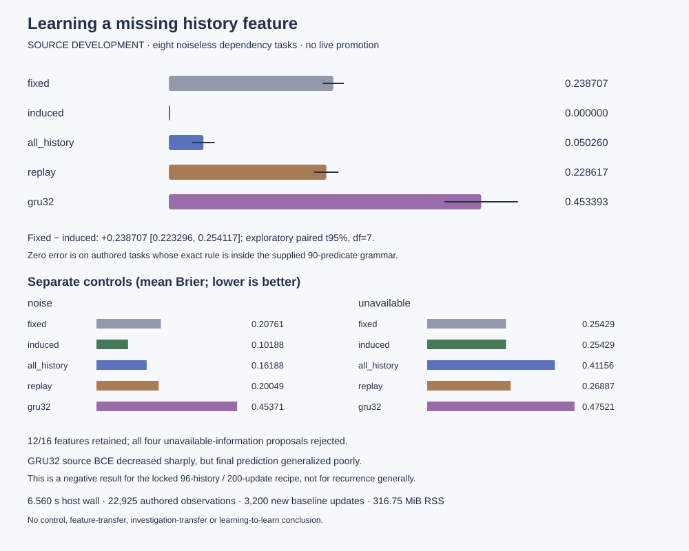

# Executable world model — first source-development result

**Narrow screen PASSED; no live promotion.** A bounded constructor selected useful
history predicates on authored tasks that deliberately omitted those predicates
from the initial explicit state. This does not establish control improvement,
feature transfer, investigation transfer, learning-to-learn or AGI.

## Provenance and execution

Start `e381132c79a2d3c71aed883e54b8577ecd0071ec` (completed conversational
workspace, descendant of the owner's reviewed9080b075). Protocol and tested
implementation committed BEFORE outcomes at
`bc57da126051d0aa5d148fcbf05bb4704f2571e1`, branch
`codex/seed-executable-world-model`. No main merge. Read the immutable
[protocol](NEXUS_SEED_EXECUTABLE_WORLD_PROTOCOL.md),
[architecture/status](NEXUS_SEED_EXECUTABLE_WORLD.md), and
[raw result](../artifacts/seed_executable_world.json).

One complete120-second-cap CPU run; no retries, grid changes, hyperparameter
changes or old holdout access. All16 task candidates were frozen before any
final-scored episode generation. Manifest digest
`5ea76dbb4aea095ae6b78c6bc4db984816e1b026e641ca4da2e3fc5d890ec441`.
Raw result SHA256 `f18adb4df4ba929e4e7f2d262d001420afa3925021328e8bd785031814138115`.
Full config/protocol hashes and new GRU checkpoints are in that artifact and its
host receipt. Source hashes and the clean execution-tree record are preserved in
the [independent provenance audit](../artifacts/seed_executable_world_audit.json),
extracted from the immutable host reservation and checked against the execution
commit. These small JSON weights are new versions; historical
frozen weights are unchanged. Private attempt/progress/frozen-manifest files:
`runs/experimental/attempts/seed-executable-world-1/`.

## Primary endpoint and every baseline

Mean final Brier over the eight noiseless earlier-event/order tasks, lower better:

- Induced feature + empirical table: **0.000000**.
- Same table without history: **0.238707**.
- All90 history predicates + context-interaction ridge: **0.050260**.
- Exact-history replay + fixed-table fallback: **0.228617**.
- Newly source-trained GRU32: **0.453393**.

Fixed-minus-induced **+0.238707**, exploratory paired95% interval
**[+0.223296,+0.254117]**, eight authored task instances, df7. All eight task
differences are positive and the .03 practical screen passes. This interval
conditions on this generator, grammar, data budget and recipe. These are not
eight independently pretrained general world models. Other comparisons are
descriptive, without multiple-comparison-adjusted superiority claims.



The exact matching predicate was supplied in the grammar as one possibility.
Experience selected its category binding and conditional table; it did not
invent the temporal operator or discover an unrestricted physical law. Zero
error here should be interpreted in that deliberately controlled setting.

## Separate controls and per-task outcomes

Earlier-event means (induced/fixed/all-history/replay/GRU):
0.000000 /0.223766 /0.042134 /0.211301 /0.423738.
Event-order means:0.000000 /0.253648 /0.058387 /0.245934 /0.483048.
Noisy-event means:0.101881 /0.207614 /0.161880 /0.200488 /0.453709.
Unavailable-information means:0.254288 /0.254288 /0.411561 /0.268866 /0.475207.

Final accuracy: induced100% for both noiseless groups,87.7604% noisy,
49.4792% unavailable. The latter matches the analytic fair-hidden-bit limit
in expectation (accuracy.5, minimum expected Brier.25). All four unavailable
proposals were rejected. Individual finite estimates can exceed chance;
this study does not demand that every unknowable episode fail.

Each line below gives seed, task kind, fixed→induced final Brier and decision.
Full per-episode predictions, all baseline scores, source arrays, validation
arrays and feature proposals remain in the raw JSON.

- 971000 earlier: .205258→.000000; retain exists(category3).
- 971001 earlier: .227217→.000000; retain exists(category2).
- 971002 earlier: .235109→.000000; retain exists(category1).
- 971003 earlier: .227480→.000000; retain exists(category1).
- 971004 order: .259405→.000000; retain latest1 after latest3.
- 971005 order: .246260→.000000; retain latest1 after latest2.
- 971006 order: .256289→.000000; retain latest3 after latest1.
- 971007 order: .252638→.000000; retain latest0 after latest1.
- 971008 noise: .213818→.079346; retain exists(category2).
- 971009 noise: .207995→.093200; retain exists(category3).
- 971010 noise: .183173→.138047; retain exists(category3).
- 971011 noise: .225472→.096931; retain exists(category1).
- 971012 unavailable: .244580→.244580; reject.
- 971013 unavailable: .269529→.269529; reject.
- 971014 unavailable: .259830→.259830; reject.
- 971015 unavailable: .243214→.243214; reject.

12 of16 feature candidates retained,4 rejected after their one validation decision.
1440 source proposals considered;1424 training-rejected,4 validation-rejected,
12 retained. No validation fallback or second attempt. The registered maximum
candidate retention excess was+.008626, below.01; that maximum includes a
rejected candidate. Among actually accepted candidates, the largest change
was−.127222 (lower retained-source error). Retention used finite prior source
checks, not a general forgetting guarantee.

## Negative baseline finding and limitations

The GRU's source BCE fell from roughly.69 to.0006–.030 after200 updates, while
final Brier stayed poor. This is strong fitting/generalization mismatch under
this recipe, consistent with memorization/overconfidence; it is not a causal
diagnosis or proof that recurrence is inadequate. We did NOT retune it after
reading final outcomes. All-history ridge was a much stronger comparator here.
The new architecture is not scientifically necessary merely because this GRU
recipe failed. Discrete supplied grammar is especially well matched to the
authored generator. No second domain, policy return or online planning efficacy
was evaluated.

The graph IR, bounded BFS, numeric residual, source-trace investigation trees,
Session integration, persistence and rollback are implemented and fixture-tested.
Only history-feature prediction induction was scientifically evaluated. Numeric
residuals and learned investigation reuse were inactive, so no ablation benefit
is claimed. Investigation API reads currently observed history; it does not
silently collect new observations. Real probe callbacks have a separate explicit
counter and require a registered observation backend before a future study.

## Tests, independent audit and GUI

Relevant regression command passed **831 tests in175.52s**:

```sh
python3 -m pytest -o addopts='' -q --tb=short tests/test_seed*.py \
 tests/test_learning_lab_sessions.py tests/test_learning_lab_release.py \
 tests/test_repository_layout.py tests/test_planning.py tests/test_expr.py \
 tests/test_factory.py tests/test_evolution2_planner_quality.py
```

Subsequent targeted compatibility run:86 passed in16.77s. Final new-kernel
tests:26 passed in1.98s, including compatible recurrent training/accounting.
After adding tracked-result tests, one QA assertion initially expected `dirty`
in the final host receipt; that field belongs to the immutable reservation.
The audit supplement now preserves the actual reservation record. Corrected
kernel/evidence run:28 passed in2.17s. No experiment or raw result was rerun/edited.
Final focused structure/evidence/chat/host/repository verification:97 passed in
18.41s. The larger regression and final focused runs are distinct, not summed
as independent test cases or scientific replications.
These use `PYTHONPATH=src:/Users/ajayghimire/Projects/nexus-ai/.deps`, CPU threads1
and no bytecode writes in this workspace. Not every historical research suite
was run. Ordinary tests do not launch the registered study.

Independent stdlib-only command:
`python3 -I -S scripts/verify_seed_executable_world.py` verifies all7680
predictions, task means, paired interval, screen and22925 observations, without
fitting, neural inference or collection. Schema validator also checks the exact
seed/method/episode/checkpoint grid, frozen hashes and separation. Deleting a
task, method, episode, checkpoint or manifest, or inserting NaN/infinity/bools/
numeric strings fails tests. Features cannot read answers, task IDs or metadata;
final outcomes never enter fitting/acceptance.

Chrome GUI contract test `tests/browser/seed_structure.cjs` passed7 checks:
chat, optional structure inspection, observation recording, repeated inspection,
same-journal save/load, unchanged original world, and read-only result display.
No simulator steps/neural calls in that GUI test. Result is shown at
`/experimental#seed-executable-world-1`; chat Evidence offers the optional model
view. These authored GUI fixtures are engineering, not scientific evidence.
[Actual GUI capture](assets/seed-executable-world-gui.png).

791 historical artifacts byte-identical to the starting revision. Frozen core
`artifacts/seed_contract_gui.json` SHA256 remains
`cfe06a6737c8e225564ebcaea9ba4678aabd45b61129828e64354e74fa3c8d1b`;
readout `artifacts/seed_readout_6301.json` remains
`8129cbd4768f4cd5dce938cd8b6740172bf5dbe8742dcb97c497951ad5e87745`.
Unrelated main-worktree files and all closed studies remain unchanged.

## Resources and decision

Host wall6.559924s, worker CPU6.186845s, measured sampled RSS316.75MiB.
22925 newly generated authored observations:9108 source,4650 validation,
9167 final; cached reuse is not new collection. No external environment,
historical replay, imagined transition or live-agent update. New baseline
optimizer updates3200, source examples processed307200, neural forward calls3216,
predicate executions1369472, ridge fits16. Parameter counts per task: fixed4,
induced8 empirical probabilities, all-history364 coefficients (+364 scales),
GRU4065; replay stores96 labels. Search/library AST storage is additional.

Measured summed method wall: induction/validation1.215769s, empirical tables
.003030s, all-history ridge.527213s, replay.000833s, GRU2.502427s, joint final
prediction.552496s. Budgets match observations, not FLOPs. Predicate primitives
and feature-table loops differ substantially from recurrent optimization.

Conservative host debit8s. Ledger now **1979.6321034559958s used /
1620.3678965440042s remaining**, carried forward without reset.

Decision: retain the implementation as OPTIONAL experimental code. It earned a
positive authored source-prediction result, not default-agent promotion. Supplied:
task laws, finite operators, grammar, router, neural architecture and evaluation
rules. Learned: per-task feature selection/conditional probabilities and new
GRU source weights; source-trace decision trees were demonstrated only in tests.

**One next experiment:** freeze a source-learned investigation library, then test
whether its probe ordering improves feature identification on fresh tasks with
new observable category bindings versus fixed-order and no-library induction,
at identical small target-support budgets and separate scored episodes. Explicit
support feedback must identify bindings; no hidden mapping. Proposed cap60 CPU
seconds /5000 authored observations, separately registered before execution.
Not executed in this branch. Earlier utility-label reliability remains a separate
unresolved recorded audit; this result does not answer it.
