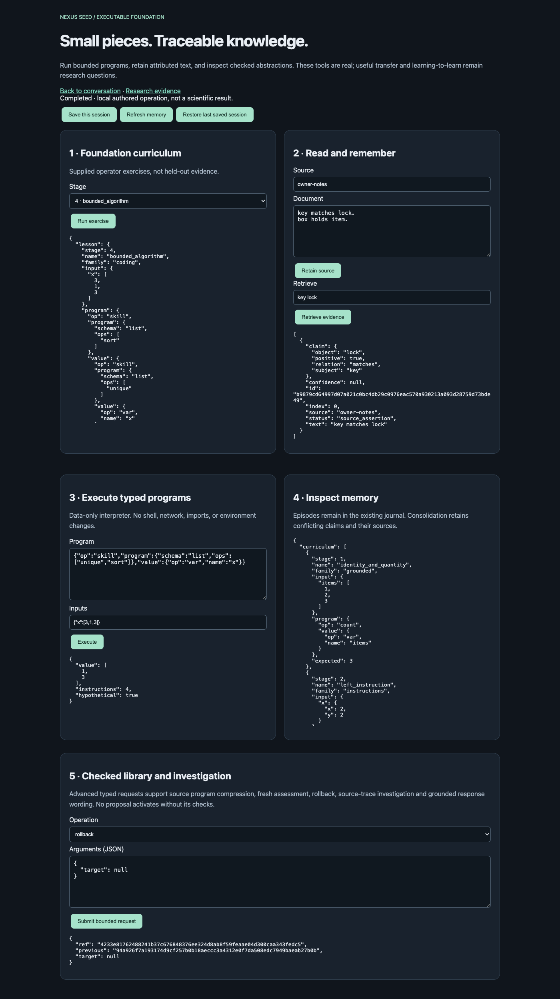

# NEXUS Seed executable foundation

Engineering branch `codex/seed-foundation-learning`, starting from
`5a554a5853cec039d1e3ab6eaefb0c1265d86cec`. The GitHub tip matched locally after
fetch. Main, other worktrees, old artifacts and checkpoints are preserved.

This implements bounded versions of the ten requested building blocks. It does
not claim broad language comprehension, cumulative intelligence, or a better
learning algorithm. No scientific study is run by this change. The previous
feature-induction result and failed question-utility studies remain closed.

## Architecture and reuse

`seed/foundation/` extends the existing `Session` / E1 journal. There is no
second database, policy controller, neural world model or general RL framework.
Save/load uses `seed/storage.py`, and replay reconstructs and verifies every
derived foundation record. The existing SharedBrain, finite concept learner,
checked skill library, frozen GRU/RSSM, readout and structured-history module
remain available. The new code neither updates nor replaces those weights.

1. **Initial foundation.** `curriculum.py` supplies six executable stages:
   quantity/identity, spatial instruction, event ordering, list algorithms,
   conditional instruction, and unknown/correction semantics. These are visible
   starting operators, not secretly supplied evaluation solutions. The small
   paraphrase vocabulary is explicitly supplied, not learned language evidence.
2. **Executable meanings.** Existing conversation teaching learns finite object
   predicates from examples, asks distinguishing questions, and requires a
   fresh check before skill activation. “A dax is an object that is red and
   square” now reaches that same path. List verbs use existing typed programs.
   `semantics.py` adds supplied container recognition, insert/remove predictions,
   capacity/open preconditions and containment-cycle rejection. Unknowns abstain.
3. **Composition.** `programs.py` executes typed JSON expressions: variables,
   lexical bindings, functions, conditions, conjunction/disjunction/negation,
   equality/comparison, bounded iteration, maps, existential/universal predicates,
   assertions and temporal operators. Existing list/motion/predicate/relation
   primitives are delegated to `skill_programs`, not reimplemented. Existing
   graph mechanisms and bounded graph planning remain usable for observed state.
4. **Library learning.** `library.py` discovers repeated contiguous list-operator
   sequences across source tasks. It proposes a parameterized function of `x`
   only if its definition and invocation tokens compress the source programs.
   Separate new task IDs and input values test actual macro execution. A bounded
   example-directed search compares the existing primitives with/without the
   proposed macro, counting all calls. Every check task must be solved with
   fewer instructions using the macro; compression without search benefit fails.
   The same authored search examples are available to both searches, not hidden
   evaluation queries. A proposal gets one assessment. Failed proposals and
   consumed check rows remain recorded. Runtime versions can be rolled back.
   Original checks and source programs are retained. Macro compression reduces
   representation/search tokens, not primitive execution work. This first
   implementation does not anti-unify arbitrary file-editing procedures or
   establish that macros improve future search scientifically.
5. **Investigation.** `inquiry.py` scores unlabeled questions by uniform
   version-space information gain minus declared cost and risk, with abstention.
   It does not pretend to estimate decision gain. Source traces train the
   existing `structure.investigation` decision tree. Its execution requests
   observed probe answers. GUI replay counts supplied-answer reads separately
   from new interactions. Transfer and label reliability are not established.
6. **Progressive curriculum.** All six exercises can be executed from the GUI.
   Their expected values are public authored checks, not generalization tests.
   New held-out combinations and task families must be separately registered
   before making curriculum-effectiveness claims. Existing teaching and fresh
   assessment separation is retained.
7. **Two memory views.** Episodes/source documents remain in the immutable
   journal; semantic facts, conflict groups, macro versions, probe programs and
   rehearsal references are projections. Consolidation groups repeated claims,
   keeps representative positive/negative evidence, and never deletes original
   episodes or overwrites contradictions. Shared checked concepts remain in the
   original skill library. No majority vote converts assertions into truth.
8. **Grounded wording.** `language.py` learns smoothed categorical wording
   probabilities from source-only surface feedback. All allowed surfaces retain
   decision, reason, uncertainty and evidence slots. References must exist.
   This is a compact trainable surface decoder, not a newly trained recurrent
   language model or unrestricted generator. The existing neural language path
   is preserved. Evidence existence does not prove the owner's stated reason;
   outputs are labeled attributed records, not independent verification.
9. **Controlled ingestion.** Small local text documents are segmented, hashed,
   retained verbatim, retrieved and consolidated. A narrow explicit triple
   grammar extracts `is`, `inside`, `requires`, `matches`, `before`, `after`,
   `holds`, including negation. Unrecognized prose stays retrieval-only. There
   is no automatic downloading, arbitrary code execution, or LLM extraction.
   Sources may be untrusted, and extracted claims remain source assertions.
10. **Learning-efficiency measurements.** `learning_curve` validates exact
    externally declared method/family/1–2–4–8 grids and aggregates actual success,
    retention, questions, instructions and stored complexity. It rejects missing,
    duplicate, nonfinite and malformed cells. It does not fabricate observations.
    No scientific learning-efficiency curve was measured by the GUI exercises.

## Use it

Run the existing bounded server from this research checkout:

```sh
PYTHONPATH=src python3 scripts/run_seed_shared_gui.py --symbolic --port 8785 \
  --max-runtime-s 900 --seed-directory runs/seed-foundation-sessions
```

Open `http://127.0.0.1:8785/foundation`. Select and run a curriculum stage,
execute the supplied typed program, or retain and retrieve your own text.
The advanced request form accesses real library proposal/review/rollback,
investigation, question selection, container prediction and wording endpoints.
Save retains the same Session journal; Restore verifies its saved hash.

Chat commands “show foundation” and “remember text: key matches lock.” access
the same memory. Teaching concepts and programs still uses the existing chat
conversation. `/foundation#session=...` and `/chat#session=...` share the session.

All foundation requests use the existing `/api/seed` endpoint:

```json
{"session_id":"existing-id","request":{"op":"foundation_execute","args":{
  "program":{"op":"skill","program":{"schema":"list","ops":["unique","sort"]},"value":{"op":"var","name":"x"}},
  "inputs":{"x":[3,1,3]}
}}}
```

`foundation_propose` accepts `programs`, each with `task`, `ops`, and labeled
`examples`. Its response contains a journal `ref` and source-only candidates.
`foundation_review` takes that `proposal` ref, a `candidate` id, and separate
`checks` in the same task shape. `foundation_execute` can then call the accepted
`macro` with an `x` input. `foundation_rollback` selects an accepted review ref
or `null`; it never erases evidence or frees consumed checks.

## Bounds, correctness and costs

The interpreter permits at most128 AST nodes/depth8,32-item data,16 repetitions,
8 function-call levels, no recursion, and512 instructions by default (hard4096).
One meter includes recursive evaluation and existing primitive operations.
Each request is synchronous and bounded; nothing runs in the background.
Document limits are16 documents,8,000 characters/64 units each; foundation
journal128 events, source programs24, one-use review2–8 tasks, probe depth3.
The existing HTTP/session/storage caps remain in force.

Predicted motion/container changes are returned as hypothetical copies. They do
not change the live world or recurrent state. Real world actions remain the
original separately routed controller operations. Inspection has no side effects.
No security setting, historical evaluator, resource meter or budget is relaxed.

The carried scientific ledger remains1979.6321034559958 seconds used and
1620.3678965440042 remaining. Deterministic engineering fixtures are not a new
scientific experiment; there are zero scientific interactions, model calls or
training updates for this addition. Tests do exercise the finite source-trace
learner, empirical wording counts and macro search on explicit fixtures.

## Verification and next scientific question

See `tests/test_seed_foundation.py` for executable semantics, unknowns, loop
limits, source-only learning, check isolation, rejected promotion, rollback,
save/restore, answer-free questioning and complete-grid tests. Browser checks
exercise the actual HTTP server and save/restore, not a mocked response.
Exact commands/results are recorded in the engineering receipt.

Implementation revision: `4bacea5f73952726792b2d8d266f2e5557914023`.
[Machine-readable engineering receipt](../artifacts/seed_foundation_engineering.json)
records 853 broad regression passes (174.61s, before the final search-cost gate),
95 final focused passes (4.28s), and nine passing browser checks. Repository,
JavaScript syntax and whitespace checks passed. Initial missing client-header
and trivial positive-fixture failures were corrected and are recorded, not
scientific failed runs. All795 historical artifacts and the frozen core/readout
hashes matched the starting revision.

On the explicit list-program fixtures, the discovered macro reduced bounded
search from59 candidates /337 interpreter instructions to2 candidates /10
instructions on each of two check inputs, with identical correct outputs.
The test also rejects a macro when identity already solves the checks. These
are deliberately authored implementation checks, not a held-out task-family
study or evidence of general cumulative learning.



One next experiment: does a frozen source-learned investigation procedure reduce
questions needed on fresh tasks relative to fixed-order and no-library controls,
with identical available teaching and independent scored examples? This remains
unrun. The new foundation makes the operations executable; it does not answer
that scientific question or justify claiming learning-to-learn.
