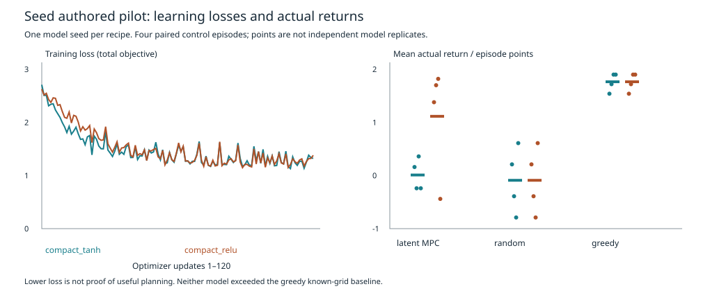

# Seed grounded-agent implementation and first bounded pilot

## Outcome

The requested eight-component prototype is connected and runs in the real local
GUI. The first pilot is **complete and finite, with mixed/negative capability
results**. It does not demonstrate general learning, transfer, learning-to-learn
or AGI. The historical finite Seed comparison remains incomplete and untouched.

Implementation/protocol: `5669389`; UI completion and clean execution revision:
`fd957655ae1acde41d55d05e10e9b5c3dcfbf3cf`. An initial preflight refused to run
because the GUI file was not yet staged; it collected no data and created no
claim. The single actual run began only after that file was committed. No model
was rerun, extended or selected after seeing results.

The one-source-seed recipes differ in trunk width/activation and parameter count.
They are not independent replications of the same algorithm or equal capacity.
Both used the same collected source/query data and reset seeds. Deployment stayed
with the predeclared tanh recipe despite its worse observed control result.

Final relevant regression: **88 passed in 9.12s**, with the same eight-file
selection listed in the protocol and four additional grounded checks. Browser
checks and repository/independent accounting audits also passed. This is a
relevant suite, not a claim that every historical test in the repository passed.

## Actual measurements

- **Tanh, 30,278 parameters:** normalized sensor-state MAE 0.3530; reward MAE
  0.1564; done BCE 0.1127; exact generated trace 1/44 (2.27%). Mean twelve-step
  latent-MPC return **0.010**, success **0/4**. Random: −0.090, 0/4; greedy
  known-grid policy: **1.765, 4/4**. Paired MPC-minus-random point estimate
  +0.100, MPC-minus-greedy −1.755. Training: 2.015 seconds.
- **ReLU, 28,870 parameters:** state MAE 0.3519; reward MAE 0.1495; done BCE
  0.1676; exact trace 3/44 (6.82%). MPC return **1.115**, success **3/4**;
  identical random/greedy means −0.090 / 1.765. MPC-minus-random +1.205;
  MPC-minus-greedy −0.650. Training: 1.629 seconds.

No seed-level confidence interval is justified: n=1 per recipe. Four episodes
are paired descriptive observations, not four independently trained agents.
Prediction MAE averages twelve authored normalized features; it is not raw-unit
physics prediction or proof that text/pixel grounding was learned. No untrained
prediction baseline was registered, so these numbers alone establish no
prediction-learning advantage. Gradients and lower losses establish optimization
paths, not useful control. Tanh total loss fell 2.709→1.321; ReLU 2.627→1.380.

## GUI and implementation verification

Real headless Chrome 155.0.8059.84 passed connection, authored pixel canvas and
three-modality observation, actual latent-MPC action, asking/answering a real
label, local decoder candidate exposure, factual fallback, Python restart with
matching h/z, stop enforcement and mobile layout. No external requests or page
errors occurred. The unchanged stdlib-only GUI also passed teaching, composed
action, correction, immutable prior snapshot, process restart and historical
read-only replay checks.

With twelve actual red/not-red labels across both scenes, the trained tanh
program proposer **failed** its training/development adoption checker. It was
rejected, not silently replaced with exhaustive symbolic discovery. The neural
proposal/store/retrieve path is implemented and tested with an informative
controlled fixture, but useful learned concept induction is not established.
The original finite version-space learner remains usable for teaching.

Runtime correctness fixes after the locked pilot: explicit work-counter display,
accurate architecture inspector, no double action-cost charge when information
feedback arrives, proposed-program training consistency, and per-primitive macro
boundary behavior matching the training world. These do not change saved pilot
weights/results; no post-fix comparative experiment was run. Models remain frozen.

The local language head actually generates, but its low exact rate requires a
factual-template guard. It is not a general conversational model. Prototype
retrieval and outer recipe adaptation have functional gradient/feedback tests,
not evidence of useful semantic memory or better learning methods. The GUI outer
adapter cannot launch training or change evaluation rules/permissions.

## Resources and reproducibility

- Wall time **4.325297958 seconds**; local CPU, one PyTorch thread; Python 3.13.5,
  PyTorch 2.14.1. Peak process RSS **324,337,664 bytes** (includes framework).
- **626 authored macro-steps:** 367 training collection, 44 prediction queries,
  215 control evaluation. A macro has at most two primitive moves. These are
  new authored Seed interactions, not Gym/old research evaluations.
- **4080 imagined planner states**, distinct from training computation. Each
  decision uses 48 states / five batched transition calls. Additional source
  training and evaluation encoder/head work is separately logged per model.
- 240 Adam updates total; 7680 sampled coherent transition presentations and
  1920 program-example presentations total. No historical checkpoint retraining.
- Configuration hash `df9d7c4cbc11079c54d6512acbc4412236cf160cf4006ffec88e40e11a456c6d`.
  Source hash `1a6f2d5e9190faecf9784c54857b1914c8c82b7f7e8a16c8c0f6ec6671cd0c51`;
  query hash `0f964f24c6ed49d277de6f32e8eebf9e2d66d75edb756aebcaa8f360e9a043a9`.
- Tanh JSON hash `934b4f51a9cf3788e28ae06693b3aaf39f8e8a9e4882ac7d47fff622ddf545ef`;
  ReLU `166d204aeee5ce242c6e913e68c872647baa962c668e493b8205dc82ae57e16f`.
  Both are small bounded JSON, included with raw results for reproducibility.

`python3 scripts/verify_seed_grounded.py` independently verifies hashes, exact
expected grids, reward/return identities, finite metrics and interaction totals
without executing a model or world. The comparison runner refuses a second run.

The broader pre-execution legacy test command passed 84 tests and failed one
child-process dependency check. That test executed eight fresh CartPole fixture
steps before its child could not import PyTorch; it was not rerun or mislabeled
passing. Conservative nine-second debit is recorded in the protocol. A separate
clean relevant suite passed 84 tests before collection; final expanded regression
counts are recorded in the delivery receipt. A conservative six-second debit
covers the 4.325-second pilot and read-only audits: carried session total
**1860.6321034559958 used / 1739.3678965440042 remaining**. GUI/unit QA is reported
separately and does not serve as scientific replication.

## One next scientific question

On separately registered authored states, does the learned world model rank the
nine actions correctly against their exact environment outcomes? Test this
before adding capacity or extending training. The current architecture exists;
reliable decision quality remains the missing evidence. No follow-up runs here.
