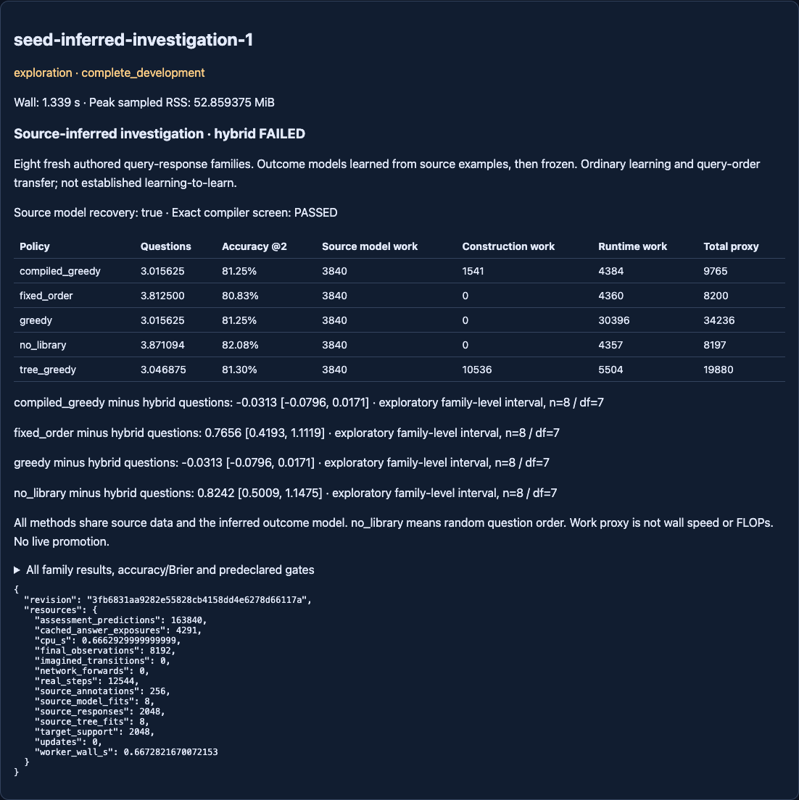

# Source-inferred investigation — complete, learned-hybrid screen FAILED

Branch `codex/seed-source-inferred-investigation`, base
`b480a507f005c41340c518ce483a3e27383cc78e`, matching fetched GitHub.
Clean execution **3fb6831aa9282e55828cb4158dd4e6278d66117a** committed the tested
implementation, [protocol](NEXUS_SEED_INFERRED_INVESTIGATION_PROTOCOL.md) and
[config](../configs/seed_inferred_investigation.json) before one run.
[Raw records/models/choices](../artifacts/seed_inferred_investigation.json),
[independent verification](../artifacts/seed_inferred_investigation_audit.json).
No retry, protocol relaxation, neural retraining, live promotion or main merge.

## What was learned and what was not

Eight new independently drawn response tables use opaque classes/questions,
rather than the prior supplied eight-law truth table. Thirty-two labelled source
instances per table reveal their responses. Source inference recovered all eight
64-cell outcome tables exactly; those models and source ID3 trees froze before
any target interaction. Each method then used the SAME inferred outcome model,
uniform target-class prior, support bank and final episodes.

This is ordinary supervised table reconstruction and investigation reuse on
new instances of already source-observed classes. Full, noiseless source
coverage makes reconstruction possible by lookup. It is a correctness milestone,
NOT evidence that NEXUS learned a better learning algorithm. All eight tables
have distinct fingerprints, but share one authored schema; they are not eight
physical environment families or eight neural pretraining replications.

## Primary outcome and all controls

Mean questions until identification, averaged inside each family then across8:

- Source-trained tree + greedy fallback: **3.046875**.
- Source-informed compiled greedy: **3.015625**.
- Source-informed online greedy: **3.015625**, exactly matching compiled.
- Fixed original question order: **3.812500**.
- Random question order (`no_library`): **3.871094**.

The hybrid fails the predeclared zero mean-regression condition versus compiled
greedy, and fails the20% construction-inclusive efficiency condition. Accuracy
tolerance alone is satisfied. Weak fixed/random comparisons pass. Do not drop
the failed strong-baseline conditions after seeing these results.

Baseline-minus-hybrid questions, exploratory95% paired t intervals across EIGHT
independently sampled response-table families (df7, not256 target tasks):

- Compiled AND online greedy: **−.031250 [−.079625,+.017125]**.
- Fixed order: **+.765625 [+.419310,+1.111940]**.
- Random order: **+.824219 [+.500930,+1.147507]**.

The strong-baseline interval includes zero. This is not established statistical
harm, nor an inconclusive execution: execution is complete and valid, and the
registered advancement screen failed. Compiled and online traces, posteriors,
snapshots and predictions match EXACTLY for all256 target instances.

Per-family questions (hybrid / compiled / fixed / random):

- 1743000001:3.000 /3.000 /3.750 /4.37500.
- 1743000002:3.125 /3.000 /3.750 /3.40625.
- 1743000003:3.250 /3.125 /4.125 /4.21875.
- 1743000004:3.000 /3.000 /4.375 /4.06250.
- 1743000005:3.000 /3.000 /4.250 /4.15625.
- 1743000006:3.000 /3.000 /3.375 /3.71875.
- 1743000007:3.000 /3.000 /3.750 /3.34375.
- 1743000008:3.000 /3.000 /3.125 /3.68750.

Only families2/3 contribute positive hybrid-minus-greedy question regret. All
methods' raw final predictions and all task-level results are retained. Source
class frequencies vary (e.g. family2 counts5/6/4/2/5/4/4/2); targets are uniformly
balanced. A compressed tree's source-frequency prior mismatch is a plausible
lead, not a demonstrated causal explanation or permission to retune this set.
No balanced-prior tree control was run, so prior mismatch is not isolated from
other criterion/compression effects. This does not rule out better learned
investigation procedures.

## Prediction quality is distinct from identification cost

Accuracy after1/2/4/8 questions:

- Hybrid:71.7407% /81.2988% /100% /100%.
- Compiled/online:72.0703% /81.2500% /100% /100%.
- Fixed:71.3989% /80.8350% /96.0938% /100%.
- Random:73.2788% /82.0801% /95.8008% /100%.

Thus greedy does NOT dominate every early classification-accuracy measurement.
Its budget-two Brier.095072 is lower than hybrid.095982, fixed.112702 and
random.103198. The greedy selection criterion is class-partition information,
not direct optimization of final binary-prediction accuracy. Neither a ceiling
at budget8 nor a lower search count establishes learning-to-learn.

## Full construction-inclusive accounting

All five hypothetical pipelines pay the same **3840** source-model work units:
2048 response reads +1536 repeated-row consistency comparisons +256 class-label
reads. Then add construction and runtime separately:

- Compiled:3840 model +1541 compilation +4384 runtime = **9765**.
- Hybrid:3840 model +10536 source ID3 partition comparisons +5504 runtime =
  **19880**.
- Online greedy:3840 model +30396 runtime = **34236**.
- Fixed:3840 model +4360 runtime = **8200**.
- Random:3840 model +4357 runtime = **8197**.

Compiled uses **71.4774% fewer proxy units than online greedy** and **50.8803%
fewer than hybrid**, including inference of the outcome model and one compilation
per family. Its exactness/efficiency screen passes. Fixed/random are cheaper
still but need more exposed answers; do not hide this computation/query tradeoff.

The proxy counts table reads, class-label/consistency checks, source partition
comparisons, posterior checks and policy visits. It excludes entropy arithmetic,
all Python instruction counts, allocations and serialization. These percentages
are NOT FLOPs or measured wall-speedups. Worker fitting wall: source trees
.001653s; compilation.0003285s. These tiny single-pass measurements are not a
robust latency benchmark. Eight source models and eight query trees were newly
persisted; host validation additionally reconstructs them deterministically
using only source data, with that verification time inside host wall. GUI
verification may repeat those reconstructions without updating any saved model.

## Data, resources and provenance

Registered maximum60s CPU/wall,13000 authored interactions,2048MiB sampled RSS.
Actual **12544**:2048 source responses +256 source class annotations +2048 target
support responses +8192 final episode records. Count the annotation cost too.
These are authored query-response interactions, not simulator transitions.
Support pools are collected fully and shared, so fewer learner questions do NOT
demonstrate fewer actually collected interactions in this paired benchmark.

4291 cached method answer exposures and163840 final prediction operations are
separate from physical authored collection. No neural forward, optimizer update,
imagined world-model transition, physics evaluation or old-checkpoint retraining.
Worker wall **.667282s**, CPU **.666293s**; host wall **1.338832s**; sampled RSS
**52.859375MiB**. Engineering tests, independent post-run arithmetic verification
and GUI checks are outside that scientific-run timing. Conservative debit **3s**.
Carried ledger now **1990.6321034559958s used /1609.3678965440042s remaining**.

Configuration SHA256:
`e319a33681dfa42cf9e0cb672845152f9ad74081b1ddbf4fc597302e715d239b`.
Protocol SHA256:
`b3f3939a688cba00151bf39fc55612876c0a5acc46c5a8cd015f07824a7fca73`.
Raw artifact SHA256:
`107c860585d05642711c7e462effbb9b65a8bc7fbb08c62e71ceea35eb092eb7`.
Per-family source, frozen-procedure and locked-choice hashes are in raw results.
Both historical neural JSON checkpoints match before/after hashes; all814 prior
artifact files match the starting Git revision byte-for-byte. Main and unrelated
worktree files remain unchanged.

## Leakage and reproducibility audit

Source fitting accepts only source-tagged traces, with source class annotations.
No evaluator table, target class, held-out label or assessment argument enters
fit_procedures. Source reconstruction is checked after choices lock. Target
choices call LabelOracle only after selecting an index; final outcomes appear
only after all256 acquisition traces are frozen. Model/trees/compiler are not
updated by targets. Target IDs are provenance/RNG inputs, never classifier
features. Repeated responses share the same underlying class rule; fresh record
IDs do not make unseen input combinations or new concepts.

The initial draft registration collided with an old YAML switch seed base. This
was caught and corrected BEFORE any registered collection. Final registrations
plus RNG offsets have no exact collision in259 JSON/YAML configs; the frozen
filename/hash snapshot covers1040 identifiers. This does not prove absence in
unavailable runs or every implicit historical seed formula. Historical evidence
has not been reopened or rewritten.

The independent stdlib verifier derives tables from source records without
calling the learner, checks compiler argmins,1280 method traces, posteriors,
metrics (arithmetic tolerance1e-12), all cost totals, family-level intervals,
source commit hashes and historical file immutability. Ordinary tests use
constructed known tables, not registered random family outcomes.

Pre-run:106 focused tests passed; broad Seed/relevant regression **980 passed
in218.65s**;90 further focused checks passed after adding a fail-closed custom
model/selector guard. Exact broad command (same dependency environment as prior
studies):

Post-result compiler/inferred-study/evidence/host/Lab regression: **88 passed
in65.95s**. Command with the same environment below:
`python3 -m pytest -o addopts= -q --tb=short tests/test_seed_inferred_investigation.py tests/test_seed_inferred_investigation_evidence.py tests/test_seed_compiled_greedy.py tests/test_seed_compiled_greedy_evidence.py tests/test_seed_experimental.py tests/test_learning_lab_sessions.py tests/test_learning_lab_release.py`.

```
env PYTHONDONTWRITEBYTECODE=1 OPENBLAS_NUM_THREADS=1 OMP_NUM_THREADS=1 \
PYTHONPATH=src:/Users/ajayghimire/Projects/nexus-ai/.deps \
python3 -m pytest -o addopts= -q --tb=short tests/test_seed*.py \
 tests/test_learning_lab_sessions.py tests/test_learning_lab_release.py \
 tests/test_planning.py tests/test_expr.py tests/test_factory.py \
 tests/test_evolution2_planner_quality.py
python3 scripts/verify_seed_inferred_investigation.py
python3 scripts/check_repository.py
```

GUI: [read-only experiment](http://127.0.0.1:8785/experimental#seed-inferred-investigation-1),
15 browser checks passed, including all controls, family-level labels, actual
costs and mobile overflow. No live agent was changed or new run started by GUI.



## Decision and one next experiment

Outcome knowledge was acquired from source rather than supplied, and exact
compilation remained a strong efficient baseline. The source-trained compressed
investigation did not outperform it. The response-table learner and compiler
are useful implemented components; improved learning-to-learn remains missing.
There is no justification here for growing the neural architecture or running
more trials on the now-inspected families.

One next experiment: **test a learned source-question acquisition rule on fresh
structured families with incomplete source coverage**, against fixed/random and
model-based uncertainty selection at equal teaching and compute budgets. This
targets how knowledge is acquired, rather than compressing an already complete
response table. Freeze the task structure, source-only feedback and held-out
family rule before fitting; do not execute that follow-up in this branch.
