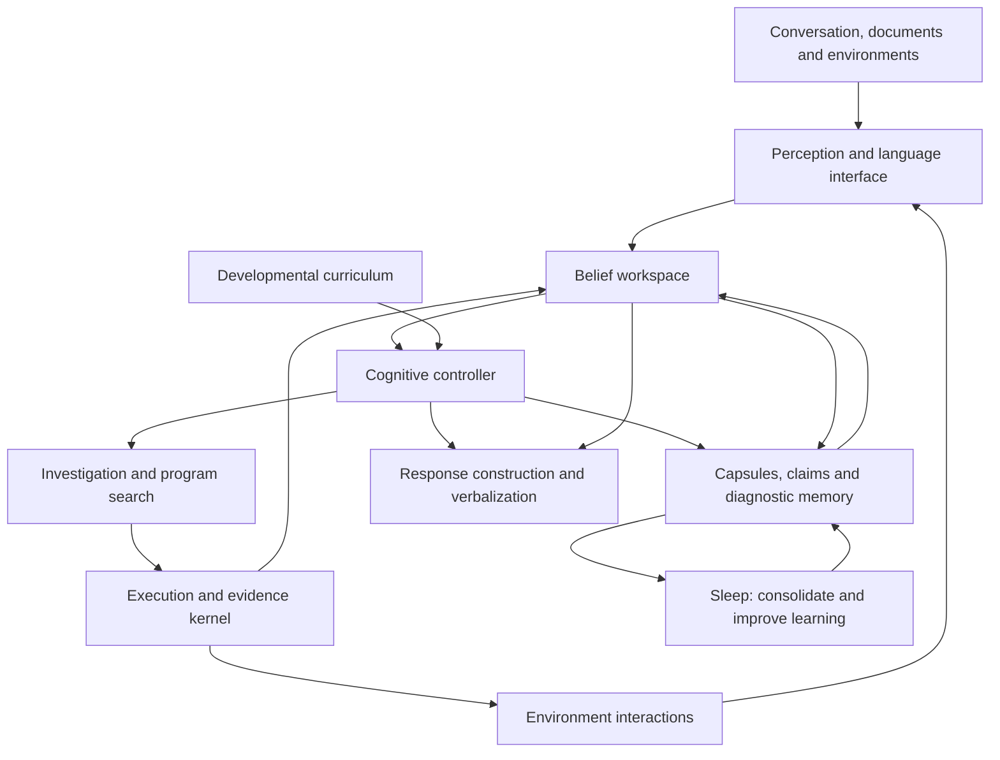

# NEXUS Seed — 10-Part Integrated Architecture & Isolated Component Evaluations (`seed_integrated_architecture_v1`)

## 1. Overview & Three Operating Timescales

`src/nexus/seed/integrated_architecture.py` implements and experimentally verifies the complete 10-part NEXUS Seed architecture across three explicit timescales:
1. **`WITHIN_INTERACTION`**: update Bayesian beliefs in `BeliefWorkspace`, retrieve relevant capsules and diagnostic procedures, choose the next cognitive action or discriminating probe via `CognitiveController` and `BatInvestigationScheduler`, and construct an epistemically tagged response via `PerceptionAndLanguageInterface`.
2. **`ACROSS_EPISODES`**: retain validated 6-part `MechanismCapsule`s, discover missing state features (`parity_run_structure`) when existing state features leave transition ambiguity, reduce failing traces into 1-minimal counterexample witnesses via bounded `ddmin`, and compile reusable decision trees in `DiagnosticProcedureLibrary` during Sleep.
3. **`ACROSS_RESEARCH_GENERATIONS`**: evolve and verify symbolic meta-rules (`open_primitive_transfer.py`) and parameterized update rules (`SmallLearnedOptimizer`) on development families before evaluating frozen versions in the isolated black-box evaluator process (`blackbox_evaluator_worker.py`).

---

## 2. Execution and Evidence Kernel (`EvidenceKernel`)

- Enforces declared resource budgets (`max_budget_units`), records outcomes in a hash-linked SHA-256 journal (`journal`), validates promotions, and supports state rollback (`snapshot()` / `restore()`).
- Separates three feedback tiers (`FEEDBACK_TIERS`):
  1. `learning_feedback`: available to the learner during an episode;
  2. `promotion_checks`: used before accepting a new capsule, diagnostic tree, or representation change;
  3. `final_assessment`: held out for evaluation in the separate evaluator subprocess (`blackbox_evaluator_worker.py`).
- Every `EvidenceRecord` carries one of the 7 explicit `EvidenceStatus` values:
  - `observed`, `tested`, `formally_established_under_assumptions`, `source_attributed`, `inferred`, `disputed`, `unknown`.

---

## 3. Seven Isolated Component Comparisons (`run_seven_isolated_comparisons`)

| Comparison | Component Evaluated | Key Quantitative Result |
| :--- | :--- | :--- |
| **1. Pooling & Compound Probes** | `synthesize_compound_probe` (`[-4, -1, 0, 2, 2, 7]`) & conditional `disjunct_matrix_comp` ($AG(2,3)$ $9 \times 12$ 2-disjunct matrix) | Compound probe partitions all **50 / 50** linear/reverse-linear hypotheses in **1** multi-outcome test (vs $\lceil \log_2(50) \rceil = 6$ binary answers); $9 \times 12$ 2-disjunct matrix verified (`verify_d_disjunct == True`) and applied **only** when sparse Boolean-OR assumptions hold |
| **2. Bat Scheduling & Unfamiliar Regimes** | `BatInvestigationScheduler` (`SURVEY -> DISCRIMINATE -> VALIDATE_AND_ACT`) & `BeliefWorkspace` | Transitions through `VALIDATE_AND_ACT` before accepting a sole surviving hypothesis; detects `UNFAMILIAR_MECHANISM_INADEQUATE_FIT` (`best_match_rate < 1.0`) when the true mechanism lies outside the initial candidate space |
| **3. Diagnostic Procedure Library** | `DiagnosticProcedureLibrary` Sleep tree compilation vs online planning | Compiles a 1-probe multi-outcome decision tree (`expected_execution_cost = 1.50` vs `7.50` online planning cost per episode; construction cost `2.50` breaks even in **1** episode) |
| **4. Targeted Variation & Goal Adapters** | 4 equal-budget variation strategies + separate `goal_adapter` evaluation | `counterexample_directed_repair` (**2** evals) and `uncertainty_directed_mutation` (**3** evals) beat `uniform_typed_mutation` (**11** evals) and `ordinary_typed_enumeration` (**17** evals); grid `goal_adapter` (reversing order + inverting directions `UP<->DOWN, LEFT<->RIGHT`) reaches `(0, 0)` (`True`) whereas naive sequence reversal fails (`False`) |
| **5. Counterexample Reduction (`ddmin`)** | `DeltaDebuggingReducer` + `FailureLibrary` | Shrinks 10-element failing input `[4, 7, 2, 9, -3, -5, 8, 1, 6, 10]` to 2-element 1-minimal witness `[-3, -5]` (`is_1_minimal = True`) within budget and blocks shrinking private assessment cases |
| **6. $2 \times 2$ Factorial, Sleep, GPI & Learned Optimizer** | `{fixed_library, growing_library} x {episodic_reset, continual_memory}`, `TriLibrarySleepConsolidator`, `SuccessorFeatureLearner`, `SmallLearnedOptimizer` | Growing library increases task success from **0.67** to **1.00** (`+0.33`); continual memory reduces compute cost from **16.2** to **10.9** (`-5.3`); Sleep yields **+45.10** net savings across 8 episodes; Successor Features GPI achieves **+2.50** zero-shot return gain under changed goal weights; `SmallLearnedOptimizer` achieves **0.000514** loss vs **0.28969** (SGD) and **0.004422** (Momentum) |
| **7. Controller Policies, Curriculum & Language Modes** | 11-action `CognitiveController` (5 policies), 6-stage `DevelopmentalCurriculum`, 3 `LANGUAGE_MODES` | `bayesian_planning`, `active_inference`, and `transparent_rule` achieve **1.00** decision accuracy across all 6 cognitive scenarios; all 6 curriculum stages pass with positive oracle-free learning progress; casual greetings (`"Hi, how are you?"`) route to `ordinary_conversation` without triggering experiments, and conflicting historical passages produce `disputed` attributed claims |

---

## 4. Complete 10-Step Integrated Episode (`run_integrated_end_to_end_episode`)

1. **Intent Routing**: Routes `"Learn what this function does and bind it to krelv"` to `mechanism_investigation`.
2. **Cognitive Controller**: Selects `retrieve` then `experiment` under `bayesian_planning`.
3. **Black-Box Unseen Workspace Initialization**: After logging `FREEZE_BEFORE_INTEGRATED_EPISODE`, initializes `ulib_window_checksum` in the separate `blackbox_evaluator_worker` subprocess with 3 candidate helpers (`_cand_alpha_1`, `_cand_alpha_2`, `_cand_beta_1` — 1 true helper + 2 decoys) and 3 candidate post-steps (`_post_reverse`, `_post_inc`, `_post_dedup`).
4. **Unfamiliar Mechanism Detection**: Initial known-only hypotheses fail on the first visible probe, triggering `UNFAMILIAR_MECHANISM_INADEQUATE_FIT`.
5. **Hypothesis Revision & Equivalence Splitting**: Composes sandbox candidate helpers with post-step functions in `BeliefWorkspace` and identifies `_post_reverse_of__cand_alpha_2`.
6. **Bounded `ddmin` Counterexample Reduction**: Reduces the discrepancy between the un-reversed helper draft and the full composition on `[-4, -1, 0, 2, 2, 7]` to a 2-element 1-minimal witness `[-4, -1]`.
7. **6-Part `MechanismCapsule` Promotion**: Validates in `VALIDATE_AND_ACT` stage and promotes `cap__post_reverse_of__cand_alpha_2_1762999500` with `EvidenceStatus = tested`.
8. **Separate `goal_adapter` Verification**: Verifies grid movement reversal adapter (`goal_adapter_reaches_start = True` vs `naive_sequence_reversal_reaches_start = False`).
9. **Sleep Consolidation**: Re-verifies capsule validation and failure regression tests and compiles the family diagnostic decision tree with net positive savings (`+42.75`).
10. **Isolated Subprocess Final Assessment**: Evaluates the synthesized AST patch and promoted primitive in `blackbox_evaluator_worker.py` (`hidden_accuracy = 1.0`, `cross_lab_coding_accuracy = 1.0`, `cross_lab_reasoning_accuracy = 1.0`, `separate_evaluator_process = True`, `private_inputs_exposed_to_learner = False`).

---

## 5. Verification

- Artifact: `artifacts/seed_integrated_architecture_v1.json`
- Standalone Verifier: `scripts/verify_seed_integrated_architecture.py`
- Test Suite: `tests/test_seed_integrated_architecture.py`
