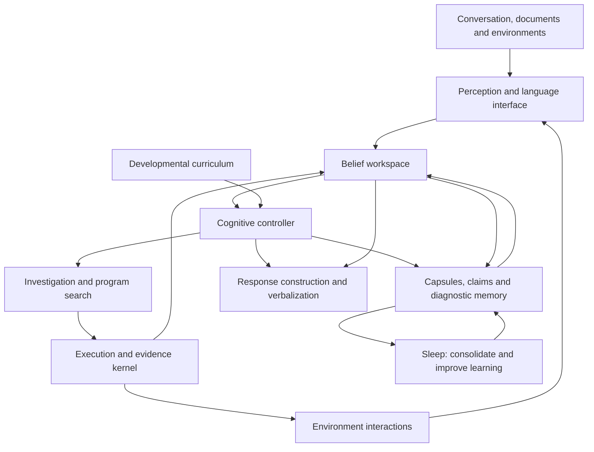

# NEXUS Seed — 10-Part Integrated Architecture & Isolated Component Evaluations (`seed_integrated_architecture_v1`)

## 1. Overview & Three Operating Timescales

`src/nexus/seed/integrated_architecture.py` implements and experimentally verifies the complete 10-part NEXUS Seed architecture across three explicit timescales:
1. **`WITHIN_INTERACTION`**: update Bayesian beliefs in `BeliefWorkspace`, retrieve relevant capsules and diagnostic procedures, choose the next cognitive action or discriminating probe via `CognitiveController` and `BatInvestigationScheduler`, and construct an epistemically tagged response via `PerceptionAndLanguageInterface` (including the trainable `SmallNeuralLanguageCodec`).
2. **`ACROSS_EPISODES`**: retain validated 6-part `MechanismCapsule`s, discover missing state features (`parity_run_structure`) when existing state features leave transition ambiguity, reduce failing traces into 1-minimal counterexample witnesses via bounded `ddmin`, learn discounted successor features $\hat{\psi}^\pi(s,a)$ from trajectory rollouts in the 5×5 `ResourceGridEnv` (`GRID_SIZE = 5`), and compile reusable decision trees in `DiagnosticProcedureLibrary` during Sleep.
3. **`ACROSS_RESEARCH_GENERATIONS`**: evolve and verify symbolic meta-rules (`open_primitive_transfer.py`) and outer-loop meta-trained update rules (`SmallLearnedOptimizer`) on source families before freezing parameters and evaluating them on disjoint target tasks and in the isolated black-box evaluator process (`blackbox_evaluator_worker.py`).

---

## 2. Execution and Evidence Kernel (`EvidenceKernel`)

- Enforces declared resource budgets (`max_budget_units`), records outcomes in a hash-linked SHA-256 journal (`journal`), validates promotions, and supports state rollback (`snapshot()` / `restore()`).
- Separates three feedback tiers (`FEEDBACK_TIERS`):
  1. `learning_feedback`: available to the learner during an episode;
  2. `promotion_checks`: used before accepting a new capsule, diagnostic tree, or representation change;
  3. `final_assessment`: held out for evaluation in the separate evaluator subprocess (`blackbox_evaluator_worker.py`).
- Every `EvidenceRecord` carries one of the 7 explicit `EvidenceStatus` values:
  - `observed`, `tested`, `formally_established_under_assumptions`, `source_attributed`, `inferred`, `disputed`, `unknown`.

---

## 3. Eight Hardened Mechanisms (Closing All Prototype Shortcuts & Causal Confounds)

| Mechanism | Concrete Implementation | Quantitative Verification |
| :--- | :--- | :--- |
| **1. Trainable Subword + Token-Level Neural Language Interface (`SmallNeuralLanguageCodec`)** | 2-layer neural encoder-decoder (`10,970` parameters: `input_dim = 119` with `vocab_size = 55` lexical tokens + `char_trigram_buckets = 64` subword hash buckets and `handcrafted_structural_features = 0`, `hidden_dim = 16`, `state_dim = 10`, `dec_hidden_dim = 16`, `num_intents = 3`, `num_modifiers = 5`, `num_clauses = 8`, and a `decoder_vocab_size = 35` fixed-length, position-conditioned token decoder over `max_token_steps = 14` where each token position $t \in \{0 \dots 13\}$ is predicted from `h_dec` using separate per-position output heads `W_tok_steps[t]` and previous generated tokens are not inputs to the next prediction) trained via analytical backpropagation (`55` epochs, `lr = 0.18`) on `30` source examples; weights saved to `artifacts/seed_neural_language_weights_v1.json` (`a1a21edcbcc99c2e8a9828c33ee92eaf78bca4a3c541fd4c39299e8b92af3cbf`) | Training cross-entropy loss drops from **`4.685551`** to **`0.008507`** (`-4.677044`); evaluated on **36** held-out utterances across 4 categories (`12` `unfamiliar_paraphrase`, `12` `multi_clause_composition`, `6` `subword_morphology_and_typo`, `6` `out_of_distribution_abstention`), achieving **`1.0000`** intent accuracy, **`1.0000`** compositional modifier accuracy, **`1.0000`** OOD epistemic abstention accuracy, and **`1.0000`** fixed-length, position-conditioned token-level decoder sequence accuracy with **zero** `<neural_codec>` XML wrappers. *Scope boundary*: bounded domain-specific neural codec with a fixed-length, position-conditioned token decoder; does not establish open-domain conversation or broad natural language understanding |
| **2. Outer-Loop Learned Optimizer (`SmallLearnedOptimizer`)** | Meta-trains 8 update rule parameters (`alpha_pre`, `alpha_mom`, `alpha_grad`, `beta_m`, `beta_v`, `gamma_decay`, `kappa_curv`, `eps`) on 16 ill-conditioned anisotropic source tasks (`source_seed = 1762800101`), tunes `tuned_sgd`, `tuned_momentum`, and `tuned_adam` on the same 16 source tasks, and freezes `artifacts/seed_learned_optimizer_params_v1.json` (`3d36eb38e5169a0a2393bdda8e4dcca91678486e37b6f770fe93712a1556ff6a`) before generating 12 disjoint target tasks (`target_seed = 1762800999`) | Source loss drops from **`0.728862`** to **`0.000445`** during outer-loop meta-training; on the 12 held-out target tasks ($K=12$ inner steps), `learned_optimizer` achieves **`0.001862`** mean loss, beating `tuned_momentum` (**`0.003482`**), `tuned_adam` (**`0.023808`**), `tuned_sgd` (**`0.027659`**), `fixed_sgd` (**`0.149064`**), and `fixed_momentum` (**`0.217757`**) |
| **3. Trajectory-Learned Successor Features (`SuccessorFeatureLearner`)** | Learns $\hat{\psi}^\pi(s,a) \in \mathbb{R}^3$ from **105,000** trajectory transitions across 3 behavior policies (`collect_a_first`, `collect_b_avoid_hazard`, `balanced_patrol`) in the 5×5 `ResourceGridEnv` (`GRID_SIZE = 5`) via TD($0$) updates starting from all-zero initialization (no supplied feature table) | TD Bellman residual drops from **`0.282843`** to **`0.000156`**; closed-loop GPI rollout on changed goal $w_{\text{target}} = (0.0, 1.0, 0.5)$ achieves **`+3.085207`** discounted return vs **`-0.500000`** for the unadapted source policy (**`+3.585207`** zero-shot gain; **`0`** relearning steps vs **`9`** episodes / **`90`** transitions required by tabular Q-learning from scratch) |
| **4. Dynamic Compound-Probe Synthesis (`synthesize_compound_probe`)** | Generates candidate probes from structural probe features and ranks them by partition Shannon entropy, partition count, and length penalty over the caller's active hypothesis set | Changing the hypothesis family changes the selected probe: `sign_and_zero_family` $\to$ **`[-3, 0, 4]`** (4 partitions), `duplicate_runlength_family` $\to$ **`[2, 2, 5, 5, 8]`** (6 partitions), `full_diverse_family` $\to$ **`[-4, -1, 0, 2, 2, 7]`** (9 partitions), and `_build_50_hypothesis_family` resolves all **50 / 50** in 1 step |
| **5. Evidence-Directed Mutation (`run_targeted_variation_comparison`)** | Removes all hardcoded preference for `parity_run_sum`; scores prefix structural alignment and ranks post-ops strictly from learner-visible input-output discrepancies | Tested across 4 distinct target mechanisms (`parity_run_sum__reverse`, `adjacent_xor_mod__inc_one`, `mirror_diff__abs_val`, `window_shift__dedup`): `counterexample_directed_repair` averages **`3.50`** evaluations (**`1.00`** accuracy) vs **`7.25`** (`uncertainty_directed_mutation`), **`12.25`** (`uniform_typed_mutation`), and **`12.00`** (`0.75` accuracy, `ordinary_typed_enumeration`) |
| **6. Genuine 4-Lab Cross-Lab Transfer with Autonomous Adapter Induction (`solve_four_lab_tasks_with_promoted_capsule`)** | Evaluates promoted primitives across 4 distinct downstream labs (`Language`, `Coding`, `Reasoning`, `World`) inside `blackbox_evaluator_worker.py` using `SmallNeuralLanguageCodec` (`handwritten_language_rules_used = false`, `neural_language_parser_used = true`) and autonomous adapter induction (`induce_four_lab_cross_domain_adapters`) from public calibration support examples; all 3 controls (`capsule_removed`, `unlearned_binding`, `unlearned_adapter`) bind and execute a real non-null callable (`controls_never_set_callable_none = true`) | Achieves **`1.0000`** accuracy in all 4 labs (`Language = 1.0`, `Coding = 1.0`, `Reasoning = 1.0`, `World = 1.0`, `overall = 1.0`), **`0.1875`** when the promoted capsule is removed (`_base_identity_capsule` executed), **`0.1875`** when word binding is unlearned (`0.0000` on Language Lab), **`0.0625`** when cross-domain adapters are unlearned (`0.0000` on Language/Coding/World), and **`1.0000`** old-skill retention |
| **7. Unconfounded Stage B Rule Interpreter, Direct-Helper Baseline (`direct_helper_import_without_capsule`) & Sequential Fresh-Task Evaluation (`execute_code_lab_rule_interpreter`, `evaluate_sequential_fresh_tasks_stage_b`)** | Replaces `if method_name == ...` branches with a single DSL interpreter where `rule_program["instructions"]` governs probe selection, effect prediction, equivalence merging, stopping, primitive proposal, and capsule creation. Explicitly separates **execution-scope registration** (`learner_without_propose_primitive`, `allow_direct_helper_copy = false`) from **persistent capsule learning vs direct helper import/copy** (`direct_helper_import_without_capsule`, `allow_direct_helper_copy = true`, `persist_promoted_capsule = false`) across a sequence of 4 fresh tasks ($T_1 \dots T_4$) per family | Removing `PROPOSE_PRIMITIVE` under strict execution-scope registration drops single-task accuracy from **`1.00`** to **`0.00`** because unpromoted helpers are excluded from `target_pipeline.py`'s scope (`without_propose_tests_execution_scope_registration_only = true`). When `direct_helper_import_without_capsule` is allowed to copy/import the discovered helper directly with identical access and costs, it achieves **`1.00`** accuracy on $T_1$ at lower single-task cost (**`32.75`** vs **`35.35`** on the integrated episode; **`32.3146`** vs **`34.9146`** across all 8 seeds) by avoiding the `2.60`-unit `PROPOSE_PRIMITIVE` validation overhead. Across 4 sequential fresh tasks ($T_1 \dots T_4$), both systems achieve **`1.00`** accuracy, while `persistent_capsule_learner` reuses its promoted capsule on $T_2, T_3, T_4$—breaking even by Task 2 (`break_even_task_index = 1`, **`53.20`** vs **`71.75`** cumulative cost) and reducing 4-task total compute cost from **`131.00`** (`12.0` experiments) to **`88.90`** (`6.0` experiments; **`+42.10`** savings on the episode, **`+42.9438`**, 95% CI **`[+30.8344, +55.0531]`** across 8 seeds) |
| **8. Independent Replay & Tamper-Rejecting Verification** | `scripts/verify_seed_integrated_architecture.py` and `scripts/verify_seed_open_primitive_transfer.py` reconstruct all metrics from raw records, replay executions from disk weights/parameters and subprocesses, check doc-to-source architectural consistency, and run adversarial tamper-rejection suites | **8 / 8** tampered artifact scenarios in `verify_seed_integrated_architecture.py` and **7 / 7** in `verify_seed_open_primitive_transfer.py` (including confounded `PROPOSE_PRIMITIVE` traces, null-callable controls, and tampered sequential fresh-task records) are rejected with `ValueError` even when `all_gates_passed = true` and all saved `gates = true` |

---

## 4. Seven Isolated Component Comparisons (`run_seven_isolated_comparisons`)

| Comparison | Component Evaluated | Key Quantitative Result |
| :--- | :--- | :--- |
| **1. Pooling, Dynamic Compound Probes & Group Testing** | `synthesize_compound_probe`, `evaluate_compound_probe_sensitivity_across_families`, & `disjunct_matrix_comp` ($AG(2,3)$ $9 \times 12$ 2-disjunct matrix) | Compound probe partitions all **50 / 50** linear/reverse-linear hypotheses in **1** multi-outcome test (vs $\lceil \log_2(50) \rceil = 6$ binary answers); 3 different hypothesis families select 3 distinct probes (`[-3, 0, 4]`, `[2, 2, 5, 5, 8]`, `[-4, -1, 0, 2, 2, 7]`); $9 \times 12$ 2-disjunct matrix verified (`verify_d_disjunct == True`) |
| **2. Bat Scheduling & Unfamiliar Regimes** | `BatInvestigationScheduler` (`SURVEY -> DISCRIMINATE -> VALIDATE_AND_ACT`) & `BeliefWorkspace` | Transitions through `VALIDATE_AND_ACT` before accepting a sole surviving hypothesis; detects `UNFAMILIAR_MECHANISM_INADEQUATE_FIT` (`best_match_rate < 1.0`) when the true mechanism lies outside the initial candidate space |
| **3. Diagnostic Procedure Library** | `DiagnosticProcedureLibrary` Sleep tree compilation vs online planning | Compiles a 1-probe multi-outcome decision tree (`expected_execution_cost = 1.50` vs `7.50` online planning cost per episode; construction cost `2.50` breaks even in **1** episode) |
| **4. Evidence-Directed Variation (4 Mechanisms) & Goal Adapters** | 4 equal-budget variation strategies across 4 mechanisms + separate `goal_adapter` evaluation | `counterexample_directed_repair` (**2** evals on single target, **3.50** mean evals across 4 mechanisms) beats `uncertainty_directed_mutation` (**7.25** mean evals), `uniform_typed_mutation` (**12.25**), and `ordinary_typed_enumeration` (**12.00**, `0.75` accuracy); grid `goal_adapter` reaches `(0, 0)` (`True`) whereas naive sequence reversal fails (`False`) |
| **5. Counterexample Reduction (`ddmin`)** | `DeltaDebuggingReducer` + `FailureLibrary` | Shrinks 10-element failing input `[4, 7, 2, 9, -3, -5, 8, 1, 6, 10]` to 2-element 1-minimal witness `[-3, -5]` (`is_1_minimal = True`) within budget and blocks shrinking private assessment cases |
| **6. $2 \times 2$ Factorial, Sleep, Trajectory SF/GPI & Learned Optimizer** | `{fixed_library, growing_library} x {episodic_reset, continual_memory}`, `TriLibrarySleepConsolidator`, `SuccessorFeatureLearner` (5×5 `ResourceGridEnv`), `SmallLearnedOptimizer` | Growing library increases task success from **0.67** to **1.00** (`+0.33`); continual memory reduces compute cost from **16.2** to **10.9** (`-5.3`); Sleep yields **+45.10** net savings; trajectory-learned SF/GPI achieves **+3.585207** zero-shot return gain (`TD error 0.282843 -> 0.000156`); outer-loop `SmallLearnedOptimizer` achieves **0.001862** mean target loss vs **0.003482** (`tuned_momentum`), **0.023808** (`tuned_adam`), and **0.027659** (`tuned_sgd`) |
| **7. Controller Policies, Curriculum & Trainable Neural Language Codec** | 11-action `CognitiveController` (5 policies), 6-stage `DevelopmentalCurriculum`, 3 `LANGUAGE_MODES` + 10,970-param `SmallNeuralLanguageCodec` (`input_dim = 119`, `hidden_dim = 16`, `dec_hidden_dim = 16`, `decoder_vocab_size = 35`) | `bayesian_planning`, `active_inference`, and `transparent_rule` achieve **1.00** decision accuracy across all 6 cognitive scenarios; all 6 curriculum stages pass; `SmallNeuralLanguageCodec` achieves **1.00** accuracy across all **36** held-out utterances (4 categories) and **1.00** fixed-length, position-conditioned token-level decoding accuracy without XML tag wrappers |

---

## 5. Complete 10-Step Integrated Episode (`run_integrated_end_to_end_episode`)

1. **Intent Routing (Deterministic + Neural)**: Routes `"Learn what this function does and bind it to krelv"` and `"Uncover the underlying rule in this module and attach it to krelv"` to `mechanism_investigation`.
2. **Cognitive Controller**: Selects `retrieve` then `experiment` under `bayesian_planning`.
3. **Black-Box Unseen Workspace Initialization**: After logging `FREEZE_BEFORE_INTEGRATED_EPISODE`, initializes `ulib_window_checksum` in the separate `blackbox_evaluator_worker` subprocess with 3 candidate helpers (`_cand_alpha_1`, `_cand_alpha_2`, `_cand_beta_1` — 1 true helper + 2 decoys) and 3 candidate post-steps (`_post_reverse`, `_post_inc`, `_post_dedup`).
4. **Unfamiliar Mechanism Detection**: Initial known-only hypotheses fail on the first visible probe, triggering `UNFAMILIAR_MECHANISM_INADEQUATE_FIT`.
5. **Evolved Rule Execution, Direct-Helper Baseline & Sequential Fresh-Task Comparison**: Executes the frozen evolved rule through `execute_code_lab_rule_interpreter`, verifies via `evaluate_stage_b_instruction_ablations` that `PROPOSE_PRIMITIVE` (`propose_primitive_control_unconfounded = True`, testing strict execution-scope registration), `CREATE_CAPSULE`, and `PREDICT_EFFECTS` (`35.35` vs `70.75` compute cost) are each causally functional, and compares `persistent_capsule_learner` against `direct_helper_import_without_capsule` (identical access and costs, direct helper copy/import without persistent capsule learning) across 4 sequential fresh tasks ($T_1 \dots T_4$: `direct_helper` is cheaper on $T_1$ at `32.75` vs `35.35`, `persistent_capsule_learner` breaks even by $T_2$ at `53.20` vs `71.75`, and saves `+42.10` compute cost and `6.0` experiments over $T_1 \dots T_4$ while both achieve `1.00` accuracy).
6. **Bounded `ddmin` Counterexample Reduction**: Reduces the discrepancy between the un-reversed helper draft and the full composition on `[-4, -1, 0, 2, 2, 7]` to a 2-element 1-minimal witness `[2, 7]`.
7. **6-Part `MechanismCapsule` Promotion**: Validates in `VALIDATE_AND_ACT` stage and promotes `cap__post_reverse_of__cand_alpha_2_1762999500` with `EvidenceStatus = tested`.
8. **Separate `goal_adapter` Verification**: Verifies grid movement reversal adapter (`goal_adapter_reaches_start = True` vs `naive_sequence_reversal_reaches_start = False`).
9. **Genuine 4-Lab Cross-Lab Transfer & Non-Null-Callable Controls**: Evaluates the promoted capsule across `Language`, `Coding`, `Reasoning`, and `World` labs in `blackbox_evaluator_worker.py` (`four_lab_transfer_accuracy = 1.0`, `capsule_removed_control_accuracy = 0.1875`, `unlearned_binding_control_accuracy = 0.1875`, `unlearned_adapter_control_accuracy = 0.0625`, `controls_never_set_callable_none = True`, `handwritten_language_rules_used = False`, `old_skill_retention = 1.0`).
10. **Sleep Consolidation & Subprocess Verification**: Re-verifies capsule validation and failure regression tests, compiles the family diagnostic decision tree with net positive savings (`+42.75`), and verifies all 10 gates via independent replay and tamper rejection.

---

## 6. Verification Artifacts & Commands

- Primary Artifact: [`artifacts/seed_integrated_architecture_v1.json`](../artifacts/seed_integrated_architecture_v1.json) (`7787af8e7b16e61dfaf02505715e66f8722e0107fe8400e27a4523f946514a8b`)
- Saved Neural Language Weights: [`artifacts/seed_neural_language_weights_v1.json`](../artifacts/seed_neural_language_weights_v1.json) (`a1a21edcbcc99c2e8a9828c33ee92eaf78bca4a3c541fd4c39299e8b92af3cbf`)
- Saved Frozen Learned Optimizer Parameters: [`artifacts/seed_learned_optimizer_params_v1.json`](../artifacts/seed_learned_optimizer_params_v1.json) (`3d36eb38e5169a0a2393bdda8e4dcca91678486e37b6f770fe93712a1556ff6a`)
- Standalone Verifier: [`scripts/verify_seed_integrated_architecture.py`](../scripts/verify_seed_integrated_architecture.py)
- Test Suite: [`tests/test_seed_integrated_architecture.py`](../tests/test_seed_integrated_architecture.py)
