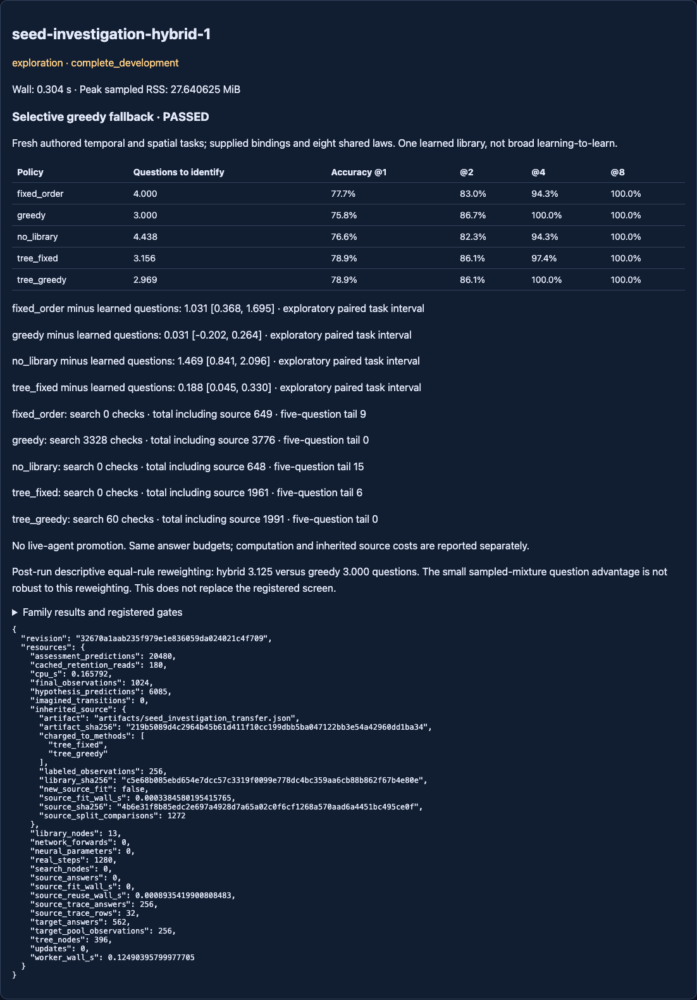

# Selective greedy fallback — complete development screen PASSED

Basec41b07fd04f2c85158b48dba8a407cf2a90ece85. Branch
`codex/seed-investigation-hybrid`. Clean execution revision
`32670a1aab235f979e1e836059da024021c4f709` committed the tested implementation,
[protocol](NEXUS_SEED_INVESTIGATION_HYBRID_PROTOCOL.md) and exact config BEFORE
one run. [Raw results](../artifacts/seed_investigation_hybrid.json) retain every
task, support observation, choice, posterior, final prediction and resource count.
The previous investigation study remains negative and unchanged.

## Answer to the registered question

The hybrid passed all five predeclared development gates: preserved tree-prefix
decisions, removed the five-question tail, matched the pure-greedy quality rule,
reduced search checks by98.20%, and reduced source-inclusive decision-work proxy
by47.27%. Library, grammar, checkpoints and source retention remained exact.

| Method | Mean questions | Worst case | Tasks >=5 | Accuracy after2 | Search checks | Source-inclusive work |
| --- | ---: | ---: | ---: | ---: | ---: | ---: |
| Frozen tree + fixed fallback | 3.15625 | 5 | 6 | 86.13% | 0 | 1961 |
| Frozen tree + greedy fallback | **2.96875** | 4 | 0 | 86.13% | **60** | **1991** |
| Pure greedy | 3.00000 | 3 | 0 | 86.72% | 3328 | 3776 |
| Fixed order | 4.00000 | 6 | 9 | 83.01% | 0 | 649 |
| No library / random | 4.43750 | 7 | 15 | 82.32% | 0 | 648 |

The quality rule required mean questions<=greedy and at most1 percentage-point
accuracy loss at EACH registered budget. Hybrid accuracy at1/2/4/8:
78.90625% /86.1328125% /100% /100%; greedy75.78125% /86.71875% /100% /100%.
Budget-two accuracy is0.5859375points lower, within the registered margin.
Budget-one/two Brier is worse for hybrid (.149531/.081868) than greedy
(.146301/.073975); probability accuracy did not universally improve.

Hybrid uses greedy only6 times versus96 calls for pure greedy. It retains every
pre-fallback question/posterior and makes zero greedy calls on those prefixes.
Six old-fallback tasks take4 rather than5 questions:983201,983203,983205,
983218,983226,983230. Other hybrid tasks:7 take2 and19 take3. Pure greedy retains
the better worst case of3. Removing the five-question tail is not removing all
query-efficiency disadvantages.

## Paired results and limitations of the pass

Baseline minus hybrid question differences, paired exploratory95% task-level
t intervals (n32,df31; ONE library and TWO authored encodings):

- Tree + fixed fallback: **.18750 [.04453,.33047]**.
- Pure greedy: **.03125 [−.20195,.26445]**.
- Fixed order: **1.03125 [.36781,1.69469]**.
- No library: **1.46875 [.84104,2.09646]**.

The hybrid is NOT statistically superior to greedy in questions. The locked
screen used point-estimate quality margins plus measured operation reductions,
not a confirmation claim or equivalence test. Temporal mean questions:
hybrid2.875, tree-fixed3.0625, greedy3, fixed4.25, random4.1875. Spatial:
hybrid3.0625, tree-fixed3.25, greedy3, fixed3.75, random4.6875. The hybrid's
question advantage does not hold separately for spatial tasks.

Post-run DESCRIPTIVE sensitivity, using only these saved rows: all8 laws are
represented, with counts7/4/3/2/8/3/4/1 for laws3/2/7/6/0/5/4/1. Reweighting the
eight rule groups equally yields **3.125 hybrid versus3.000 greedy questions**.
This was NOT the registered endpoint and does not replace its result. It shows
that the small sampled-mixture advantage is distribution dependent. No new
outcomes, labels, tuning or collection were used for this reweighting.

These are fresh authored tasks using supplied temporal/spatial adapters and a
shared finite grammar, not unseen logical capabilities or learned perception.
The manually specified fallback uses an existing source-learned tree; this is
not evidence that NEXUS autonomously invented a better learning algorithm.

## Costs, provenance and retention

1280 new authored observation/outcomes:256 shared target support rows +1024
final rows.562 cached target answer exposures and180 cached retention reads
are reported separately; they are NOT extra collection. Source traces/tree
are reused, with zero source fitting or new neural operations.

Both tree methods are charged their inherited256 labeled source observations,
32 traces,13 nodes and1272 original ID3 candidate-partition comparisons. Historical
source-fit wall.000338458s is disclosed, not redebited as new CPU. Source cost
is amortized over32 evaluated tasks:8 historical observations and39.75 source
split comparisons per task. The same historical fit supports both hypothetical
method pipelines; this is not two newly executed source collections.

Hybrid target work:60 search checks +470 posterior checks +189 tree visits=719.
Add1272 inherited source comparisons=**1991**. Greedy:3328 search checks +448
posterior checks=**3776**. Reduction47.272%; target search reduction98.197%.
Tree-fixed work1961 is slightly LOWER than hybrid1991: better fallback has a
real cost. Fixed/random need much less compute and more questions. The work
proxy unit-weights heterogeneous operations and excludes entropy arithmetic;
it is not FLOPs or a measured47% wall-time speedup.

Greedy scoring uses an exact single-pass partition count, tested across all255
nonempty hypothesis subsets against the previous criterion/tie rule. Every
actual lookup is charged. Historical helper counts/results were not rewritten.

Actual host wall **.303936s**, worker wall **.124904s**, process CPU **.165792s**,
sampled peak RSS **27.640625MiB**. Local CPU only; cap60s/5000 observations.
Zero neural forwards/optimizer updates/imagined transitions; no new source fit.
Scientific debit **2s**; carried ledger **1983.6321034559958s used /
1616.3678965440042s remaining**. This is whole-run accounting, not per-policy
latency benchmarking. A broad regression process also ran during execution.

Parent artifact SHA219b5089d4c2964b45b61d411f10cc199dbb5ba047122bb3e54a42960dd1ba34;
frozen library SHA c5e68b085ebd654e7dcc57c3319f0099e778dc4bc359aa6cb88b862f67b4e80e.
The artifact stores config/protocol/source hashes and clean host registration.
All801 pre-existing artifacts are unchanged. Frozen core/readout hashes and the
same source replay behavior (28 stops,4 abandons) match before/after.

## Tests, GUI and next question

Focused pre-run regression:138 passed. One earlier synthetic runner fixture
omitted its schema field; fixed before the run (no scientific execution).
Broad regression: **907 passed in188.49s**. Final affected evidence/server
checks: **39 passed in13.47s**. An earlier post-run focused group passed27 in5.55s.
Exact commands and independent checks are in the
[audit receipt](../artifacts/seed_investigation_hybrid_audit.json).
The independent verifier replays all160 policies, independently recomputes
questions, accuracy, intervals and compute, verifies committed source hashes
and every old artifact. No further collection or fitting occurs in that audit.
GUI tests passed11 final checks: all five methods, explicit source-inclusive
work, tail counts, rule-mixture caveat, the latest chat evidence link and no
JavaScript errors. The existing chat suite also passed8 checks before the run.

Read-only results: `/experimental#seed-investigation-hybrid-1`, also available
from `/chat` → Evidence → Latest investigation results. No live-agent promotion
or main merge. Prior negative outcomes remain visible.

**One next experiment:** replicate hybrid versus pure greedy across independently
source-trained, then frozen investigation trees, with rule-balanced fresh target
tasks. Keep the grammar and algorithm fixed and use source-library replications
as the statistical units. This tests whether the compute/quality trade-off
survives source-tree and rule-mixture variation. Proposed ceiling60s/5000 authored
observations; not registered, allocated or executed here. No architecture sweep.
