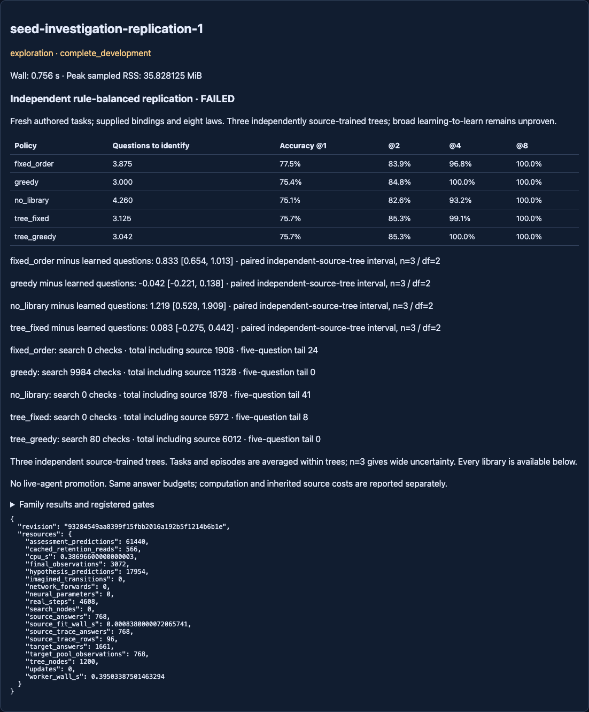
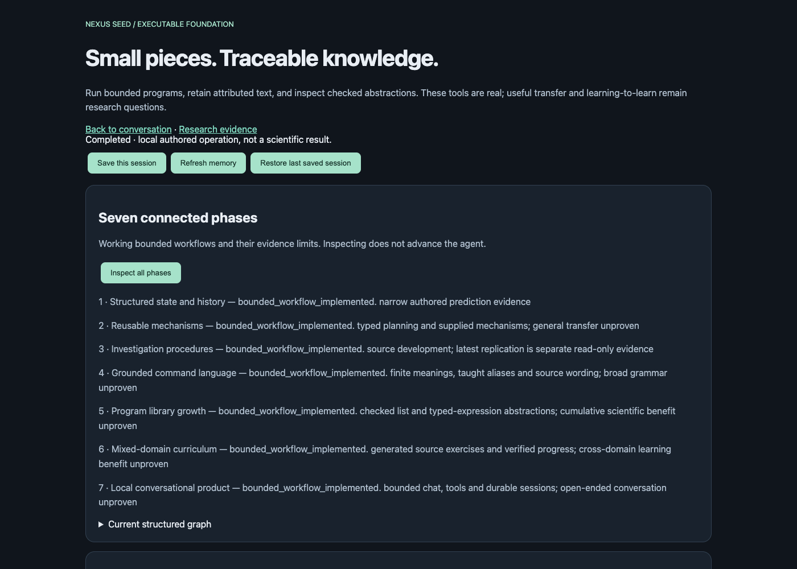

# Independent frozen-tree replication — complete, screen FAILED

Branchcodex/seed-investigation-replication; base
7ee43e296c521c713f41e3c4cd4508a152853089. Clean execution
**93284549aa8399f15fbb2016a192b5f1214b6b1e** committed the tested code,
[protocol](NEXUS_SEED_INVESTIGATION_REPLICATION_PROTOCOL.md) and exact config
before one run. [Raw results](../artifacts/seed_investigation_replication.json)
contain all source data, three fitted/frozen trees, choices, final observations,
predictions, per-task metrics, exact hashes and the metered host registration.
Historical positive and negative results are unchanged.

Engineering completion revisiona1abcaeef1cfe34cb065b0698d97260a2325b5ce connects
checked expressions to phrases and corrects GUI interval labels. These isolated
engineering changes do not alter the registered experiment or its outputs.

## Primary result

Across three independently source-trained trees and96 fresh rule-balanced
target tasks, hybrid mean questions **3.041667** versus greedy **3.000000**.
The strict predeclared zero mean-regression requirement failed. The excess is
small and its interval includes zero; this is NOT statistically established
harm. It is a complete negative result for the registered advancement screen.

| Method | Mean questions | Accuracy after2 | Max questions | Tasks>=5 | Search checks | Total work including source |
| --- | ---: | ---: | ---: | ---: | ---: | ---: |
| Tree + fixed fallback | 3.125000 | 85.25% | 5 | 8 | 0 | 5972 |
| Tree + greedy fallback | **3.041667** | 85.25% | 4 | 0 | **80** | **6012** |
| Pure greedy | **3.000000** | 84.80% | 3 | 0 | 9984 | 11328 |
| Fixed order | 3.875000 | 83.85% | 6 | 24 | 0 | 1908 |
| No-library/random order | 4.260417 | 82.58% | 7 | 41 | 0 | 1878 |

All gates except greedy quality passed: exact early decisions; no five-question
tail;99.20% fewer search checks;46.93% less source-inclusive work proxy; exact
library/grammar/checkpoint preservation; complete finite resource-valid grid.
The work proxy is not FLOPs or a measured46.93% wall-speedup.

The quality gate combined three conditions. Only its mean-question condition
failed: hybrid-minus-greedy mean+.041667>0. The95% upper excess bound.220944
remained below the registered.25 margin, and accuracy at every budget remained
within the1percentage-point tolerance. Do not remove the stricter mean criterion
after seeing this result. No runtime promotion or automatic replacement occurred.

## Independent-unit statistics

Targets and final observations are averaged WITHIN each tree first. Paired
exploratory95% t intervals use THREE source-trained trees,df2, not96 independent
learners or3072 independent final observations. The precision is limited and
conditional on the supplied finite grammar and source-sampling recipe.

Baseline minus hybrid questions:
- Tree-fixed: **.083333 [−.275221,.441888]**.
- Greedy: **−.041667 [−.220944,.137611]**.
- Fixed order: **.833333 [.654056,1.012611]**.
- No-library: **1.218750 [.528766,1.908734]**.

| Source-tree ID | Tree-fixed | Hybrid | Greedy | Fixed order | Random |
| --- | ---: | ---: | ---: | ---: | ---: |
| 995001 | 3.375 | 3.125 | 3.000 | 3.875 | 4.03125 |
| 995002 | 3.000 | 3.000 | 3.000 | 3.875 | 4.43750 |
| 995003 | 3.000 | 3.000 | 3.000 | 3.875 | 4.31250 |

The fallback helped only tree995001, removing its eight5-question cases and
making them4-question cases. The other two trees already identified all laws
in3 questions without fallback. Every library has exactly four targets per law,
two in each temporal/spatial encoding; the question means above also hold
separately in each family. These family encodings are supplied adapters, not
learned perception or independently discovered domains.

Hybrid accuracy at1/2/4/8:75.6510% /85.2539% /100% /100%; greedy75.4232% /
84.7982% /100% /100%. Hybrid Brier at1/2 is.150625/.077013, slightly worse than
greedy.145182/.076253. Classification accuracy and probabilistic error are
different evidence. Budget8 is a ceiling for the supplied law grammar, not an
independent capability success.

## What the evidence establishes

Source-frozen query ordering can avoid much of online greedy computation and
beat weak fixed/random query orders. The local fallback removes the long tail
for the one source tree needing it, preserving source decisions exactly. The
previous sampled-mixture pass did NOT reproduce its strict greedy-quality
condition under balanced fresh rules and independently sampled source trees.
Neither significant superiority nor significant inferiority to greedy in
questions is established. Useful general learning-to-learn remains unproven.

All methods were served by a private shared answer bank. Thus “questions” are
answers EXPOSED to each learner, not reduced actually collected interactions:
the benchmark collected all eight support answers per task for pairing. No
claim of lower measured real collection follows. A source-free, precompiled
greedy decision policy is a missing strong baseline for this fixed tiny grammar.
Lower runtime search alone does not establish a benefit specific to learning
from source experience rather than caching known computations.

## Resources and reproducibility

Registered cap60s CPU/wall,5000 authored observations,2048MiB sampled RSS. Exact
new collection **4608**:768 source observations +768 target support +3072 final.
Three NEW decision trees were fitted (96 source traces); historical neural
models were not retrained. Zero neural forwards, neural optimizer updates or
imagined world-model transitions.1661 cached method answer exposures,566 cached
source-retention reads and61440 final predictions are separate counters.

Source fit wall.000838s; host wall **.756048s**; worker wall **.395034s**; CPU
**.386966s**; sampled peak RSS **35.828125MiB**. Broad regression also ran during
execution, so this is metered whole-run accounting, not isolated policy latency.
Conservative scientific debit **2s**. Carried ledger:
**1985.6321034559958s used /1614.3678965440042s remaining**. No retry or second
experiment was run.

Both tree methods are charged the source comparisons required by their own
tree,3972 total, plus source observation cost768 (the actual collection is shared,
not physically executed twice). Hybrid work80 search +1372 posterior checks
+588 tree visits +3972 source comparisons=**6012**. Greedy9984+1344=**11328**.
Cheap fixed/random orders have much less computation and need more answers.
Source preprocessing, model hashes and frozen before/after source behavior are
recorded per library. No source feedback from another library or target bank
updates a global procedure. All805 previous artifact files remain unchanged.

The repository-only verifier replays480 policies, recomputes accuracy/question
means and paired tree-level intervals using independent formulas, verifies exact
committed source hashes and checks every historical artifact. It generates no
new observations and fits no new model. Repeated tasks sharing a rule/tree have
dependent question traces and are not treated as independent library units.
The three independent source datasets produced two distinct observed hybrid
query policies; differing dataset IDs alone are not evidence of three different
strategies. All sources were genuinely fitted separately; renaming duplicated
source samples is rejected by the validator.

Clarification of the frozen protocol: its word “unseeded” for the old matching
episode token is imprecise. That token was generated by a seeded observation
RNG; the token itself is not a task or RNG-seed registration. No closed seed
was reused. The protocol and its committed hash are preserved.

## Phase1–7 engineering delivered alongside the study

The [workbench guide](NEXUS_SEED_PHASE1_7_WORKBENCH.md) documents the implemented
bounded pipeline: structured state/history checks; mechanism planning; metered
investigations; taught phrases linked to verified list OR expression programs;
multiple checked expression functions with source/assessment isolation and
rollback; generated four-domain source practice with verified feedback; and
durable local chat/tools/GUI. Rolling back a function disables its phrase links.

These are real executed workflows, with source-only unit and browser checks.
The new expression constructor handles conditional subtrees, not just contiguous
list windows. A public fixture saves2 stored expression nodes; macro execution
can cost MORE instructions, and this is disclosed rather than called a speedup.
Generated source practice changes scheduling via existing statistics, not a
new neural learner. Local read-aloud refuses remote voices; microphone speech
recognition, unrestricted language/coding and general autonomous tool use are
not implemented or claimed. Engineering completion does not finish the seven
phases' scientific generalization questions.

Tests:135 pre-run affected tests passed;931 broad regression tests passed.
Final affected paths:94 tests passed after expression-phrase integration;
96 passed after adding the engineering receipt verification.
20 workflow browser checks and12 result-display checks passed. Exact commands,
source hashes and fixtures are in the [research audit](../artifacts/seed_investigation_replication_audit.json)
and [engineering receipt](../artifacts/seed_phase1_7_engineering.json). Initial failures were a synthetic fixture-family
rotation, a missing GUI compression candidate, and a stale GUI interval label;
they were fixed and regression-tested. No scientific run was retried or retuned.

## Single next scientific task

**Source-only compiled-greedy baseline audit.** Compile the exact greedy rule
from the already supplied finite grammar without source labels, then compare
its choices and construction-plus-lookup cost with online greedy and learned
hybrid on saved arrays. This tests whether caching, rather than learned
investigation knowledge, suffices for the observed computational benefit.
Register it as a retrospective source audit, not new confirmation. Proposed30s
CPU/wall,zero new collection, no model fitting or architecture sweep. It has not
been registered, allocated or executed here.
