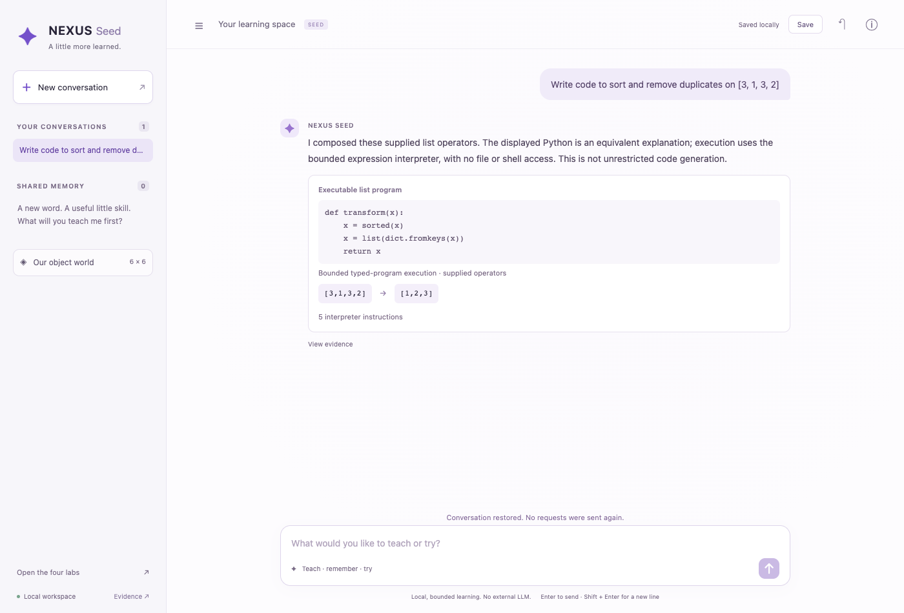
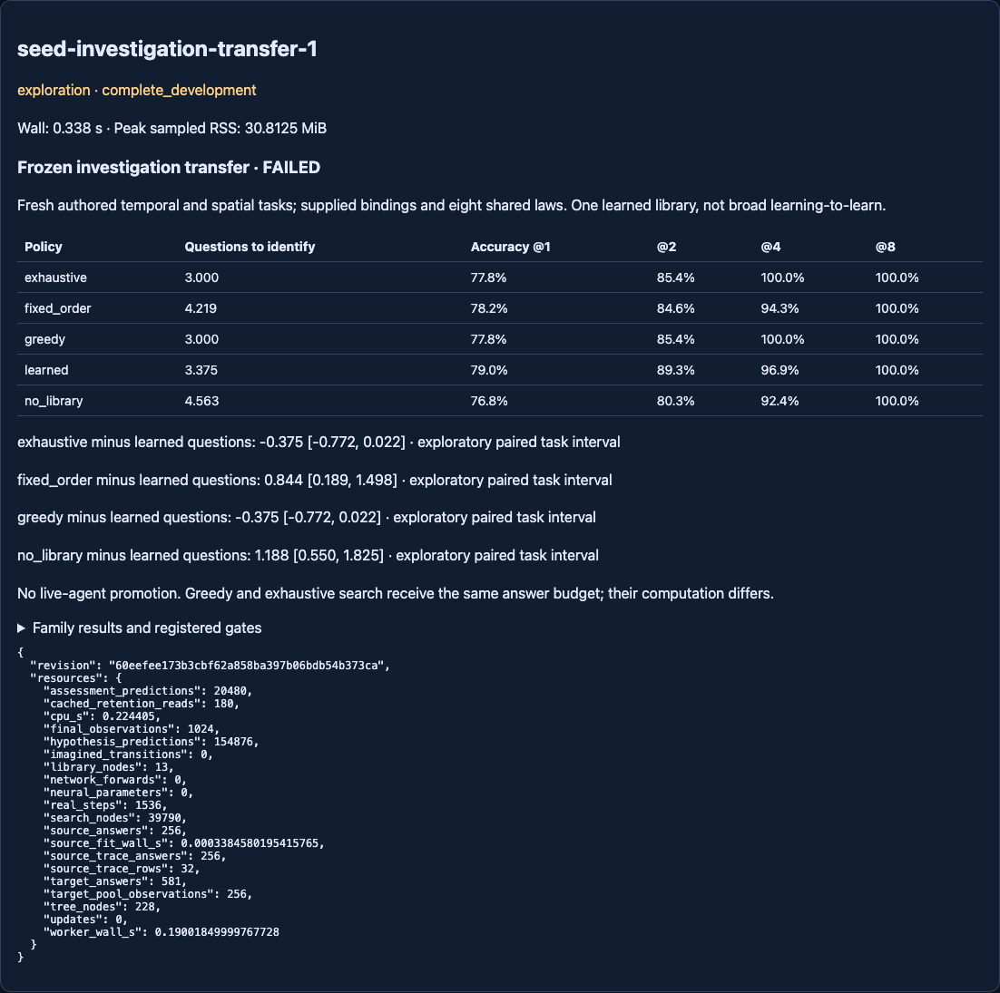

# Frozen investigation transfer — complete, registered screen FAILED

Branch `codex/seed-investigation-transfer`. Starting revision
`6f4b17ff2297aec9c7f54966d9d7a9ff9712e24f`; clean execution revision
`60eefee173b3cbf62a858ba397b06bdb54b373ca` committed the
[protocol](NEXUS_SEED_INVESTIGATION_TRANSFER_PROTOCOL.md), exact configuration,
tested implementation and read-only display before collection. One run only.
[Raw artifact](../artifacts/seed_investigation_transfer.json) contains every
source observation, target support bank, locked choice, posterior, final episode,
prediction, resource count and host registration. This is authored development.

## What happened

A 13-node, depth-three tree learned from 32 source traces was frozen before
32 fresh target tasks. Each target had eight available teaching questions and
32 separately generated final episodes. All five policies shared the same
version-space learner, public bindings and eight supplied candidate laws.

| Policy | Mean questions to identify | Accuracy @1 | @2 | @4 | @8 |
| --- | ---: | ---: | ---: | ---: | ---: |
| Learned investigation | 3.37500 | 79.00% | 89.26% | 96.88% | 100% |
| Fixed order | 4.21875 | 78.22% | 84.57% | 94.34% | 100% |
| No library / random order | 4.56250 | 76.76% | 80.27% | 92.38% | 100% |
| Greedy information gain | 3.00000 | 77.83% | 85.35% | 100% | 100% |
| Bounded exhaustive search | 3.00000 | 77.83% | 85.35% | 100% | 100% |

Question savings (baseline minus learned), exploratory paired task-level 95%
intervals, n=32 conditional on ONE library and TWO authored target encodings:

- Fixed order: **0.84375 [0.18906, 1.49844]**.
- Random order: **1.18750 [0.55015, 1.82485]**.
- Greedy and exhaustive: each **−0.37500 [−0.77154, 0.02154]**.

The learned tree reduced questions against weak ordering controls, but FAILED
the full registered screen. Its budget-two accuracy gain over fixed order was
**0.046875**, below the required **0.05**; this threshold is not rounded into a
pass. It needed **0.375** extra questions versus each strong search baseline,
exceeding the allowed **0.25**. Random-order gates passed. Integrity and retention
passed. A complete negative outcome is not an incomplete or invalid run.

At budget two, learned Brier was .070774 versus greedy/exhaustive .070313:
higher classification accuracy here did not imply lower probabilistic error.
At budget four, strong baselines resolved all tasks; learned did not. Budget
eight is a ceiling where all methods recover the supplied law, not additional
independent evidence. Greedy and exhaustive produced identical trajectories on
this bank; their matching outcomes are not two independent replications.

## Family and failure diagnosis

Mean questions on temporal tasks: learned3.5625, fixed4.7500, random5.0625,
greedy3.0000, exhaustive3.0000. On spatial tasks: learned3.1875, fixed3.6875,
random4.0625, greedy3.0000, exhaustive3.0000. These are supplied sensor adapters;
NEXUS did not learn temporal or spatial perception in this experiment.

The source tree distinguishes six laws within its depth cap but abandons the
branch containing role2 and majority. These laws had only4/32 source traces
(one and three), versus9/32 target tasks (four and five). Those nine targets
needed five questions after the registered fixed-order fallback. Six targets
needed two questions and17 needed three. This is a descriptive trace diagnosis,
not proof that frequency imbalance alone caused the gap.

Five-question tasks: temporal982201,982203,982205,982208,982213,982214;
spatial982219,982226,982229. Raw per-task choices and final predictions are in
the artifact. No source frequency, depth, fallback or target result was retuned.

Source retention is EXACT, including the four pre-existing abandoned traces:
28 source stops and4 abandons before and after. Exact preservation does not
mean perfect source classification or general continual-learning retention.

## Costs and provenance

Host wall time **0.337980s**; worker wall **0.190018s**; process CPU **0.224405s**;
peak sampled RSS **30.8125MiB**. The conservative host ledger debit is **2s**.
Carried session now **1981.6321034559958s used /1618.3678965440042s remaining**.
The registered cap was60s CPU/wall and5000 authored observations, not consumed.

- 256 source labeled observations +256 shared target support observations
  +1024 final observations = **1536 authored observation/outcomes**.
- 581 target answer exposures are cached reads across methods, not581 extra
  collected interactions. 180 cached source retention reads;20,480 final
  predictions. Zero neural forwards, optimizer updates or imagined world-model
  transitions. The source decision tree IS fitted; “zero updates” here means
  neural/outer optimizer updates, not no learning of the tree.
- Source fit0.000338s,32 traces/256 answers,13 tree nodes; zero neural parameters.
  Learned target cost:228 tree visits +489 hypothesis checks. Fixed670 checks;
  random641; greedy3776; exhaustive149300 checks +39790 search nodes. All costs
  include posterior filtering; different operations are not equal FLOPs. No
  per-method wall-speed claim follows from these counts.

The host recorded a clean revision, exact source/config/protocol hashes and a
one-use allocation. Source hash
`4b6e31f8b85edc2e697a4928d7a65a02c0f6cf1268a570aad6a4451bc495ce0f`;
frozen library hash
`c5e68b085ebd654e7dcc57c3319f0099e778dc4bc359aa6cb88b862f67b4e80e`;
pre-final choice hash
`d8521797e8c353c6e948830290b8f2079a8ad79fdd1bf24cb37c7b0d877910e1`.
Historical core and readout JSON checkpoint hashes match before/after. All797
pre-existing artifact files remain byte-identical. No main merge or promotion.

## Audit and tests

The independent verifier replays160 policies using recorded support answers,
checks exact trajectories, recomputes question means/accuracy/intervals without
using the study aggregation, checks committed source hashes, and verifies all
797 historical artifacts. It collects nothing and fits nothing.

Focused pre-run tests:137 passed; final affected checks:60 passed. Initial
broad regression found one stale historical-source test (880 passed), corrected
to check its recorded execution commit without changing the old artifact.
An earlier chat test expected three instructions; the actual interpreter
correctly charged five and the expectation was corrected. One invocation omitted
the local dependency path and could not import pytest; no results came from it.
Final broad regression: **882 passed in177.05s**. Final saved-evidence and
focused checks: **31 passed in3.25s**. Exact commands and provenance are in the
[audit receipt](../artifacts/seed_investigation_transfer_audit.json).
Browser checks:6 pre-run and8 post-run passed, including execution, save/restore,
recorded result display, all five methods and no JavaScript errors.

Leakage checks cover pre-answer choice signatures, hidden-answer-independent
initial choices, no target library refitting, label limits, binding round-trips,
incomplete grids, nonfinite values, posterior arithmetic and frozen checkpoints.
Final episode generation follows persisted target choices. The fixed grammar
contains the true laws; repeated Boolean combinations and shared source priors
limit independence. This is not untouched scientific confirmation.

## GUI and the next decision

Use `/chat` for the local conversational interface. Try:
**Write code to sort and remove duplicates on [3, 1, 3, 2]**.
It displays equivalent Python and actually executes the typed program, returning
[1,2,3] with five interpreter instructions. Supported operators are sort,
reverse, remove duplicates, increment, and keep even numbers, composed with
“and” or “then.” This is bounded supplied-operator composition, not Gemini-level
language understanding or unrestricted coding. Teaching and durable memory
remain available through the existing conversation workflow.

Open Evidence → Latest investigation results, or
`/experimental#seed-investigation-transfer-1`, for the failed screen, every
baseline, uncertainty and resource accounting. Reading results cannot train or
promote the procedure.

**One next experiment:** on separately registered fresh authored tasks, compare
the frozen tree's current fixed-order fallback with a greedy fallback only when
the tree abandons, retaining pure greedy as the strong reference. This directly
tests whether selective search can preserve the tree's early benefit while
removing its five-question tail. Keep the tree and grammar fixed and charge
all source and search costs. Proposed ceiling60s/5000 authored observations;
not allocated or executed here. Do not expand architecture on this result.
