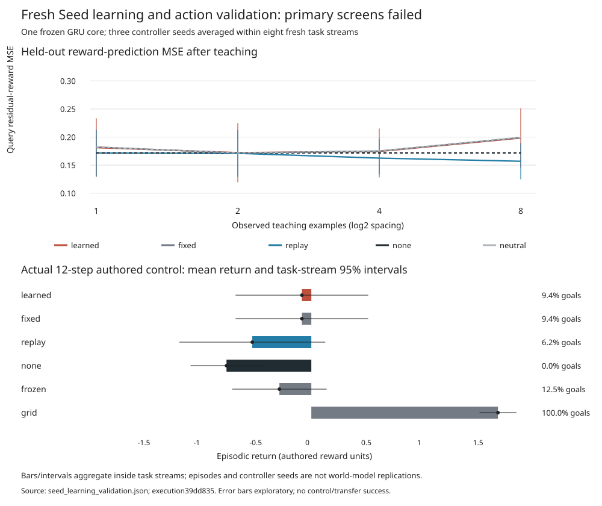

# Seed: isolated mechanisms and fresh learning validation

## Decision

**Complete, valid execution; learning, action and selection success were not
established. Cross-domain evaluation was correctly blocked.** The GRU, world
heads and source bank remained frozen. No earlier experiment was overwritten.
Execution revision: `39dd835154c1ccd3fd5dcad4c2cb71098757bba3`; base:
`8d0218176307eb1cf119d54d82272c7cabd9c177`.

## 1. Mechanisms are now distinct

- **Repair** fits the shared block, retains existing skill vectors and requires
  known other-context prediction drift <=1e-5 before adoption.
- **Scoped addition** creates a new scope only. Existing scopes cannot be
  replaced; shared parameters and predictions in other contexts are unchanged.
- **Merge** absorbs an existing skill algebraically, without optimization. It
  rebases other scopes and rejects a change that damages retained anchors.
- **Keep** is a scored candidate. All candidates use final development error,
  not mismatched final-error versus learning-curve criteria.
- Reviews are cached under evidence and post-edit parameters. Repeating the
  same review performs no fits and creates no new adoption or undo entries.
- The last four edits can be reversed exactly if no intervening learning changed
  parameters. Rollback preserves evidence and spent work. It rejects stale undo.
  Saved state v2 records undo/cache metadata; legacy v1 remains loadable.

Unit tests demonstrate exact scope isolation, successful and rejected merges,
distinct repair behavior, reversibility, stale-undo rejection and idempotent
repeated reviews. These establish software semantics, not empirical usefulness
of structural growth. Finite-anchor preservation is not a guarantee for every
unobserved input. The GUI includes a checked rollback button.

## 2. Fresh learning-to-learn benchmark: failed

New registered authored task streams: eight training, eight development and
eight assessment goals, with disjoint teaching/query/retention resets. Three
new plasticity-controller fits, 64 Adam updates each. They share one frozen
neural core; they are not three independent pretrained models. Source-only RMS
feature scaling is frozen and shared across methods.

All learners start from the same four-example old-task fit. No adaptation
retains it; the separate frozen-neural controller has zero residual. Replay
uses one full-prefix/old-anchor update with a feature-curvature-bounded step.
Unlike the previous 0.2-step baseline, it is numerically stable. A neutral
untrained diagonal matches the learned controller's initialization.

Assessment MSE after **1 / 2 / 4 / 8** examples:

- Learned: **0.18111 / 0.17225 / 0.17441 / 0.19826**.
- Fixed protection: **0.18217 / 0.17158 / 0.17504 / 0.19911**.
- Scaled replay: **0.17148 / 0.17095 / 0.16244 / 0.15687**.
- No adaptation: **0.17175** at every budget.
- Neutral diagonal: **0.18222 / 0.17178 / 0.17539 / 0.19953**.

Mean learning-curve MSE: learned **0.181507**, fixed **0.181978**, replay
**0.165435**, no adaptation **0.171752**, neutral **0.182230**.
Fixed-minus-learned reduction **+0.000470 [-0.000742,+0.001682]** is inconclusive.
Replay-minus-learned is **-0.016072 [-0.029590,-0.002555]**: replay has lower
error on this finite assessment. Learned plasticity fails the registered 10%
all-baseline rule. Retention degradation: learned **+0.016832**, fixed
**+0.016443**, replay **-0.004281**, none **0**. More teaching does not reliably
help the protected learners in this setup.

Intervals use eight independently registered task streams after averaging the
three controller seeds inside each stream, Student-t95%, df7. They are
conditional on one pretrained core and this authored distribution. Comparisons
are exploratory/unadjusted; tasks, states and controller seeds are not extra
world-model replications. Development outcomes did not select checkpoints.

## 3. Learning did not improve action quality

At eight examples, mean action regret: learned **0.70833**, fixed **0.70833**,
frozen neural **0.45000**. Learned and fixed chose identical tested actions.
Closed-loop goal fractions and returns:

- Learned: **9.375%**, **-0.084375**.
- Fixed: **9.375%**, **-0.084375**.
- Scaled replay: **6.25%**, **-0.528125**.
- No adaptation: **0%**, **-0.758750**.
- Frozen neural: **12.5%**, **-0.285625**.
- Known-grid controller: **100%**, **+1.669375**.

Learned-minus-fixed return: **0 [0,0]** on this sample. Learned-minus-frozen:
**+0.20125 [-0.40458,+0.80708]**, inconclusive. A positive return point estimate
does not override worse ranking/goal completion or failure versus fixed protection.
There were four paired episodes per stream/method, maximum 12 steps, no online
adapter changes during evaluation. There were 96 actual episodes per adaptive
method (three controller versions), and 32 for each external frozen/grid
reference. Repeated deterministic baseline runs were charged, not counted as
extra independent models.



### Exact source-derived representational limitation

The reward residual input concatenates shared current h/z, observation, action
one-hot and a bias. For a fixed linear adapter:

`correction(state,a) - correction(state,b) = weight_action[a] - weight_action[b]`.

The learned correction therefore cannot change its relative action preference
with the current state. The frozen nonlinear model can still have state-dependent
rankings; this statement applies to the added residual, conditional on fixed
adapter weights. An algebraic regression test verifies it without new data.
It is a demonstrated representational restriction, not proof that it alone
caused every episode failure. Online updates could change the biases over time;
the registered assessment froze them.

The shared meaning block has a related limitation: the appended word hash
changes only an object-independent offset. Arbitrary word-by-object meanings
cannot be assumed expressible by that shared additive head. Scoped blocks can
change that behavior within their bounded contexts; isolated per-word tests are
not evidence that the deployed shared block already does so generally.

## 4. Few-example meaning: limited, no neural advantage established

Twelve new authored lessons: six unary predicates and six supplied relational
primitives. Same teaching-label counts, disjoint support/query inputs, neural
costs and full-symbolic checking reported separately. At eight labels:

- Unary: learned/fixed **80.0%**, replay **71.67%**, all-negative no-adaptation
  **86.67%**. Symbolic **71.67%** correct with that same coverage; unresolved
  answers abstain and count as no correct answer. This is not evidence that the
  neural learner is more reliable than the symbolic checker.
- Relations: learned/fixed **65%**, replay **75%**, none **63.33%**, symbolic
  **100%**. The symbolic learner is stronger here.
- Composed instruction check: neural and symbolic both **100%** after one
  demonstration per word, remaining at 100% for 2/4/8. There is no neural
  sample-efficiency advantage. Syntax, primitive moves and displacement labels
  are supplied. One direction answer is repeated across eight object examples;
  separate per-word linear heads and unlabelled query observations are used.

Unary targets are imbalanced: guessing negative is a strong baseline. The raw
capture retains labels and per-task correctness but not every semantic prediction,
so no posthoc balanced-accuracy claim is made. Relation geometry is structured
input, not discovered visual relations. The instruction test is a finite binding/
composition check, not open-ended sentence understanding. All budget curves,
abstentions and task outcomes are retained. No claim of useful general language
learning or new symbolic primitives follows.

## 5. Autonomous learning-action selection: failed utility test

The same OuterSeedMeta/EpsilonGreedyController selects ask, test concept, repair,
add scope or keep under fixed feasibility/cost rules. Twelve source lessons pay
for revealed probes; eight other lessons assess the frozen selection policy.
Final two query labels never enter learning or choice. All methods have eight
decision/16-label caps; actual consumption differs and is reported.

- Adaptive: final MSE **0.25**, improvement/cost **0**, **16** labels used.
- Random: **0.25**, **0**, **1.75** labels on average, usually stops early.
- Always ask: **0.213220**, **0.002216**, **16** labels; weighted cost **16.6**.

Adaptive selected test-concept for all 192 held-out decisions. Source training
per controller attempted ask5/test53/keep8, never repair or scoped addition.
Structural actions were implemented but received no training exposure under
this schedule. Thus their comparative utility is unmeasured; this does not prove
they cannot help. The myopic probe-credit/feasibility loop learned a non-improving
reservation policy. It failed the future-performance-per-cost screen. Functional
feedback updates are not useful autonomous experiment selection.

## 6. Cross-domain transfer: correctly not executed

The bounded list-permutation adapter and strict gate are implemented and tested.
Because both object-world primary gates failed, its fresh scientific seeds
remain unused. Status is `not_run_object_success_gate_failed`, not incomplete
execution and not demonstrated transfer. No held-out family result is fabricated.

## Tests, provenance and resources

Pre-execution **176 relevant tests passed in 10.85s**. Final delivery receipt
records additional saved-data/representational tests, GUI checks and independent
arithmetic audit. The full historical suite was not rerun. Repository-only
verification works without PyTorch or local binary checkpoints:

```sh
python3 -I -S scripts/verify_seed_learning_validation.py
```

Independent stdlib recomputation verifies **4,320** raw ranking cells, maximum
arithmetic discrepancy **1.11e-16**. Parent/model/config/controller hashes are
checked; conditional completeness requires every planned task/method/budget.

Single run: **4.052113 seconds** body, conservative **6-second** debit. **7,035**
authored interactions: 192 new support +96 old teaching +648 query +648 retention
+4,843 actual control steps +216 meaning labels +32 instruction demonstrations
+360 selector label-bank outcomes. Cached labels are not recollected per learner.
The five world-step roles total **6,427**; the other **608** are supervised
authored answers. Zero Gym/real-world physics interactions. **46,404** imagined
action rows plus **5,156** posterior-prior rows, **5,948** encoder rows.
192 new controller optimizer steps; the GRU/heads/bank stayed unchanged.
Raw update/replay/anchor-solve counts are in the artifact, not hidden compute.

Carried session: **1901.6321034559958 used /1698.3678965440042 remaining**.
No retuning or second run followed. All historical artifacts remain preserved.
Source weights are small tracked JSONs; new validation heads are not silently
promoted into the GUI. The existing hash-locked GUI controller remains selected.

## One next scientific experiment

Test a bounded **action-by-observation interaction residual** against the current
additive head on newly registered teaching/control data, keeping the GRU frozen
and retaining scaled replay/fixed-protection/known-grid baselines. Match or report
parameter and compute differences. This directly tests the proven representational
restriction before spending more effort on a larger meta-controller. Do not
retune or reopen the current assessment, and do not advance transfer on this result.
