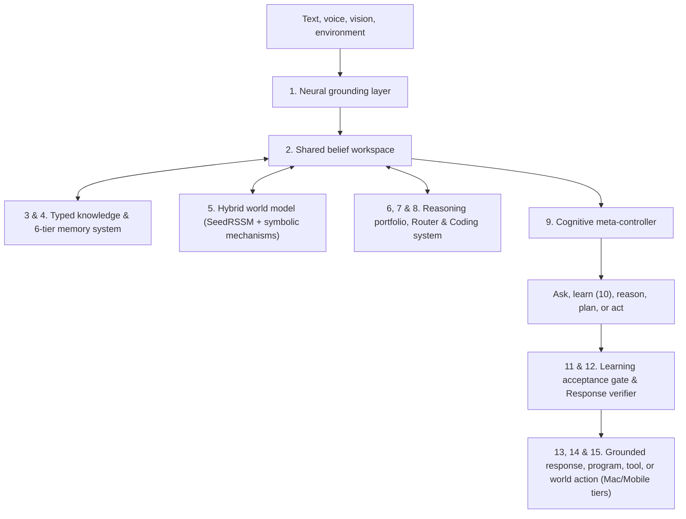

# NEXUS Seed — 15-Component Master Architecture

## Scientific Scope and Honesty Boundary

The NEXUS Seed Master Architecture (`src/nexus/seed/master/`) is a **bounded research architecture**—not a claim of achieved AGI or established learning-to-learn. Most of its individual components exist in prior research; NEXUS's scientific value must come from testing specific learning mechanisms for transfer, retention, or sample/compute efficiency under the repository's locked protocols.

Every component reuses and extends the existing `Session`, `SharedBrain`, `E1 Journal`, `SeedRSSM`, `skill_library`, `foundation`, `structure`, and `Conversation` modules without creating a parallel database or overwriting historical checkpoints.

## Architecture Overview

## The 15 Implemented Components

1. **Neural grounding layer (`src/nexus/seed/master/grounding.py`)**:
   - `CompactSubwordTokenizer` (byte + subword vocabulary, default 4096 tokens).
   - `build_torch_grounding_encoder`: 128-dimensional embeddings, two-layer bidirectional GRU (~1.5M parameters), and 5 separate heads (`intent_head`, `concept_head`, `skill_head`, `argument_head`, `confidence_head`).
   - Modality encoders (`ground_text`, `ground_vision`, `ground_audio`, `ground_sensor`, `ground_code`) all emitting typed `GroundedObservation(concepts, entities, relations, quantities, requested_goal, uncertainty, provenance)`.

2. **Shared belief workspace (`src/nexus/seed/master/memory.py`)**:
   - `SharedBeliefWorkspace.build_belief_state` constructs a temporary, task-focused `BeliefState(current_goal, dialogue_state, grounded_observations, active_concepts, candidate_hypotheses, retrieved_memories, available_skills, world_state, uncertainties, assumptions, resource_budget)` view over `SharedBrain`, `Session`, `SeedRSSM`, and `skill_library`.

3. **Unified typed knowledge representation (`src/nexus/seed/master/types.py`)**:
   - Strict dataclasses with invariant validation and deterministic serialization (`to_dict`/`from_dict`): `GroundedObservation`, `BeliefState`, `Concept`, `TaskSpec`, `Hypothesis`, `Skill`, `ExperienceEvent`, `ResponsePlan`, `ReasoningResult`, and `DebuggingSkill`.

4. **Six-tier memory architecture (`src/nexus/seed/master/memory.py`)**:
   - `MemoryArchitecture` projects six views over `Session` and `E1 Journal`:
     1. Working memory (`working_memory_view`)
     2. Episodic memory (`episodic_memory_view`)
     3. Semantic memory (`semantic_memory_view`)
     4. Procedural memory (`procedural_memory_view`)
     5. Model memory (`model_memory_view`)
     6. Replay and retention memory (`replay_retention_memory_view`) prioritizing important capabilities, rare concepts, failure cases, conflicts, and representative old knowledge.

5. **Hybrid world model (`src/nexus/seed/master/hybrid_world.py`)**:
   - Combines neural dynamics $f_{\text{RSSM}}(s_t, a_t)$ with symbolic mechanisms $r_{\text{mechanism}}(s_t, a_t)$:
     $$\hat{s}_{t+1} = f_{\text{RSSM}}(s_t, a_t) + r_{\text{mechanism}}(s_t, a_t)$$
   - Computes disagreement $D_t = d(\hat{s}^{\text{neural}}_{t+1}, \hat{s}^{\text{symbolic}}_{t+1})$ to trigger clarifying questions, active experiments, memory retrieval, hypothesis revision, or cautious abstention.

6. **Reasoning portfolio (`src/nexus/seed/master/reasoning.py`)**:
   - `RelationalReasoner` (graph + typed rules such as `transitive(older)` and spatial `north`/`south` with assumption tracking)
   - `ConstraintReasoner` (backtracking CSP/SAT solver)
   - `MathematicalReasoner` (typed arithmetic, linear equation solving, substitution verification, dimensional homogeneity checks)
   - `ProgramExecutionReasoner` (stepwise execution traces and postcondition verification)
   - `CausalReasoner` (`X causes Y`, `X correlates with Y`, `Z may explain both X and Y`, interventional experiment selection)
   - `AnalogicalReasoner` (structural relational mapping across domains such as `list_reversal <-> reverse_movement_sequence`)
   - `HierarchicalPlanner` (`Goal -> subgoals -> candidate skills -> imagined consequences -> verified action`)
   - `ActiveInvestigationReasoner` ($\operatorname{VOI}(q) = \mathbb{E}_y[L(b_t) - L(b_{t+1} \mid q, y)] - \lambda C(q)$).

7. **Reasoning router (`src/nexus/seed/master/reasoning.py`)**:
   - `ReasoningRouter.route(task_type, payload)` dispatches tasks across the portfolio and returns `ReasoningResult(conclusion, proof_or_trace, assumptions, confidence, cost, unresolved_questions)`.

8. **Coding and debugging architecture (`src/nexus/seed/master/coding.py`)**:
   - `CodeTaskParser`, `RepositoryModel`, `ProgramSynthesizer` (retrieve skill, compose programs, generate patch), `ExecutionSandbox` (AST syntax, static lint, security/resource limits, type contracts, unit tests), `DebuggingController` (`repair_syntax`, `change_implementation`, `revise_specification`, `request_clarification`, `revert`), and `DebuggingSkill` extraction.

9. **Cognitive meta-controller (`src/nexus/seed/master/controller.py`)**:
   - Scores $c_t \in \{\text{answer}, \text{retrieve}, \text{reason}, \text{simulate}, \text{ask}, \text{experiment}, \text{execute}, \text{learn}, \text{abstain}\}$ via:
     $$J(c) = \mathbb{E}[U_{\text{current}} + \kappa U_{\text{future information}}] - \lambda C_{\text{compute}} - \mu C_{\text{risk}} - \nu C_{\text{forgetting}}$$

10. **Three timescales of learning (`src/nexus/seed/master/memory.py`)**:
    - Immediate in-conversation semantic learning (`learn_immediate_concept`, no neural training required)
    - Medium-term cross-lab skill induction (`learn_medium_term_skill`, disjoint checks + counterexamples)
    - Long-term neural consolidation (`consolidate_long_term`, verified episode filtering + retention pairing).

11. **Learning acceptance gate (`src/nexus/seed/master/memory.py`)**:
    - `LearningAcceptanceGate.evaluate_and_gate` checks new-task gain, retention ($\ge 0.98$), transfer, compute/risk bounds, and paired confidence intervals before committing any persistent update; otherwise rolls back and logs the rejection in the journal.

12. **Grounded response generation (`src/nexus/seed/master/controller.py`)**:
    - `GroundedResponseGenerator.render_and_verify` enforces that every factual claim maps to evidence, numbers and skill results remain unaltered, uncertainty is preserved in wording, unsupported claims are stripped, and deterministic fallback templates take over if candidate surface text fails verification.

13. **Conversation behavior (`src/nexus/seed/master/runtime.py` & `src/nexus/seed/conversation.py`)**:
    - Supports normal greetings, immediate concept/skill teaching (`"Flip" means reverse the order of a sequence.`), relational reasoning (`"If A is north of B and B is north of C, where is A relative to C?"`), and skill execution (`"Could you arrange these from smallest to largest? [4, 1, 3, 2]"`), with deterministic data-only replay on `Session.restore`.

14. **Knowledge acquisition (`src/nexus/seed/master/controller.py`)**:
    - `KnowledgeAcquisitionEngine` ingests local documents and structured tables with provenance (`sha256`, `source`, `ref`) and performs sparse keyword/inverted-index retrieval without scanning all memory.

15. **Compute architecture for Mac and mobile (`src/nexus/seed/master/controller.py`)**:
    - `TieredComputeController` manages Tier 1 (always-on compact core), Tier 2 (medium neural layer), and Tier 3 (on-demand/background consolidation), including 8-bit and 4-bit weight quantization and mobile battery/charging deferment.

## Audited Benchmark Classification (`src/nexus/seed/master/meta_learning.py`)

- **Benchmark label**: `bounded exact-motif program-prior reuse demo` (`mean_cold_start_evaluations = 9.5 -> mean_meta_learned_evaluations = 1.75`, `81.58%` reduction)
- **Claim classification**: `engineering demonstration of within-family search-prior reuse`
- **Multi-domain suite label**: `bounded multi-reasoner integration suite` (6 domains)
- **Dialogue answer to "Did we achieve learning to learn?"**:
  `"Not yet. I demonstrated bounded program-prior reuse, but genuine held-out learning-to-learn remains unestablished."`

### Five Audited Limitations of the Present Demo

1. **Source and target reuse exact canonical motifs**:
   - `sort -> unique`
   - `reverse -> increment`
   - `even -> sort`
2. **Held-out inputs are not held-out program mechanisms**: evaluating the same canonical program on new integer lists tests input execution, not unseen program composition.
3. **"Retention" in the demo stores target held-out correctness rather than old-task retention**: `retention_scores` recorded whether the target held-out input passed rather than re-evaluating frozen source tasks before and after learning.
4. **"Transfer" in the demo is constructed rather than independently measured**: `transfer_score = meta_score + 0.02` is a synthetic offset, not a separate domain evaluation.
5. **The six-domain suite contains hand-authored solver fixtures**: it is a `bounded multi-reasoner integration suite`, not evidence of acquired general intelligence.

For the preregistered scientific test of disjoint compositional meta-learning, see [NEXUS_SEED_DISJOINT_META_PROTOCOL.md](NEXUS_SEED_DISJOINT_META_PROTOCOL.md).

## Related Documentation

- [Master Context](MASTER_CONTEXT.md)
- [Canonical Current State](NEXUS_CANONICAL_CURRENT_STATE.md)
- [Code Ownership and Reuse Map](NEXUS_CODE_REUSE_MAP.md)
- [Executable Foundation](NEXUS_SEED_FOUNDATION.md)
- [Conversational Workspace](NEXUS_SEED_CONVERSATION_WORKSPACE.md)
