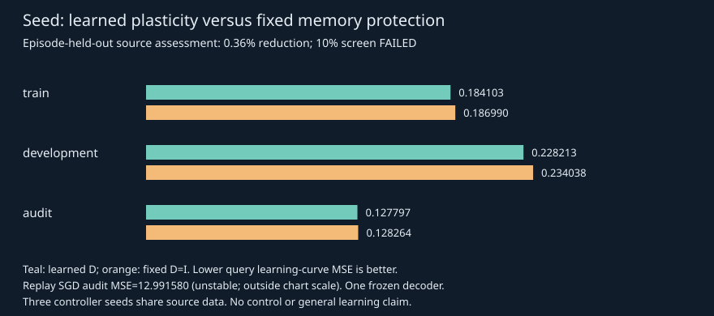

# Seed memory-aware adaptation: implementation and source-only results

## Decision

**Implemented and functional; registered practical learning-rule improvement
NOT ESTABLISHED.** The user-supplied structure is actual executable code,not a
capability checklist. It wraps the existing core rather than replacing research
history. Source study ran once from **bd1f8b3c6fcb13529c15f60f7468129c86eb03bb**.
Original frozen models and prior result artifacts remain unchanged.

## Actual architecture

Frozen SeedRSSM/Belief → small reward62/meaning53 residual parameters → actual
feedback → memory-aware local solve. Eight anchors and four reserved assessments
per channel live in SAME Session/E1 Journal. A4→62 positive plasticity controller
(310parameters) learns from short teaching-curve assessment loss plus retention,
not merely current-example training loss. Runtime learns theta only; controller
phi is loaded hash-verified and remains frozen during user sessions.

Local equation is the attachment's damped precision-weighted correction,using
a memory-sized Woodbury solve. For these linear blocks the Jacobian is exact.
The2parameter example reproduces1.090909/0.909091 and30.25×less old squared
error than the unprotected solution.100seeded direct precision solves agree
within1e−11. These are mathematical correctness tests,not transfer evidence.

Actual label updates meaning only; actual reward updates reward only. Channel
routing is **typed and explicit**,not learned semantic routing. The learned
controller was meta-trained on reward residuals only; transfer of its diagonal
settings to meaning is untested. The learned meaning score is inspectable but
cannot authorize unverified symbolic execution. Existing37-way program proposals
and symbolic checker remain; no unrestricted new language/program generation.

Bounded edits are executable numeric skills: keep,repair a shared block,add a
context-scoped residual,merge scoped into shared. At most2skills of<=62parameters.
Development selection uses subsequent-support-prefix query error,retention,
temporary-fit counts and exact canonical JSON storage. This is a replay-based
future-learning proxy,not demonstrated benefit on new future tasks. Keep always
competes; tests demonstrate both keep and an actual scoped-skill adoption. GUI
retains keep when there is insufficient separate evidence. No source rewriting.

Question selection performs <=8temporary local updates with an equal binary
answer prior,and scores remembered-label error reduction. Neither imagined answer
nor reserved assessment enters live learning. It is a computational proxy for
question value; no sample-efficiency advantage was tested. Corrections invalidate
meaning weights/anchors/skills safely instead of retaining stale trusted labels.

## Source-only measured test

Runtime follow-up after the source result: every eight actual lessons now
automatically triggers the same bounded edit checker (maximum three/session).
This removes the need for a human to request every structural review. A unit
fixture verifies all three triggers and cap enforcement; the Chrome sequence
checks manual review with insufficient evidence. No new scientific outcomes
were collected and the source-study calculation was not changed or repeated.

No environment construction or new scientific interactions. Reused only351
recorded source transitions from the previous contract study,with locked hashes.
Three short episodes excluded by preregistered length rule.30training,7development,
8audit episodes;first2rows teach,remaining rows assess. Old anchors come from a
different cyclic episode inside the same partition. Source records were already
inspected and used in world-model training,so this is NOT untouched confirmation.

Three controller optimizer seeds,64Adam steps each,final checkpoints only.
All begin at the same neutral diagonal;seeds vary sampled training-lesson order.
Error/novelty context features use stop-gradient;the outer gradient follows the
inner parameter updates and learned diagonals,not the nonlinear frozen core.
All share **one** frozen tanh/5511 core. Across audit episodes within each seed:

- Learned plasticity query learning-curve MSE: **0.12779743**.
- Fixed D=I memory protection: **0.12826394**.
- Fixed-step.2 replay SGD: **12.99158037**.
- Paired fixed-protected minus learned reduction: **+0.00046651
  [−0.00117837,+0.00211139]**,or **0.3637%**.
- Learned retention degradation0.000012696 versus fixed0.000013673.

The registered10% screen fails despite slightly less average forgetting. All
three point differences favor learned D,but the paired interval includes0.
This n3 interval is over controller optimizer randomness conditional on the
same decoder and data; it is not an interval across3independent world models.

Train MSE learned/fixed0.184103/0.186990;development0.228213/0.234038.
The fixed replay baseline is finite but unstable for these feature scales:
audit forgetting6.67757. Its large deficit is **not** evidence of beating a
strong tuned replay learner. No retuning or alternative run followed this result.
Fixed memory protection is the relevant stronger comparator,and learned D did
not meaningfully improve it. Raw per-episode curves/gradients and independent
stdlib analysis are preserved in the linked artifacts.

## Tests and real GUI

Pre-execution147relevant tests passed;final **156passed in9.39seconds**. They cover local math,outer gradients,
query-label isolation,determinism,feedback routing,retention constraints,typed
edits,temporary answer isolation,correction invalidation,hashes,owner opt-in,
session independence,restart,stop and missing-grid rejection,including independent
repository-only evidence checks. The entire historical test suite was not rerun.

Actual Chrome155.0.8059.85 verified teaching updates meaning only,actual action
feedback updates reward,learned meaning readout,inspection immutability,server
restart recovery,hypothetical answers discarded,conservative structural keep,
correction invalidation,stop and mobile. Zero page errors or external requests.
These are authored engineering checks,not control-quality experiments. Two
actual teaching/correction answers,three adapter lessons and1110candidate/
1831predicate checks were recorded;the selected GUI action was not demonstrated
to improve movement. No hidden oracle was passed into the learner.

## Resources and provenance

Measured source-study command body0.792305541seconds,plus interpreter/import
startup;conservative2second session debit.192Adam meta-steps,384learned inner
support examples,384baseline support examples;2178query examples per side.
Evaluation810inner support examples and4608query predictions.789anchor-init
solves,924protected-update solves,and1288replay anchor predictions counted.
351new imagined candidate rows plus351posterior-prior rows;351encoder rows.
Zero new real-environment interactions. Runtime90second/400candidate-row cap
respected. Frozen core weights/source bank unchanged. No historical retraining.

Carried session ledger **1895.6321034559958used /1704.3678965440042remaining**.
Repository-only analyses do not run models or environments. GUI/unit fixtures
are separate engineering checks,not scientific replications. Three small new
controller JSONs and hashes are tracked;all required model data for this GUI
are available in Git. All old results stay byte-identical.
Independent byte comparison verified706prior artifacts against520100e.
All3new controller JSONs total18,270bytes;peak process RSS was not recorded.

## Use and one next scientific step

[Adaptive GUI instructions](seed/ADAPTIVE_QUICKSTART.md).
Protocol: [locked source test](NEXUS_SEED_MEMORY_AWARE_PROTOCOL.md).
Raw: [study](../artifacts/seed_memory_aware.json),
[analysis](../artifacts/seed_memory_aware_analysis.json).

One next question: on a fresh,predeclared stream of grounded teaching tasks,
does this protected small-block learner beat a feature-scale-stable replay
baseline in both learning speed and retention? Freeze normalization/update
choices on training data before scoring. Do not expand capacity or treat the
present small positive point estimate as learning-to-learn or AGI.
