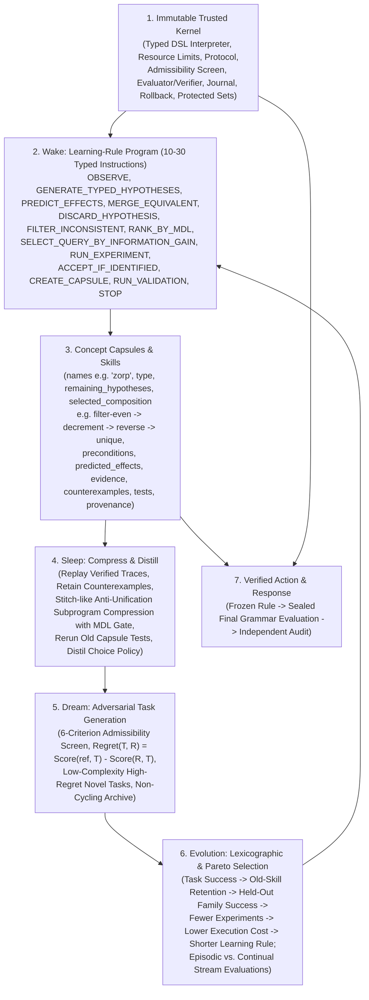

# NEXUS Seed Combined Wake–Sleep–Dream–Evolution Architecture & Meta-Rule Evolution v1 Protocol (`seed_meta_rule_evolution_v1`)

## 1. Scientific Objective & Architecture Overview

This preregistered protocol specifies the **Combined Wake–Sleep–Dream–Evolution Architecture** for NEXUS Seed and its first CPU-sized evolutionary meta-learning experiment, **Meta-Rule Evolution v1 (`seed_meta_rule_evolution_v1`)**.

---

## 2. Six Architectural Invariants

### 2.1 Immutable Trusted Kernel
The kernel must **never evolve** (`kernel_sha256_before == kernel_sha256_after` across every generation and task):
1. Typed 13-instruction DSL interpreter (`execute_learning_rule`);
2. Hard resource limits (`10..30` instructions, question budget $Q_{\max}=6$, execution budget $E_{\max}=64$, wall/CPU cap `120s`, memory `2048 MB`);
3. Preregistered experiment protocol and configuration digest check;
4. Hidden-task generator admissibility interface;
5. Evaluator and independent verifier;
6. Append-only SHA-256 evidence journal;
7. State snapshot and rollback guard on retention/validation failure;
8. Protected assessment sets across all four grammar families.
The learning rule may replace itself, but can **never** modify its evaluator, score function, or target generator.

### 2.2 Executable Learning-Rule DSL (`10–30` Typed Instructions)
- **Instruction Vocabulary (13 typed instructions)**:
  `OBSERVE`, `GENERATE_TYPED_HYPOTHESES`, `FILTER_INCONSISTENT`, `PREDICT_EFFECTS`, `RANK_BY_MDL`, `SELECT_QUERY_BY_INFORMATION_GAIN`, `RUN_EXPERIMENT`, `ACCEPT_IF_IDENTIFIED`, `CREATE_CAPSULE`, `MERGE_EQUIVALENT`, `DISCARD_HYPOTHESIS`, `RUN_VALIDATION`, `STOP`.
- **7 Mutation Operators**:
  1. `insert_instruction`
  2. `delete_instruction`
  3. `replace_instruction`
  4. `swap_ordering`
  5. `modify_stopping_threshold`
  6. `change_tie_breaking_rule`
  7. `toggle_validation_test`
- **Initial Population (`32` rules per seed)**:
  - `handwritten_learner` (current handwritten enumerate-filter-query learner);
  - `exact_information_gain_learner` (handwritten exact Shannon information-gain learner);
  - `random_question_learner`;
  - `shortest_program_learner`;
  - `minimal_noop_learner`;
  - `27` seeded mutated copies (`mutated_starter`).

### 2.3 Wake: Concept Capsules Without Whole-Program Fingerprints
During each Wake task, the executed learning rule constructs a `ConceptCapsule` with all 10 required fields:
`names`, `type`, `remaining_hypotheses`, `selected_composition`, `preconditions`, `predicted_effects`, `evidence`, `counterexamples`, `tests`, `provenance`.
- Hidden target compositions have length $L \in \{4, 5\}$ (including `["even", "decrement", "reverse", "unique"]`, i.e. `filter-even -> decrement -> reverse -> unique`, bound to the invented word `"zorp"`) and **cannot exist in any stored whole-program fingerprint table**.
- Primitive effects are learned from length-1 primitive interactions only (`stored_whole_program_fingerprints == 0`, `manually_supplied_cross_lab_mapping == False`).

### 2.4 Dream: Admissible Regret-Driven Adversarial Task Generation
A Dream-generated task $T$ is admissible only if all 6 kernel checks pass:
1. Trusted reference oracle solves $T$ within budget;
2. Hidden composition is absent from stored whole-program fingerprints;
3. Semantically distinct from all archived tasks in `DreamTaskArchive`;
4. Sufficient evidence exists to uniquely identify the mechanism within budget;
5. Zero evaluator-only assessment information is exposed;
6. Description complexity $L(T) \le 5$ is bounded.
Admissible candidates are ranked by $\operatorname{Regret}(T, R) = \operatorname{Score}(\text{reference}, T) - \operatorname{Score}(R, T)$ divided by complexity.

### 2.5 Evolution: Lexicographic & Pareto Selection Across Episodic and Continual Regimes
- Rules failing `task_success < 1.0`, `old_skill_retention < 0.98`, or `held_out_family_success < 1.0` are rejected even if cheap or short.
- Admissible rules are selected by lexicographic priority and Pareto dominance:
  `(1) task_success`, `(2) old_skill_retention`, `(3) held_out_family_success`, `(4) fewer_experiments`, `(5) lower_execution_cost`, `(6) shorter_learning_rule`.
- Every candidate rule is evaluated separately in:
  - **Episodic evaluation**: capsule memory reset between tasks to measure the learning rule itself;
  - **Continual stream**: accepted capsules retained across tasks to measure reuse, compression, and forgetting.

### 2.6 Sleep: Stitch-Like Compression & Verified Policy Distillation
After Wake tasks on the continual stream:
1. Replay verified traces and retain counterexamples;
2. Run anti-unification / Stitch-like subprogram compression over accepted capsules, adding a reusable macro primitive **only when total description length strictly decreases ($\Delta\text{MDL} < 0$)**;
3. Rerun all old capsule validation tests (`pass_rate == 1.0`);
4. Distil verified step choices into a small choice policy (`DistilledChoicePolicy`) that predicts the verified slow rule's choices without ever deciding truth (`neural_decides_truth == False`).

---

## 3. Meta-Rule Evolution v1 Experimental Design

- **8 Independent Evolution Seeds**: `1751000001..1751000008`
- **Population & Generations**: `32` rules $\times$ `20` generations per seed (`640` rule evaluations per seed, `5,120` across 8 seeds)
- **Rule Length Bounds**: `10..30` typed instructions
- **Four Independent Compositional Grammars**:
  1. **Source Family 1 — `list_transformations`**: 6 list primitives (`reverse`, `sort`, `unique`, `increment`, `decrement`, `even`), unseen length 4–5 targets including `filter-even -> decrement -> reverse -> unique` bound to `"zorp"`.
  2. **Source Family 2 — `boolean_mechanisms`**: 6 4-bit register stream primitives (`invert_stream`, `lex_sort_registers`, `prune_duplicate_registers`, `toggle_parity_up`, `toggle_parity_down`, `gate_even_parity`), unseen length 4–5 targets.
  3. **Development Transfer Family — `relational_graphs`**: 6 directed weighted graph primitives (`flip_edge_sequence`, `canonical_edge_order`, `contract_parallel_edges`, `boost_edge_flow`, `attenuate_edge_flow`, `filter_balanced_flow`), unseen length 4–5 targets.
  4. **Sealed Final Family — `sealed_action_state_transitions` (generated AFTER freezing the evolved rule)**: 6 action-state telemetry primitives with new sensor `thermal_flux`, new action `calibrate_shield`, and new hidden variable `latent_drift_polarity`.

---

## 4. Nine Mandatory Pass Criteria (All Nine Required)

1. **Gate 1 (`beats_handwritten_info_gain_on_sealed`)**: Evolved frozen rule beats `exact_information_gain_learner` on both development (`relational_graphs`) and sealed (`sealed_action_state_transitions`) families with 95% paired CI strictly $> 0$.
2. **Gate 2 (`fewer_experiments_and_less_compute`)**: Requires strictly fewer active experiments AND lower execution compute than `exact_information_gain_learner` and `handwritten_learner` in both episodic and continual evaluations.
3. **Gate 3 (`retains_98pct_old_skills`)**: Retains $\ge 98\%$ (`>= 0.98`) of protected old skills across all 8 seeds and passes 100% of Sleep capsule regression tests.
4. **Gate 4 (`wins_on_multiple_independent_grammars`)**: Wins on all 4 independent grammars (`list_transformations`, `boolean_mechanisms`, `relational_graphs`, `sealed_action_state_transitions`).
5. **Gate 5 (`target_compositions_not_stored`)**: `stored_whole_program_fingerprints == 0`, `stored_target_compositions == 0`, `manually_supplied_cross_lab_mapping == False`, and `"zorp"` capsule constructs `["even", "decrement", "reverse", "unique"]` from primitives.
6. **Gate 6 (`removing_evolved_rule_removes_advantage`)**: Ablating the evolved rule back to `exact_information_gain_learner` or stripping `PREDICT_EFFECTS -> MERGE_EQUIVALENT -> DISCARD_HYPOTHESIS` eliminates the experiment and compute reductions.
7. **Gate 7 (`controls_do_not_match`)**: Both `random_evolution_control` and `rule_size_only_control` fail to match the evolved rule across all 8 seeds.
8. **Gate 8 (`survives_independent_seeds`)**: Improvement holds on `8/8` independent seeds (`ci95_low > 0`).
9. **Gate 9 (`all_compute_and_kernel_integrity_reported`)**: Immutable kernel hash unchanged (`kernel_sha256_before == kernel_sha256_after`), frozen rule committed before sealed family generation, and all evolutionary + construction + Wake/Sleep/Dream compute reported.
