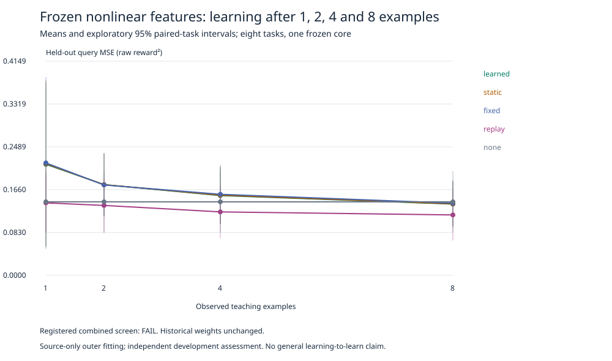

# Seed nonlinear-feature learned update rule — development result

**Registered combined screen: FAILED.** The experiment completed once without
retuning or retry. Learning-to-learn remains unestablished.

Protocol/code: `73d1dcd813dfa951562a7ec427c3b9223ac02f3b`.
Starting base: `cf3f54cebe580a14ec191c48659f79e371cc1b72`.
Branch: `codex/seed-nonlinear-learning-rule`.
[Protocol](NEXUS_SEED_NONLINEAR_LEARNING_PROTOCOL.md),
[configuration](../configs/seed_nonlinear_learning.json),
[raw results](../artifacts/seed_nonlinear_learning.json).
Raw SHA256: `c6c62c01d4b957c5928599884cdf499a462f6063b423fc45775515ac4763b650`.
Config file SHA256: `aa5aa49a90f44f54c291091b331692d548b21891807d06e5497aa433e7fc1201`.

## What ran

The existing EXPERIMENTAL host dispatched a vetted Seed adapter, with durable
reservation, CPU/wall/RSS limits and pre-interaction/forward checks. It reused
ActionReadout's 33-dimensional nonlinear basis, PlasticityController,
correction(), LessonTask/curve/scale_features, Belief and the unchanged MPC.
No new core, architecture search or parallel learning framework.

Twelve source tasks, four development tasks and eight fresh final development
task streams. Three outer learner seeds share ONE frozen core/readout and are
averaged within tasks. New-task goals are disjoint within this study; the prior
goal (0,0) is shared for retention. Previous model training may have included
these goal coordinates. This is not unseen-physics confirmation. Initial state
identities avoid the 2,559 identities extracted from the registered prior
artifacts, and are disjoint across new roles/control resets.

Contextual protection has 165 trainable parameters; static protection has 33.
Both receive the same 64-update Adam budget and source feedback. All methods
share the old-anchor initial residual, eight teaching labels and source-only
feature scaling. "None" retains the old fit but does not adapt to new labels.
Outcome MSE is raw reward squared, not target-normalized.

## Prediction after teaching

Primary: equal average over four budgets, outer seeds averaged within tasks.
Budgets count NEW-task examples; every method additionally receives the same
four old-task anchors as initial knowledge.

| Method | 1 example | 2 examples | 4 examples | 8 examples | Curve mean |
| --- | ---: | ---: | ---: | ---: | ---: |
| Learned contextual | .215157 | .175638 | .154609 | .138088 | .170873 |
| Source-trained static | .216274 | .175622 | .155281 | .138515 | .171423 |
| Fixed protection | .217827 | .175056 | .156988 | .139787 | .172414 |
| Scaled replay | .140368 | .135441 | .122897 | .117015 | .128930 |
| No new-task adaptation | .142419 | .142419 | .142419 | .142419 | .142419 |



Positive differences favor learned contextual adaptation. Paired 95% intervals
use eight task means, df7, conditional on the single core; exploratory/unadjusted:

- Static minus learned: +.000550 [−.000201,+.001301]. Only 0.32% lower error,
  below the registered 10% minimum. The interval includes zero.
- Fixed minus learned: +.001541 [−.000715,+.003798]. Inconclusive.
- Replay minus learned: −.041943 [−.089400,+.005514]. Replay has a better mean;
  learned error is 32.53% higher, but this paired interval also includes zero.
- None minus learned: −.028455 [−.092469,+.035559]. No reliable improvement.

The intersection screen fails. This does not disprove learned update rules or
establish replay superiority under every task distribution. A falling curve
alone is insufficient: the learner must beat strong equal-teaching baselines.

Forgetting (change in old-task MSE): −.007057 learned, −.007153 static,
−.007364 fixed, −.010225 replay and 0 none. Negative means improvement.
The fixed+.01 retention bound passes.

Source fitting was active: contextual parameter changes had L2 norms
2.4741, 2.5154, 2.5099, with finite nonzero mean gradient norms. Static changes
were 1.2597, 1.2860, 1.2847. These prove updates, not useful meta-learning.

## Actual actions and complete episodes

Budget 8, two paired resets per task, 20 steps maximum. Learned/static/fixed
produced identical actual action sequences for every paired outer seed/task/
episode. All achieved mean return 1.4300 and 75% goals.

References and baselines, mean return / goal rate:

- Scaled replay and none: 1.33875 / 68.75%.
- Frozen readout: 1.33750 / 68.75%.
- Frozen world: −.47125 / 12.5%.
- Latent MPC: −.12375 / 18.75%.
- Random: −.23625 / 12.5%.
- Known-grid greedy: 1.82125 / 100%.

Learned-minus-static/fixed return is exactly 0. Versus frozen readout:
+.09250 [−.12623,+.31123]. Versus replay/none: +.09125 [−.12452,+.30702].
The registered −.1 lower-bound non-regression requirement was not met. This
means the bound is unestablished, not that control harm was demonstrated.

At eight examples, query-action regret was .219444 learned, .216667 static/fixed,
and .266667 replay/none. Optimal-action rates were 79.17% for all protected
rules, 75% replay/none. These query differences did not distinguish learned
protection from fixed/static in full episodes.

Task-specific learned return / goal rate (static/fixed identical):

- 97000000, goal (1,4): 1.72 / 100%.
- 97010000, goal (0,2): 1.99 / 100%; replay 1.26 / 50%.
- 97020000, goal (0,3): 1.37 / 100%.
- 97030000, goal (3,5): .20 / 0%.
- 97040000, goal (1,5): 1.99 / 100%.
- 97050000, goal (0,5): .30 / 0%.
- 97060000, goal (4,5): 1.85 / 100%.
- 97070000, goal (5,5): 2.02 / 100%.

The return point advantage over replay is concentrated in one task and matched
by fixed protection. It is not evidence of a better learned update procedure.
Full per-task/per-seed curves and every control step are in the raw artifact.

## Costs and reproducibility

1,584 collection + 3,066 control = **4,650 authored interactions**;
39,315 imagined rows + 3,116 posterior-prior rows = 42,431 core transition rows.
Query labels were collected once and reused across methods, not repeatedly
charged as simulation. Readout score/basis batches: 2,827 each. Replay prediction
examples: 2,448. The same frozen feature bank was reused across paired methods.

384 outer Adam updates, 3,072 source support examples processed, 41,472 source
query and 41,472 source retention examples processed. Fitting wall times per
seed (contextual/static): (.0843,.0705), (.0714,.0702), (.0709,.0700) seconds,
including each arm's initialization/optimizer setup, excluding shared collection,
feature extraction and checkpoint export. Updates are not matched FLOPs.
Frozen core: 30,278 stored weight scalars; frozen readout: 2,209 parameters.
Each inner residual has 33 coordinates. Across three contextual and three
static outer learners, there are 594 new trainable parameters in total.

Study body 2.924259s; full host dispatch 4.164333s; peak sampled RSS 361.55MiB.
CPU only, below all caps. macOS memory enforcement is the declared sampled-RSS
watchdog, not a byte-exact kernel limit. Conservative debit: 6 seconds.
**Ledger: 1916.6321034559958s used / 1683.3678965440042s remaining.** Host actual
charge and conservative scientific carry are both recorded. No confirmation
data, historical rerun or frozen checkpoint replacement.
An explicit additive journal debit reconciles the conservative six-second carry
with actual host wall time; it is not a second run or a rewritten receipt.

Core, readout and normalization/memory-bank tensors verified exactly unchanged.
Six new rule checkpoints are at
`runs/experimental/attempts/seed-nonlinear-learning-1/`; the freeze-before-audit
manifest is there too. Complete weights and file hashes are in tracked JSON.

```sh
python3 -I -S scripts/verify_seed_nonlinear_learning.py
python3 -I -S scripts/verify_seed_nonlinear_learning.py --check-checkpoints
python3 -I -S scripts/verify_seed_nonlinear_learning.py --restore-checkpoints runs/restored-seed-rules
```

Default verification needs no neural packages or private files. Explicit local
checkpoint audit fails if files are missing/wrong. Restoration writes NEW JSON
from saved weights and verifies exact hashes; no inference or training.

The GUI `/experimental` displays the live receipt, labeled curves and controls.
Fresh clones without private run files use stdlib-validated recorded replay.
No rule is promoted into the live agent. Post-result GUI/replay additions do
not change the execution revision or recorded experimental outcomes.

## Verification

The full relevant Seed/session/release/layout/planning/expression/factory suite
passed **292 tests in 27.29 seconds**. Source-only preflight passed before the
experiment; post-result tests reject missing seeds/tasks/methods/budgets,
nonfinite or changed metrics, and altered transition records. A separate test
proves that changing examples 5–8 cannot change snapshots after 1, 2 or 4.
All learned/static/fixed control action sequences were checked for equality.

Repository-only metric/resource reconstruction and the explicit local checkpoint
audit passed. All six rule checkpoint bytes can be reconstructed from saved
JSON. Real Chrome155 GUI QA passed six checks (including all baselines, correct
audit labels, immutable refresh and mobile layout), with no page errors or
external requests. Replay performed no inference, training or new interactions.
All **742 historical artifacts** match the starting Git blobs. Main and unrelated
original-worktree changes remain untouched. Verification receipt:
[machine-readable audit](../artifacts/seed_nonlinear_learning_verification.json).

## Decision and one next question

Do not expand architecture or call this useful learning-to-learn. Ask whether
the first protected correction is too aggressive relative to scaled replay.
Audit update magnitudes and prefix errors using permitted SOURCE data only,
before proposing a separately registered change. The audit stays closed;
the current evidence does not establish that cause.
