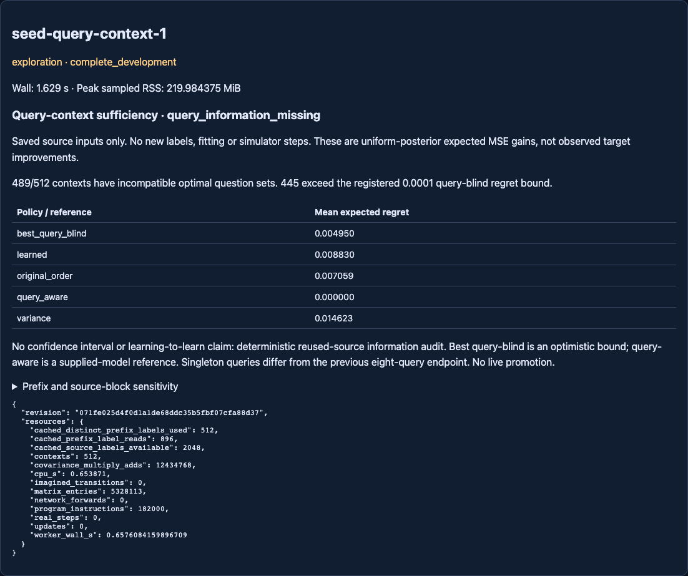

# Query-context sufficiency — completed source-only audit

## Finding and limits

**Query information is missing from the ten-feature selector.** In 489 of 512
saved source-prefix contexts, no single query-blind question was optimal across
all eight public singleton query sets. In 445 contexts, the unavoidable
mean-query expected regret exceeded the preregistered 0.0001 threshold.
The diagnostic verdict is `query_information_missing`; execution is complete
and valid, not an incomplete attempt or a learned-policy success claim.

This establishes an information limitation under the supplied uniform finite
prior and fixed version-space learner. It does NOT establish that this omission
caused the previous selector's failure, explain its effect size, or demonstrate
that a new feature or larger network would improve actual task outcomes.
The previous two failed acquisition screens remain closed and unchanged.

## Provenance and frozen inputs

- Branch: `codex/seed-query-context-sufficiency`.
- Actual base: `94bdad2a7c5c080e6bf105089243e225f3876579`, matching fetched GitHub.
- Clean protocol/implementation execution: `071fe025d4f0d1a1de68ddc35b5fbf07cfa88d37`.
- [Locked protocol](NEXUS_SEED_QUERY_CONTEXT_PROTOCOL.md).
- [Executable config](../configs/seed_query_context.json).
- [Raw cells and resources](../artifacts/seed_query_context.json).
- [Independent receipt](../artifacts/seed_query_context_audit.json).

Raw SHA256: `19d384738056dbe587436877f5737e3904d8069828cced40d690f54bd3180f52`.
Config SHA256: `015756cefe53b2b8b45b96db6d22f8c2c480ccbb52bb8f9f4f528772c4165f8b`.
Protocol SHA256: `12d921ce4a6bb84b6f053ac8154add68fc7aa27001bd68fc210801621b65c9a2`.
Parent SHA256: `afff98802bbadd0cc79ea2f5fd786c37c9a3670347e4ba01290f461b71e6f370`.

The audit projects only the parent's 128 SOURCE histories and eight frozen ridge
coefficient/normalization pairs. It uses no closed target rows or assessment
labels. Only already observed source-prefix labels condition the posterior.
The public 910-program catalogue is supplied knowledge, not newly discovered
ground truth. No GRU/RSSM/readout, teacher or selector is trained or changed.
The frozen selector was originally fitted from these source tasks, including
their source query labels, in the parent experiment. Its regret here is an
in-sample diagnostic, not a held-out generalization score. This audit does not
use those query labels to compute gains or reveal any additional answers.
Every one of the 822 prior Git-tracked artifacts is byte-identical to the base;
historical neural JSON checkpoint hashes match before and after execution.

## What was compared

For each source task, replay the original random teaching order at prefix
lengths 0, 1, 2 and 4. Keep the remaining question pool, posterior, model and
features fixed. Pair eight contexts differing only in the singleton query input
drawn from the task's original disjoint public query set. Thus 512 prefix
contexts and 4096 paired query contexts, with 25,600 candidate–query gain cells.

Expected MSE gain is `Cov(Yx,Yq)^2 / Var(Yx)` under the uniform posterior, zero
for constant candidates. This is a model expectation, not an unknown task's
observed reward. No unseen candidate label is revealed to choose a question.

The optimal query-blind reference is allowed to choose the best ONE candidate
for the mean of eight query contexts. The query-aware reference may choose a
different candidate for each query. Their difference is a lower bound on the
expected regret of ANY query-blind choice, including randomized choices.
Neither reference is a newly learned agent or evidence of real-world success.

Mean expected regret, equally weighted across source tasks/prefixes/blocks:

- Full query-aware supplied-model reference: **0.000000** by definition.
- Best query-blind optimistic reference: **0.004950234**.
- Original-order question: **0.007059353**.
- Frozen learned selector: **0.008829912**.
- Variance question: **0.014622720**.

These are not the previous experiment's actual query-MSE measurements. In
particular, the learned policy's lower expected regret than variance here does
not override its negative actual-outcome comparison in that experiment. The
audit uses singleton queries and a uniform posterior, whereas the previous
endpoint averaged eight actual query outcomes from a different task mixture.
We did not retune on these results or score closed targets again.

## Concrete counterexample

The first recorded source context (task 1745100000, empty prefix) has candidates
`[0,4,5,7,11,13,14,15]` and queries `[1,2,3,6,8,9,10,12]`.
For query 1, candidate 0 is uniquely best: expected gain **0.090000** versus
candidate 4's **0.024693878**. For query 6, candidate 4 is uniquely best:
**0.024693878** versus candidate 0's **0.003923439**.

For each candidate, its own ten-feature vector is exactly unchanged across
these query contexts. The two DIFFERENT candidates need not have identical
vectors to each other. Candidate 0 has features
`[1,0,0,0,0,.5,.25,1,.5,1]` and frozen score 0.034052541;
candidate 4 has `[1,0,0,1,0,.5,.25,1,.5,1]` and score 0.022538843.
Thus learned, variance and original-order select 0 for BOTH query contexts,
while the optimal choice changes. The eight-query alias gap here is 0.005192610.

## Sensitivity and statistical interpretation

By observed prefix, incompatible counts out of 128 and mean alias gap:

- Prefix 0: **117**, **0.004095501**.
- Prefix 1: **122**, **0.003731141**.
- Prefix 2: **125**, **0.005316946**.
- Prefix 4: **125**, **0.006657347**.

Across the eight source-selector blocks, incompatible counts out of 64 are
`64,62,63,58,61,58,61,62`; mean gaps are
`.006153254,.005661344,.004723549,.004357650,.004269409,.005468506,.004759231,.004208926`.
The maximum single-context gap is **0.032577328**.

No confidence intervals are reported. These are deterministic reused-source
counterexamples, not independent fresh task/model replications. Prefixes and
query contexts share posteriors and catalogue entries; their counts cannot be
treated as thousands of independent trials. All hypotheses belong to one
authored Boolean family. The frequency in other tasks is unknown.

## Resources and integrity

One registered host execution, no retries:

- Host wall: **1.628969458 s**; worker wall **0.657608416 s**, CPU **0.653871 s**.
- Peak sampled RSS: **219.984375 MiB**; cap 2048 MiB sampled RSS, CPU/wall 60 s.
- Ledger debit **3 s**; carried **1999.6321034559958 s used /
  1600.3678965440042 s remaining**.
- New labels/interactions, fitting updates, neural forwards and imagined
  transitions: **all zero**.
- 2048 source labels available in the saved projection; 512 distinct prefix
  labels used, with 896 repeated prefix reads. Availability is not collection.
- 5,328,113 matrix entries, 12,434,768 covariance multiply-add terms and
  182,000 public interpreter instructions. These are separate work proxies,
  not a total FLOP count or evidence of wall-time efficiency over another policy.

The existing EXPERIMENTAL Sandbox/worker, E1 Journal and generic study runner
enforced the committed scope. All main-worktree unrelated files remain intact;
main is unchanged. The GUI shows saved evidence only and cannot promote it.

## Verification and tests

Before execution: **106 focused/regression tests passed in 52.33 s**, covering
new synthetic audit cases, acquisition unit/evidence checks, inferred
investigation, EXPERIMENTAL host and Lab sessions/release. An initial historical
fixture incorrectly scanned new configs; it was corrected to its original
registry snapshot. No historical result was changed and no audit was retried.

After saving results, **1029 broad regression tests passed in 280.24 s**:
`tests/test_seed*.py`, Lab sessions/release, planning, expressions, factory and
Evolution-2 planner quality. An additional source-replay leakage test passed in
0.47 s: flipping every unobserved source answer leaves the full audit replay
unchanged. The implementation executed scientifically remains the committed
revision above; the later code change is only GUI card styling. Repository
consistency passed for 83 documents, 384 local links, 2010 preserved files and
20 explicitly recorded code changes. `git diff --check` passed.

Independent verification used an algebraic parity table rather than the runtime
interpreter and explicit outcome-branch squared-error enumeration rather than
the covariance formula. All 512 contexts, 25,600 gain cells, feature rows,
frozen-score choices, raw optimal sets, query-blind bounds, work counts and
aggregates match within **1e-12**. Ranking-set tolerance is the locked **1e-10**.
All 822 prior artifacts and frozen checkpoint hashes passed preservation checks.

Reproduction commands (use the existing local dependency environment):

```sh
env PYTHONDONTWRITEBYTECODE=1 OPENBLAS_NUM_THREADS=1 OMP_NUM_THREADS=1 \
PYTHONPATH=src:/Users/ajayghimire/Projects/nexus-ai/.deps \
python3 -m pytest -o addopts= -q --tb=short tests/test_seed_query_context.py \
 tests/test_seed_source_acquisition.py tests/test_seed_source_acquisition_evidence.py \
 tests/test_seed_inferred_investigation.py tests/test_seed_experimental.py \
 tests/test_learning_lab_sessions.py tests/test_learning_lab_release.py
python3 scripts/verify_seed_query_context.py
python3 scripts/check_repository.py
```

The broad regression invocation used the same environment and pytest flags with
`tests/test_seed*.py tests/test_learning_lab_sessions.py
tests/test_learning_lab_release.py tests/test_planning.py tests/test_expr.py
tests/test_factory.py tests/test_evolution2_planner_quality.py`.

The read-only GUI passed **14 browser checks**, including all zero resource
counters, saved comparisons and mobile overflow. Visual inspection led only to
a full-width card styling correction, not a scientific implementation change.
Open `/experimental#seed-query-context-1` on the existing local GUI.



## Decision and one next experiment

The registered missing-information criterion is met, while useful learned
questioning remains unestablished. Do not increase network capacity or promote
the failed selector on the strength of this audit.

**Next: a separately registered query-conditioned acquisition comparison on
fresh source/target task assignments.** Keep the fixed learner, ridge capacity
and training budget matched; compare a query-conditioned utility representation
against the old query-blind selector and the full model-based policy. Train
only from permitted source feedback and judge actual independent query error,
not this expected-value bound. Charge query-evidence computation. This is the
minimal direct test of whether retaining query relevance improves learning;
it is not executed in this branch.
