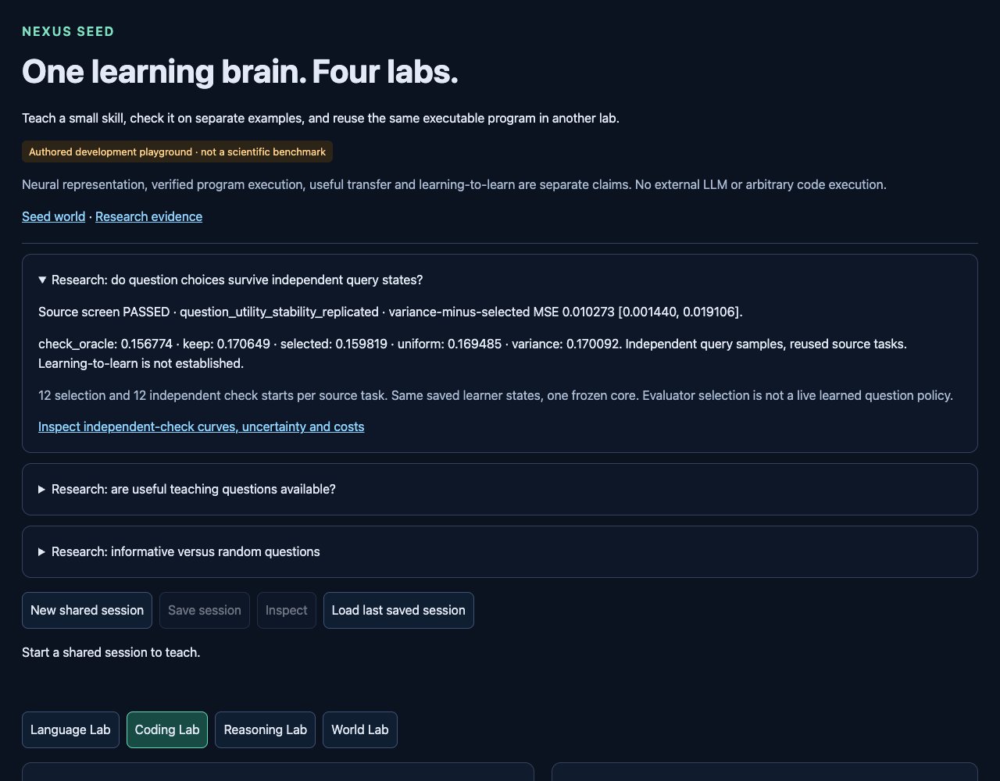

# Independent source queries support useful next-question choices

Branch **codex/seed-query-utility-replication**, starting at GitHub-matched
**41b0f0990362e47ff378cd6a887a1cb89bf9de94**. Protocol/tested implementation
committed BEFORE collection at **25b155a16b0e0b49d4a5f3e4181d3d426be3e65d**.
[Protocol](NEXUS_SEED_QUERY_REPLICATION_PROTOCOL.md),
[configuration](../configs/seed_query_replication.json),
[unchanged raw capture](../artifacts/seed_query_replication.json),
[separate offline validation](../artifacts/seed_query_replication_validation.json).
No retraining, changed teaching data or live agent promotion.

## Result and audit qualification

The registered development screen **PASSED on the independently checked
queries**. Mean reward-prediction MSE across the four fixed-state interventions:

- Selection-locked choice: **.159818667**.
- Variance choice: **.170091822**; selected is **6.04% lower**.
- Uniform next-candidate expectation: **.169485073**; selected is **5.70% lower**.
- Keep the previous fit: **.170649377**; selected is **6.35% lower**.
- Check-informed oracle: **.156773676**, an optimistic bound, not the selector.

All point-estimate5% gates pass. Selected improves keep in **9/12 task means**.
Cached retention **.072231269** versus variance **.076968395** meets the+.01
tolerance. Both required paired intervals have positive lower bounds.

The one execution collected the entire registered grid, but the final host
validator incorrectly expected40,487 parameters. Actual frozen JSON weight
arrays contain30,278 core and2,209 readout parameters: **32,487 total**. The
host therefore returned **invalid_integrity**. The raw file still has
`declared_complete=false`, that failure, all metrics and its original hash.
Nothing in that capture was edited. This was my accounting-validator error.

Commit **7839514ce8838ff308265055ac75547e286168ba** derives the count from the
hash-verified arrays and tests the actual output validation. The separate
stdlib-only validator rechecks the complete raw grid, numerical predictions,
selection lock, rewards, costs and frozen state. It labels the unchanged capture
**complete_offline_validation_of_unchanged_capture**, rather than rewriting
the execution receipt. **No second collection, fitting or scientific run.**
The raw SHA256 remains
**79c8ad44827ca6be5e9b8a6f35abb888f41755f7c3751e2356ba60c0e9ce9b70**.
GUI and saved-data verification require the separate hash-bound validation.

## What this establishes

With the same saved learner states and teaching pool, candidate utility selected
using12 source query starts transferred usefully to12 different starts of the
same source task. This is stronger evidence of within-task utility stability
than the earlier failed two-state/one-state check. It motivates trying a
source-trained question-utility predictor.

The evaluator still uses query labels to choose candidates. A deployed question
policy cannot receive these labels. No question predictor was fitted and no
selected counterfactual became a later reference state. The four points are
isolated next-update interventions, **not a sequential learning curve**.
This is not useful learned questioning, independent task confirmation, control
improvement, continual learning or learning-to-learn.

This replication changes the particular query starts and their near/random
balance as well as sample size. The old bank used three starts, normally two
near and one random; the new rule nominally balances six/six. Novelty fallback
can also move positions. Thus the passing check does **not causally establish
that larger sample size alone explains** the earlier failure. Preserve that
failed result and the optimistic historical oracle separately.

## Paired contrasts and task sensitivity

Positive differences favor the locked choice:

- Variance minus selected: **+.010273155 [+.001440084,+.019106226]**.
- Uniform minus selected: **+.009666406 [+.004483050,+.014849762]**.
- Keep minus selected: **+.010830710 [+.001782068,+.019879352]**.

These are exploratory unadjusted paired df11 task-cluster intervals. Three
damping fits are averaged inside each task/candidate; budgets, starts and
actions are averaged inside tasks. **One pretrained core**, overlapping source
fits and12 reused task configurations. These are not12 independent world
models. Requiring every screen does not create independent corroborating tests.

Task mean check MSE: selected / variance / keep:

- 95000000: **.295691 / .307520 / .306593**.
- 95010000: **.166432 / .202530 / .203407**.
- 95020000: **.107031 / .149261 / .145473**.
- 95030000: **.164275 / .172105 / .170358**.
- 95040000: **.176641 / .179369 / .180727**.
- 95050000: **.141436 / .147470 / .140736** — worse than keep.
- 95060000: **.184505 / .187091 / .183238** — worse than keep.
- 95070000: **.121925 / .126734 / .126788**.
- 95080000: **.116757 / .117133 / .123003**.
- 95090000: **.194621 / .196450 / .192972** — worse than keep.
- 95100000: **.131363 / .133484 / .133963**.
- 95110000: **.117147 / .121954 / .140535**.

Selected beats variance on all12 task averages but not on every individual
budget. Tasks95010000 and95020000 contribute large gains. Descriptive
leave-one-task-out variance benefit remains+.007368 to+.011173; keep benefit
+.008321 to+.011965. This is sensitivity analysis, not12 new confirmations.

At budgets1/2/4/8 respectively:

- Selected: **.163498 / .156833 / .159316 / .159628**.
- Variance: **.174196 / .174302 / .172241 / .159628**.
- Uniform: **.175911 / .170406 / .171995 / .159628**.
- Keep: **.174851 / .174196 / .172524 / .161026**.
- Check oracle: **.155633 / .153229 / .158605 / .159628**.

Selection/check oracle choices agree on6/12,8/12,11/12 tasks at budgets1/2/4.
At8 all12 agree because one candidate remains; this is not further stability
evidence. Selected improves keep in9/12,11/12,9/12,9/12 tasks at those budgets.
The source-selection winner MSE.151185 and check MSE.159819 use different starts;
their difference is descriptive, not a calibrated unbiased generalization gap.

## Reproducibility and resource costs

All288 registered starts are distinct, disjoint in full object/goal identity
from3,886 identifiable historical states.107 prior Seed JSON files were
hash-checked for conservative historical seed coverage; seven contain the
recorded state identities. Unsaved external/manual runs cannot be inventoried.
Selection and check subsets each contain144 starts. Both have71 distance-one
starts after novelty resampling; mean Manhattan distance2.771 and2.604.
All nine actions use separate copies of the identical start. Same decoder,
base scorer, frozen source normalization and candidate-specific saved theta.

Every task's candidate choice was written to `locked-selection.json` before
any check collection. Manifest SHA256
**b3b448039677b7eb4be1ee6744870fe8863336165a85401d1a601e46e9e4c894**,
also stored in the tracked raw JSON. The complete raw per-start observations,
outcomes, features, residuals and per-fit/budget MSE blocks are included.
All required model weights are hash-verified tracked JSON; no new private binary
is needed to replay the arithmetic.

Exact frozen network/bank state fingerprint before/after:
**7d3868c8de885209b038063e177170ddafdc485cad94112b245483e5971709ee**.
Cached fits/normalization also match exactly. The independent scalar audit
rechecked all900 assessed states; maximum metric discrepancy **1.885e−8**,
below the predeclared2e−6 float32 tolerance. Paired interval arithmetic agrees.

- **2,592** new authored interactions: query collection only; no training,
  control, probe or separate support interactions.
- **2,592** imagined action transitions, **288** posterior rows; total recurrent
  transition rows2,880.288 encoder batches,576 transition batches,288 head
  batches. Neural batches/rows are different from environment interactions.
- **194,400** fresh-query row predictions by900 cached theta states.
  The24,300 old retention rows underlie cached metrics and were not executed
  again. Zero new inner solves, outer updates or normalization fits.
- Host wall **3.371769s** under60s; worker CPU **2.465307s**. Worker collection
  **.214403s**, scoring **.036717s**, summary **.006524s**; serialization, loading,
  validation and dispatch explain the remaining time. Peak sampled RSS
  **352.89MiB** under2048MiB. RSS is sampled, not an exact peak measurement.
- Conservative scientific debit **5s**; carried ledger **1956.6321034559958s
  used /1643.3678965440042s remaining**. No budget reset or scientific retry.

Original config SHA256
**61456dc241a9fcd80f80fd49529da1353ef56f6a7b4a9536d629fab33dccf93b**;
protocol SHA256
**fb3a079e6ac05ab9ea108e550aff77217fc7affc1853f54e4e6d645e56694c01**.
Dependencies: Python3.13.5, Torch2.14.1, CPU, one thread; exact runtime in raw.

## Verification and use

Before execution: **130 focused tests passed**, then **699 relevant regression
tests passed in98.90s**. The missing test was actual output parameter accounting;
the original fixture validated grid arithmetic but omitted that output check.
After correction: **39 focused tests**, then **47 focus/layout tests passed**;
new tests exercise the real resource validator and reject the original wrong
total. Final relevant regression: **707 passed in111.09s**. **Eight GUI checks
passed in16.35s**, no new interactions or ledger changes; desktop/mobile layout,
curve/metrics, original failure and corrected offline status verified. One
initial GUI test assertion was case-sensitive about the word "Not"; corrected
the test, without changing data or the displayed scientific claim. The
[verification receipt](../artifacts/seed_query_replication_verification.json)
records commands and preservation. This is the relevant Seed/shared-dependency
suite, not every historical research test. Exact regression command:

```sh
python3 -m pytest -o addopts='' -q --tb=short tests/test_seed*.py \
  tests/test_learning_lab_sessions.py tests/test_learning_lab_release.py \
  tests/test_repository_layout.py tests/test_planning.py tests/test_expr.py \
  tests/test_factory.py tests/test_evolution2_planner_quality.py
```

Standalone checks import no neural runtime and collect no data:

```sh
python3 -I -S scripts/validate_seed_query_replication.py
python3 -I -S scripts/verify_seed_query_replication.py
python3 -I -S scripts/check_repository.py
```

The bounded GUI at `/labs` and `/experimental` shows saved check curves, each
task, original accounting failure and separate offline validation. Reading it
does not train, ask questions, alter a session or launch this study.



## One next experiment

Test a **task-blocked, source-only question-utility predictor** against variance,
uniform and keep, with the learner fixed and query labels excluded from the
held-out task's decisions. Fit utility only on other source tasks, then assess
the selected questions using held-out task check rows. Predeclare the small
representation, regularization and thresholds before fitting; use simple
task/global-mean utility controls and nested selection where needed. This would
test whether the available signal can be learned from permitted experience,
rather than supplied by this evaluator. This query bank has now been inspected;
future reuse is source development, never untouched validation/confirmation.
Separate fresh validation would still be required for promotion. No such fit
or further experiment ran.
