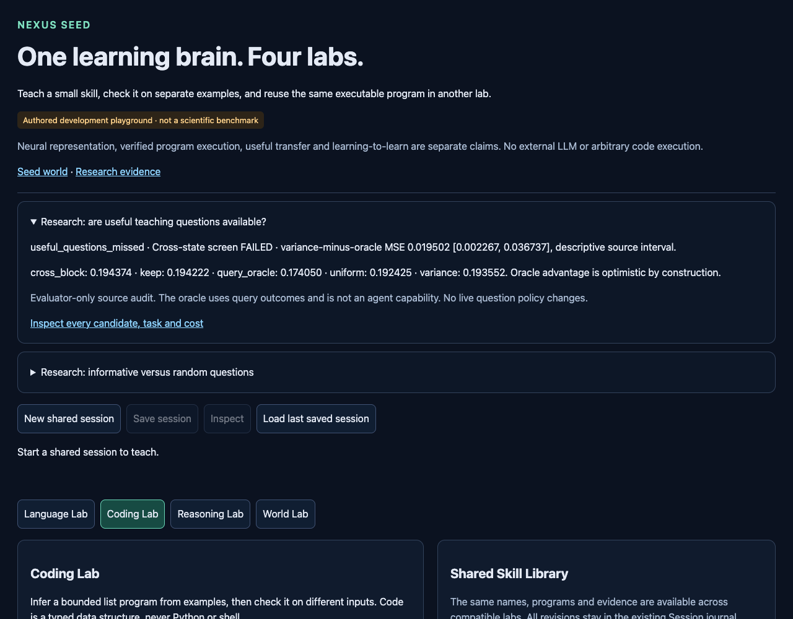

# Useful questions exist retrospectively; cross-state selection failed

Branch **codex/seed-question-pool-headroom**, from GitHub-matched
**2b9bf380f8fbfcf4f74b827202cc3e238db07573**. Tested implementation and
[protocol](NEXUS_SEED_QUESTION_HEADROOM_PROTOCOL.md) locked before scoring at
**354f47af7cf5cfaf2e69130fac7758b08d9706c8**.
[Configuration](../configs/seed_question_headroom.json),
[raw results](../artifacts/seed_question_headroom.json).
Raw SHA256 **56afbd9a42b228517c6f50b4a03cd5ea5fd1745044683e537a6d36a491c3216c**.
One valid complete run. No collection, frozen-weight changes or live promotion.

## Answer and important qualification

The available eight-example teaching pool contains questions that the variance
heuristic missed **on the already inspected source queries**. The optimistic
query-oracle screen passed: **.174050461 MSE** versus variance **.193552378**
(10.08% lower), exact uniform candidate mean **.192424906** (9.55% lower),
and keeping the current fit **.194221588** (10.39% lower). Oracle choices improve
keep in10/12 task means and meet the retention tolerance. Locked label:
**`useful_questions_missed`**.

But selecting a question using two recorded query states and testing on the
third scored **.194374297 MSE**. The secondary cross-state screen **FAILED**,
with only4/12 task means better than keep. Cross-state error is slightly higher
than both variance and keep, with intervals including zero. Useful retrospective
choices do not yet establish reliable question selection or learning-to-learn.

The oracle examines candidate errors on the same queries used to score it.
Its advantage over available candidates is nonnegative by construction and
optimistic from winner selection. It is an evaluator bound, not an agent with
privileged answers, a fair deployed policy, fresh validation or a new learning
procedure. No query outcome enters the fixed inner update. No oracle-selected
state becomes a later reference state or a runtime skill.

## Primary and secondary contrasts

Positive differences favor the evaluator-selected question:

- Variance minus query oracle: **+.019501917 [+.002266706,+.036737127]**.
- Keep minus query oracle: **+.020171127 [+.002227818,+.038114436]**.
- Variance minus cross-state selection: **−.000821919 [−.009517477,+.007873638]**.
- Keep minus cross-state selection: **−.000152710 [−.008115129,+.007809709]**.

These are descriptive paired df11 intervals across12 reused source task
clusters. Average the three frozen damping fits within each task; choose one
common oracle candidate for those fits. There is ONE frozen pretrained core,
overlapping source fits and repeated prior inspection. Candidate choices,
states, actions, budgets and damping seeds are not extra independent models.
The oracle interval is not independent evidence of generalization. All
cross-state contrasts are exploratory; the failed check cannot be upgraded by
the oracle's positive bound or favorable individual budgets.

## Fixed-state budget diagnostics

After1,2,4,8 labels respectively, one-step counterfactual query MSE:

- Variance: **.200370 / .200783 / .196827 / .176229**.
- Uniform candidate: **.202487 / .196839 / .194144 / .176229**.
- Query oracle: **.166144 / .172179 / .181649 / .176229**.
- Cross-state choice: **.204251 / .196831 / .200185 / .176229**.
- Keep previous fit: **.200637 / .200370 / .195796 / .180084**.

These points are separate one-update interventions on saved variance-policy
states. They are **not sequential oracle learning curves**. Uniform here means
the exact next-candidate expectation at those states; it is different from the
previous experiment's random-order trajectories (.191753 curve MSE).

At budget8 only one candidate remains, so oracle regret is exactly zero and
candidate agreement is guaranteed. Float32 whole-array versus block-mean
reduction differs by less than2e−6; no statistical conclusion depends on it.

The fraction of candidate questions that worsen query error, averaged equally
within tasks, is50.0%,46.43%,50.0%,33.33% at those budgets. The variance choice
is harmful on7/12,6/12,5/12,4/12 tasks respectively. Oracle choices improve keep
on11/12,12/12,9/12,8/12 tasks. Query-state selection is unstable in this small
bank: its three omitted-state folds agree on one candidate in only2/12,1/12,
1/12 tasks at budgets1,2,4. Agreement at8 is automatic and is not corroboration.
This pattern motivates replication with more query starts; it does not identify
a causal source of instability or prove a learned selector cannot work.

## Task sensitivity

Task four-budget mean MSE, variance / query oracle / cross-state / keep:

- 95000000: .310477 / .273233 / .325271 / .313013.
- 95010000: .225980 / .213210 / .228883 / .213598.
- 95020000: .290179 / .189761 / .258408 / .287579.
- 95030000: .158749 / .157901 / .165167 / .155512.
- 95040000: .236382 / .221321 / .254668 / .250062.
- 95050000: .120669 / .109609 / .110291 / .109964.
- 95060000: .218242 / .215954 / .222041 / .215319.
- 95070000: .170950 / .154465 / .160507 / .172996.
- 95080000: .109605 / .102343 / .113839 / .108157.
- 95090000: .213869 / .199492 / .209043 / .216226.
- 95100000: .120341 / .114021 / .124191 / .119564.
- 95110000: .147186 / .137296 / .160183 / .168670.

The largest oracle headroom is task95020000. The oracle still loses to keeping
the current fit on95030000 and95060000. Cross-state selection improves keep on
95020000,95070000,95090000,95110000 and worsens the other eight. Query-oracle
error is lower than variance in all four fold means, but those comparisons are
dependent on the same oracle selection, not four confirmations.

Retention MSE averaged over these budget interventions: variance **.076968395**,
uniform **.075697530**, keep **.077887136**, query oracle **.073975451**,
cross-state **.074829860**. Retention tolerances pass; that does not establish
better new-task learning. These are local counterfactual fits, not the final
retention curves of a newly deployed policy.

## Implementation and verification

Reuse question_selection's fixed learner and assessment, cumulative posterior,
source hashes and the same EXPERIMENTAL host/ledger. Its original update
expression was extracted into `damped_step`; old behavior and all prior saved
metrics remain unchanged. Every counterfactual restores the same saved pre-fit,
initial fit, anchors and allowed teaching prefix. The evaluator scores all
756 updates before choosing any oracle candidate. Query-state identities and
the nine-action block order are verified against hashed original records;
support, anchor, query and retention seeds are disjoint, including across tasks.

Focused verification: **90 passed in29.55s**. Pre-execution full relevant
regression: **656 passed in83.01s**. Additional screen/seed tests are included
in that full suite. Initial focus had62 passes and one assertion requiring exact
equality between differently rounded float32 reductions; corrected to the
predeclared2e−6 tolerance before protocol lock. No source outcomes were involved.
Final relevant regression including saved-evidence checks: **662 passed in
84.54s**. Actual command:

```sh
python3 -m pytest -o addopts='' -q --tb=short tests/test_seed*.py \
  tests/test_learning_lab_sessions.py tests/test_learning_lab_release.py \
  tests/test_repository_layout.py tests/test_planning.py tests/test_expr.py \
  tests/test_factory.py tests/test_evolution2_planner_quality.py
```

This covers the full relevant Seed/shared-dependency suite, not every historical
research suite. [Verification receipt](../artifacts/seed_question_headroom_verification.json).

The first standalone `python3 -I -S` verifier call exposed a sibling-import
packaging error. Commit **8f423cd6535fd839c5ddfd5a2df4599a9441ad00** adds the explicit
scripts path and an isolated-import regression (1 passed in.51s). This changes
verification packaging only. It does not alter the locked experiment, raw
capture, metric rules or thresholds, and no experiment was repeated.

Independent stdlib equation replay passed all756 counterfactuals, with maximum
posterior error **6.241e−7** (tolerance2e−6). Previously selected candidate theta
and metrics reproduce **exactly,0.0 error**. Frozen state fingerprint remains
**4c1c58096a92ca22df3b8f241f3a1cc9ecc1854e4eea0ec16a9e6489f2d52dd6**;
reference-state fingerprint remains
**fb36540f4472198bec59fdcde76b2d386735d15e820ae8c081db2b15a900b9a6**.
Completeness validation rejects missing tasks, budgets, candidates, fits,
blocks and metrics, invalid numeric types, nonfinite values or changed states.
Saved-evidence replay needs no private binary or neural dependencies.
All776 preexisting artifact files remain byte-identical. The original Seed core
JSON remains SHA256 cfe06a6737c8e225564ebcaea9ba4678aabd45b61129828e64354e74fa3c8d1b.

## Cost and research decision

Host wall **1.820904s**, worker process CPU **1.283007s**, peak sampled RSS
**282.844MiB**, under30s/2048MiB. Fit .038621s, assessment .019016s, analysis
.013754s; total includes imports, hashes, validation and serialization. Source
provenance checks are read-only preflight audits. RSS is sampled rather than a
kernel-enforced macOS ceiling.

756 cumulative solves/inner counterfactual updates,144 keep states,900 total
evaluated states,24300 cached query and24300 cached retention rows,1800
support and3024 anchor presentations.324 reference snapshots and96 unique
old teaching labels reused.0 initialization solves,0 new normalization fitting,
0 outer updates,0 world-model calls,**0 new real or imagined interactions**.
Conservative dispatch debit **3s** leaves the carried scientific ledger at
**1951.6321034559958 used /1648.3678965440042 remaining**.

The GUI shows evaluator-only headroom alongside the failed cross-state check,
not a successful learning agent. Prior question-selection and learning-rule
failures remain closed. No new learner or live policy was promoted.
Eight browser checks passed in4.680s: actual numbers, the failed cross-state
screen, oracle limitations, all four labs, mobile layout, plot labels, unchanged
ledger under repeated inspection and no JavaScript errors. GUI used no new
environment or teaching interactions.



**One next experiment:** repeat candidate-utility selection on a larger,
independently collected source query bank while keeping supports and learner
fixed. This tests whether the current three-query-state sample is too unstable
to support a reusable question-ranking target. Freeze its sampling/splits and
selection rule before collection. Do not train a larger learner or tune this
closed bank to turn its oracle bound into a learning-to-learn claim.
Planning estimate only:24 query starts per12 source tasks, split equally between
utility-selection and independent checking, requires2592 authored action outcomes
(12x24x9). Propose a60-second CPU cap with separately counted frozen-model feature
inference. No seeds, allocation, new data or execution are registered here.
