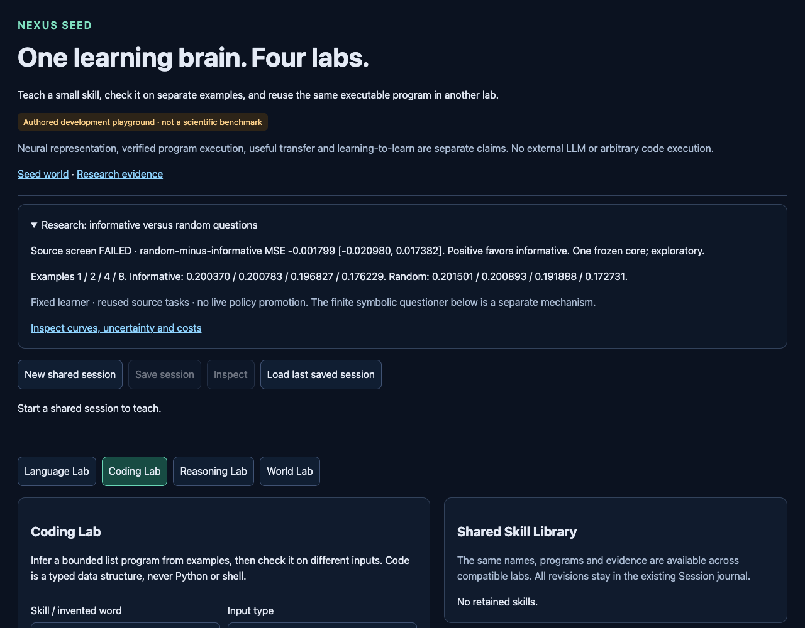

# Informative questions did not beat random choice

Branch **codex/seed-informative-questions**, from GitHub-matched
**1bf505c0415c5c2b8dd0a9dbfcac511f283ec4e3**. Tested implementation and
[protocol](NEXUS_SEED_QUESTION_SELECTION_PROTOCOL.md) committed before execution
at **080d051b7e227d27ba389fd104d9f7d9573b44a6**. One completed locked run.
[Configuration](../configs/seed_question_selection.json),
[raw results](../artifacts/seed_question_selection.json).
Raw SHA256 **62107f74c6cb0e81b5dcf0a2a352719e8ceb806d88a4d5c7a6adfe1a505577c1**.

## Outcome

The registered source improvement screen **FAILED**. Mean held-task query MSE
over1/2/4/8 examples was **.193552378 informative**, **.191753435 random** and
**.180187275 original-order**. Lower is better. Informative choice was0.94%
worse than random by point estimate. Random-minus-informative difference:
**−.001798943 [−.020979770,+.017381884]**. The interval includes zero; neither
benefit nor a reliable disadvantage is established. The original order remains
stronger on this bank. Its result exactly reproduces the closed damping study.

At1,2,4,8 labels respectively:

- Informative: **.200370 / .200783 / .196827 / .176229**.
- Random: **.201501 / .200893 / .191888 / .172731**.
- Original order: **.195193 / .179183 / .173685 / .172688**.

All per-budget random-minus-informative intervals include zero:
1 label +.001132[−.024927,+.027190];2 labels +.000110[−.033125,+.033346];
4 labels −.004939[−.030002,+.020123];8 labels −.003498[−.010100,+.003103].
These secondary intervals are exploratory and unadjusted. The registered primary
is the four-budget mean; choosing the favorable first-budget point estimate would
change the question after seeing the result.

## What was isolated

The same33-feature residual learner, anchor initialization, source-only
normalization and three frozen source-trained scalar damping fits were used
throughout. No GRU, readout, optimizer setting, learning rule or checkpoint changed.
Input-only linear variance chose the next row from eight permitted saved
teaching inputs. An oracle adapter revealed its label only on request. Random
used ten registered permutations. All methods received the same four labeled
initialization anchors and the same new-label budgets. Query and hidden-retention
data entered the evaluator only after a whole fitted path was recorded.

This is an authored source-bank question-order test, not a fresh human teaching
study, a new evaluation split or a learned question policy. The eight labels
are identical at the final budget; differences there follow the damping/order
path, not additional task information. Linear variance is a geometry heuristic,
not calibrated reward uncertainty. Its failure does not prove active teaching
cannot help. No model capacity was increased and no live policy was promoted.

## Task and fold sensitivity

Informative / random four-budget mean MSE by source task:

- 95000000: .310477 / .335328.
- 95010000: .225980 / .203312.
- 95020000: .290179 / .221490.
- 95030000: .158749 / .169390.
- 95040000: .236382 / .246078.
- 95050000: .120669 / .110170.
- 95060000: .218242 / .215817.
- 95070000: .170950 / .158302.
- 95080000: .109605 / .098209.
- 95090000: .213869 / .273424.
- 95100000: .120341 / .116241.
- 95110000: .147186 / .153280.

Informative wins5/12 tasks and3/4 fold means. Fold0 .218821/.226538,
fold1 .186839/.195636,fold2 .209587/.184516,fold3 .158962/.160324.
The large negative task95020000 and positive task95090000 show heterogeneity;
three favorable fold means do not override the failed pooled criterion.

Final hidden retention MSE: informative **.074399620**, random **.071457275**,
original **.072084455**. The informative excess .002942345 is below the locked
.01 tolerance, so the retention screen passes. Mean change from budget0 is
−.007770 informative,−.010713 random,−.010085 original. This is measured hidden
retention on reused source data, not a guarantee of preserving all knowledge.

Twelve reused source tasks are the conditional analysis clusters. Average the
three damping fits and ten random orders INSIDE each task. They are not additional
pretrained-core replications. There is one frozen core, four overlapping source
fits and repeated prior inspection. Task intervals are descriptive, not a fresh
generalization or learning-to-learn confirmation. Curves, budget contrasts,
fold means and the original study's repeated baseline are dependent evidence.

## Correctness, independent audit and cost

Focused checks: **78 passed in21.76s** (question, sequential and experimental
host tests). Pre-execution relevant regression: **618 passed in72.64s**.
An initial focused run had30 passes and one test-only float32/float64 covariance
reference mismatch (1.50e−7); the reference was corrected to float64 before the
passing runs and protocol commit. Production selection math was unchanged.
The test suite uses toy arrays, never the scientific source run as a fit fixture.
Final relevant regression after adding saved-evidence tests: **622 passed in
74.43s**. Executed command (CPU/thread environment as recorded in the artifact):

```sh
python3 -m pytest -o addopts='' -q --tb=short tests/test_seed*.py \
  tests/test_learning_lab_sessions.py tests/test_learning_lab_release.py \
  tests/test_repository_layout.py tests/test_planning.py tests/test_expr.py \
  tests/test_factory.py tests/test_evolution2_planner_quality.py
```

This is the full relevant Seed/shared-dependency suite, not all historical
experiment suites. [Verification receipt](../artifacts/seed_question_selection_verification.json).

`python3 -I -S scripts/verify_seed_question_selection.py` independently checks
all432 available variance scores with stdlib Gaussian elimination: maximum
absolute error **2.955e−7**, below2e−5. All original-order theta and score
snapshots match the prior study **exactly (0.0 error)**. Complete grids, finite
numeric types, cumulative normal equations, support losses, aggregates and
frozen checkpoint metadata are verified. No private binaries or neural imports
are required for saved-evidence replay. Frozen state SHA is recorded in raw data.
All773 preexisting artifact files remain byte-identical; the original core JSON
remains SHA cfe06a6737c8e225564ebcaea9ba4678aabd45b61129828e64354e74fa3c8d1b.

Host execution **3.348762s wall**, **2.310780s worker process CPU**, peak sampled
RSS **353.297MiB**, under60s/2048MiB limits. Selection/order construction .007257s,
inner fits .163207s, assessment arithmetic .030897s; total host time additionally
includes imports, setup, hashes, validation, serialization and supervision.
Sampling RSS is not a guaranteed kernel memory ceiling on this macOS backend.

432 trajectories,3456 inner updates,432 anchor solves,3456 cumulative solves,
96 variance solves,768 computed candidate variances (432 available scores),
120 random permutations.3456 cached teaching presentations use96 unique existing
labels;432 scale-fit source rows,1728 anchor-initialization presentations,
15552 cumulative support rows and13824 cumulative anchor rows.3888 snapshots
score104976 cached query rows and104976 cached retention rows. All are arithmetic
reuse, not new interactions. **0 real steps,0 imagined transitions,0 world-model
forwards,0 outer updates.** Random selection requires less compute; equal labels
and inner updates do not imply equal FLOPs or demonstrated compute advantage.

Existing conservative dispatch debit: **5s**. Carried session ledger now
**1948.6321034559958 used /1651.3678965440042 remaining**. No retry, confirmation
collection, control experiment or extra scientific run.

## GUI and decision

The [Shared Labs](http://127.0.0.1:8782/labs) evidence card and
[Experimental Lab](http://127.0.0.1:8782/experimental#seed-question-selection-1)
show actual1/2/4/8-example curves, failed screen, task/fold sensitivity, uncertainty
and costs. Eight browser checks passed in3.018s, including recorded-number
agreement, mobile overflow, no JavaScript errors and unchanged ledger under
repeated inspection. GUI requests collect no teaching or environment data.
For a fresh clone, use the existing symbolic GUI option when no frozen core
is installed; research replay itself needs only tracked JSON and stdlib.



Useful learning-to-learn remains unestablished. The fixed input-variance question
rule is not justified for promotion. **One next experiment:** an evaluator-only,
source-data pool-headroom audit of each available one-label counterfactual.
Determine whether any candidate question can materially improve the fixed
learner's query error before attempting to learn which question to ask. Keep
those oracle utility labels outside the runtime selector. This distinguishes an
uninformative small pool from a poor selection proxy without new architecture.
It is proposed only; no such audit was executed in this branch.
