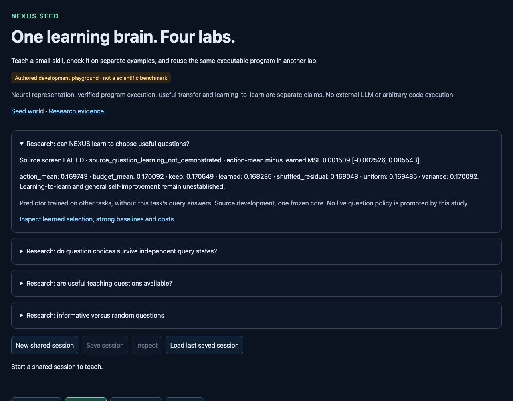

# Learned question selection did not beat the strong controls reliably

Branch **codex/seed-question-utility-learning**, base
**8f404db2539c06a4ed95c8ff5758f8b24ce3af71**, verified against GitHub.
[Protocol](NEXUS_SEED_QUESTION_UTILITY_PROTOCOL.md) and tested implementation
committed before the single run at **a8ca30a977689a5e7239be8e17e512b09f1158c4**.
[Configuration](../configs/seed_question_utility.json),
[raw models/cases/results](../artifacts/seed_question_utility.json).
Raw SHA256 **b15182f4eec9f3f773c62efbb85b85a92e513a970178f2c0a3ea4a2b518528e9**.
Valid complete execution, no scientific retry or post-result tuning.

## Answer

NEXUS now has a working small learned question-selection component. It fits
source feedback and makes different question choices on tasks excluded from its
training, using candidate inputs and observed teaching only. It is reusable
code, not an oracle supplied with the current task's query answers.

Its scientific improvement screen **FAILED**. Four-budget mean check MSE:

- Learned contextual correction: **.168234546**.
- Source action/budget mean: **.169743101** — learned point reduction **.89%**.
- Variance selection: **.170091822** — learned point reduction **1.09%**.
- Uniform next-candidate expectation: **.169485073** — reduction **.74%**.
- Keep current fit: **.170649377** — reduction **1.42%**.
- Shuffled residual feedback: **.169047887** — reduction **.48%**.
- Budget mean: **.170091822**, exactly variance because of the registered tie rule.

All practical gains are below the prespecified5%. Required paired intervals
include zero; learned improves keep on **6/12 tasks**, below8, and action mean
in **2/4 fold means**, below3. Retention passes (.074791506 versus variance
.076968395), and the shuffled-control point comparison passes. Those two
secondary gates cannot override the failed primary conditions. Locked label:
**source_question_learning_not_demonstrated**. No live promotion.

Useful independent question choice, a self-improving learning procedure and
learning-to-learn remain unestablished. Training a predictor or passing its
unit tests does not establish those capabilities.

## What was implemented and isolated

Reuse the fixed33-feature reward learner, input-variance orders, cumulative
posterior, damping constants and frozen source normalization. Add one small
ridge1.0 correction over source action/budget means, with54 public features.
The same primitive implements a shuffled-residual control. No neural capacity,
optimizer, model weight, normalizer or architecture change.

Public selector features include candidate input/action, its predicted reward
and input variance, observed anchor/prefix errors and gradient alignment, and
the current fit. They exclude the unasked candidate answer, post-update fit,
query outcomes and task identity as features. Candidate labels enter
evaluator-owned counterfactual updates, separately from the public inference
path. All choices lock before check scores are read.

Four original task-blocked folds train on nine tasks and exclude three. For
training examples, rebuilding trajectories under the CURRENT fold's frozen
damping/normalization prevents indirect excluded-task feedback through another
fold's historical damping fit. Excluded tasks retain their exact saved learner
states. Current-fold query labels never fit their predictor. Only the other
nine tasks' recorded SELECTION queries label utility; CHECK outcomes never fit
or select a model. No hyperparameter search.

All four models and48 question decisions were persisted before reading any
assessment score. Lock SHA256
**701e091c1610cb273b168eded285d5dd3a28f87e86f96b48e0124a5737642e34**.
Inference and assessment have separate arguments; inspection does not update
the model. Fitted coefficients, normalization, mean tables and all raw training
cases/counterfactual states are saved in tracked JSON.

## Paired evidence and diagnostics

Positive differences favor learned selection:

- Action mean minus learned: **+.001508555 [−.002525745,+.005542855]**.
- Variance minus learned: **+.001857276 [−.004558255,+.008272807]**.
- Keep minus learned: **+.002414831 [−.003126858,+.007956519]**.
- Uniform minus learned: **+.001250527 [−.003524308,+.006025362]**.
- Shuffled residual minus learned: **+.000813341 [−.001956132,+.003582815]**.

These are unadjusted exploratory df11 paired intervals across12 reused source
task clusters. Average three damping fits within each candidate, four budgets
within task, and tasks equally. ONE frozen pretrained core; folds overlap.
Candidates, actions, states and damping fits are not extra independent models.
This inspected bank is SOURCE development, not fresh task validation.

Learned utility prediction is poorly calibrated on held-out task/check cases:
MSE **.000797419**, versus action mean **.000386002**, budget mean **.000321392**
and shuffled residual **.000601944**. Sign accuracy **43.93%**, versus action
mean **50.89%**, budget mean **56.84%**, shuffled **52.84%**. These descriptive
metrics do not identify whether representation, label noise or estimation is
responsible. The small selection-error lead does not establish useful feedback
learning, especially while utility prediction worsens.

Per-task MSE averaged over budgets, learned / action mean / variance / keep:

- 95000000: **.290739 / .308383 / .307520 / .306593**.
- 95010000: **.180487 / .188642 / .202530 / .203407**.
- 95020000: **.142330 / .142330 / .149261 / .145473**.
- 95030000: **.172389 / .172389 / .172105 / .170358** — worse than keep.
- 95040000: **.177529 / .182256 / .179369 / .180727**.
- 95050000: **.149276 / .149276 / .147470 / .140736** — worse than keep.
- 95060000: **.184885 / .184825 / .187091 / .183238** — worse than keep.
- 95070000: **.125873 / .125873 / .126734 / .126788**.
- 95080000: **.126129 / .124733 / .117133 / .123003** — worse than keep.
- 95090000: **.196292 / .194621 / .196450 / .192972** — worse than keep.
- 95100000: **.135072 / .133790 / .133484 / .133963** — worse than keep.
- 95110000: **.137815 / .129800 / .121954 / .140535**.

At budgets1/2/4/8:

- Learned: **.168994 / .169292 / .175024 / .159628**.
- Action mean: **.170731 / .170175 / .178439 / .159628**.
- Variance: **.174196 / .174302 / .172241 / .159628**.
- Uniform: **.175911 / .170406 / .171995 / .159628**.
- Keep: **.174851 / .174196 / .172524 / .161026**.
- Shuffled residual: **.175893 / .172760 / .167911 / .159628**.

Learned changes7/12,6/12,5/12 action-mean question choices at the first three
budgets. It improves that baseline on3 task averages, ties4 and worsens5.
Budget8 has one remaining candidate; agreement there is tautological.
These are isolated next-update interventions on saved variance trajectories,
not a sequential learned-question learning curve. Budget-mean/variance scores
are mathematically dependent and cannot be counted twice as evidence.

Mean regret to the best available cached question is.011461 learned versus
.012969 action mean,.013318 variance and.012711 uniform. These subtract the
SAME oracle error from the reported MSEs, so their paired differences are also
dependent evidence. The smaller regret point estimate does not upgrade the
failed screen.

## Cost, integrity and tests

The one run completed in **5.672237s host wall /3.562376s worker CPU** under
30seconds. Peak sampled RSS **333.78MiB** under2048MiB. Worker training
.681065s, prediction .148255s, assessment .006164s; loading, validation and
serialization account for the rest. Source feature/learner state hash unchanged.
No previous model or result file was overwritten.

**Zero new environment interactions, imagined transitions, neural forwards or
outer optimizer updates.** Rebuilt108 anchor-initial fits,864 reference updates
and2268 counterfactual updates (3132 cumulative solves).480 variance solves,
1008 public candidate feature rows,756 training and252 excluded cases. Eight
ridge solves/432 coefficients,1512 training-row and3024 augmented presentations.
Predictor centering/scaling uses training rows only; frozen learner normalization
is not refitted.291600 training-query row predictions;900 cached assessment
states reused. Compute differs from the no-training simple baselines.

Conservative debit **7s** leaves **1963.6321034559958s used /
1636.3678965440042s remaining** in the carried session. No reset or retry.
Python3.13.5, Torch2.14.1, CPU, one thread. Config SHA256
**ce2b9ee3c2d62eb1f44f4dfd23a2d438a8063c2f29eb9843c42761bd66664eeb**;
protocol SHA256
**334d430d8021edf2326918bbabd7a5955e4f6e6e346407504e9bcda8f7dde2f3**.

Before the scientific run:34 initial focused tests passed. A broader run caught
a malformed numeric string causing TypeError instead of the intended explicit
ValueError; fixed before lock, then **101 focused tests passed in45.72s**.
Full relevant regression **742 passed in136.49s** before execution. Final
regression including saved-result tests: **748 passed in146.85s**. Eight GUI
checks passed in26.30s with zero new interactions or budget changes. This covers
Seed/shared dependencies, not every historical scientific suite. Commands and
preservation are recorded in the
[verification receipt](../artifacts/seed_question_utility_verification.json).

```sh
python3 -m pytest -o addopts='' -q --tb=short tests/test_seed*.py \
  tests/test_learning_lab_sessions.py tests/test_learning_lab_release.py \
  tests/test_repository_layout.py tests/test_planning.py tests/test_expr.py \
  tests/test_factory.py tests/test_evolution2_planner_quality.py
```

The independent stdlib auditor checks all1008 candidate variances (maximum
error **3.675e−7**, below2e−5), every saved fold's equations and decision grid,
and paired interval arithmetic. No model fitting or scientific replay:

```sh
python3 -I -S scripts/verify_seed_question_utility.py
python3 -I -S scripts/check_repository.py
```

The shared `/labs` and `/experimental` GUI shows the FAILED source screen,
strong controls, task/budget curves and costs. It does not activate this selector
in the live teaching session. Original successful source oracle and all earlier
negative findings remain unchanged.



## One next experiment

Audit **question-utility label reliability** using the already recorded
selection/check query starts and the saved counterfactual fits, with no fitting
or new simulation. Compare utility signs and candidate rankings across query
subsets under the SAME outer-fold learner. This separates unstable supervision
from failure to transfer an otherwise reliable utility signal. Preregister the
agreement/estimation criteria; do not tune another selector or enlarge the
network in this branch. Proposed cap30s CPU/wall, zero interactions. This audit
has not been executed or allocated here.
