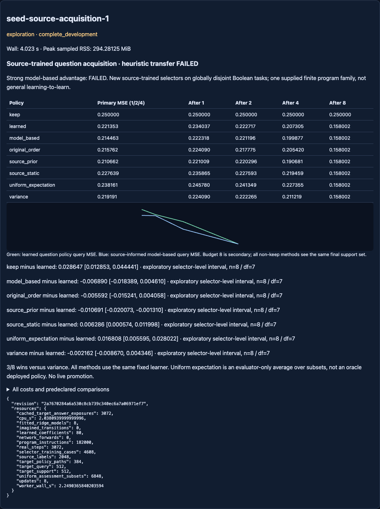

# Source-trained question acquisition — complete, both screens FAILED

Branch `codex/seed-source-question-acquisition`, base
`4bd8f381e80eddeae88299ecc0c382cec4409387`, matching fetched GitHub.
Clean execution **2a7670284a6a530c8cb739c340ec6a7a06971ef7** committed tested code,
[protocol](NEXUS_SEED_SOURCE_ACQUISITION_PROTOCOL.md) and
[config](../configs/seed_source_acquisition.json) before the single run.
[Raw source cases, fits and target paths](../artifacts/seed_source_acquisition.json),
[independent audit](../artifacts/seed_source_acquisition_audit.json).
No retry, target-driven refit, architecture sweep, live promotion or main merge.

## Main result

Eight source-trained10-coefficient ridge selectors were evaluated on64 globally
excluded target programs. Every policy used the SAME uniform version-space
learner. Primary query MSE is the mean across budgets1/2/4, averaging targets
inside each selector repetition first:

- **Learned selector: .221353**.
- Variance: **.219191**.
- Original sorted input order: **.215762**.
- Uniform model-based expected improvement: **.214463**.
- Source-informed model-based expected improvement: **.210662**.
- Source-trained static input order: **.227639**.
- Exact uniform-random subset expectation: **.238161**.
- Keep/no teaching: **.250000**.

Both preregistered screens failed. The learned selector beats random expectation
and source-static ordering, but not variance, fixed order or either model-based
control. Its gain over source-static is only2.76%, below the required5%. It wins
versus variance in **3/8**, short of6/8; that paired interval includes zero.
The absolute deficits versus model-based.006890 and source-prior.010691 exceed
the.005 noninferiority tolerance. Do not drop failed gates or call a random-only
improvement useful learned questioning.

Baseline-minus-learned primary MSE, exploratory95% paired selector-level
intervals (n8,df7):

- Variance: **−.002162 [−.008670,+.004346]**.
- Original order: **−.005592 [−.015241,+.004058]**.
- Model-based: **−.006890 [−.018389,+.004610]**.
- Source-prior: **−.010691 [−.020073,−.001310]**.
- Source-static: **+.006286 [+.000574,+.011998]**.
- Uniform expectation: **+.016808 [+.005595,+.028022]**.
- Keep: **+.028647 [+.012853,+.044441]**.

The source-prior deficit is negative throughout its exploratory interval. Other
deficits are uncertain; do not turn point estimates into established harm.
All intervals are conditional on one supplied finite program family and a
without-replacement allocation. These are eight fitted selector repetitions,
NOT eight independent pretrained world models or64 independent trained agents.

## Curves and individual repetitions

Held-out MSE after1/2/4/8 teaching examples:

- Learned: .234037 / .222717 / .207305 / **.158002**.
- Variance: .224090 / .222265 / .211219 / **.158002**.
- Original: .224090 / .217775 / .205420 / **.158002**.
- Model-based: .222318 / .221196 / .199877 / **.158002**.
- Source-prior: .221009 / .220296 / .190681 / **.158002**.
- Source-static: .235865 / .227593 / .219459 / **.158002**.
- Uniform expectation: .245780 / .241349 / .227355 / **.158002**.
- Keep: .250000 at every budget.

Budget8 is a required consistency check, not selector superiority: every
non-keep method has the same support set and learner, so its final prediction
is identical. The learner still has only8 of16 input labels; prediction error
does not collapse to zero. Uniform subset averages equal random-permutation
marginals because this learner depends on sets, not reveal order. This control
uses more assessment compute, not privileged deployed question selection.

Per-repetition primary MSE (learned / variance / source-prior):

- 1745000001: .207597 / .203387 / .213273.
- 1745000002: .259350 / .255509 / .252030.
- 1745000003: .224751 / .222930 / .214757.
- 1745000004: .217146 / .221603 / .209661.
- 1745000005: .199729 / .203002 / .195857.
- 1745000006: .232879 / .213920 / .199928.
- 1745000007: .206121 / .211800 / .194145.
- 1745000008: .223250 / .221377 / .205644.

In repetition2 every teaching policy's primary mean is worse than keep.250000.
Questions are not guaranteed to help under this fixed learner. Source-prior has
the best overall point estimate, but its descriptive improvement over uniform
model-based selection is only.003802 [−.000725,+.008328]. That comparison was
not a separate registered advancement screen and does NOT establish robust
source-prior superiority or justify automatic deployment.

## What the implementation actually learns

Source feedback supplies16 labels on each of128 source task programs. The
selector is fitted to4608 counterfactual one-update query-MSE improvements from
source tasks only. Features are ten public/prefix scalars; normalizer and ridge
coefficients are source-only. Targets are64 different functions, globally absent
from all128 source tasks, including the other repetitions. All fits freeze
before target observations; all target choices lock before query labels appear.

The base learner has a SUPPLIED910-function compositional program catalogue,
executed through the existing bounded interpreter. This is a substantial prior,
not newly discovered grammar, unrestricted language or visual grounding. Task
functions are two/three-term Boolean polynomials with a deliberately biased
75%/25% term-count mixture; negation is balanced. All target tasks use the same
authored family. No cross-domain, control or general learning-to-learn result.

All eight ridge fits reduce IN-SAMPLE utility MSE versus a featureless source
mean; e.g. repetition1 .000732 versus.000901. That only confirms fitting, not
held-out utility signal or improved decisions. Coarse candidate/prefix features,
random-source-prefix versus policy-roll-in shift, and noisy answer-dependent
utility labels remain competing explanations. No causal explanation is claimed.

A specific representational omission is visible in code: features() has no
query-set argument, while expected_gain() uses public query INPUT geometry.
All methods are permitted those inputs, but the compact feature map discards
them. This is not hidden-label leakage by the baseline. It does not by itself
prove the omission caused the observed loss, nor that more parameters will fix
it. No feedback-shuffle ablation or feature-capacity sweep was executed.

## Source-inclusive computation and resources

Materialized hypothesis-table entries (source training + target acquisition):

- Learned: **12231635 +1416156 =13647791**.
- Source-static: **10575569 +529463 =11105032**.
- Source-prior: **1863680 +15002613 =16866293**.
- Uniform model-based: **0 +15150652 =15150652**.
- Variance: **0 +1317694 =1317694**.
- Original order: **0 +533219 =533219**.

Thus the learned policy needs fewer target entries than the model-based methods,
but source utility construction is substantial. Original order is both much
cheaper and better by point estimate. No quality/compute advantage is claimed.
Source-static excludes unnecessary feature and ridge-solve work; source-prior
pays source function/group identification but not utility-case construction.
Actual joint-source preparation shares operations; comparative pipeline counts
are explicit projections, not physically repeated work.

Also account for **182000 public interpreter instructions** to construct the
common prior,23040 target feature scalars for the learned policy, eight ridge
solves,80 fitted coefficients plus80 normalization values,128 derived static
scores and four source group counts per repetition. Derived910 prior weights
per repetition are not910 independent fitted parameters. Exact uniform
assessment uses6848 subsets and18383604 materialized entries, separately from
live selector costs. Table-entry/instruction counters are NOT FLOPs or measured
wall-speedups; array allocation, reductions, normalization, solving, hashing and
serialization are included in worker/host timing rather than assigned fake units.

Cap60s CPU/wall,4000 authored labels,2048MiB sampled RSS. Actual **3072 new
authored labels**:2048 source +512 target support +512 target query. Separately,
3072 cached policy answer exposures,384 executable paths and4608 source utility
cases. These equal-looking3072 totals count DIFFERENT operations. Pairing pools
are collected fully; fewer exposed questions do not prove less actual collection.
Zero simulator steps, neural forwards, historical neural updates or imagined
world-model transitions. Eight new numerical ridge fits, not GRU/RSSM retraining.

Worker wall **2.249037s**, CPU **2.038094s**, host wall **4.022611s**, sampled peak
RSS **294.28125MiB**. Host includes deterministic source reconstruction and cached
target validation; post-run tests/independent verifier/GUI checks are engineering
outside that timing. Debit **6s** (ceil exact host wall +1), no retry.
Carried ledger **1996.6321034559958s used /1603.3678965440042s remaining**.

## Provenance and verification

Config SHA256:
`aa5c0886b9f02617f1651607456c9aec8d3e817401edab02f6979fa6ebb290af`.
Protocol SHA256:
`81f457bfdda21f0eef3ef2e99e78c7897a5ac6d8cf21ce40fd662e09bb710f6c`.
Raw artifact SHA256:
`afff98802bbadd0cc79ea2f5fd786c37c9a3670347e4ba01290f461b71e6f370`.
Runtime Python/NumPy versions, exact sources, catalogue/assignment, models,
normalizers, source/choice hashes and the host allocation are in raw results.

The numerical run uses existing local NumPy2.5.4 with CPU threads fixed to1.
Existing package extra`nexus-ai[seed]` includes NumPy; no new service or download
was needed. Explicit numerical verification requires that dependency. The GUI
uses the saved independently checked artifact hash, does not refit the selector,
and fails clearly on a missing/mismatched receipt. That receipt view is not
silently presented as a newly executed numerical audit.

Both historical neural JSON checkpoints and all818 previous artifacts remain
byte-identical to the base. The registry snapshot checks260 prior JSON/YAML
configs and593 identifiers/conservative offsets; this does not certify
unavailable external runs or every implicit historical seed formula. Main and
unrelated worktree changes remain unchanged. No closed evaluation is reopened.

Independent verification reconstructs truth tables by algebraic parity rather
than the runtime interpreter; derives instruction counts; checks4608 source
utilities/features; reproduces RMS and ridge by normal equations; checks384
paths, posteriors, predictions, exact-uniform risk, costs, aggregation and paired
intervals. Numerical arithmetic tolerance1e-12, coefficient reconstruction1e-10.
It collects no new labels and performs no new scientific run.

Tests before execution:73 focused checks;1002 broad regression tests passed
in241.68s;35 final affected tests passed after adding read-only receipt handling.
A stale historical fixture initially included new configs in an old exclusion
snapshot. The fixture was corrected to use the saved historical snapshot;
no scientific artifact was changed or experiment retried.

After saving results, 66 affected regression/evidence tests passed in 61.12s:
`tests/test_seed_source_acquisition.py`,
`tests/test_seed_source_acquisition_evidence.py`,
`tests/test_seed_inferred_investigation_evidence.py`,
`tests/test_seed_experimental.py`, `tests/test_learning_lab_sessions.py` and
`tests/test_learning_lab_release.py`, using the same pytest environment below.
The repository consistency check passed: 81 active documents, 375 local links,
2010 preserved files and 20 explicitly recorded code changes. `git diff --check`
also passed. These are engineering checks, not additional scientific trials.

```
env PYTHONDONTWRITEBYTECODE=1 OPENBLAS_NUM_THREADS=1 OMP_NUM_THREADS=1 \
PYTHONPATH=src:/Users/ajayghimire/Projects/nexus-ai/.deps \
python3 -m pytest -o addopts= -q --tb=short tests/test_seed*.py \
 tests/test_learning_lab_sessions.py tests/test_learning_lab_release.py \
 tests/test_planning.py tests/test_expr.py tests/test_factory.py \
 tests/test_evolution2_planner_quality.py
python3 scripts/verify_seed_source_acquisition.py
python3 scripts/check_repository.py
```

The [existing GUI](http://127.0.0.1:8785/experimental#seed-source-acquisition-1)
shows all controls, curves, both failed screens, uncertainty and full resource
profiles. Fifteen browser checks passed, including mobile overflow and no live
promotion. Bounded server: `python3 scripts/run_seed_shared_gui.py --symbolic
--port 8785 --max-runtime-s 900` (use the existing dependency environment where
other numerical replay adapters require it).



## Decision and exactly one next task

The proposed learned question selector is implemented and source-trained, but
does not provide the required useful advantage on new tasks. Lower source fit
loss and better-than-random questioning are insufficient. Do not promote it,
tune it on these target outcomes, or grow a network to hide the negative result.

**Next: a source-only query-context sufficiency audit.** Test whether the SAME
ten-feature descriptions can require different expected-value question rankings
when only the public query set changes. Keep the feature map and learner frozen,
use source/public contexts rather than target outcomes, and compare expected
risk rather than clairvoyant answer-dependent utility. This can distinguish
information discarded by the representation from a need for model capacity,
with zero new labels. It has not been executed in this branch.
