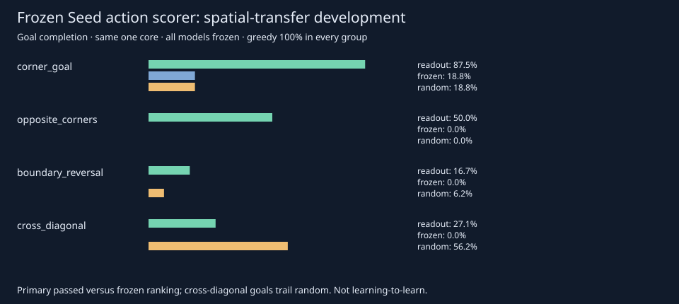

# Seed frozen action readout: spatial-transfer results

## Decision

Complete valid development execution; registered transfer screen **passed**.
The frozen readout retained a gain over frozen ranking on four fresh spatial
mixtures. **Greedy remained stronger**, and cross-diagonal goal completion was
worse than random's point estimate. This is conditional on one frozen neural
core and known authored dynamics,not general control or learning-to-learn.

Protocol/implementation committed before collection:
adc60c7f1ae94287677b3d5a6a0f6ba3362ec65a. Base cleanup revision:
dd0ffd513f2e5bc28799949faf885db0626737b3. No fitting or checkpoint selection.
All original core,source bank and three readout weights remained exactly equal.

## Primary and baselines

Pooled readout-minus-frozen return **+1.411667 [1.188644,1.634690]**.
Pooled goal gain **+0.40625** (45.3125% versus4.6875%). The practical margin,
positive lower bound,goal threshold and all group non-regression conditions pass.

Other pooled paired return differences:

- Random: **+1.081354 [0.930938,1.231770]**.
- Existing latent MPC: **+1.105417 [0.882101,1.328732]**.
- Known-grid greedy: **−0.862083 [−0.989301,−0.734866]**.

Head seeds and episodes are averaged within each group/reset stream,then groups
equally weighted. Eight stream-level paired differences,Student-t95%,df7.
These are exploratory intervals conditional on ONE pretrained core; three
readout seeds are not three independent world-model replications. Pooled
improvement must not hide the weak individual distributions below.

## Spatial groups and failures

- **Corner goal:** readout goals87.5%,frozen18.75%,random18.75%,greedy100%.
  Return gain versus frozen **+1.720417 [1.090617,2.350216]**.
- **Opposite corners:** readout goals50%,frozen0%,random0%,greedy100%.
  Gain **+1.738750 [1.292785,2.184715]**.
- **Boundary reversal:** readout goals16.67%,frozen0%,random6.25%,greedy100%.
  Gain **+1.290417 [1.022354,1.558480]**. Better return than a weak baseline
  does not make this a reliable goal-reaching controller.
- **Cross diagonal:** readout goals27.08%,frozen0%,random56.25%,greedy100%.
  Gain over frozen **+0.897083 [0.440940,1.353227]**. Readout-minus-random
  return **−0.340417 [−1.024534,0.343700]** is inconclusive,with a negative
  point estimate. Do not describe this as a statistically established loss or
  suppress it because the pooled primary passed.

Initial-state mean ranking regret (readout versus frozen):corner0.00417/0.30000;
opposite0.02083/0.20000;boundary0.17917/0.10625;diagonal0.03542/0.20000.
Boundary initial regret is worse despite positive episode-return gain.
This underlines that immediate error/ranking and complete control are distinct.
The task-level traces contain every failed episode and head/reset outcome.
No causal mechanism follows from these descriptive differences.

## Provenance and costs

Fresh128 ranking states,9 cloned outcomes each;64 paired resets per method,
448 actual controller episodes across seven methods. Exact initial states are
paired and exclude all parent source/development/audit/control initials. Physics,
attributes and action semantics are unchanged; only initial spatial mixtures
shift. Subsequent trajectories can intersect prior cells naturally.

Body **3.154639s**,**7,504 authored steps** (1,152 cloned outcomes+6,352 actual
controller steps),**90,198 imagined transitions** and**6,480 posterior-prior
model rows**. Zero optimizer updates. Worst-case bounds and120s/12,000step
caps were committed before evaluation. Session conservative debit5seconds:
**1910.6321034559958 used /1689.3678965440042 remaining**.

All three parent head hashes,core hash,parent result/manifest hashes,frozen
tensors and source bank verify. Complete grids,paired starts,finite metrics,
closed-initial exclusions,reward identities and resource totals pass. Run the
repository-only check without torch:

`python3 -I -S scripts/verify_seed_spatial_transfer.py`

## Learning-to-learn remains the next research problem

The transfer result is for an ordinary source-trained frozen action scorer.
It does not show a better learned learning algorithm. The previous failed
plasticity result and strongest-baseline edit-credit tie remain unchanged.

A small post-result engineering bridge now exposes the existing frozen32-unit
readout basis plus bias to the existing33-parameter correction API. Zero
residual reproduces old scores; outer meta-gradients can flow while the readout
and GRU remain fixed. This is tested functionality,not another learning result.
It is not enabled in GUI control or scored on this closed transfer sample.

Exactly one next experiment:the [fresh nonlinear-feature adaptation
comparison](NEXUS_SEED_READOUT_LEARNING_PROPOSAL.md),against source-trained static
protection,scaled replay,fixed protection and no adaptation. Measure1/2/4/8-label
learning curves,forgetting and actual actions. Exact numerical task registration
and budget derivation remain prerequisites. Do not retune on these transfer
outcomes or claim that a low query loss alone establishes learning-to-learn.

## Executed regression and integrity checks

Before collection:53 focused pairing/fixture/frozen-readout/state/planning tests
passed in2.51s;final14 transfer tests passed before protocol commit. After
results and the nonlinear learning bridge:239 relevant tests passed in12.11s.
Command: `python3 -m pytest -o addopts='' -q tests/test_seed*.py
tests/test_learning_lab_sessions.py tests/test_learning_lab_release.py
tests/test_repository_layout.py tests/test_planning.py tests/test_expr.py
tests/test_factory.py` with one CPU thread and source/dependency paths configured.
This is the relevant suite,not a rerun of historical scientific experiments.

Stdlib verifier and repository navigation checks pass (34documents/130links).
All736 prior artifacts at cleanup base remain byte-identical. Actual Chrome155
GUI:12 checks pass,including readout/surprise,read-only inspection,save/restart,
correction,stop and mobile layout;no page errors/external requests. Scientific
execution ran once. Source-only verification and GUI engineering did not rerun it.
