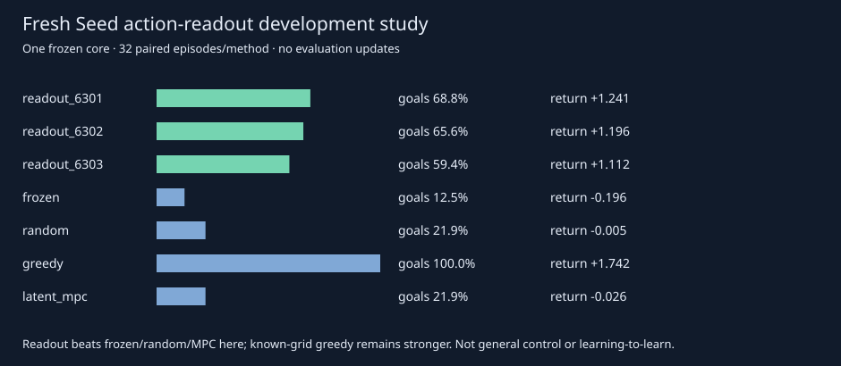

# Seed: useful nonlinear action ranking, bounded investigation

## Decision

The fresh action-readout development screen **passed**. It did **not beat greedy**.
The failed plasticity/structural-selection study remains unchanged. Execution:
`4d8b22161d530a6b35a2225847f98e88b9c224bd`, protocol and implementation committed
before collection. All three fixed heads were saved before final-state scoring.
No checkpoint, training duration or architecture was selected using the audit.
This is one authored grid and one frozen neural core, not general control or
learning-to-learn. It establishes a useful fitted action scorer in this setting.

## Fresh ranking and full episodes

The reused nonlinear head contains **2,209 parameters**, receives current
observations and frozen imagined predictions, and can express state/action
interactions absent from the old fixed linear residual. Three head seeds,
800 source-only Adam updates each. The GRU, heads and source retrieval bank
were unchanged exactly. No rank-four representation adaptation was needed or run.

On64 newly registered balanced states, mean regret:

- Frozen reward: **0.78125**, optimal action **15.625%**.
- Head6301: **0.11250**, optimal **84.375%**.
- Head6302: **0.078125**, optimal **87.500%**.
- Head6303: **0.12500**, optimal **85.938%**.

Across heads: regret **0.105208** (86.53% reduction), optimal **85.938%**.
All comparisons use identical actual nine-action outcomes. These64 states are
fresh; no old64-state diagnostic outcome selected training settings.

Actual complete episodes,20-step cap,32 paired resets per method:

- Three heads averaged: return **+1.182917**, goals **64.583%**.
- Frozen ranking: **−0.196250**, goals **12.500%**.
- Random: **−0.005000**, goals **21.875%**.
- Unchanged latent MPC: **−0.025625**, goals **21.875%**.
- Known-grid greedy: **+1.742500**, goals **100%**.

Readout-minus-baseline paired return, eight task streams after averaging heads:

- Frozen: **+1.379167 [1.174923,1.583411]**.
- Random: **+1.187917 [0.889242,1.486592]**.
- Latent MPC: **+1.208542 [0.646839,1.770244]**.
- Greedy: **−0.559583 [−0.835295,−0.283872]**.

Student-t95% intervals, df7, conditional on one frozen core. These exploratory
comparisons are unadjusted; head seeds are not independent world-model
replications. Thirty-two resets are grouped into eight preregistered streams,
not a claim of eight independently learned environments. Supplied position and
goal features are sufficient for the strong greedy reference; this does not
establish pixels-only grounding or open-ended reasoning. MPC uses the existing
Seed H4/16/pruned rule, not historical Pendulum H16.

## Surprise, assessment and structural preservation

Frozen reward development RMS error **0.3887426692** is the fixed scale, bound
to development data and predictor hashes. Threshold3 flagged **17/576** final
counterfactual rewards for investigation. These are diagnostic flags, not17
successful edits or17 independent adaptation events. Audit errors did not
recalibrate the gate. No automatic promotion followed surprise.

Runtime integration is a post-result engineering change, separately tested:
the owner-enabled GUI emits actual-error surprise receipts with source-event
references, scale, threshold and predictions. Replay validates actual reward
binding and surprise arithmetic; inspection does not emit new feedback. This
post-result instrumentation did not rerun or alter the scientific artifact.

Saved session v3 persists consumed assessment references. Each structural review
uses a fresh development batch only once, even if no candidate wins. A second
review after unrelated learning cannot reopen that batch. Legacy v1/v2 sessions
conservatively retire existing assessment labels because their exposure cannot
be certified. Repair, scoped addition and algebraic merge stay distinct;
rollback does not refund compute or unconsume assessment data.

`AssessmentLedger` explicitly reserves one-use leases and rejects final-audit
roles. It supports G=Lkeep−Lcandidate−forgetting−.0001cost, G>.01, forgetting<=.01.
The deployed structural review reuses the same gain function, with actual old
anchor loss increase as forgetting and a disclosed fit/storage cost proxy. Its
strict finite-anchor drift tolerance also remains mandatory. This post-result
runtime change is covered by tests, not relabeled as a scientific validation of
automatic promotion. Merge faces the same positive margin as other edits.

## Future-learning edit credit: functional signal, no strongest-baseline gain

Existing epsilon-greedy meta-controller now accepts source-only future-learning
receipts, with loss reduction minus forgetting and compute. Acceptance is logged
but is **not the reward**. Rejected/invalid proposals incur costs. Forced initial
coverage and epsilon.2 expose keep,repair,add and merge.

Source-bank diagnostic:32 proposals then8 held-out source states per policy,
with disjoint fitting, acceptance, subsequent teaching and future-probe action
labels. No final readout-audit data entered this experiment. Mean held-out credit:

- Adaptive: **0.00691728**, chose scoped addition on all8 final states.
- Random: **0.00164505**.
- Fixed repair: **0.00175790**.
- Historical best: **0.00691728**, also always chose addition.

Thus adaptive selection **does not beat historical-best selection**. Costs differ
with actual fits:284/230/320/260 logical compute units across the40 opportunities
for adaptive/random/fixed/historical-best respectively. Opportunities match;
FLOPs do not. Full traces, rejection reasons and paired contrasts are retained.
This is a source-bank functional diagnostic of four bounded edits, with padded
readout features and different action labels of the same state. It is **not**
evidence of useful meta-learning across unfamiliar task families.

## Costs, correctness and reproduction

Body runtime **2.411152s** on local CPU. **4,773** actual authored world steps:
2,016 cloned ranking/source/development outcomes and2,757 control actions.
**42,798** imagined candidate transitions; **2,981** posterior-prior model rows
reported separately. Source features are cached: head fitting uses307,200
example presentations and2,400 optimizer updates, zero training GRU updates.
Logical edit costs are not new simulator interactions. Scientific ledger:
**1905.6321034559958 used /1694.3678965440042 remaining seconds**.

All source/query/reset seeds, trained heads, losses, actual rewards, candidate
scores, hashes, model-call counters, task contrasts and incomplete-state rules
are stored in `artifacts/seed_surprise_readout.json`. The small trained heads
are tracked JSON, hash-bound to the unchanged frozen core. No large binary is
required for this particular study. Reproduce verification without torch:

`python3 -I -S scripts/verify_seed_surprise_readout.py`

GUI: `PYTHONPATH=src:.deps python3 scripts/run_seed_adaptive_gui.py --with-readout`.
Use **Learned one-step action**. The launcher always enables the first registered
seed6301, not the best audit performer. Other adaptive buttons remain experimental
and preserve prior controller6101; failed6201–6203 controllers are not promoted.

Exactly one next scientific experiment: freeze this readout procedure and test
new goal/layout distributions with matched recurrent-history and independent
core replications. This asks whether its observed decision gains transfer,
rather than increasing capacity or optimizing this now-closed sample.

## Executed verification

Relevant suite: **212 passed in10.14s**. Command uses `python3 -m pytest -o
addopts='' -q` with tests for Seed surprise/readout, saved readout evidence,
learning validation, structural isolation, learning evidence, plasticity,
adaptive runtime, plasticity artifacts, state contract, action readout/ranking,
grounded architecture, Seed, Lab sessions/release, repository layout, planning
and expressions. This is the full relevant regression selection, not a claim
that every historical experiment suite ran. After final document edits,
repository-layout and readout-evidence checks: **10 passed in1.53s**.

Source-only verification commands `python3 -I -S scripts/check_repository.py`
and `python3 -I -S scripts/verify_seed_surprise_readout.py` passed. The first
checks24 active documents and112 local links; the second rechecks config,
source and checkpoint hashes, exact grids, ranking/return arithmetic and
resource accounting. Git diff whitespace checks passed.

Actual Chrome155 GUI QA (`NEXUS_QA_READOUT=1 node
scripts/check_seed_adaptive_browser.cjs`):12 checks passed, no page errors or
external requests. Save/restart caught a missing new-event replay case during
engineering; it was fixed with typed provenance/arithmetic validation and
retested. No scientific experiment was retried. All724 prior tracked artifacts
at parent `abd8a43` remain byte-identical. The original checkout's unrelated
untracked adapter files were untouched. See `artifacts/seed_readout_delivery.json`.
