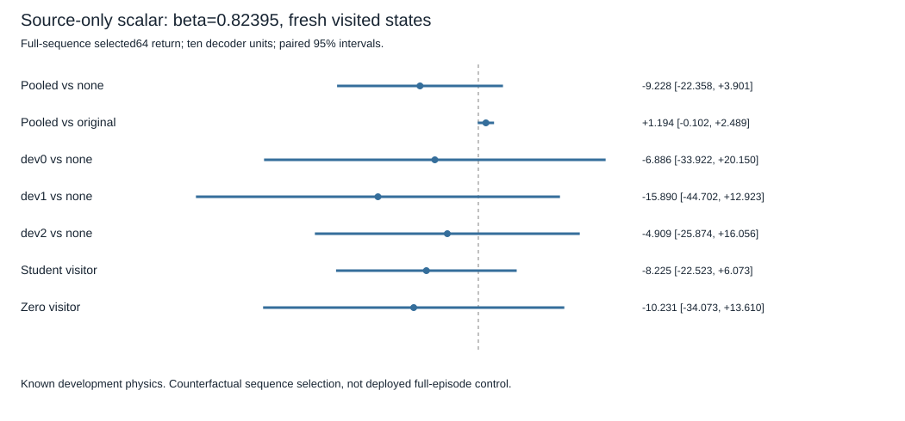

# Source-only scalar calibration — fresh visited-state results

## Decision

The complete registered test **did not establish a selection gain**. Label: `scalar_selection_gain_not_established`.

- Calibrated-minus-no-correction full-sequence chosen64 return: **−9.228 [−22.358,+3.901]**.
- Calibrated-minus-original-correction return: **+1.194 [−0.102,+2.489]**.

Both paired95% intervals include zero. The registered screen required a gain≥1 and lower>0 against no correction, plus lower>0 against the original correction. Neither condition passed. This is valid, complete but inconclusive evidence about return, not a timeout or equivalence claim.

Source-only calibration **did improve centered tail error relative to the original correction** on these fresh visited states: **+221.281 [73.560,369.002]** squared return units. That secondary prediction improvement does not upgrade the failed selection screen, establish full-episode control improvement or explain the historical negative transfer.

## Source fit, frozen inputs and evaluation

Exactly one scalar was fit from the previously recorded source-only calibration rows: ten decoders, eight source tasks, five student contexts and four candidate labels,400 groups/1,600 examples. Each group centered its four imagined-endpoint tail predictions and actual48-step tails. The covariance/variance rule produced **beta_raw=beta=0.8239474184740522**, within the predeclared[0,1] bounds; no clipping or degeneracy occurred. There was no grid search, target tuning or refit.

For every decoder, the calibrated prediction is its fixed source mean plus beta times the deviation of the original readout from that mean. Thus deviations shrink by17.605%, not the entire raw return. The scalar is shared across all decoders/tasks/contexts. No encoder, decoder, FiLM layer, head, normalizer or historical readout coefficient changed. Original binary files and readout artifacts remain untouched; the new scalar is an external wrapper.

The fit manifest was committed **before collecting any fresh evaluation state**. The source artifact's original floating-point validation failure remains preserved; its complete hash-bound offline proof was verified. Old development rows were checked as part of capture integrity, but the fitting function filters strictly to source tasks0..7 before accessing labels/predictions. Tests changing other-task labels leave the fitted scalar unchanged. No new source interactions were collected.

Fresh evaluation used all ten original independent decoders, five scoring students, the same three known development physics, equal student/zero visitor weights and registered new seeds. One unchanged student visitor `(d+t) mod5` and one zero visitor each collected50 live steps per decoder/task. All five students scored every phase50 state. The same16 H16 candidates and actual outcomes served no correction, original correction and calibrated correction. Every counterfactual used fixed zero-context continuation through64 local steps; this is not a deployed calibrated policy.

All60 final live decisions reproduced recorded actions/scores. Exactly60 decoder/task/visitor cells completed, with all16 block outcomes and all three first-action outcomes. Source contexts were reused unchanged; no new target support or neural updates occurred. All120 binary hashes, all60 model/context/normalization fingerprints and all ten historical readouts passed integrity checks.

## Means and sensitivity

Pooled full-sequence returns: no correction **−223.073**; original correction **−233.495**; calibrated correction **−232.301**. Corresponding in-set regrets:60.295,70.717,69.523. Regret reduction is algebraically the return contrast, not an independent success. The calibrated choice differed from the original correction in **5% of student selections (15/300)** and from no correction in81.33%.

First-action results are secondary: calibrated-minus-base **−1.741 [−8.620,+5.138]**; calibrated-minus-original **−0.066 [−1.404,+1.273]**. Mean first-action returns were−172.541,−174.216 and−174.282 for base,original andcalibrated. These findings do not establish better receding-horizon control.

Task-specific full-sequence contrasts, unadjusted exploratory95% intervals:

- **dev0 (g6,m1,l1):** calibrated−base **−6.886 [−33.922,+20.150]**; calibrated−original **+2.493 [−1.183,+6.168]**. Centered-error benefit **+455.248 [87.168,823.328]**.
- **dev1 (g10,m2,l1):** calibrated−base **−15.890 [−44.702,+12.923]**; calibrated−original **−0.108 [−0.639,+0.424]**. Centered-error benefit **+127.751 [21.713,233.789]**.
- **dev2 (g10,m1,l1.55):** calibrated−base **−4.909 [−25.874,+16.056]**; calibrated−original **+1.195 [−1.374,+3.765]**. Centered-error benefit **+80.845 [30.867,130.822]**.
- **Student-visited:** calibrated−base **−8.225 [−22.523,+6.073]**, calibrated−original **+0.030 [−0.293,+0.354]**.
- **Zero-visited:** calibrated−base **−10.231 [−34.073,+13.610]**, calibrated−original **+2.357 [−0.401,+5.114]**.
- **Zero scoring context**, distinct from visitor group: calibrated−base **−24.701 [−51.104,+1.702]**, calibrated−original **−0.432 [−1.325,+0.460]**.

No task or visitor group establishes either required return gain. Eight of ten decoder calibrated-minus-base point estimates are negative; all decoders remain included. Raw per-decoder/task/visitor/context returns and metrics are saved. The original-correction commitment interaction on this new sample also remains unestablished; it is a secondary baseline diagnostic, not an opportunity to reopen the preceding sample.



## Statistical and scientific limitations

Primary analysis averages scoring students, equally weighted visitor groups and tasks inside each independently pretrained decoder, then uses ten paired decoder values, df9,t critical2.262. Candidates, states and student seeds are not independent replications. Only one phase and one visitor history per decoder/task/group were sampled, on known development physics.

**The shared scalar was fit using source data from all ten decoders. The reported intervals are conditional on this locked fitted scalar and finite task/seed suite. They do not include scalar-estimation uncertainty or represent ten independently repeated end-to-end scalar-training pipelines.** New evaluation outcomes never entered fitting, but pooling source data introduces a common learned hyperparameter. Independent method confirmation would need a separately designed replication with its calibration uncertainty accounted for; this development screen is not such confirmation.

Improved centered prediction error is insufficient for useful top-candidate choice. The small change in chosen sequences and uncertain return gain show that this specific source-only shrinkage did not establish a practical fix. This does not prove all calibration methods fail. The protocol stops this scalar branch: no more weights, target fitting, horizon changes or architecture changes are tried on these outcomes. No confirmation physics or closed evaluation seeds were reopened.

## Commits, hashes and costs

Branch `codex/source-scalar-calibration`; initial GitHub-matched SHA **beab44938076d454a12129e60fe3667619b33e2f**. Protocol/implementation commit **c6c5d07** preceded fitting. Source-fit manifest commit/clean evaluation SHA **051adc7567ac4fb5a0b7c6a2c8a8b0300488c050** preceded fresh collection. The manifest itself records the clean protocol implementation SHA used to fit.

- Config SHA256 `ecc4c9e1655ea28bdcab3ec02e9dd50edb6692b4cc3d447205b43b66842e4ef9`.
- Protocol SHA256 `70abf5761b3102a4113f732f3b3c85e63bd57070153cde08539fef6ba686b555`.
- Allocation SHA256 `0e29407cdfd33bfaddf326cb1caf6e7bec74b208ed103fd91182a8ad71351893`.
- Immutable fit SHA256 `a61b66b0cca9750dfeed3c734b4f35c7ee1550420d53b222889b940429812c8f`.
- Raw evaluation SHA256 `c1b9726911f43d6e62aa79c957f6f9eeb653b845bc3553cc8648477511d9ec87`.

Source fit **0.6583seconds**; fresh evaluation/validation **251.3581seconds**; **252.0164seconds total**, below360. Exactly75,960 unique fresh real steps: collection3000,prefix15360,block tails46080,first-action branches11520. Exactly15,667,200 imagined transitions, including60 final live-decision replays. No fresh support, source environment collection, neural/readout training or checkpoint replacement. Source-only calibration used15,872 previously collected source steps, not recollected; inherited original training and384 target-support interactions remain separately documented. Linear readout arithmetic and scalar fitting consumed CPU time but no new world-model rollouts.

The standing session ledger advances from3,170.4791 to **3,422.4955seconds** as a conservative accounting upper bound, leaving **177.5045seconds**. Its inherited2,700-second reservation is not a measured-runtime claim. No session reset, silent retry or additional scientific experiment occurred. Peak memory was not measured. Dependencies are recorded in the raw artifact: local CPU,torch threads1,Python3.13.5,NumPy2.5.4,torch2.14.1,Gymnasium1.4.0.

## Tests and audit

Before fitting: **76 focused tests passed in24.98seconds** after final schema checks; an earlier76-test pass preceded the final strict fit-type addition. An additional synthetic full-cell beta1 equivalence check passed afterward as part of a14-test source suite (8.29seconds), without using fresh outcomes. Historical visited behavior is unchanged by the provenance/preflight extension, and previous artifacts still validate.

An independent scalar implementation recomputed beta from source covariance/variance, then chosen actions, rewards, error benefits and decoder intervals from raw evaluation data. It agreed exactly within declared numerical tolerance. This is independent arithmetic, not external scientific replication. Recorded-result tests reject missing decoders/visitors, changed beta, altered fit hash and changed summaries. Final full suite: **686 passed,1 deselected in206.68seconds**. The separate local-binary marker remains intentionally deselected; explicit post-run binary audit verified120 files with0missing/0mismatches. No tests or experimental runs failed in this cycle. Final counts are also in `artifacts/source_scalar_verification.json`. Original artifacts are unchanged and checkpoint binaries remain outside Git.

```sh
PYTHONPATH=src:.deps python3 -m pytest tests/test_source_scalar_calibration.py tests/test_visited_commitment.py tests/test_commitment_value.py -p no:cacheprovider
# Each collection/fitting command below was executed once only, from its clean committed stage:
PYTHONPATH=src:.deps python3 scripts/run_source_scalar_calibration.py --fit-source
PYTHONPATH=src:.deps python3 scripts/run_source_scalar_calibration.py --execute
# Reproduce arithmetic/integrity without collecting data:
PYTHONPATH=src:.deps python3 scripts/run_source_scalar_calibration.py --audit
PYTHONPATH=src:.deps python3 scripts/audit_source_scalar_calibration.py
PYTHONPATH=src:.deps python3 scripts/verify_checkpoint_integrity.py
PYTHONPATH=src:.deps python3 -m pytest -p no:cacheprovider
```

## One next experiment

Preregister an **offline action-value alignment audit** using the already saved outcomes: when the actual best64-step full sequence is selected, is its first action also good under the measured common-zero replanning future? Compare its selected first-action64 return with the best of the three already measured first-action branches, alongside the original/scaled scoring rules. This tests whether even a perfect sequence-value objective aligns with the executed first-action intervention before fitting a more elaborate predictor. It requires zero new environment/model interactions, not another scalar sweep. It is proposed only; no extra analysis has been executed.
