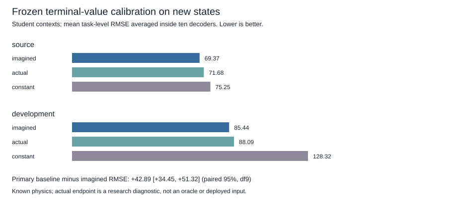

# Frozen terminal-value calibration — completed via offline validation

## Decision and scope

The registered new-state development calibration screen passed. Frozen student-context readouts have mean task-level RMSE **85.437** versus the fixed source-target-mean baseline **128.324** on three known development physics: a **33.42%** reduction. Paired baseline-minus-readout error is **+42.887 [34.451,51.323]**, ten independent decoders, df9. Both the10% practical threshold and positive95% lower bound were met.

This establishes value-prediction benefit versus this constant reference on the sampled states, not better candidate selection or control. A source mean is a weak baseline for action discrimination: it cannot rank candidates. The earlier first-action correction result remains inconclusive and unchanged. A positive calibration result cannot supersede that closed result.

The model-predicted versus actual endpoint comparison did not identify an endpoint-error explanation. Imagined-minus-actual RMSE was **−2.649 [−7.169,+1.871]** on development and **−2.311 [−5.325,+0.704]** on source. These intervals include zero; negative means imagined inputs happened to perform better. Actual inputs are not oracle values because the readout was fitted using imagined endpoints. No causal explanation of the historical full-episode loss follows.

## Execution, failure preservation and recovery

Protocol and implementation: `24db6c469a94d75810fba809582428b9f8964704`; readiness: `3200f126048ba5ad0631ea46a7649b14147557af`. User explicitly approved the pending run and a bounded two-hour local research session. Approval and session records were committed before collection as **40bc1e301577cd871759dfae82890e638f4ff4b1**, the clean execution SHA. Config/protocol remained locked; no hyperparameters changed after observation.

All planned data and both checkpoint audits completed. Final validation rejected an exact comparison between a Python sum of builtin floats and a sum over NumPy scalar objects. Python3.13 compensated floating addition differed by at most **1.7053e−13**. The original capture remains `complete=false`, with the original failure, SHA256 **419a07b95881aaeae1a61c57e194acd75d37a73031e23990a4ca315ca7245d4d**. It was committed unchanged as **6a4ee1e** before any correction. No replay or resimulation occurred.

Commit **204b46372fa231de3df80f51c33b67b19720bb70** changed only that validation arithmetic to sum the saved builtin reward list, added independent offline auditing, and added a regression using the actual nonuniform reward traces. The old constant-reward fixture could not catch this numeric-type issue. A separate complete validation proof, `artifacts/terminal_value_calibration_validation.json`, records the raw hash, execution SHA, clean validator SHA, original failure, and all reconstructed results. It is the authoritative completion record. Never rewrite the failed capture to erase the failure. The independent arithmetic audit agrees with the recovered primary/secondary intervals and creates no new experience. It is not external scientific replication.

The fresh `--audit` CLI on the original capture deliberately refuses its false completion flag; use the separate recovery/audit commands below to reproduce the proven result. This preserves the distinction between the captured validation failure and the completed offline grid verification.

## Registered results

Errors below average each task/context's four-candidate RMSE first, then five students and tasks within each decoder. No pooled-candidate RMSE or extra student/episode replications are used.

Development means:

- Student imagined endpoints: **85.437**.
- Student actual endpoints: **88.085**.
- Fixed source mean: **128.324**.
- Zero context, imagined endpoints: **90.650**.
- Zero context, actual endpoints: **87.018**.

Source means on new states:

- Student imagined endpoints: **69.370**.
- Student actual endpoints: **71.681**.
- Fixed source mean: **75.248**.
- Zero context, imagined endpoints: **61.429**.
- Zero context, actual endpoints: **65.831**.

Source constant-minus-student benefit is **+5.878 [2.384,9.371]**,7.81% reduction; this is secondary, not the primary10% criterion. These marginal errors do not establish a context benefit over zero; the zero condition has lower source error. All raw paired context metrics remain available.

Per-development-task constant-minus-student imagined RMSE (secondary unadjusted intervals):

- dev0: **+6.151 [−12.730,+25.033]**.
- dev1: **+90.822 [69.025,112.618]**.
- dev2: **+31.689 [8.489,54.889]**.

The primary gain is uneven and concentrated in dev1. All ten decoder primary means are positive, but this is one shared suite with only one initial state per physics; the interval is conditional on these states and frozen models, not broad state-distribution uncertainty. Raw values and task-specific context conditions appear in the validation artifact. No secondary interval multiplicity adjustment; they are exploratory.



## Integrity and resource costs

**83.48 seconds**, below600 seconds. All110 decoder/task groups and11 cached prefix groups completed; six contexts each, four preselected candidates each. **21,824 real steps**:704 cached prefix interactions,21,120 decoder-specific zero-continuation interactions. **5,448,960 imagined transitions**. Prefixes and shared target rewards are counted once, not once per student/context. Zero new support steps, encoder-history processing, model updates or readout fits. Prior pretraining/support costs are inherited and disclosed in the previous reports, not included as newly incurred steps.

All120 local files verified before and after, zero missing/mismatched. Every network, encoder, FiLM, head, normalizer and saved context fingerprint matched before/after. All ten source readouts and source means stayed fixed. No reserved confirmation physics, old evaluation seeds or past artifacts were modified. Large checkpoints still require the locally saved binaries; repository-only arithmetic verification does not load those binaries.

Config SHA256: `0fea17504d5a5baea32d857947cd516ab14cef84df524d7f835594d71d7d6184`. Parent capture, source fit and manifest hashes are in the executable config and result. Dependencies and exact execution revision are in the raw capture. The two-hour authorization was recorded with a wall-clock end; a later continuation arrived after that window. No additional simulation is launched after that deadline; offline auditing and a separately designed recorded-data diagnostic do not collect research experience.

## Executed checks and reproduction

Focused regression **35 passed**,12.74 seconds, including the recorded nonuniform-float case and approval isolation. Full suite **551 passed,1 deselected**,126.35 seconds; the explicitly run checkpoint verifier separately passed all120 files. Independent arithmetic audit passes. All prior closed JSON/protocol hashes remain unchanged.

```sh
PYTHONPATH=src:.deps python3 scripts/run_terminal_value_calibration.py --approved-config-sha256 0fea17504d5a5baea32d857947cd516ab14cef84df524d7f835594d71d7d6184
PYTHONPATH=src:.deps python3 -m pytest tests/test_terminal_value_calibration.py -p no:cacheprovider
PYTHONPATH=src:.deps python3 scripts/validate_terminal_value_calibration_capture.py --write
PYTHONPATH=src:.deps python3 scripts/audit_terminal_value_calibration.py --write
PYTHONPATH=src:.deps python3 -m pytest -p no:cacheprovider
```

The execution command ran exactly once. Do not rerun/overwrite it. Offline validation and auditing default to read-only; omit `--write` to reproduce their calculations. Write modes refuse existing outputs. All frozen source-fit arithmetic and the full110-cell calibration grid are rechecked before recovery succeeds.

## One next question

Does the readout distinguish candidates **within the same state**, rather than merely correcting a task/state mean? Design a separately registered exploratory analysis of the existing saved four-candidate predictions, including candidate-centered errors and within-state selection regret. That requires no new environment data or retraining and is the smallest next step before another controller modification. It cannot estimate full-episode policy benefit or replace independent confirmation.
