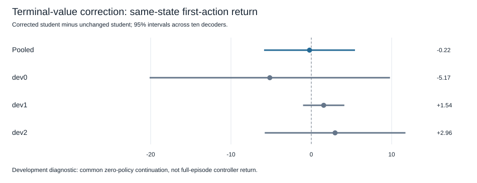

# Terminal-value correction pilot — completed results

## Decision

The approved one-run development experiment completed its entire registered grid. **The improvement screen did not pass.** Corrected-student minus unchanged-student common64 return was **-0.221 [-5.881, +5.438]** across ten decoder units. The mean is below the one-point practical threshold and the interval includes zero. Locked label: **`local_first_action_inconclusive`**. This is an inconclusive scientific result from a complete, valid execution, not an incomplete run and not evidence of equivalence.

The value readout changed decisions but did not demonstrate better first-action choices on this sample. No hyperparameter, loss, candidate count, horizon, encoder or decoder was changed after outcomes were collected. No second execution was performed.

## Protocol, approval and provenance

Frozen protocol: `NEXUS_TERMINAL_VALUE_PROTOCOL.md`; executable config: `configs/terminal_value.yaml`. Implementation commit: `f8a438eb95bec092df259a52de45cd246ab309fc`; readiness commit: `8b88eaf66e2b3350f0e201c09d292d9d750c18d6`. The user replied **continue** to the explicit request for one estimated2–4 minute local run, capped at600 seconds and28,800 real steps. Scope approval was recorded and committed as `ebc93dd1cf306739dd0650223b42dcf30420378b` before any research collection. The implementation source was unchanged from the tested commit. The run started from a clean working tree on `codex/terminal-value-pilot`; GitHub matched the reviewed readiness HEAD before execution.

Execution SHA: `ebc93dd1cf306739dd0650223b42dcf30420378b`. Config SHA256: `b426beef6da918c94c300fe8935b97c8b1640dadd03f1f9cedc17f3f8bd5b094`. Frozen protocol SHA256: `836b2c00664269acdbee985b7b7f27e5dcee6b7b5b181519815ec59fd29c0a42`. Parent capture SHA256: `597faebffee7354141a512ac3c970e37d11bf1ee0ed3feed074a6a2d82345781`. Checkpoint-manifest SHA256: `265cd1822ec73bab8eac6fd792438c3c9fe7834ae5af307b8c33104bf919d06b`. Approval-record SHA256: `e407698b0769d062b2123d998ed779d53b18d044f707ed291ae3beef62614c30`.

Raw result: `artifacts/terminal_value.json`, SHA256 `74dcff9c710e6108020c11b64f68b4321fc9306a8f69b9a8491af60a86f9a420`. Source fitting: `artifacts/terminal_value_source_fit.json`, SHA256 `9cd44bb05759c7df5313997ae7176f655f1d2397c437a01145ee60cd8060c994`. Every original checkpoint remained outside tracked binaries with its original path/hash in the existing manifest. The ten small readouts, normalization metadata, source examples and raw reward traces are retained in JSON, permitting source-fit verification without those binaries. A GitHub clone cannot rerun the frozen neural controllers without the corresponding120 local checkpoint files.

## What was fitted and what stayed fixed

One78-coefficient quadratic ridge readout per decoder, lambda1, source-only scaling, no tuning. It estimates the actual48-step unchanged-zero continuation return from an imagined16-step endpoint and frozen latent context. Each decoder used32 distinct endpoint targets, repeated across six contexts to yield192 numerical fitting rows. Those repeated labels are not192 independent pieces of real experience. All ten readouts were saved and validated **before** any development support or outcome collection. No model refitting or normalization updates followed.

All existing encoders, decoders, FiLM layers, heads, source normalizers, H=16 and sixteen-candidate sets remained fixed. Source and development physics tuples were disjoint for readout fitting. Development physics had been inspected historically; they are not fresh confirmation. No reserved confirmation task or closed control episode was reopened.

## Primary and strong-baseline comparisons

Conditions use the same restored state, candidate array and common unchanged-zero future policy. The primary unit is one mean per independently trained decoder, averaging five student seeds, two states per task and three tasks inside it. T95% intervals use df9 and critical value2.262. Candidate rows, student seeds and states are not separate model-training replications.

Mean common64 return, conditional on the selected first action:

- Unchanged student: **-218.252**.
- Student plus terminal value: **-218.473**.
- Unchanged zero context: **-216.819**.
- Zero context plus terminal value: **-218.359**.

Paired comparisons:

- Corrected student minus student, primary: **-0.221 [-5.881, +5.438]**.
- Corrected student minus unchanged zero: **-1.655 [-6.798, +3.489]**.
- Corrected zero minus unchanged zero: **-1.540 [-6.582, +3.502]**.
- Corrected student minus corrected zero: **-0.114 [-0.335, +0.106]**.

All secondary comparison intervals include zero and are unadjusted. They are paired differences, not conclusions from overlap of separate condition intervals. First-action regret was **8.207** with correction versus **7.985** without. These regret differences are algebraically the same primary contrast with sign reversed; they are not independent evidence. Other secondary contrasts are also linear combinations of the same three counterfactual returns.

### Task-level results (exploratory, unadjusted)

- pendulum_ctx_dev0: **-5.167 [-20.126, +9.792]**.
- pendulum_ctx_dev1: **+1.542 [-1.028, +4.112]**.
- pendulum_ctx_dev2: **+2.960 [-5.797, +11.718]**.

All three intervals include zero. The largest task/decoder harm is decoder0/dev0, **−64.634** after averaging its two states and student seeds; the largest task/decoder gain is decoder2/dev2, **+37.604**. Both remain in the primary aggregation. No decoder or task is excluded to change the conclusion.

### Decoder-level primary differences

- Decoder 0: -19.081270.
- Decoder 1: -0.690356.
- Decoder 2: +13.652402.
- Decoder 3: +1.341202.
- Decoder 4: -2.016910.
- Decoder 5: +0.198350.
- Decoder 6: +1.196578.
- Decoder 7: +0.852719.
- Decoder 8: +2.190960.
- Decoder 9: +0.141437.

Seven of ten decoder means are positive, but that was not the success criterion and does not override the inconclusive registered interval or negative pooled point estimate.



## Did the intervention learn anything or change behavior?

The readout's source training RMSE averaged **48.962** return units, against **108.292** for a source-target-mean constant predictor. The constant reference is a posthoc training-fit diagnostic, not a registered independent comparison or generalization test. The better source fit does not establish held-out value accuracy.

The correction changed **154/300 (51.3%)** student first actions and **29/60 (48.3%)** zero-context first actions. The near-zero primary effect therefore is not explained by an intervention that never changes actions. Positive and negative changes coexist. It does not identify why they differ.

This study did **not** collect held-out48-step values from each imagined candidate endpoint on the development tasks. Its counterfactuals force one action and then immediately use zero MPC. Therefore the saved first-action returns cannot be repurposed as held-out terminal-value labels for the complete16-action candidates. Value-function generalization and endpoint-model error remain competing explanations. No causal claim about either is justified by these descriptive patterns.

## Integrity and resource accounting

All planned320 source tails,32 cached source-prefix blocks, ten readouts,60 decoder/task/state cells and180 common continuations completed. The source tail count is10×8×4=320, and the source prefix count is8×4=32 full16-action blocks. Source readout rows total1,920 with repeated labels. The corrected and unchanged conditions share scores/candidate opportunities; the correction adds endpoint-rollout and readout computation.

Original model/normalization/context checks: **110 groups**, each with six model/context fingerprints, all exactly preserved. All120 checkpoint files verified before and after; the standalone post-run audit also verified120 with zero missing/mismatched. The separate arithmetic implementation reconstructed the primary from raw action scores and per-step rewards, used the exact locked grid, and matched the decoder-level interval. This is an independent calculation, not external scientific replication.

Execution time: **109.68 seconds**, below600. Actual environment interactions:

- Source support1,024.
- Cached source prefixes512, counted once across models.
- Source continuation targets15,360.
- Development support384.
- Development common counterfactuals11,520, counted once across controllers/student seeds.
- Total **28,800**, exactly the cap.

Imagined dynamics transitions: **7,050,240**, exactly the cap. Encoder work: **70,400 history rows**, separate from real/model transitions. Ten ridge solves,780 fitted coefficients plus source-only feature-scaling statistics; zero neural-optimizer updates. Prior pretraining costs are inherited and not included in this evaluation budget. Audit and secondary analysis generated zero new environment interactions. No paid compute or external service was used.

Dependencies: python=3.13.5 (main, Jun 11 2025, 15:36:57) [Clang 17.0.0 (clang-1700.0.13.3)], numpy=2.5.4, torch=2.14.1, gymnasium=1.4.0.

## Checks and commands actually executed

Before this run, focused suite35 passed in9.47 seconds. After collection, full suite **516 passed**, one explicitly local-checkpoint test deselected, in112.06 seconds. The new repository-only test reconstructs the complete recorded result and verifies source/audit hashes with checkpoint loading explicitly disabled. The standalone checkpoint audit separately verifies actual binaries; it never skips missing files.

```sh
PYTHONPATH=src:.deps python3 -m pytest tests/test_terminal_value.py -p no:cacheprovider
PYTHONPATH=src:.deps python3 scripts/run_terminal_value.py --approved-config-sha256 b426beef6da918c94c300fe8935b97c8b1640dadd03f1f9cedc17f3f8bd5b094
PYTHONPATH=src:.deps python3 scripts/audit_terminal_value.py --write
PYTHONPATH=src:.deps python3 scripts/summarize_terminal_value.py --write
PYTHONPATH=src:.deps python3 -m pytest -p no:cacheprovider
PYTHONPATH=src:.deps python3 scripts/verify_checkpoint_integrity.py
```

Execution and source-fit outputs refuse overwrites. Auditing and summarizing are read-only by default on an existing result; omit `--write` to reproduce their calculations without editing artifacts. The original implementation/protocol were committed before outcomes; only reporting and a recorded-evidence regression were added afterward. Full simulation reproduction requires a separate checkout with verified binaries and exact dependency versions; do not overwrite or reuse these closed episodes as independent evidence.

## Limits and single next question

Only six development initial states across three previously inspected physics, and only32 distinct fitting targets per decoder. The interval is conditional on this narrow suite and frozen model history. A 78-coefficient readout can have a small effective sample size despite192 rows. The objective predicts a48-step zero-policy suffix after committing a16-action candidate, while the primary test commits only its first action; that planning/continuation mismatch is intentional to test decision usefulness but prevents interpreting it as a full-policy experiment. Full-episode return, continual learning and learning-to-learn were not tested.

**One next experiment:** keep these fitted readouts frozen and measure held-out continuation-value calibration on new source/development states, comparing inputs from actual endpoints versus model-predicted endpoints. This would distinguish deficient value-readout generalization from endpoint-induced error before adding capacity or modifying the controller again. Proposed design and estimated cost are in `NEXUS_TERMINAL_VALUE_CALIBRATION_PROPOSAL.md`; it has not been executed or approved by this run's budget. No general control improvement or AGI claim is supported.
