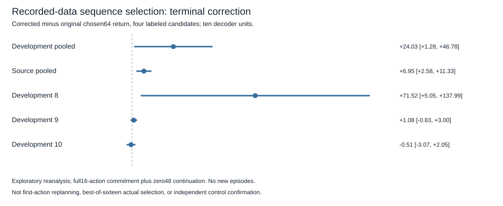

# Frozen value/candidate discrimination — recorded-data exploratory results

## Decision

On the four previously labeled candidates at each calibration state, the frozen terminal-value correction improved the **complete-sequence** chosen64 return on development by **+24.030 [1.279,46.781]** across ten decoder units. Registered exploratory label: `exploratory_in_set_gain`. The mean exceeds the one-point screen and the paired95% lower bound is above zero.

This is a narrow positive retrospective finding, not independent control confirmation. It uses complete16-action commitment followed by48 zero-policy steps and only four labeled candidates. It does not establish improvement when committing one action then replanning, choosing among all16 actual candidates, or controlling a full episode. The earlier corrected-first-action result remains **−0.221 [−5.881,+5.438]**, inconclusive on a different closed sample. Comparing those studies does not itself establish a commitment-length interaction.

## Protocol and provenance

The new contrasts were locked after observing calibration but before calculating ranking outcomes. Protocol/implementation commit and clean execution SHA: **438bacea9fd327c5d56e2ad8128baaa20679d897**. Parent result commit:12ae8c7. Config SHA256: `737da7623b973f4ef176838dee742149f38a6d95ef3cc28fa859be099a635db8`. Input hashes bind the unchanged calibration capture, offline validation, source readouts and checkpoint manifest. Raw result: `artifacts/value_candidate_discrimination.json`, SHA256 **4de98e582129067a4d18c9012c5b053fe5d7361fb295370e5b5d6add2da412ed**. All110 cells completed and passed grid/hash checks on the first execution. No numerical recovery or resimulation was needed for this analysis.

Full original16-candidate scores were reproduced with the exact original horizon, candidate seeds, decoder/context and terminal-survival formula. Endpoint inputs for indices0,4,8,12 reproduced the saved calibration inputs within1e−6. Only those four candidates had actual outcomes; every method's reported choice is restricted to them. Their actual64 reward is recorded actual16 prefix plus recorded48-step zero continuation. Those outcomes entered metrics only, not scoring or model inputs.

## Comparisons

Development student-context means:

- Original-score selected64 return: **−407.784**.
- Learned-terminal selected64 return: **−383.754**.
- Constant-tail-corrected selected64 return: **−407.784**.
- Original regret versus best of the four: **48.366**.
- Learned-terminal regret: **24.336**.
- Actual simulator16-reward selection regret: **53.692**, a research-only truncation reference.

The learned-minus-constant difference is the same **+24.030 [1.279,46.781]**. The constant correction changed **0/660** context selections, whereas learned values changed **347/660**. The equality with the original-score comparator is observed, not assumed: survival weighting could in principle make a negative constant affect selection. Consequently the two equal contrasts are mathematically duplicate evidence on this data. Regret reduction is also the same contrast with sign reversed, not a separate positive result.

Source student chosen-return benefit: **+6.951 [2.576,11.325]**. Development zero-context benefit is **+14.433 [−1.518,30.385]**, inconclusive; source zero benefit **+5.609 [0.548,10.670]**. These are secondary unadjusted diagnostics, not independent replications. The test does not establish that student context is necessary for all value-correction gains.

### Per-development-task sensitivity

- dev0: **+71.520 [5.054,137.986]**.
- dev1: **+1.081 [−0.835,2.996]**.
- dev2: **−0.510 [−3.068,2.048]**.

The pooled benefit is concentrated in dev0; the other two intervals include zero. Decoder means are +52.177,+48.040,−46.979,+3.642,+21.850,+20.460,+47.355,+48.125,−0.983,+46.616. Two decoder means are negative, and all remain included. Only one sampled initial state per physics and the same candidate set per task were used. The decoder interval does not account for a broad initial-state/candidate distribution.



## Absolute prediction versus decision information

Development tail MSE **8317.212** decomposes exactly into mean-bias squared **7082.681** plus centered MSE **1234.531**, after averaging inside decoders. Thus bias contributes85.16% of this measured MSE; this is an error decomposition, not85% of the causal control gap. The constant's centered MSE is **1341.525**. Constant-centered minus readout-centered error is **+106.993 [−42.133,256.119]**, inconclusive. Source centered benefit is **+120.636 [−33.129,274.402]**, also inconclusive.

Task patterns differ:

- dev0 centered benefit **+443.922 [6.904,880.939]**, alongside the largest sequence-selection gain. Its previous absolute calibration benefit interval included zero.
- dev1 centered benefit **+0.671 [−7.477,8.819]**, despite its large previous absolute calibration improvement. Its selection gain is inconclusive.
- dev2 centered benefit **−123.613 [−169.345,−77.880]**, indicating worse centered predictions on these four candidates; the chosen-return difference still includes zero.

These are descriptive, dependent measurements on the same targets. They illustrate why a large absolute prediction improvement need not imply a comparable action-selection improvement. They do not establish that any particular error component causes the historical full-episode loss. The primary sequence-selection result and the aggregate centered-error result need not share a sign or significance: they measure different properties.

### Posthoc baseline-strength audit

After the registered analysis, an explicitly posthoc supplementary calculation compares with the expected return of **uniform selection among these four candidates**, using the already measured returns. This is not a new randomized controller run or a preregistered screen.

Development uniform expected return is **−400.503**; learned-minus-uniform is **+16.750 [1.181,32.319]**. Source uniform expected return is **−305.361**; learned-minus-uniform is **+20.016 [14.994,25.038]**. These unadjusted exploratory intervals are recorded in a separately labeled supplement. They audit baseline strength without redefining the primary result. No all16-candidate or full-episode uniform-policy claim follows.

## Costs, tests and reproducibility

**8.01 seconds** frozen inference, below300 seconds. **337,920 imagined transitions**, exactly the preregistered cap. **Zero new environment interactions**, support collection, teacher fitting, neural updates or readout fits. All120 binaries verified before/after;110 six-model groups preserved network/normalizer/context fingerprints. Inference replay used the same ten decoders and five students per decoder; students/candidates/tasks were averaged inside decoder before intervals. No main merge or old artifact changes.

Before analysis: **15 focused tests passed**,7.34 seconds; full suite **566 passed,1 deselected**,131.17 seconds. After analysis: combined calibration/discrimination focused suite **51 passed**,22.23 seconds, including a new repository-only recorded-result regression. Final full suite including that recorded-result test: **567 passed,1 deselected**,132.08 seconds. Explicit binary verification is separate; repository-only arithmetic tests do not require the120 untracked `.pt` files. Tests verify decomposition, paired labels, candidate subset/ties, survival-weighted constant control, forbidden environment collection and missing-grid/type rejection. Passing tests or the retrospective screen does not demonstrate general control improvement.

```sh
PYTHONPATH=src:.deps python3 -m pytest tests/test_value_candidate_discrimination.py -p no:cacheprovider
PYTHONPATH=src:.deps python3 -m pytest -p no:cacheprovider
PYTHONPATH=src:.deps python3 scripts/run_value_candidate_discrimination.py
PYTHONPATH=src:.deps python3 scripts/run_value_candidate_discrimination.py --execute
PYTHONPATH=src:.deps python3 scripts/run_value_candidate_discrimination.py --audit
PYTHONPATH=src:.deps python3 scripts/audit_value_candidate_discrimination.py --write
PYTHONPATH=src:.deps python3 scripts/summarize_value_candidate_discrimination.py --write
PYTHONPATH=src:.deps python3 -m pytest tests/test_value_candidate_discrimination.py tests/test_terminal_value_calibration.py -p no:cacheprovider
```

Execution occurred once after the clean protocol commit; it refuses overwrite. Offline audits/default preparation collect no data and perform no fitting; omit `--write` to reproduce saved arithmetic without modifying artifacts. Independent selected-index arithmetic matches the primary across both task groups. This is an independent calculation, not external scientific replication. Inherited model training and original calibration collection costs are disclosed in their original reports and are not counted again as new interactions here.

## One next scientific question

Does the same frozen value correction help when its selected16-action sequence is actually committed, but fail when only its first action is committed? A fresh, paired same-state commitment-length comparison is the next minimal experiment: correction versus original score crossed with1 versus16 committed actions, then a common zero-context future to64 steps. The primary interaction must be registered in advance. Neither comparing the two already closed samples nor this retrospective subset analysis proves that mechanism. Keep the controller, model weights and horizons fixed; do not increase encoder capacity or alter the readout from these outcomes.
