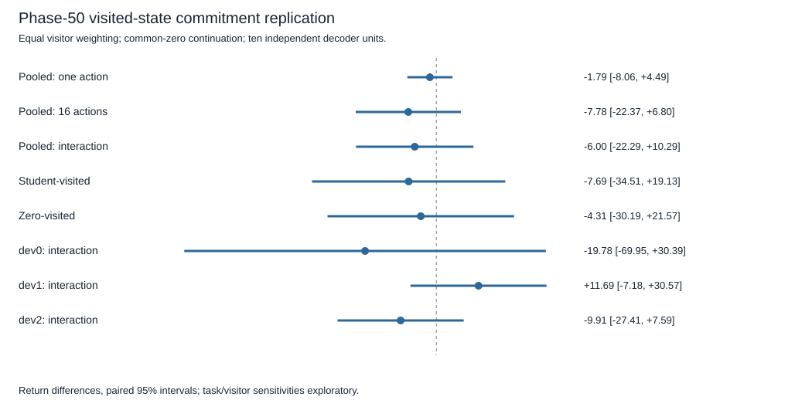

# Phase-50 visited-state commitment replication — results

## Decision

The complete registered replication **did not establish commitment sensitivity** at visited states. Label: `commitment_interaction_not_established`.

- **Primary interaction (gain16−gain1): −5.999 [−22.293,+10.295]**.
- **16-action correction gain: −7.784 [−22.369,+6.800]**.
- **One-action correction gain: −1.786 [−8.063,+4.492]**.

All are paired 95% t intervals across ten independently pretrained decoder units. Five scoring students, both visitor groups and three tasks are averaged inside each decoder. The positive mean≥1/lower-bound>0 screen did not pass, and the full-sequence gain was not established. This is a complete, valid but scientifically inconclusive replication; it is not an incomplete run. The negative point estimates do not establish harm or equivalence.

The earlier initial-state result **+39.366 [26.247,52.484]** is preserved. That positive interaction did not replicate under this registered phase-50 sampling rule. We cannot say the benefit disappears at every visited state or that state distribution alone caused the change. This experiment does not justify deploying a block-committing controller.

## What was actually evaluated

Ten existing independent decoders; five saved student contexts plus zero; three previously inspected development physics; exactly one phase-50 state from each visitor per decoder/task. There are **60 decoder/task/visitor cells**, with all16 candidate sequence outcomes and all three first-action outcomes measured from each restored state.

The two visitors share initial reset and collection RNG within decoder/task, but act separately. The student visitor uses prespecified seed `(decoder+task) mod5`; each student is assigned six of the30 decoder/task pairs. All five students score every saved state. This does not represent all five possible student-visitor trajectories. Visitor groups receive equal weight; no outcome-based selection or reweighting occurred.

The H16/16-candidate planner, source normalization, original reward, torque discretization, encoder/decoder/FiLM/heads and ten source-fitted readouts stayed fixed. No model or readout fitting, no new context support, no online adaptation, no new confirmation physics. The same common zero-context continuation defines both counterfactual arms through local step64. Actual episode clocks are50 for the first-action/prefix start and66 for the block suffix; final clock114 is below truncation200.

All60 final live decisions replayed with the recorded action and candidate scores before counterfactual interpretation. Every live reward and prefix reward passed published reward-timing checks. Context/model/normalization fingerprints stayed unchanged in every cell;120 binary hashes verified before/after and separately afterward.

## Visitor and task sensitivity

These unadjusted exploratory intervals use the same ten decoder units and do not change the primary decision:

- **Student-visited states:** gain1 +1.401 [−2.829,5.630]; gain16 −6.286 [−31.546,18.974]; interaction **−7.686 [−34.508,19.135]**.
- **Zero-visited states:** gain1 −4.972 [−16.908,6.965]; gain16 −9.283 [−31.192,12.626]; interaction **−4.311 [−30.194,21.571]**.
- **dev0 (g6,m1,l1):** gain1 −9.001 [−24.678,6.675]; gain16 −28.780 [−74.808,17.248]; interaction **−19.779 [−69.949,30.391]**.
- **dev1 (g10,m2,l1):** gain1 −1.269 [−6.193,3.656]; gain16 +10.426 [−4.411,25.263]; interaction **+11.695 [−7.181,30.570]**.
- **dev2 (g10,m1,l1.55):** gain1 +4.913 [−4.371,14.197]; gain16 −4.999 [−20.643,10.644]; interaction **−9.912 [−27.412,7.587]**.

Neither visitor group nor any task establishes a positive interaction on its own. Four pooled decoder point estimates are positive and six negative: −28.090,+30.473,+18.314,−27.557,+2.975,−9.015,−21.585,−2.883,−37.739,+15.118. Every decoder remains included.

The zero-context scoring comparison, distinct from the zero-visitor group, has interaction **−7.542 [−26.898,11.813]**, gain16 −15.545 [−32.821,1.730], gain1 −8.003 [−14.935,−1.072]. It is secondary and not a replacement primary result.



## Absolute returns and interpretation

Mean original one-action return **−158.529**; corrected one-action **−160.314**; original full-sequence **−214.171**; corrected full-sequence **−221.955**. Both block-commitment means remain descriptively below original one-action return. These absolute comparisons reinforce the need to distinguish a correction effect from a useful deployed policy.

Correction changed78.67% of chosen sequences and51.33% of first actions. Endpoint observation divergence between commitment arms averages1.637 under original scores and2.025 under correction. These are descriptive, raw-unit observation distances, not causal evidence. Regret reduction duplicates the chosen-return contrast algebraically and is not independent support.

An explicitly **posthoc exploratory** paired comparison of new-minus-old interaction within the same decoder gives **−45.365 [−72.104,−18.625]**. This is calculated from the two artifacts' ten per-decoder interaction arrays with t critical2.262; it is not inferred from overlap of separate intervals. It was not the registered success test. The candidate sets, resets and state-sampling procedures also differ between studies; the old states were shared across decoders whereas the visited states depend on decoder and visitor. Thus this paired decline describes these two finite samples, not an isolated causal effect of state distribution. The original historical full-episode loss remains closed and unexplained.

## Provenance, resources and reproducibility

Protocol/implementation/clean execution SHA: **fb109c4d9cd2a3573cc4c3fc1d760cd39fc39a3f**. Starting SHA: **f7dd7239cc13ad6b02bdee89c4c41010af1c83e5**, verified against GitHub before branching. Branch: `codex/visited-commitment-diagnostic`. The allocation cites the human standing grant; no new human reply or expanded permission is fabricated.

- Config SHA256: `b53c3e8cadc051a913751a8cf4371823bab8745f2c0554a91becb25e321b8d86`.
- Protocol SHA256: `e443b458b95f72c8928395cb61af753e20c6ee9ea4fcbf4a0373a235de9dde66`.
- Allocation SHA256: `e241cebc6e11bd5a77810f5ed4018d6760f2128430cbddc59e33402e1bd6e322`.
- Raw artifact SHA256: `2ecf9ab383aa592a5d92f72eb8347c3711badc84eda08a43b3173392d35315f2`.

The single run took **242.932 seconds**, below600. Exactly **75,960 unique real interactions**:3,000 live collection,15,360 candidate prefixes,46,080 block suffixes,11,520 first-action branches. Exactly **15,667,200 imagined transitions**, including60 final live-decision replays. No cached outcome is counted again for another scoring context. No source/support collection, teacher fitting or weight updates. Inherited contexts came from384 unique earlier support steps, not recollected. Unit tests use small, separate synthetic/toy simulations rather than registered evaluation seeds; their execution is separate from the declared research grid.

CPU execution used Python3.13.5, NumPy2.5.4, torch2.14.1 and Gymnasium1.4.0; torch threads1. Peak memory was not measured. All saved checkpoints remain outside Git; their paths/hashes and context fingerprints are bound through the preserved parent manifests and raw artifact. A fresh clone can run tracked-data arithmetic validation without those binaries; explicitly requested checkpoint verification fails if they are absent.

The session ledger carries forward the conservative2,700-second prior reservation and previous225.528-second run. Adding this242.932-second run gives a3,168.460-second accounting upper bound against3,600, leaving431.540seconds. The prior reservation is not a measured-runtime claim. No simulation retry or further experiment occurred in this cycle.

## Tests and independent audit

Before collection: **63 focused tests passed in19.28 seconds** after final provenance/allocation checks. An earlier preparation pass had58 tests before those additions. These cover synthetic complete-grid validation, every missing axis, visitor balancing/equal weights, restoration clocks, live replay, context locking, reward accounting, finite metrics, exact budgets and stale/missing allocations.

After collection, an independently implemented arithmetic audit recomputed selected indices, raw returns, interactions and decoder intervals, including visitor and task subsets. It agreed with the capture, without model inference or environment calls. This is independent arithmetic, not external scientific replication. Recorded-data tests additionally reject deleted decoders/visitors, unselected reward corruption and changed saved summaries. Final full suite: **639 passed,1 deselected in163.37 seconds**. Explicit separate checkpoint audit: **120 verified,0 missing,0 mismatched**. The deselected marker is the intentionally separate local-binary test. Final totals are also in `artifacts/visited_commitment_verification.json`. There were no test or experiment failures in this cycle.

```sh
PYTHONPATH=src:.deps python3 -m pytest tests/test_visited_commitment.py tests/test_commitment_value.py -p no:cacheprovider
PYTHONPATH=src:.deps python3 scripts/run_visited_commitment.py
# Executed once from clean fb109c4; the closed sample must not be rerun:
PYTHONPATH=src:.deps python3 scripts/run_visited_commitment.py --execute
# Offline reproduction, no new collection:
PYTHONPATH=src:.deps python3 scripts/run_visited_commitment.py --audit
PYTHONPATH=src:.deps python3 scripts/audit_visited_commitment.py
PYTHONPATH=src:.deps python3 scripts/verify_checkpoint_integrity.py
PYTHONPATH=src:.deps python3 -m pytest -p no:cacheprovider
```

## One next experiment

Before building a committing controller, preregister an **offline within-state terminal-value ranking audit on these already saved16-candidate outcomes**. Compare predicted tails and rankings with actual48-step zero-policy tails, separating absolute bias from centered candidate error and action-selection regret, with equal visitor/task weights inside decoders. This can distinguish poor visited-state value discrimination from a broadly accurate but decision-insufficient forecast without more environment data, fitting or architecture changes. Estimated under30seconds, cap120seconds, zero new real or imagined transitions. It has not been executed; do not retune the readout on this closed sample.
