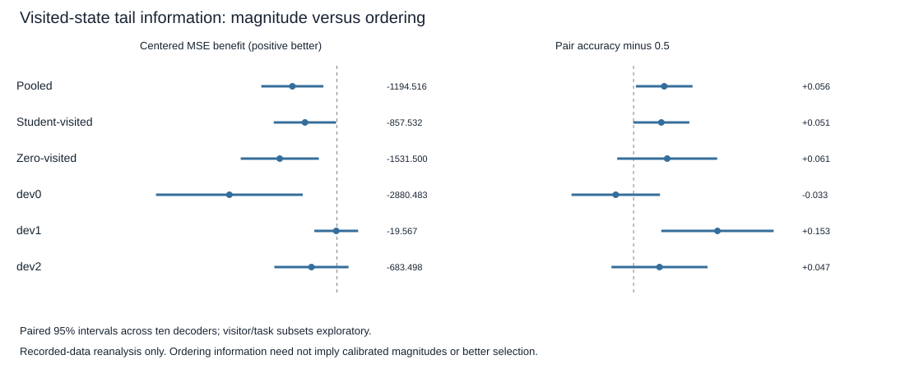

# Visited-state terminal-value discrimination — exploratory results

## Decision

The frozen readout retains some pair-ordering information but fails the registered centered-error screen. Label: **`tail_centered_error_worse_than_constant`**. This is exploratory reanalysis of the closed phase50 sample, not an independent confirmation or control improvement.

- Within-state tail variance: **1,886.552**.
- Learned tail centered MSE: **3,081.068**.
- Primary centered benefit, variance minus centered MSE: **−1,194.516 [−2,025.559,−363.473]**.
- Tail-pair ordering accuracy: **55.597% [50.432%,60.763%]**; advantage over neutral0.5: **+0.05597 [0.00432,0.10763]**.

The screen required positive lower bounds for both centered benefit and ordering advantage. The centered condition fails in the opposite direction. Do not turn the positive ranking component into a success claim. Equally, do not conclude that the readout has no task/candidate information: pairwise ordering and calibrated relative magnitudes are different properties.

Intervals use ten independent decoders, averaging five students, two equally weighted visitor groups and three tasks inside each decoder. Candidate pairs, states and student seeds are not extra independent replications. All subset intervals below are unadjusted exploratory diagnostics.

## Calibration and decision measurements

Overall tail MSE is10,893.624, decomposed exactly into squared mean error7,812.556 plus centered MSE3,081.068. The ratio of aggregated bias² to aggregated MSE is71.72%; this is an algebraic decomposition, not the percentage of the control gap caused by bias. A fixed source-training mean has MSE8,227.972. Constant-minus-learned absolute MSE is **−2,665.652 [−6,790.938,+1,459.633]**, inconclusive. The statistically supported negative result concerns centered error, not a reliable absolute-error difference.

Constant predictions have centered error equal to within-state target variance. The query-conditioned empirical mean is used only for this analysis identity, never as a deployed baseline. The deployable comparison uses each decoder's fixed original source48-step mean. Survival weighting remains intact; the code checks whether constant correction changes choices instead of assuming it cannot.

Reconstructed chosen64 returns:

- Original H16 score: **−214.171**; regret60.405.
- Frozen value correction: **−221.955**; regret68.189.
- Fixed source-constant correction: **−214.171**; regret60.405.
- Research-only actual16 score: **−182.761**; regret28.995.
- Research-only actual16 prefix plus saved predicted tail: **−223.779**; regret70.013.

The corrected-minus-original return is exactly the closed **−7.784 [−22.369,+6.800]** gain16; it is not new evidence. Fixed-constant correction changed0/360 context selections, while learned correction changed78.67% of student selections. Thus the equal corrected-minus-constant and corrected-minus-original contrasts are duplicate evidence. Regret reduction is algebraically the same return contrast. The research references use measured outcomes for analysis only and are not learned or deployable controllers. Their mean differences do not establish a causal prefix/tail explanation.

Corrected-minus-original full64 candidate ordering accuracy is **+0.02936 [−0.03126,+0.08998]**, inconclusive. Full64 centered-error benefit versus the constant-tail score is **−1,271.760 [−2,294.242,−249.278]**. Actual-tail tie fraction is0; predicted ties would receive neutral0.5 pair credit. Mean predicted survival is0.999148, but survival weighting was not removed or retuned.

## Task and visitor sensitivity

- **dev0:** centered benefit **−2,880.483 [−4,844.789,−916.177]**; pair accuracy46.75% [38.68%,54.82%]. This task has the clearest centered-error failure and no demonstrated ordering advantage.
- **dev1:** centered benefit **−19.567 [−606.617,+567.483]**; pair accuracy65.31% [55.05%,75.56%]. Ordering is useful here, while magnitude benefit remains uncertain.
- **dev2:** centered benefit **−683.498 [−1,677.099,+310.104]**; pair accuracy54.73% [45.96%,63.50%]. Both advantages remain unestablished.
- **Student-visited states:** centered benefit **−857.532 [−1,692.184,−22.880]**; rank advantage+0.05061 [−0.00062,+0.10184].
- **Zero-visited states:** centered benefit **−1,531.500 [−2,577.301,−485.698]**; rank advantage+0.06133 [−0.02988,+0.15254].
- **Zero scoring context**, distinct from the zero-visitor group: centered benefit **−716.139 [−1,161.134,−271.144]**, rank advantage+0.06125 [0.00745,0.11505]. Therefore this relative-magnitude failure is not exclusive to student context.



These patterns support unreliable candidate-relative tail magnitudes on the sampled visited states, alongside weak pooled ordering information. They do not prove that magnitude scaling alone caused the earlier episode loss. The original initial-state positive interaction and subsequent visited-state inconclusive interaction remain unchanged. No confirmation split was accessed.

## Provenance, execution and checks

Branch `codex/visited-value-ranking-audit`. Starting revision **e606212f4015a743a6cca194eb95a671fa29af3a**, matched GitHub before branching. Clean protocol/implementation/execution SHA **a1c70c35ced916f562636650f9f15afa69d80169**.

- Config SHA256 `aa5dd1c78fd29d3d40c69f512db74926c8ad6e7c259a908cac94ca36651fb7af`.
- Protocol SHA256 `2dcf29c28e8e0f9a3abf4e90566b9a8f1afa96af4bb73b4b53fc3fc3c118a6ea`.
- Allocation SHA256 `148c84baa77c8a22264b29d6fbfff57e6c76ab999a8e2856035fe447bb15e8fe`.
- Raw result SHA256 `62a3cd4d9403bbdbe05720fc66ecf1487e316cf313304af8cfd39fdc235f69e7`.

The analysis completed once in **2.0195 seconds**, below120. All60 input cells and360 context-metric cells were complete and finite. **Zero new real interactions, imagined transitions, world-model inference calls, fitting or checkpoint changes.** The artifact's `model_inference_calls` counter refers to neural world-model execution; the frozen scalar readout formula is recomputed on stored inputs during source validation, with that arithmetic included in runtime. It reused the previously collected75,960-step sample and original source labels; those costs are inherited, not counted anew. No binary files were loaded or newly audited: their preceding120-file integrity audit remains in the previous report. Parent JSON/protocol/hash checks passed. Python3.13.5, NumPy2.5.4, local CPU; peak memory not measured.

The standing session account carries prior3,168.4596 seconds and adds2.0195, leaving about429.5209seconds against3,600. The prior conservative2,700-second reservation is not a measured-runtime claim. Verification/tests are reported separately from the single scientific analysis run. No simulation or additional scientific experiment was launched.

Before execution **21 focused tests passed in2.36seconds**. An initial synthetic run caught strict JSON validation rejecting internal NumPy arrays (6 failures,8 fixture errors,5 passes); the internal-array conversion was corrected while retaining boolean/string/nonfinite rejection. The subsequent19-test pass preceded two extra offline-path/allocation checks. All corrections occurred before preregistration commit and before these experimental metrics were calculated. No analysis retry or raw-artifact rewrite occurred.

An independent scalar implementation reconstructed centered errors, pair-ordering accuracy, chosen returns and decoder intervals from saved rewards/predictions; all matched. This is independent arithmetic, not external scientific replication. Tests prevent environment/model loading during source validation and reject missing grid/context/metrics, corrupted numbers and changed summaries. Final full suite: **666 passed,1 deselected in178.31seconds**. The separate local-binary marker remains deselected because this analysis does not need checkpoint binaries; no new explicit binary audit is claimed. Final totals are also in `artifacts/visited_value_ranking_verification.json`.

```sh
PYTHONPATH=src:.deps python3 -m pytest tests/test_visited_value_ranking.py -p no:cacheprovider
PYTHONPATH=src:.deps python3 scripts/run_visited_value_ranking.py
# Executed once from clean a1c70c3; refuses repeat/overwrite:
PYTHONPATH=src:.deps python3 scripts/run_visited_value_ranking.py --execute
# Offline validation, no new experiment:
PYTHONPATH=src:.deps python3 scripts/run_visited_value_ranking.py --audit
PYTHONPATH=src:.deps python3 scripts/audit_visited_value_ranking.py
PYTHONPATH=src:.deps python3 -m pytest -p no:cacheprovider
```

## One next experiment

Test **source-only scalar calibration of the frozen terminal correction**, then evaluate the locked scalar on separately registered visited states against the unchanged correction and no correction. Fit/select the scalar only on source data; never on these closed visited outcomes. Preserve all original readout/network checkpoints and apply any scalar externally. This is a minimal test of whether usable ordering information is obscured by magnitude calibration; it is a hypothesis, not an established fix. It requires a separate bounded protocol, fair source/target accounting and fresh evaluation seeds before execution. Do not increase encoder capacity or deploy block commitment from this audit.
