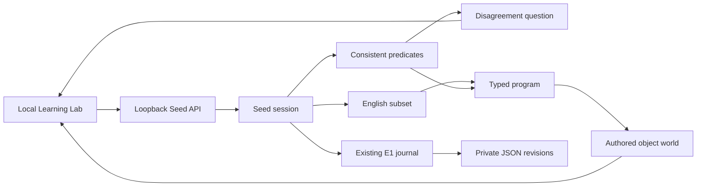

# Seed S0–S1 architecture

Seed is a bounded symbolic teaching loop. It infers finite meanings from evidence;
the parser, object schema, grammar and primitive actions are authored.

## Code ownership

- `src/nexus/seed/core.py`: typed moves, parser, 37-predicate grammar, evidence,
  corrections, questions and atomic sandbox execution.
- `src/nexus/seed/storage.py`: append-only JSON revisions, hash links and
  replay-based reconstruction. No pickle or arbitrary executable imports.
- `src/nexus/seed/lab.py`: bounded local session registry and API dispatch.
- `web/learning-lab/seed.html`: real teaching UI, not a fake conversation script.
- `scripts/run_learning_lab.py`: existing shared server with opt-in Seed routes.
- `src/nexus/seed/comparison.py`: authored development comparison, separate from
  private sessions. Its recorded run is incomplete and must not be rerun.

## Reuse

Seed uses `evolution1.fixtures.Journal/verify_journal` and
`evolution1.catalogue.canonical/digest`. Persistence follows the existing durable
Lab revision pattern without pretending a concept is a strategy-catalogue record.
It adds no generic memory, evolution framework or meta-controller.

The scientific `Work` meter counts environment/model operations. Symbolic labels,
predicate tests and sandbox actions use explicit domain counters instead; they
are not real scientific simulator interactions. No historical model is loaded
as a language model.

## Meaning, action and storage

The version space contains property atoms, negations and two-property positive
conjunctions. Labels remove inconsistent predicates. Questions use permissible
examples on which remaining predicates disagree. Corrections supersede labels
without erasing old events. Contradiction must not trigger a guess.

A concept command acts only when consistent predicates agree on a unique object.
Every clause and boundary is validated before committing the proposed world.
`then` composes existing primitives; it is not learned skill synthesis. Shell
commands, file permissions and research grants are outside the program type.

Restore checks typed events/hashes and replays state. Hash chains detect
corruption, not a local owner rewriting everything. Cancellation is cooperative,
not OS-level sandbox isolation. Private snapshots stay under ignored `runs/`.

## Evidence and boundaries

Cross-scene teaching and process restart passed functional/browser tests.
The active-versus-random comparison is incomplete. No general language, neural,
cross-domain, control, learning-to-learn or AGI result follows. Read
[results](../NEXUS_SEED_RESULTS.md), [charter](../NEXUS_SEED_CHARTER.md), and
[roadmap](../NEXUS_SEED_ROADMAP.md) before extending the learner.
