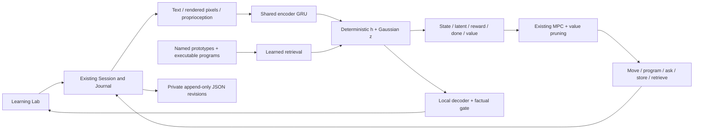

# Seed grounded architecture

Current structural contracts: distinct shared repair, new scoped addition,
training-free merge, cached reviews and safe rollback. The fresh benchmark
failed learning/action gates; see [actual findings](../NEXUS_SEED_LEARNING_VALIDATION_RESULTS.md).
The additive reward residual cannot express state-dependent action differences.
New validation heads are experimental, not silently promoted into the GUI.

New adaptive layer: [memory-aware implementation](../NEXUS_SEED_MEMORY_AWARE_RESULTS.md).
SAME frozen core/Belief/Session journal,115small residual parameters,310parameter
learned diagonal update head,max8anchors/channel,max2scoped residual skills.
Runtime actual feedback updates small blocks;outer source training optimizes
query learning curves/retention. Hypothetical question updates are disposable.
The functional structure is present;the10% learned-update screen failed.
Typed routing and residual skills are not arbitrary language or source rewriting.

Current contract: [shared-state results](../NEXUS_SEED_CONTRACT_RESULTS.md).
Read-only inspection does not commit h/z. World conditioning uses a fixed
source-only bank in training/control/GUI; user concept prototypes are retrieved
read-only and cannot substitute an unseen bank. V3 is current-state behavior
value. Both pruning modes are available. The matched practical screen failed;
these correctness improvements do not establish better control.

All eight requested components have connected implementation paths. Their
presence is distinct from demonstrated usefulness. The finite S0–S1 engine
remains available. The earlier command-MLP pilot was never executed.

- **Perception:** authored text characters, rendered 18×18 image patches and
  twelve proprioceptive values feed one shared 32-state GRU. This is neither
  real-camera grounding nor unrestricted language understanding.
- **Working memory:** RSSM-inspired deterministic h=32 plus Gaussian z=8,
  trained on coherent sequences to predict next state/latent, reward and done.
  Inference uses deterministic means and frozen parameters.
- **Concept memory:** named prototypes, learned key/query retrieval into h,
  executable expression programs and label/model provenance. Retrieval training
  uses within-batch identity targets; useful semantic recall is not established.
- **New concepts:** a source-trained head proposes eight finite programs.
  Proposed programs must fit training labels and beat a constant predictor on
  disjoint distinct-property checks. This is a development gate, not open-ended
  discovery or robust noisy induction. Corrections invalidate stale prototypes.
- **Reasoning:** existing RandomShootingMPC adapted to explicit h/z; sixteen
  H=4 candidates, learned-value pruning to eight, 48 imagined states per plan.
  Two vetted movement compositions are actions. No old H=16 controller changes.
- **Questions:** ask/store/retrieve share the nine-action planner space. Training
  uses a first-ask information proxy; runtime information feedback requires an
  actual requested human label. The action cost is not charged twice.
- **Learning to learn:** existing EpsilonGreedyController proposes two registered
  recipes between episodes and updates from actual training-loss receipts.
  GUI proposals cannot launch training, change metrics or grant permissions.
  Useful learning-rule adaptation remains unestablished.
- **Language:** a small local GRU decoder trained on executed traces generates
  from h/z and retrieved keys. Candidates are visible; factual templates guard
  incorrect output. There is no external LLM.

## Ownership and safeguards

`nexus.world.seed_rssm` extends the existing world package.
`seed.latent_planner` adapts the existing MPC; `seed.grounded_meta` reuses the
controller, factory-compatible recipes and numeric expression trees.
`seed.grounded_agent` connects these to existing Session/evidence/Journal.
`seed.grounded_records` validates saved records without PyTorch. No parallel
generic memory, planner, evolution or meta-controller framework is introduced.

Default server startup remains stdlib-only. Neural mode requires owner-selected
model path and exact hash. Saved files cannot enable it. JSON weights have
bounded shapes and finite numeric checks; no executable pickle or generated
Python runs. No tool or shell permissions can be taught.

Runtime `grounded_model_work` distinguishes encoder batches/rows, recurrent
transitions, head evaluations, proposals and generated tokens. These counters
are model API operations, not a count of every internal linear-layer call.
The legacy `neural_forward_calls` field counts only the optional command MLP.

## Evidence

Read [grounded results](../NEXUS_SEED_GROUNDED_RESULTS.md),
[protocol](../NEXUS_SEED_GROUNDED_PROTOCOL.md), and
[quickstart](GROUNDED_QUICKSTART.md). The first pilot has one seed per recipe
and a small authored evaluation. Neither model beat greedy known-grid movement.
Language accuracy was low. This does not establish general learning or AGI.
The earlier [incomplete finite comparison](../NEXUS_SEED_RESULTS.md) is preserved.
